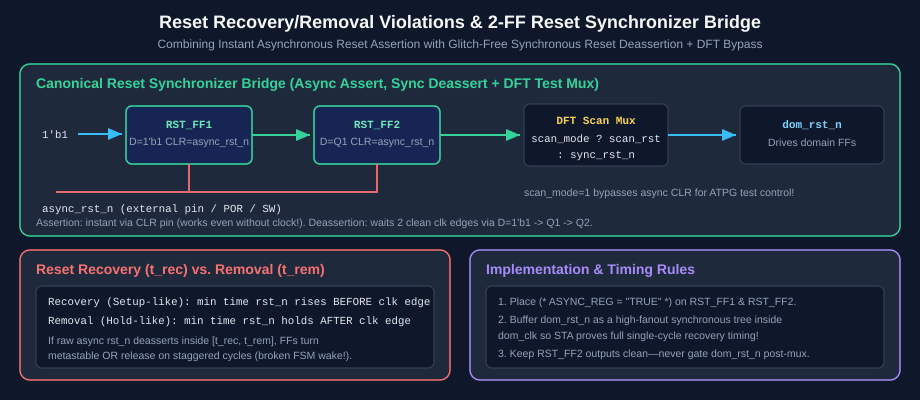
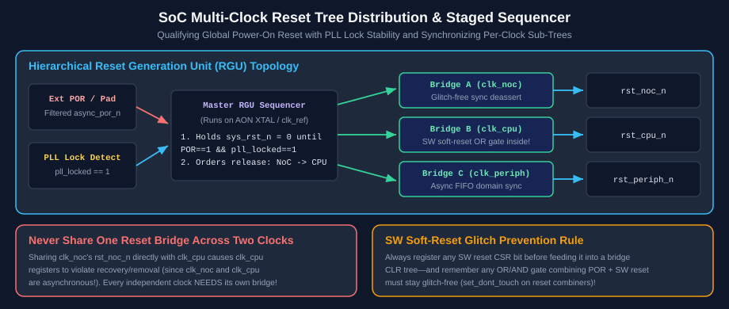

# Reset Architectures and Reset Synchronizer Design

Every digital logic system depends on reset to steer flip-flops into known deterministic starting states at power-up or fault recovery. Yet choosing between **Synchronous Reset** and **Asynchronous Reset**—and worse, distributing an unsynchronized external or software reset across clock domains—is one of the most frequent causes of intermittent post-silicon boot failures. Just like data pins crossing clocks, asynchronous reset **deassertion** is an asynchronous CDC event governed by **Recovery** and **Removal** timing.

---

## Learning Goals

After completing this chapter, you should be able to:

- Compare **Synchronous Reset** vs. **Asynchronous Reset** trade-offs across boot behavior without clocks, area/timing slack, clock-gating compatibility, and power.
- Define **Reset Recovery ($t_{\text{rec}}$)** and **Reset Removal ($t_{\text{rem}}$)** timing arcs and explain why raw asynchronous reset deassertion sends flip-flops metastable or causes staggered single-cycle boot skew.
- Design a synthesizable, DFT-safe **2-FF Reset Synchronizer Bridge** (asynchronous assertion, synchronous deassertion) with scan-mode muxing.
- Architect a clean **SoC Multi-Clock Reset Generation Unit (RGU)** combining POR, PLL lock qualifiers, software resets, and per-clock bridges.

---

## Synchronous vs. Asynchronous Reset Trade-Offs

| Characteristic | Synchronous Reset (`always_ff @(posedge clk)`) | Asynchronous Reset (`always_ff @(posedge clk or negedge rst_n)`) |
| :--- | :--- | :--- |
| **Reset Works Without Oscillating Clock?** | **No!** Needs active clock edges (fails if PLL off or clock gated at boot!) | **Yes!** Instantly forces known state regardless of clock or ICG gating |
| **Timing Analysis** | Standard D-pin setup/hold checks; adds MUX/gate before `D` input | Requires **Recovery / Removal** checks on `CLR/PRE`; zero `D`-path logic penalty |
| **Glitch Sensitivity** | Immune to mid-cycle glitches on reset wire | **Sensitive:** Any spurious low pulse on `rst_n` clears flops immediately! |
| **Critical CDC / RDC Hazard** | **Zero RDC across clocks sharing sync edge**; still needs sync if pulse comes from another clock | Causes **Recovery/Removal metastability** on release AND **RDC hazards** on assertion! |
| **Best Usage** | Datapath pipelines (`if (rst)` only if needed), FPGAs with BRAM sync clears | Boot controllers, FSMs, CDC/async modules, clock-gated low-power blocks |

---

## Reset Recovery, Removal, and the 2-FF Reset Bridge

If an external push-button, Power-On Reset (POR), or asynchronous software reset drops `rst_n = 0` and later releases `rst_n: 0 -> 1` directly near a rising `clk` edge, two fatal failures happen:



1. **Recovery ($t_{\text{rec}}$) & Removal ($t_{\text{rem}}$) Metastability:**
   - **Recovery Time ($t_{\text{rec}}$):** Minimum time active-low reset must deassert (`0 -> 1`) *before* the active clock edge (analogous to Setup Time).
   - **Removal Time ($t_{\text{rem}}$):** Minimum time active-low reset must hold *after* the active clock edge (analogous to Hold Time).
   If raw `async_rst_n` rises inside $[t_{\text{rec}}, t_{\text{rem}}]$, the flip-flop goes metastable—potentially hanging boot state!
2. **Staggered Wakeup Skew Across FSMs:** Even if zero flops go metastable, wire delay differences across a large chip mean Flop A sees `rst_n == 1` just before Clock Edge $K$ (starting count on Edge $K$), while Flop B sees `rst_n == 1` just after Edge $K$ (staying reset until Edge $K+1$)! An FSM or one-hot state machine immediately wakes up in a corrupted illegal state (`2'b11`)!

### Canonical Synthesizable Reset Synchronizer Bridge (with DFT Bypass)

The industry-standard **Reset Bridge** provides the best of both worlds: **instant asynchronous assertion** (`CLR` pin, works even if clocks are stopped!) paired with **glitch-free synchronous deassertion** aligned cleanly to `clk`:

```systemverilog
module reset_sync_bridge #(
    parameter int unsigned STAGES = 2
) (
    input  logic clk,
    input  logic async_rst_n,   // Unsynchronized POR / external / SW reset
    input  logic scan_mode,     // 1 = DFT ATPG scan active
    input  logic scan_rst_n,    // ATE-controlled direct reset during ATPG
    output logic sync_rst_n     // Safe to drive domain async-CLR flip-flops!
);
    (* ASYNC_REG = "TRUE", dont_touch = "yes" *)
    logic [STAGES-1:0] rst_pipe_q;

    // 1. Assert immediately on async_rst_n == 0; release synchronously shifting 1'b1
    always_ff @(posedge clk or negedge async_rst_n) begin
        if (!async_rst_n)
            rst_pipe_q <= '0;
        else
            rst_pipe_q <= {rst_pipe_q[STAGES-2:0], 1'b1};
    end

    // 2. DFT Scan Bypass MUX: During scan_mode, ATPG needs direct reset control!
    // In ASIC flows, use a synthesis-preserved MUX cell!
    assign sync_rst_n = scan_mode ? scan_rst_n : rst_pipe_q[STAGES-1];
endmodule
```

### Why `RST_FF2` Output Drives Domain Asynchronous Clears Safely

Look closely at what happens when `sync_rst_n` feeds all flip-flops inside `clk`:
- **When `async_rst_n` drops `1 -> 0`:** Both `RST_FF1` and `RST_FF2` asynchronously clear immediately (`sync_rst_n <= 0`), resetting the entire chip in picoseconds—even if PLLs are dead!
- **When `async_rst_n` rises `0 -> 1`:** Even if `async_rst_n` violates recovery on `RST_FF1`, `RST_FF1` resolves cleanly within 1 full `clk` cycle before `RST_FF2` samples it, releasing `sync_rst_n` **100% synchronously on `posedge clk`**, with STA checking full single-cycle recovery timing across the balanced `sync_rst_n` fanout buffer tree!

---

## Multi-Domain SoC Reset Tree Distribution

A complex SoC typically contains multiple PLLs (`clk_noc`, `clk_cpu`, `clk_periph`), software-programmable soft resets, and Always-On standby subsystems. Every independent clock domain **must** possess its own dedicated `reset_sync_bridge`.



### Key Architectural Rules for Multi-Domain RGU Design

1. **Always Qualify System Reset With `pll_locked`:** Release `sys_rst_n` strictly *after* PLL frequency locks cleanly (`por_n && pll_locked`); releasing reset while a VCO ramps through unstable sub-nanosecond runt glitches corrupts reset bridges.
2. **One Reset Bridge Per Independent Clock:** Sharing `rst_noc_n` directly across `clk_noc` and `clk_cpu` turns `rst_noc_n` into an **un-synchronized async reset** relative to `clk_cpu`, triggering immediate recovery/removal failures inside the CPU!
3. **Never Combine Resets Using Glitchy Combinational Logic Downstream of `reset_sync_bridge`:** If software can trigger a soft reset (`sw_rst_n`), combine `raw_por_n & sw_rst_reg_n` **upstream** of the block's `reset_sync_bridge` using glitch-free registered inputs (`sw_rst_reg_n` driven directly from a flop with zero downstream LUT skew!), **never** after `sync_rst_n` exits the bridge!

---

## Best Practices and Common Pitfalls

- **Always Include a DFT `scan_mode` Mux on Generated Resets:** ATPG testers cannot toggle clocks safely across reset synchronizer pipes while controlling async clear pins globally; omitting `scan_mode ? scan_rst_n : sync_rst_n` blocks scan DRC closure (Chapter 2 of *DFT*).
- **Keep Reset Fanout Trees Buffered & Timing-Closed in STA:** Because `sync_rst_n` can fan out to 100,000 flip-flops inside `clk`, do *not* slap `set_false_path` on `sync_rst_n`! Let CTS/HFNS buffer `sync_rst_n` so STA proves every leaf flip-flop meets single-cycle recovery $t_{\text{rec}}$ after `RST_FF2` rises!
- **Watch Active-High vs. Active-Low Tie-Off Bugs:** If synthesis allows `RST_FF1.D` (`1'b1`) to be optimized onto a volatile register or misconnected, or if `async_rst_n` floats during power ramp, reset locks up permanently—protect bridges with `dont_touch` and external glitch filtering!

---

## Practical Exercises with Solutions

### Exercise 1 Diagnosing Staggered FSM Boot Lockup

**Problem:**
A testbench models zero-delay async reset release `async_rst_n = 1` simultaneously across an 8-bit one-hot FSM clocked at `500 MHz`. In lab silicon bring-up, 1 out of 500 cold boots hangs immediately in `8'b0000_0000` (or `8'b0000_0011`). Zero CDC crossings exist anywhere in the FSM. What caused this?

**Solution:**
`async_rst_n` was fed directly to the 8 one-hot flip-flops without passing through a **`reset_sync_bridge`**! At `500 MHz` ($2\text{ns}$ period), minor PCB trace and on-chip RC buffer differences caused some FSM flip-flops to release reset right *before* a rising clock edge (transitioning out of `8'b0000_0001` to `8'b0000_0010`), while neighboring bits saw reset release *after* that clock edge (staying cleared at `0`), leaving the one-hot vector permanently invalid (`8'b0000_0000` or `8'b0000_0011`)!

### Exercise 2 Fixing a Glitchy Software Reset Combiner

**Problem:**
Inspect the RTL snippet below intended to allow software bit `sw_cfg_rst` (`1` = reset) to reset `u_dma`:

```systemverilog
wire dma_async_rst_n = sync_sys_rst_n & ~(sw_ctrl_q[0] & sw_ctrl_q[1]);
always_ff @(posedge dma_clk or negedge dma_async_rst_n) ...
```

Identify TWO serious CDC/RDC flaws and rewrite cleanly.

**Solution:**
1. **Glitch Hazard on Async Pin:** `~(sw_ctrl_q[0] & sw_ctrl_q[1])` is un-registered combinational logic driving an asynchronous `CLR` pin—any race between `sw_ctrl_q[0]` and `[1]` creates a runt `0` pulse that wipes out `u_dma` unpredictably!
2. **Unsynchronized Cross-Clock Reset Release:** `sw_ctrl_q` is clocked on `apb_clk` while `u_dma` clocks on `dma_clk`, causing recovery/removal violations when `sw_ctrl_q` returns to `0`!
**Fix:** Register `sw_dma_rst_n_q` cleanly inside `apb_clk` first, combine `por_rst_n & sw_dma_rst_n_q` upstream, and pass through `dma_clk`'s dedicated `reset_sync_bridge`!

### Exercise 3 Why `sync_rst_n` Still Needs Single-Cycle STA Closure

**Problem:**
Why should an SDC file contain **`set_false_path -to [get_pins u_rst_sync/rst_pipe_q_reg[0]/CLR]`** (the raw async input to Stage 1), while leaving **`u_rst_sync/rst_pipe_q_reg[1]/Q -> all domain CLR pins`** fully timing-checked by STA?

**Solution:**
- `async_rst_n` is truly asynchronous; its arrival phase vs `clk` cannot be constrained (and Stage 1 + Stage 2 exist specifically to absorb its recovery/removal metastability!).
- Conversely, Stage 2 (`rst_pipe_q_reg[1]/Q`) updates synchronously on `posedge clk` and must reach every leaf flip-flop's `CLR` recovery pin cleanly within **one clock period** so all flip-flops exit reset on the exact same clock cycle!

##### Copyright (c) 2026 squared-studio
