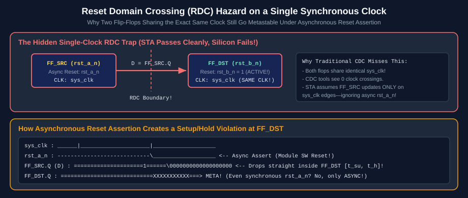
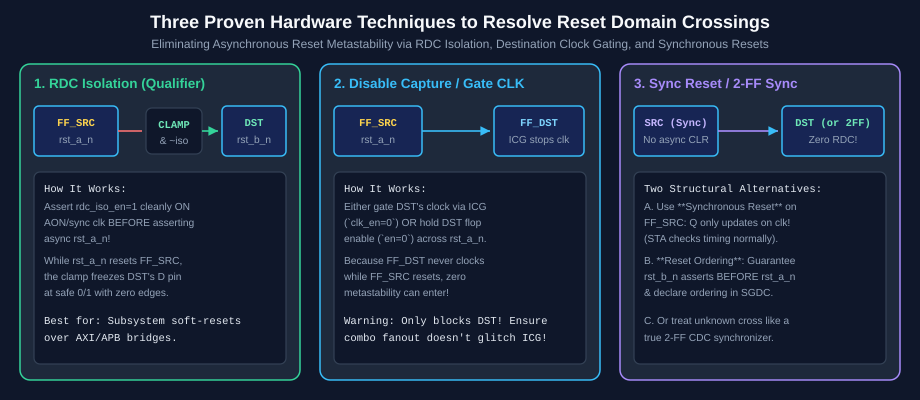

# Reset Domain Crossing (RDC) Hazards and Isolation Strategies

For decades, ASIC engineers focused primarily on Clock Domain Crossings while overlooking a subtler failure mode: **Reset Domain Crossings (RDC)**. Even if two flip-flops sit on the **exact same clock** (`sys_clk`), if the launching flip-flop uses asynchronous reset `rst_a_n` while the capturing flip-flop uses `rst_b_n`, asserting `rst_a_n` asynchronously triggers real **setup and hold violations (`D` changing mid-clock)**—slipping straight past traditional Static Timing Analysis and classic CDC checks!

---

## Learning Goals

After completing this chapter, you should be able to:

- Define a **Reset Domain** and prove why asynchronous **assertion** (`negedge rst_a_n`) causes single-clock metastability at receiving registers in another reset domain.
- Contrast **Same-Clock RDC** vs. **Cross-Clock RDC** and distinguish **Asynchronous Reset RDC** from **Synchronous Reset** behavior.
- Design and compare the three primary hardware fixes for RDC: **RDC Isolation Clamping**, **Destination Clock Gating**, and **Coordinated Reset Sequencing / Reset Ordering**.
- Specify reset relationships cleanly in verification/constraints (reset order rules, `quasi_static` exclusions, and synchronous RDC wrappers).

---

## Same-Clock Asynchronous Reset Metastability

Traditional CDC rules ask whether `FF_SRC.CLK` and `FF_DST.CLK` belong to different clocks. **RDC rules** instead ask whether `FF_SRC` can change asynchronously via `CLR`/`PRE` while `FF_DST` continues clocking actively!



### Why STA and Standard 2-FF Reset Bridges Do Not Catch RDC

Suppose Subsystem A (`u_gpu`, asynchronously reset by `sw_gpu_rst_n`) drives AXI signals into Always-On Subsystem B (`u_noc`, reset only by `por_rst_n`), and **both blocks share the identical 400 MHz `sys_clk`**:
1. Remember from Chapter 8 that `reset_sync_bridge` synchronizes reset **deassertion** (`0 -> 1`), **not assertion** (`1 -> 0`)! Reset assertion propagates **instantaneously** via the async `CLR` pin!
2. When software or another clock domain triggers `sw_gpu_rst_n` (`1 -> 0`), `u_gpu/FF_SRC.Q` drops instantaneously from `1 -> 0` regardless of `sys_clk` phase!
3. If `FF_SRC.Q` arrives at `u_noc/FF_DST.D` inside `[t_su, t_h]` around a rising `400 MHz` `sys_clk` edge—while `u_noc` is fully powered, clocked, and *not* in reset (`por_rst_n == 1`)—**`FF_DST` goes metastable**!
4. Worse still: if `FF_SRC` resets a multi-bit bus (`32'hFFFF_FFFF -> 32'h0000_0000`) across unequal wire lengths while `FF_DST` clocks, `u_noc` latches half-reset garbage (`32'hFF00_FFFF`)!

---

## Resolving Reset Domain Crossings Safely

Three deterministic hardware architectures completely eliminate RDC metastability and multi-bit reset skew:



### Technique 1 RDC Isolation Clamp (Qualifier Wrapper)

Analogous to UPF power isolation (Chapter 5 of *UPF/CPF*), an **RDC Isolation Cell** (`AND` / `OR` clamp driven by synchronous `rdc_iso_en`) freezes all signals crossing from `rst_a_n -> rst_b_n` *before* `rst_a_n` asserts:

```systemverilog
module rdc_iso_sequencer #(
    parameter int WIDTH = 32
) (
    input  logic             sys_clk,
    input  logic             por_rst_n,

    // Software trigger to soft-reset Domain A (e.g. from CSR)
    input  logic             sw_reset_req,

    // Safe RDC isolation enable & staggered reset output to Domain A
    output logic             rdc_iso_en,
    output logic             dom_a_async_rst_n,

    // Raw Domain A bus -> Clamped output to Domain B
    input  logic [WIDTH-1:0] dom_a_bus,
    output logic [WIDTH-1:0] dom_b_safe_bus
);
    typedef enum logic [1:0] {
        RDC_IDLE    = 2'd0,
        RDC_ISOLATE = 2'd1,
        RDC_RESET   = 2'd2,
        RDC_RELEASE = 2'd3
    } rdc_st_e;

    rdc_st_e state_q;

    always_ff @(posedge sys_clk or negedge por_rst_n) begin
        if (!por_rst_n) begin
            state_q           <= RDC_IDLE;
            rdc_iso_en        <= 1'b0;
            dom_a_async_rst_n <= 1'b1;
        end else begin
            case (state_q)
                RDC_IDLE: if (sw_reset_req) begin
                    rdc_iso_en <= 1'b1;          // Cycle 1: Freeze boundary synchronously!
                    state_q    <= RDC_ISOLATE;
                end
                RDC_ISOLATE: begin
                    dom_a_async_rst_n <= 1'b0;   // Cycle 2: Safe to drop async rst_a_n!
                    state_q           <= RDC_RESET;
                end
                RDC_RESET: if (!sw_reset_req) begin
                    dom_a_async_rst_n <= 1'b1;   // Release reset (via Domain A bridge!)
                    state_q           <= RDC_RELEASE;
                end
                RDC_RELEASE: begin
                    rdc_iso_en <= 1'b0;          // Un-isolate only after Domain A stabilized!
                    state_q    <= RDC_IDLE;
                end
            endcase
        end
    end

    // Synchronous Clamp: While rdc_iso_en == 1, Domain B sees clean 0 regardless of rst_a_n!
    assign dom_b_safe_bus = rdc_iso_en ? '0 : dom_a_bus;
endmodule
```

### Technique 2 Destination Clock Gating or Data Enable Masking

Instead of clamping every data wire on a wide 256-bit bus crossing:
- Gate `FF_DST`'s clock cleanly with an ICG cell (`icg_en = ~rdc_hold_q`), **or** add a synchronous register enable (`if (!rdc_hold_q)`) synchronized before `rst_a_n` asserts!
- Because `FF_DST` receives zero rising clock edges (or holds its own feedback value) while `FF_SRC` asynchronously resets, no transition at `FF_SRC.Q` can trigger setup/hold violations inside `FF_DST`.

### Technique 3 Synchronous Reset Conversion or Reset Ordering

- **Convert Source Registers to Synchronous Reset (`always_ff @(posedge clk)`):** If `FF_SRC` uses a **synchronous** reset (`if (!rst_a_n)` inside `always_ff @(posedge clk)`), `FF_SRC.Q` transitions *strictly* on `posedge clk`, turning the RDC path back into an ordinary STA-checked synchronous register-to-register path with **zero async RDC hazard**!
- **Coordinated Reset Ordering:** If `rst_b_n` **always asserts concurrently with or strictly before** `rst_a_n` (e.g., global system POR asserting before any block reset, and never independent soft resets), `FF_DST` is already held safely in reset (`rst_b_n == 0`) while `FF_SRC` clears! Document this reset hierarchy order explicitly in static RDC constraints.

---

## Comparison of RDC Resolution Strategies

| Strategy | Hardware Overhead | Handles Independent SW Reset? | Handles Unknown Cross-Clock Reset? | Recommended When |
| :--- | :--- | :---: | :---: | :--- |
| **RDC Isolation Clamp** | Clamp mux + sequencer | **Yes** | Yes (if seq runs on `dst_clk`) | Narrow control/AXI buses across soft-resettable IPs |
| **Destination Clock / Enable Gate** | 1 ICG or mux enable | **Yes** | Yes (with sync qualifier) | Wide internal pipelines/buffers |
| **Synchronous Source Reset** | Small D-input gate | **Yes (Same Clock)** | No (Cross-clock still needs CDC!) | Datapaths and FSMs sharing a guaranteed active clock |
| **Strict Reset Ordering** | **Zero gates!** | No (unless ordered) | Only if `rst_b_n` asserts first | Hierarchical `POR -> Sub-system` boot resets |

---

## Best Practices and Common Pitfalls

- **Audit Every Soft Reset Register Path:** Whenever software can toggle a CSR reset bit targeting one IP while its peer interconnect remains active (`u_noc`), verify either synchronous reset semantics or an `rdc_iso_sequencer` protects all leaving signals.
- **Check Combined CDC + RDC Paths:** A crossing where `FF_SRC` and `FF_DST` run on **different clocks AND different resets** still suffers metastability unless `2-FF` / `MCP` / `Async FIFO` synchronization covers both—especially when `FF_SRC` resets asynchronously to clear `wptr` while `rclk` runs! (Chapter 7 note: use synchronized reset release and quiesce before resetting either side of an Async FIFO!)
- **Register `rdc_iso_en` Cleanly in Destination Clock (`dst_clk`):** If Domain A and Domain B run on *different* clocks, `rdc_iso_en` clamping Domain B's inputs must transition **synchronously to Domain B's clock (`dst_clk`)**—never drive an async clamp directly from Domain A's clock!
- **Run Dedicated Static RDC Checks Early:** Enable SpyGlass RDC / Questa RDC / VC SpyGlass RDC in RTL linting before tape-out; static CDC checks alone routinely miss same-clock RDC bugs!

---

## Practical Exercises with Solutions

### Exercise 1 Why Synchronous Reset Removes Same-Clock RDC

**Problem:**
Domain A and Domain B both clock on `clk_200m`. Domain A resets cleanly on `rst_a_n` (`sw_reset_a`), while Domain B resets only on `por_rst_n`. Compare what happens if `FF_SRC` in Domain A uses **asynchronous** `negedge rst_a_n` vs. **synchronous** `if (!rst_a_n)` when software writes `sw_reset_a = 1`.

**Solution:**
- **With Asynchronous `negedge rst_a_n`:** Even if `sw_reset_a` originates synchronously on `clk_200m` or another clock, propagation through `reset_sync_bridge`/reset trees fires `FF_SRC.CLR` arbitrarily with respect to `clk_200m` leaves in Domain B—producing uncontrolled `FF_SRC.Q` edges inside `FF_DST`'s `[t_su, t_h]` setup/hold window (`Rdc_async_cross` violation!).
- **With Synchronous `if (!rst_a_n)`:** `FF_SRC.Q` updates *only* at `posedge clk_200m`, and STA explicitly checks single-cycle setup/hold from `FF_SRC` to `FF_DST`—eliminating async RDC completely!

### Exercise 2 Finding the RDC Isolation Mistake

**Problem:**
In `rdc_iso_sequencer`, an impatient engineer optimizes out `RDC_ISOLATE` by asserting `rdc_iso_en <= 1'b1;` and `dom_a_async_rst_n <= 1'b0;` in the **exact same clock cycle**! Explain why `FF_DST` can still see a timing violation or glitch!

**Solution:**
Because `rdc_iso_en` and `dom_a_async_rst_n` both toggle simultaneously at `t = 0`:
If physical routing delay to `dom_a_async_rst_n -> FF_SRC.CLR -> AND clamp` is shorter than routing delay of `rdc_iso_en -> AND clamp`, the reset clearing pulse on `dom_a_bus` races **ahead** of `rdc_iso_en` arriving at the clamp gate—leaking a short reset glitch directly to `FF_DST.D`! Always assert `rdc_iso_en` **at least 1 full clock cycle BEFORE** dropping `dom_a_async_rst_n`!

### Exercise 3 Resetting an Async FIFO Safely Mid-Simulation

**Problem:**
An SoC soft-resets only the `wclk` USB producer (`wrst_n = 0`) while `rclk` (`soc_noc`) keeps running actively reading an Async FIFO. What goes wrong at the FIFO `rptr_empty` comparator (`rq2_wptr`), and what is the clean fix?

**Solution:**
When `wrst_n` resets `wptr` asynchronously (`wptr <= 0`) while the FIFO was half-full (e.g. `wptr` at `0110` $\to$ `0000`), two problems strike simultaneously:
1. Resetting `wptr` jumps **multiple Gray bits** (`0110 -> 0000`, 2 bits!) asynchronously during active `rclk` sampling, triggering multi-bit Gray coherency corruption!
2. Even after resolving, `rptr` is still nonzero, so `rclk` misinterprets `wptr == 0000` vs `rptr == 0110` as non-empty garbage or corrupted occupancy!
**Fix:** Always quiesce/drain and **reset both `wrst_n` and `rrst_n` together** (via a shared synchronous soft-reset sequencer holding `rdc_iso_en` / draining traffic before clearing both pointers cleanly!).

##### Copyright (c) 2026 squared-studio
