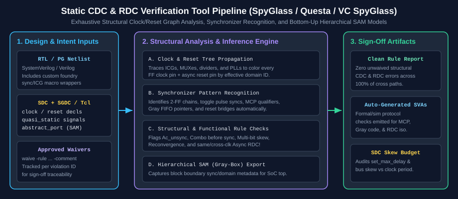
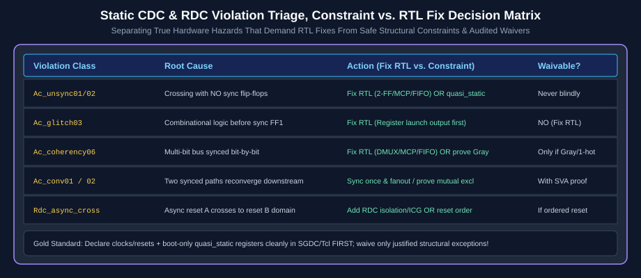

# Static CDC and RDC Verification, Constraints, and Waiver Management

Finding metastability or async reset glitches in lab silicon or gate-level simulation is notoriously hard because setup/hold collisions occur stochastically across PVT corners. Modern ASIC sign-off therefore relies first on **Static CDC & RDC Structural Verification** (Synopsys **VC SpyGlass CDC**, Siemens **Questa CDC**, Cadence **Conformal CDC / JasperGold CDC**). Static tools mathematically inspect 100% of RTL net connectivity without writing test vectors—catching every missing synchronizer, upstream glitch, convergence bug, and RDC violation automatically.

---

## Learning Goals

After completing this chapter, you should be able to:

- Explain how static CDC/RDC engines trace clock trees, reset trees, and synchronizer topologies across multi-million-gate RTL hierarchies.
- Author clean **SDC + SGDC / Tcl CDC constraints** defining root clocks, generated clocks, asynchronous resets, `quasi_static` boot registers, and Reset Ordering pairs.
- Manage hierarchical bottom-up SoC verification using **Sequential Abstract Models (SAM / Gray-Box models)** so large multi-IP chips run overnight cleanly.
- Triage common static violations (`Ac_unsync`, `Ac_glitch`, `Ac_coherency`, `Ac_conv`, `Rdc_async`) rigorously—distinguishing true RTL defects from justified waivers.

---

## The Static CDC and RDC Verification Pipeline

Static analysis treats RTL not as timing numbers, but as a **directed structural graph** of flip-flop clock pins (`CK`), asynchronous clear/preset pins (`CLR/PRE`), combinational cones, and synchronizer primitives:



### Five Core Stages Inside a Static Analyzer

1. **Clock & Reset Tree Propagation:** Reads SDC (`create_clock`, `create_generated_clock`, `set_clock_groups`) and tool Tcl/SGDC (`clock`, `reset`) files, tracing through PLL dividers, clock muxes, and ICG gates to paint every flip-flop with its **Clock Domain ID** and **Reset Domain ID**.
2. **Domain Boundary Extraction:** Enumerates all register-to-register paths whose launch clock != capture clock (CDC) or launch async reset != capture async reset (RDC).
3. **Synchronizer Topology Recognition:** Pattern-matches destination capture logic against known safe templates (2-FF/3-FF `ASYNC_REG` shift chains, toggle pulse syncs, DMUX mux-enable qualifiers, Gray counters, and Reset Synchronizer Bridges).
4. **Rule Engine Checks:** Evaluates structural hygiene rules (`combo before sync`, `reconvergence`, `multi-bit coherency`, `glitch on reset`, `async RDC`).
5. **Protocol Assertion & SAM Export:** Emits formal/dynamic SVA assertions for assumptions the structural graph cannot prove statically (like `$stable(src_data)` on DMUX) and writes compact **SAM (Abstract Models)** of verified sub-blocks for top-level SoC runs.

---

## Authoring Clean CDC and RDC Constraints (SDC + SGDC / Tcl)

**"Garbage constraints in, garbage CDC reports out."** A missing clock declaration or forgotten constant strap causes thousands of false `Ac_unsync` errors that bury genuine silicon bugs!

### Essential Constraint Declarations (Synopsys VC SpyGlass / SGDC Style)

```tcl
# 1. Declare Asynchronous Clock Groups & Periods
current_design soc_top
clock -name clk_cpu   -period 1.0  -domain DOM_CPU
clock -name clk_noc   -period 2.5  -domain DOM_NOC
clock -name clk_uart  -period 20.0 -domain DOM_UART

# 2. Declare Asynchronous Resets & Their Synchronized Active Polarity
reset -name por_rst_n   -value 0 -async
reset -name sw_gpu_rstn -value 0 -async

# 3. Declare Boot-Time Static / Quasi-Static CSRs (Only written while idle!)
quasi_static -name u_cfg_regs/boot_mode_q
quasi_static -name u_cfg_regs/mac_addr_hi_q

# 4. Declare Validated Reset Ordering (Domain B ALWAYS resets before/with A)
reset_order -from por_rst_n -to sw_gpu_rstn

# 5. Qualify Custom Foundry Hardened Synchronizer Cell Wrappers
set_cdc_attribute -sync_cell {SYNC2FF_HVT*}
```

> [!CAUTION]
> **Never Abuse `quasi_static` to Silence Active Crossing Errors!** Tagging a signal as `quasi_static` instructs the CDC tool to stop checking *every* destination crossing fanned out from that register! If software ever modifies a `quasi_static` register dynamically while the receiving clock runs without pausing traffic first, **real silicon goes metastable silently**! Every `quasi_static` entry must be audited and proved by SVA/software protocol!

### Hierarchical Bottom-Up Verification with SAM (Gray-Box Abstract Models)

Running flat full-chip CDC checks on a 100-million-gate SoC overflows RAM and compute runtime. Instead:
1. Run static CDC/RDC sign-off inside each **IP block** (`u_pcie`, `u_ddr`, `u_gpu`) until 100% clean.
2. Export each IP's **SAM (Sequential Abstract Model / Gray-Box)** capturing *only* boundary port clock/reset colors, synchronized boundary wrappers, and internal paths touching ports—stripping millions of already-clean internal flip-flops!
3. Run fast full-SoC top-level CDC/RDC stitching SAMs together to verify chip-level interconnect crossings!

---

## Triage and Waiver Management

Every static CDC/RDC violation falls into one of two buckets: **Fix the RTL / Constraints**, or **Apply an Audited Waiver** only when structural intent is sound yet impossible for graph pattern matching to infer directly.



### Standard Static Rule Codes and Engineering Disposition

| Violation Category | What Triggered It | Correct Engineering Action |
| :--- | :--- | :--- |
| **`Ac_unsync01` (Missing Sync)** | Direct cross-clock register path with zero recognized synchronizer | **Fix RTL:** Add `cdc_bit_sync` / `MCP` / `async_fifo` (or verify genuine boot-only `quasi_static`) |
| **`Ac_glitch03` (Combo Before Sync)** | Combinational gate (`&`, `|`, mux, `+`) sits between launch FF and `FF_SYNC_1` | **Fix RTL Always:** Register source signal cleanly before crossing |
| **`Ac_coherency06` (Multi-Bit Bus Sync)** | Multi-bit bus feeds parallel per-bit 2-FF syncs | **Fix RTL** via DMUX/MCP/FIFO—or **Waive only if** proven Gray code / one-hot with bounded skew |
| **`Ac_conv01` (Reconvergence)** | Separate synchronized wires recombine in downstream logic | **Fix RTL** to synchronize once and fanout inside `dst_clk` (or prove mutual exclusion) |
| **`Rdc_async_cross` (RDC)** | Async `rst_a_n` reset clears `FF_SRC` feeding active `FF_DST` (`rst_b_n`) | **Fix RTL** with RDC isolation / DST ICG / Sync reset—or declare proven `reset_order` |

### Writing Auditable, Reviewable Waivers

Never write blanket file-level waivers (`waive -rule ALL -file foo.sv`)! A production waiver must pinpoint exact rule, hierarchical signal/module, bug-tracker justification, and reviewer signature:

```tcl
# GOOD Auditable Waiver: Narrow target + exact reason + sign-off owner
waive -rule Ac_coherency06 \
    -from "u_dma/wptr_gray_q*" \
    -to   "u_dma/u_sync_w2r/sync_pipe_q*" \
    -comment "Verified 5-bit Cummings Gray pointer (unit distance proven via formal SVA p_gray_onehot0; SDC set_max_delay 0.8ns bounded). Approved: F.Ahmed."
```

---

## Best Practices and Common Pitfalls

- **Audit Clock Definitions First Before Looking at Violations:** Run `check_clock` / `clock_sanity` reports first; 80% of early noisy violations stem from missing generated clocks (`create_generated_clock` on dividers/muxes) or unconstrained test/JTAG pins.
- **Keep SDC and SGDC Synchronized in Version Control:** Whenever a designer renames a PLL clock or adds a divided clock in SDC, update the CDC/RDC constraint script atomically so false-clock-grouping bugs don't silently mask cross-domain paths!
- **Never Waive Combinational Glitch Warnings (`Ac_glitch`):** Even if two inputs seem unlikely to glitch in your current testbench, PVT metal-delay variance will eventually trigger a runt glitch on silicon—always add the launch register cleanly!
- **Check DFT Scan Logic Modes Separately vs Functional Mode:** Always run static CDC/RDC in **Functional Mode (`scan_en == 0, test_mode == 0`)** so test-only bypass muxes don't trick tools into mixing async test clocks with functional paths!

---

## Practical Exercises with Solutions

### Exercise 1 Fixing Missing Generated Clock Coloring

**Problem:**
Static CDC reports 450 critical `Ac_unsync` errors inside a UART controller between `clk_200m` and `u_baud_gen/baud_clk_q`. Inspection confirms `baud_clk_q` is an integer divide-by-8 register generated from `clk_200m` cleanly on `posedge clk_200m` and checked in STA. Why did VC SpyGlass / Questa flag every crossing, and how do you fix the constraints?

**Solution:**
Because `u_baud_gen/baud_clk_q` was never declared in SDC/SGDC with `create_generated_clock -source [get_ports clk_200m] -divide_by 8`, the static analyzer treated `baud_clk_q` as an **unconstrained unrelated clock domain** asynchronous to `clk_200m`! Adding the exact `create_generated_clock` (or specifying `-domain DOM_200M` synchronous grouping in SGDC) links both under the same synchronous PLL tree and resolves all 450 false violations instantly!

### Exercise 2 Auditing an Unsafe Waiver

**Problem:**
During a tape-out review, you spot this waiver in `cdc_waivers.tcl`:
`waive -rule Ac_unsync01 -to "u_pcie_ep/csr_shadow_q*" -comment "Tested fine in sim."`
Why must you reject this waiver immediately?

**Solution:**
1. **"Tested fine in sim" proves zero CDC safety:** Behavioral RTL simulation never models setup/hold metastability or random resolution delays!
2. Without checking whether `csr_shadow_q` sources from a proven `quasi_static` boot-only register (with runtime bus protection) or whether an actual synchronizer/DMUX was omitted, waiving `Ac_unsync01` silently ships a real metastability bug straight to silicon! Reject the waiver and inspect/fix the path.

### Exercise 3 Applying `quasi_static` Legitimately

**Problem:**
At boot time, firmware programs `cfg_endian_mode` inside `apb_clk` while `u_crypto` (`crypto_clk`) is held completely in reset (`crypto_rst_n == 0`). Once firmware releases `crypto_rst_n = 1`, `cfg_endian_mode` NEVER changes until next cold chip reset. Should you spend 2-FF syncs or mark it `quasi_static`, and what SVA guard should protect that assumption?

**Solution:**
Mark `cfg_endian_mode` cleanly as **`quasi_static`** in SGDC/Tcl (avoiding sync cells on wide boot configuration pins), **paired with an SVA safety assumption** verifying the software protocol invariant:

```systemverilog
assert property (@(posedge apb_clk) crypto_rst_n |-> $stable(cfg_endian_mode))
    else $error("Quasi-static cfg_endian_mode toggled while crypto active!");
```

##### Copyright (c) 2026 squared-studio
