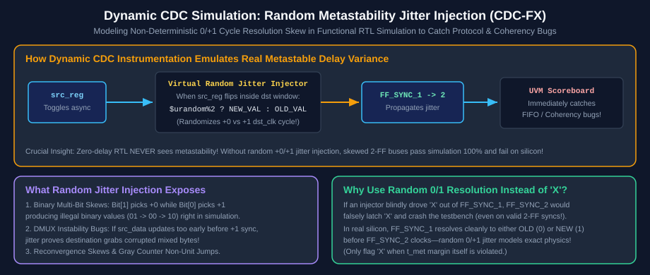
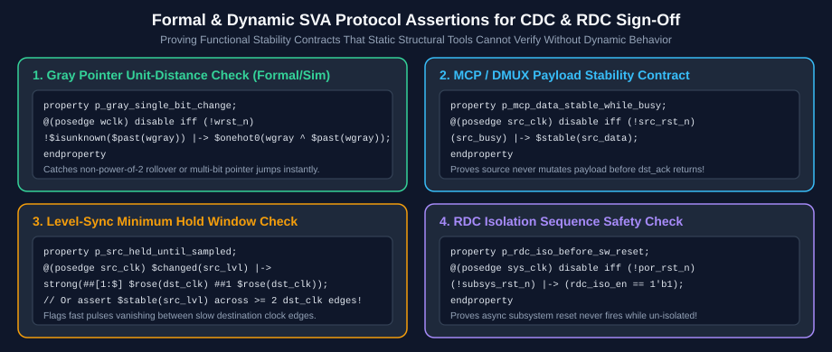

# Dynamic CDC Simulation, Jitter Injection, and Formal Protocol Proofs

Static CDC/RDC tools excel at checking **structure** (does a 2-FF sync or Gray pointer exist?), yet static graph analysis alone cannot prove **dynamic protocol invariants**—for example, whether source software genuinely holds `src_data` stable across an MCP handshake, whether a FIFO pointer truly wraps by at most 1 bit, or whether two synchronized signals work harmoniously across stochastic `+0` vs `+1` cycle delays. Closing the final mile requires **Dynamic CDC Jitter Injection** in simulation and **Formal CDC Model Checking**.

---

## Learning Goals

After completing this chapter, you should be able to:

- Explain why standard zero-delay RTL simulation misses almost all multi-bit skew, DMUX stability, and reconvergence bugs.
- Describe how **Dynamic CDC Simulation (`CDC-FX` / Random Jitter Injection)** emulates physical metastability resolution uncertainty (`+0` vs `+1` destination cycle) cleanly in UVM regressions.
- Write synthesizable **Formal & Dynamic SVA Protocol Monitors** covering Gray unit-distance transitions, MCP stability, pulse spacing, and RDC isolation safety.
- Use **Formal CDC Verification** (bounded model checking & induction) to exhaustively disprove corner-case CDC protocol violations without writing manual corner tests.

---

## Why Standard RTL Simulation Misses CDC Bugs

In standard SystemVerilog RTL simulation, flip-flops exhibit idealized zero setup/hold windows ($t_{su} = t_h = 0$) and instantaneous transitions. That creates two huge blind spots:
1. If a 32-bit binary counter crosses via 32 parallel 2-FF synchronizers (`Ac_coherency06`) with identical zero wire delay in RTL, **all 32 bits capture synchronously on the exact same cycle in simulation**—passing 100% of functional regressions cleanly while failing catastrophically on silicon!
2. If an open-loop DMUX `src_data` changes 1 picosecond before `dst_load_en`, RTL cleanly misses the race!



---

## Dynamic CDC Random Jitter Injection

Commercial CDC-aware simulators (Questa CDC-FX, VCS CDC Dynamic Verification, Xcelium with static CDC auto-monitors) bridge this simulation gap by instrumenting every identified CDC crossing at elaboration time:

### How Random Resolution Delay (`+0` vs `+1` Cycle) Works

Whenever a source signal `src_q` flips inside a configurable **uncertainty window** around `dst_clk`'s rising edge (or intentionally on every asynchronous transition during stress regressions!):
- Instead of driving illegal `'X'` straight into downstream logic (which would break valid 2-FF synchronizers!), a probabilistic injector randomly selects between:
  - **Path A (`+0` Cycle Resolution):** `FF_SYNC_1` resolves immediately to the **new** value (`src_q`).
  - **Path B (`+1` Cycle Resolution):** `FF_SYNC_1` lingers/resolves back to the **old** value (`$past(src_q)`), updating on the *next* `dst_clk` edge!
- Notice what happens when two bits of an unsynchronized binary bus flip (`01 -> 10`): Bit `[1]` picks `+0` while Bit `[0]` picks `+1`, injecting `11` directly into the UVM scoreboard!

> [!TIP]
> **Deterministic Seed Reproducibility Matters!** Ensure your dynamic CDC jitter generator derives its randomness cleanly from your UVM testbench `+ntb_random_seed` / SystemVerilog RNG seed so any intermittent CDC failure uncovered overnight reproduces deterministically on the next debug run!

---

## Dual-Clock SVA Protocol Monitors and Formal Proofs

Every static CDC tool (SpyGlass / Questa / VC SpyGlass) can auto-generate **SystemVerilog Assertions (SVAs)** at verified CDC crossings—and designers can write clean custom SVA modules bound into key bridges (`bind async_fifo cdc_fifo_sva u_sva (.*);`) to verify protocol assumptions formally using **JasperGold** or **VC Formal**!



### Production SVA CDC/RDC Monitor Module

Notice how each assertion targets a fundamental protocol invariant that structural linting alone cannot guarantee:

```systemverilog
module cdc_protocol_monitors #(
    parameter int PTR_W  = 4,
    parameter int DATA_W = 32
) (
    // 1. Gray Counter Crossing Signals
    input logic               wclk,
    input logic               wrst_n,
    input logic [PTR_W-1:0]   wptr_gray,

    // 2. Closed-Loop MCP Signals
    input logic               src_clk,
    input logic               src_rst_n,
    input logic               src_busy,
    input logic [DATA_W-1:0]  src_data_q,

    // 3. RDC Sequencer Signals
    input logic               sys_clk,
    input logic               por_rst_n,
    input logic               dom_a_rst_n,
    input logic               rdc_iso_en
);
    // Assertion 1: Gray pointer MUST NEVER jump more than 1 bit per wclk cycle!
    // (Proves power-of-2 wraparound & catches missing register stages)
    a_gray_unit_hamming: assert property (
        @(posedge wclk) disable iff (!wrst_n)
        !$isunknown($past(wptr_gray)) |-> $onehot0(wptr_gray ^ $past(wptr_gray))
    ) else $error("CDC_SVA_ERR: Gray pointer flipped >1 bit simultaneously!");

    // Assertion 2: MCP payload MUST remain 100% static throughout busy handshake!
    a_mcp_payload_stable: assert property (
        @(posedge src_clk) disable iff (!src_rst_n)
        src_busy |-> $stable(src_data_q)
    ) else $error("CDC_SVA_ERR: Source mutated payload while MCP transfer active!");

    // Assertion 3: RDC isolation MUST cover entire async reset window!
    a_rdc_iso_covers_reset: assert property (
        @(posedge sys_clk) disable iff (!por_rst_n)
        (!dom_a_rst_n) |-> (rdc_iso_en == 1'b1)
    ) else $error("RDC_SVA_ERR: Domain A async reset active without RDC isolation!");

    // Cover 4: Prove at least one full Gray pointer wraparound exercised!
    c_gray_wrap: cover property (
        @(posedge wclk) disable iff (!wrst_n)
        (wptr_gray == {1'b1, {(PTR_W-1){1'b0}}}) ##1 (wptr_gray == '0)
    );
endmodule
```

### Multi-Clock Formal CDC Verification Power

In dynamic simulation, hitting an obscure phase beat between a `133.3 MHz` clock and a `400.0 MHz` clock on the exact cycle a wakeup interrupt collides with reset takes hours of regression runs. **Formal Model Checking** treats clocks as symbolic primary inputs (or constrained step relations), mathematically exploring *every conceivable interleaving* of `wclk`, `rclk`, `src_clk`, and `dst_clk` edges simultaneously—proving Gray pointer unit distance, Async FIFO data integrity (no lost/duplicated words), and RDC isolation invariants with **100% mathematical certainty** in minutes!

---

## Best Practices and Common Pitfalls

- **Always Enable Dynamic CDC Jitter in At Least One Weekly UVM Regression:** Running cleanly without jitter gives false confidence; running full UVM packet scoreboards with `+0/+1` jitter enabled catches latent reconvergence and early-overwrite bugs immediately.
- **Avoid Cross-Clock Expressions Inside Single SVA `assert property` Without Proper Clocking:** Standard SVA properties should clock cleanly on *one* clock (`wclk` or `src_clk`) when checking source-side invariants (`$onehot0`, `$stable(src_data_q)`) so formal tools evaluate cycles unambiguously—or use dual-clock formal modeling primitives supported by your formal solver.
- **Check That Waived Static Rules Have Corresponding Formal/Dynamic SVA Proofs:** Every `Ac_coherency` waiver on a Gray counter or `quasi_static` exemption should automatically be backed by an active SVA assertion (`a_gray_unit_hamming`, `$stable(cfg)`) running in regression!

---

## Practical Exercises with Solutions

### Exercise 1 Why Random `+0/+1` Jitter Beats `'X'` Injection Inside 2-FF Syncs

**Problem:**
A testbench engineer writes a quick behavioral synchronizer check that forces `FF_SYNC_1.Q = 1'bx` for 1 destination cycle whenever `src_in` toggles near `dst_clk`. Within 10 cycles, the entire simulation floods with `'X'` errors and crashes! Why did this happen, and how should behavioral CDC modeling represent metastability instead?

**Solution:**
In real CMOS hardware, `FF_SYNC_1` enters a transient voltage near $V_{DD}/2$, **resolving back to clean `'0'` or `'1'`** inside $t_{\text{met}}$ long before `FF_SYNC_2` samples on the *next* rising edge! Forcing `FF_SYNC_1.Q = 'X'` for an entire clock cycle makes `FF_SYNC_2` sample `'X'`, breaking valid 2-FF synchronizers!
Instead, model real resolution physics by **randomly selecting** between capturing the `NEW` value (`+0` cycle delay) vs. holding the `OLD` value (`+1` cycle delay) whenever `src_in` transitions close to `dst_clk`.

### Exercise 2 Writing an SVA Check for Open-Loop Pulse Spacing

**Problem:**
An open-loop toggle synchronizer feeds `src_pulse` from `100 MHz` `src_clk` ($T_{\text{src}} = 10\text{ns}$) into `33.3 MHz` `dst_clk` ($T_{\text{dst}} = 30\text{ns}$). Write a single-clock SVA assertion in `src_clk` enforcing the minimum safe inter-pulse spacing rule ($\Delta t_{\text{pulses}} \ge 2 \cdot T_{\text{dst}} = 60\text{ns} = 6$ `src_clk` cycles!).

**Solution:**

```systemverilog
a_min_pulse_spacing: assert property (
    @(posedge src_clk) disable iff (!src_rst_n)
    src_pulse |=> (!src_pulse)[*6]
) else $error("CDC_PULSE_ERR: Open-loop pulses arrived closer than 2 * T_dst!");
```

### Exercise 3 Proving Async FIFO Data Integrity Formally

**Problem:**
Beyond verifying Gray pointer Hamming distance (`$onehot0`), how do formal CDC verification engineers mathematically prove that an Async FIFO **never corrupts, drops, duplicates, or reorders data words** across *any* ratio of `wclk` and `rclk`?

**Solution:**
Insert a small **Formal Two-Transaction Scoreboard / Tracking Tag** in an SVA wrapper (`jasper_fifo_chk`): pick two arbitrary symbolic data values `D1` and `D2` pushed sequentially (`winc && !wfull`), track an auxiliary state counter noting `D1` and `D2` entered memory, and prove via formal induction across arbitrary asynchronous `wclk`/`rclk` edge interleavings that `rinc && !rempty` **must observe `D1` cleanly before `D2`** (FIFO ordering + zero loss + zero duplication!).

##### Copyright (c) 2026 squared-studio
