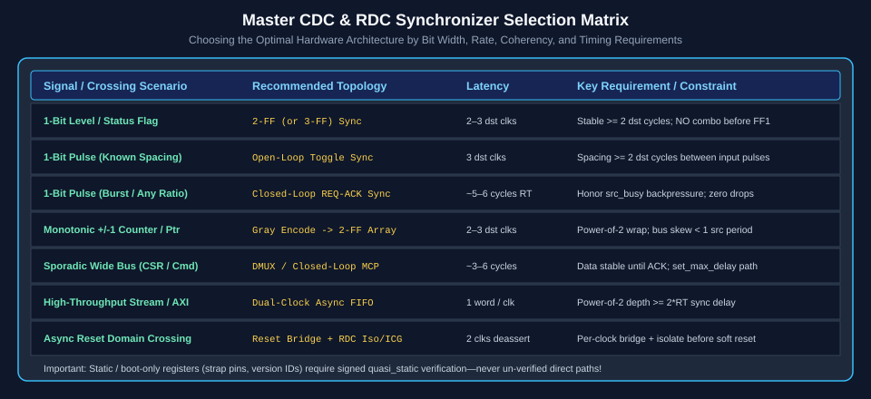
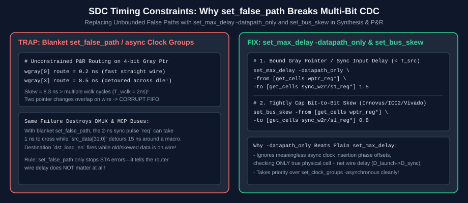

# Comprehensive CDC and RDC Pattern Reference, SDC Timing, and Sign-Off

Closing CDC and RDC verification across complex multi-clock SoCs demands more than knowing individual synchronizer circuits—it requires picking the right topology for every interface bandwidth/latency budget, writing airtight SDC timing bounds that survive aggressive Place-and-Route optimizations, and enforcing a rigorous tape-out checklist across RTL, synthesis, and gate-level netlists. This capstone chapter consolidates every CDC/RDC pattern, constraint template, and verification gate into a practical field guide.

---

## Learning Goals

After completing this chapter, you should be able to:

- Select the optimal CDC/RDC hardware topology immediately across all seven primary crossing patterns using a structured selection matrix.
- Explain why blanket **`set_false_path`** constraints silently break multi-bit Gray-pointer and DMUX/MCP synchronizers during physical Place-and-Route—and replace them cleanly with **`set_max_delay -datapath_only`** and **`set_bus_skew`**.
- Assemble complete, foundry-ready **SDC + SGDC/Tcl + SystemVerilog attribute** packages covering single-bit syncs, Gray FIFOs, MCP bridges, and Reset Bridges.
- Execute a comprehensive **Pre-Tape-Out CDC/RDC Sign-Off Checklist** across RTL, Synthesis, P&R, and Gate-Level Simulation.

---

## Master CDC and RDC Architecture Selection Matrix

Choosing the right crossing circuit early saves massive ECO churn later during physical closure:



### Quick Rule-of-Thumb Decision Tree

1. **Same PLL, exact integer multiple (`1:N`) with balanced CTS?** Use synchronous clock-enable architecture (`en_strobe`)—zero async CDC hardware needed.
2. **One slow 1-bit level/flag signal ($\Delta t \ge 2 T_{\text{dst}}$)?** Use a dedicated `cdc_bit_sync` (2-FF; 3-FF above `1 GHz`), driven directly from a `src_clk` flop.
3. **One narrow pulse (`src_clk -> dst_clk`)?** Use Open-Loop Toggle Sync *only* if guaranteed $\Delta t \ge 2 T_{\text{dst}}$; otherwise use Closed-Loop `REQ-ACK`.
4. **Monotonic $\pm 1$ pointer or event counter?** Convert registered binary count to registered Gray code (power-of-2 depth), cross via 2-FF array, decode post-sync.
5. **Sporadic wide payload (CSR write, descriptor, command)?** Use Open-Loop DMUX (guaranteed wait) or Closed-Loop Ready/Valid MCP bridge (`src_data_q` locked until `ack`).
6. **Sustained full-bandwidth streaming bus (AXI, PCIe, pixel stream)?** Use Cummings-style Dual-Clock Async FIFO with power-of-2 depth $\ge 2 \times \text{RT sync latency}$.
7. **Asynchronous reset release or cross-reset crossing?** Add per-clock `reset_sync_bridge` (with DFT mux) + RDC Isolation Clamping / Destination Clock Gating / Synchronous Source Reset.

---

## SDC Timing Constraints for Physical CDC Sign-Off

The single deadliest backend timing mistake in low-power/multi-clock ASICs is applying **`set_clock_groups -asynchronous`** or **`set_false_path`** blindly without overriding multi-bit CDC paths!



### Why Blanket `set_false_path` Breaks Physical Silicon

In Static Timing Analysis (STA), `set_clock_groups -asynchronous` (or `set_false_path -from clk_a -to clk_b`) tells synthesis and the physical P&R router: *"Wire delay on any path between `clk_a` and `clk_b` has infinity timing slack—do not optimize it!"*
Consequently, under die congestion, the router sends bit `0` of an Async FIFO Gray pointer across a $0.2\text{ns}$ short metal track while detouring bit `3` along a $9.0\text{ns}$ serpentine route around SRAM macros!
- When `wclk` runs at $500\text{MHz}$ ($2.0\text{ns}$ period), bit `3` arrives **4.5 write cycles late**, causing multiple pointer transitions to overlap in transit and destroying Gray code unit-distance!
- Similarly, in an MCP/DMUX bridge, unconstrained `src_data_q[31:0]` wires can detour *behind* the fast `src_req_q` qualifier, causing destination capture flops to latch half-new, half-stale data!

### Production SDC Constraint Reference Package

Always place bounded datapath constraints *after* `set_clock_groups` (in PrimeTime/Vivado/Tempus, explicit `-datapath_only` max-delay exceptions take precedence cleanly over blanket async clock groups):

```tcl
# ==============================================================================
# Production CDC/RDC SDC Constraints Template
# ==============================================================================

# 1. Declare Asynchronous Clock Groups (Suppresses bogus cross-clock setup/hold)
set_clock_groups -asynchronous \
    -group [get_clocks {clk_cpu}] \
    -group [get_clocks {clk_noc}] \
    -group [get_clocks {clk_periph}]

# 2. 2-FF / 3-FF Single-Bit Sync: Bound Launch -> FF1 Delay <= 1 * T_dst (keep short!)
set_max_delay -datapath_only \
    -from [get_cells -hier *src_launch_q*] \
    -to   [get_cells -hier *u_bit_sync/sync_pipe_q_reg[0]*] 1.0

# 3. Async FIFO Gray Pointers: Bound max latency < T_src AND cap skew < 0.5 * T_src!
# Example: wclk = 500MHz (2.0ns), rclk = 250MHz (4.0ns)
set_max_delay -datapath_only \
    -from [get_cells -hier *u_fifo/wptr_reg*] \
    -to   [get_cells -hier *u_fifo/rq1_wptr_reg*] 1.5
set_bus_skew \
    -from [get_cells -hier *u_fifo/wptr_reg*] \
    -to   [get_cells -hier *u_fifo/rq1_wptr_reg*] 0.6

set_max_delay -datapath_only \
    -from [get_cells -hier *u_fifo/rptr_reg*] \
    -to   [get_cells -hier *u_fifo/wq1_rptr_reg*] 1.5
set_bus_skew \
    -from [get_cells -hier *u_fifo/rptr_reg*] \
    -to   [get_cells -hier *u_fifo/wq1_rptr_reg*] 0.6

# 4. Closed-Loop MCP / DMUX Data Bus: Payload MUST settle faster than req sync latency!
set_max_delay -datapath_only \
    -from [get_cells -hier *u_mcp/src_data_q_reg*] \
    -to   [get_cells -hier *u_mcp/dst_data_reg*] 1.5

# 5. Reset Synchronizer Bridge: Mask ONLY async CLR input to Stage 1; KEEP Stage 2 STA active!
set_false_path -through [get_pins -hier *u_rst_sync/async_rst_n] \
               -to      [get_pins -hier *u_rst_sync/rst_pipe_q_reg[0]/CLR]
# (Do NOT false_path sync_rst_n -> domain leaf FFs; STA verifies full 1-cycle recovery!)
```

> [!IMPORTANT]
> **Understand `-datapath_only` vs. Plain `set_max_delay`:** Never omit `-datapath_only` on async crossings! Plain `set_max_delay` still factors arbitrary cross-clock launch/capture clock-tree latency skew into calculations, generating false negative slack whenever one PLL clock tree runs $2\text{ns}$ deeper than the other! `-datapath_only` measures purely **D-pin/Q-pin logic + metal wire propagation delay**.

---

## Pre-Tape-Out CDC and RDC Sign-Off Checklist

1. **Zero Unsynchronized Crossings:** Static CDC/RDC tool (`VC SpyGlass` / `Questa CDC` / `Conformal CDC`) achieves **0 unwaived errors** across RTL **and** Post-Synthesis/Post-P&R netlists (confirming optimization never broke `ASYNC_REG` or injected logic before `FF_SYNC_1`).
2. **Every Synchronizer Registered Cleanly:** Zero combinational gates on CDC crossing paths (`Ac_glitch03 = 0`), and all `ASYNC_REG` / placement groups keep `t_route` between `FF_SYNC_1` and `FF_SYNC_2` minimal inside P&R.
3. **MTBF Budget Verified at Worst PVT Corner:** Every 2-FF/3-FF sync satisfies fleet MTBF requirements using foundry $\tau$, $T_0$ parameters at minimum DVFS operating voltage (`> 10^12 years`).
4. **Reset Trees Verified End-to-End:** Every independent clock domain owns its dedicated `reset_sync_bridge` (with DFT `scan_mode` mux), and every same/cross-clock soft-reset RDC boundary passes isolation/clock-gate/synchronous checks cleanly.
5. **SDC Bounds Audited Post-P&R:** Verify zero `set_false_path` overrides exist on Gray pointers or DMUX/MCP payloads, and confirm Post-Route STA proves all `set_max_delay -datapath_only` and `set_bus_skew` limits pass across corners.
6. **Dynamic Jitter & Formal Protocol Proofs Complete:** Run full UVM regressions with random `+0/+1` CDC metastability jitter enabled alongside Formal SVA checks backing every Gray counter, MCP stability contract, and `quasi_static` waiver.
7. **Gate-Level Netlist Timing Simulation (`+neg_tchk` + Notifier Check):** Confirm expected timing-check `$setup`/`$hold` notifier suppression (`x_on_violation = 0` or `+no_notifier` **strictly restricted** to qualified `FF_SYNC_1` instances via `tfile`, never globally disabled chip-wide!) passes cleanly.

---

## Best Practices and Common Pitfalls

- **Never Run Gate-Level Simulation with `+notimingchecks` Globally:** Disabling timing checks globally hides genuine broken timing paths! Instead, maintain an explicit **Synchronizer Instance List (`no_timing_notifier.tfile`)** disabling `'X'` notifier generation *exclusively* on first-stage `FF_SYNC_1` registers and `reset_sync_bridge` Stage 1 `CLR` pins, leaving all remaining millions of chip flip-flops strictly timing-checked!
- **Reuse Parameterized, Sign-Off-Approved CDC Primitives:** Maintain a central `cdc_lib` package (`cdc_bit_sync`, `cdc_pulse_req_ack`, `cdc_mcp_data_bridge`, `async_fifo`, `reset_sync_bridge`) with standardized hierarchical instance naming (`*u_cdc_*`), so SDC regex rules and static tool qualifiers attach cleanly across the entire SoC!
- **Audit Synthesis Netlists for Cloned / Merged Sync Flops:** Disable register retiming, FSM optimization, and flip-flop merging (`set_register_merging false`) on all `ASYNC_REG` cells so synthesis never folds a 2-FF synchronizer into downstream logic.

---

## Practical Exercises with Solutions

### Exercise 1 Debugging a Corrupt Post-P&R Async FIFO

**Problem:**
An `async_fifo` passes 100% of RTL regressions, dynamic CDC jitter runs, and formal JasperGold proofs. Yet during Post-P&R Gate-Level Simulation (`GLS`), the FIFO sporadically outputs garbage bytes! Inspecting the constraints reveals the backend engineer wrote:
`set_clock_groups -asynchronous -group clk_w -group clk_r`
with **no** extra exceptions on `wptr` or `rptr`. What physical failure happened in P&R, and write the missing SDC commands assuming $T_{\text{wclk}} = 2.0\text{ns}$ and $T_{\text{rclk}} = 3.0\text{ns}$.

**Solution:**
Because `set_clock_groups -asynchronous` marked all `wclk <-> rclk` paths as false paths with zero delay constraints, the router allowed wide multi-bit trace skew (`> 2.0ns`) across `wptr[3:0]`, breaking Gray unit-distance sampling in physical silicon / SDF GLS!
**Fix:** Add explicit `-datapath_only` delay bounds and bus-skew limits strictly tighter than the faster clock (`2.0ns`):

```tcl
set_max_delay -datapath_only -from [get_cells -hier *wptr_reg*] -to [get_cells -hier *rq1_wptr_reg*] 1.5
set_bus_skew  -from [get_cells -hier *wptr_reg*] -to [get_cells -hier *rq1_wptr_reg*] 0.6
set_max_delay -datapath_only -from [get_cells -hier *rptr_reg*] -to [get_cells -hier *wq1_rptr_reg*] 1.5
set_bus_skew  -from [get_cells -hier *rptr_reg*] -to [get_cells -hier *wq1_rptr_reg*] 0.6
```

### Exercise 2 Selective SDF Notifier Masking in GLS

**Problem:**
During back-annotated SDF Gate-Level Simulation, every single 2-FF synchronizer turns into `'X'` the first time a signal crosses asynchronously and corrupts the testbench! Should the team pass `+notimingchecks` to the simulator? Explain the exact safe solution.

**Solution:**
**Never pass `+notimingchecks` globally!** That blinds GLS to real setup/hold timing violations across the rest of the chip!
Instead:
1. Extract the exact hierarchical list of **first-stage synchronizer flip-flops** (`FF_SYNC_1`) and Stage-1 `reset_sync_bridge` cells.
2. Load an SDF instance-specific timing exception file (e.g., VCS `instance {tb.dut...sync_pipe_q_reg[0]} { noTiming; }` or `tchk_msg` notifier disable strictly on `FF_SYNC_1`!) so `FF_SYNC_1` continues resolving cleanly without poisoning `FF_SYNC_2` with `'X'`, while 99.9% of the chip retains full SDF timing checks!

### Exercise 3 Selecting Optimal Crossings for a Full SoC

**Problem:**
Match each interface in a new mobile SoC to the best architecture from our selection matrix:
1. External tactile button signal (`btn_async_in`) $\to$ `24 MHz` wakeup block.
2. `500 MHz` Camera ISP pixel stream (`128b` pixels every cycle) $\to$ `300 MHz` DRAM DMA (`AXI4`).
3. `100 MHz` APB CPU writing sporadic `64-bit` filter coefficients $\to$ `250 MHz` Audio DSP (`< 100 writes/sec`).
4. `100 MHz` software block reset CSR resetting an audio subsystem (`aud_sw_rst_n`) that exports status flags to an Always-On power unit clocked on the same `100 MHz` clock.

**Solution:**
1. **`cdc_bit_sync` (2-FF)** + optional digital debouncer inside `24 MHz` domain.
2. **Dual-Clock Asynchronous FIFO (`async_fifo`)** with power-of-2 depth sized for peak ISP pixel burst accumulation (`>= 8`–`64` entries).
3. **Closed-Loop Ready/Valid MCP Bridge (`cdc_mcp_data_bridge`)** (or Open-Loop DMUX if software waits strictly >40ns between APB writes)—saves huge area vs. a 64-bit RAM FIFO!
4. **RDC Isolation Clamp Sequencer (`rdc_iso_sequencer`)** (assert `rdc_iso_en = 1` $\ge 1$ cycle before asserting `aud_sw_rst_n`, or convert source status registers to synchronous reset).

##### Copyright (c) 2026 squared-studio
