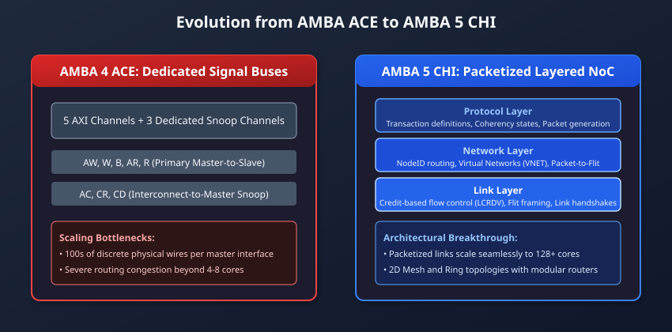

# Introduction to AMBA 5 CHI & Architecture Evolution

## The Multi-Core Scaling Wall and the Death of Parallel Buses

Over the past two decades, System-on-Chip (SoC) architectures have evolved from single-processor embedded microcontrollers to massive, heterogeneous computing fabrics containing dozens to hundreds of high-performance processor cores, graphics processing clusters, neural processing units (NPUs), and high-bandwidth memory controllers.

In early multi-core systems, bus-based protocols such as **AMBA 3 AXI** and **AMBA 4 ACE** provided the backbone for on-chip communication. As detailed in the ACE protocol specification, hardware cache coherency was achieved by extending the five standard AXI channels (`AW`, `W`, `B`, `AR`, `R`) with three dedicated snoop channels (`AC`, `CR`, `CD`). While this architecture succeeded admirably for small clusters of 2 to 4 cores, it hit an insurmountable physical scaling wall as core counts expanded toward enterprise servers and high-performance computing:

1. **The Pin-Count and Wire Routing Crisis:**
   Every ACE master requires upwards of 300 to 500 discrete physical wires connecting it to the central interconnect. In a 32-core or 64-core SoC, routing hundreds of thousands of parallel wires across silicon creates intolerable routing congestion, timing closure failures, and massive silicon area overhead.
2. **Frequency and Crossbar Saturation:**
   Traditional crossbars and bus matrix switches require wide multiplexers that scale quadratically ($O(N^2)$) with the number of attached masters. Beyond 8 to 16 ports, capacitive wire loading forces clock frequencies to drop drastically, throttling overall memory throughput.
3. **Rigid Point-to-Point Topology Constraints:**
   Dedicated physical channels prevent the physical design team from utilizing modern Network-on-Chip (NoC) topologies—such as 2D Meshes or Bidirectional Rings—where multiple traffic types must share high-speed, uniform physical links.

To shatter these architectural bottlenecks, ARM introduced the **AMBA 5 Coherent Hub Interface (CHI)**.



---

## The Packetized, Layered Network-on-Chip Paradigm

AMBA 5 CHI fundamentally reimagines on-chip communication by borrowing architectural principles from computer networking and telecommunications. Rather than transmitting memory transactions across dedicated physical wires, CHI encapsulates memory commands, coherency snoops, and cache-line data into **packetized messages** that route across a shared **Network-on-Chip (NoC)**.

CHI establishes a formal three-layer protocol stack:

```
+-------------------------------------------------------------------------+
|                              PROTOCOL LAYER                             |
|  - Defines transaction opcodes (ReadShared, WriteUnique, SnpCleanInvalid)|
|  - Enforces cache state transitions (MOESI / MESI)                      |
|  - Generates Request, Response, Snoop, and Data Packets                 |
+-------------------------------------------------------------------------+
                                    |
                                    v
+-------------------------------------------------------------------------+
|                              NETWORK LAYER                              |
|  - Responsible for end-to-end packet routing across the NoC             |
|  - Attaches Source NodeID (SrcID) and Target NodeID (TgtID)             |
|  - Manages Virtual Networks (VNETs) to prevent routing deadlocks        |
|  - Segments Packets into Flow Control Units (Flits)                     |
+-------------------------------------------------------------------------+
                                    |
                                    v
+-------------------------------------------------------------------------+
|                                LINK LAYER                               |
|  - Governs point-to-point transmission between adjacent routers/nodes   |
|  - Implements credit-based flow control (LCRDV mechanism)               |
|  - Handles flit framing, link activation, and low-power states          |
+-------------------------------------------------------------------------+
                                    |
                                    v
               [ Physical Wires: High-Speed NoC Links ]
```

By decoupling transaction intent (Protocol Layer) from physical routing (Network Layer) and link-level transmission (Link Layer), CHI enables SoC architects to run the exact same coherency protocol over arbitrary physical topologies: crossbars, multi-stage rings, or multi-dimensional mesh networks.

---

## CHI Node Taxonomy

In an AMBA CHI system, every functional block attached to the interconnect is formally classified as a **Node**. Each node is assigned a unique physical address called a **NodeID**, analogous to an IP address in a local area network.

Nodes are categorized into four fundamental architectural classes based on their role in transaction generation, coherency management, and memory hosting:


### Request Nodes (RN)

Request Nodes initiate memory transactions into the interconnect.

- **`RN-F` (Fully Coherent Request Node):** Typically a multi-core CPU cluster or high-performance compute core. It maintains hardware-coherent internal caches (L1/L2), supports the full MOESI cache state model, can issue coherent reads/writes, and **accepts incoming snoop requests** from the interconnect.
- **`RN-D` (DVM-Capable Request Node):** A processing element (such as an advanced GPU or DSP) that does not maintain fully snooped CPU caches, but participates in Distributed Virtual Memory (DVM) operations to synchronize address translation tables.
- **`RN-I` (I/O Coherent Request Node):** A streaming or master agent (e.g., standard DMA controller, PCIe Root Complex, or Ethernet MAC) that does not maintain a snooped cache. It can read and write memory coherently without software flushes, but cannot receive snoop requests (the CHI counterpart to ACE-Lite).

### Home Nodes (HN)

Home Nodes serve as the central points of serialization, directory tracking, and memory orchestration for specific address ranges.

- **`HN-F` (Fully Coherent Home Node):** The architectural cornerstone of CHI coherency. Every physical address in the SoC maps to a specific HN-F. The HN-F contains:
  - **Point of Serialization (PoS):** Enforces a deterministic global order for all concurrent accesses to the same cache line.
  - **Snoop Filter / Directory:** Tracks which RN-F nodes currently cache that address.
  - **System Level Cache (SLC):** An optional shared on-chip L3/L4 cache to service reads without accessing external DRAM.
- **`HN-I` (Non-coherent Home Node):** Orchestrates transactions targeting non-cacheable memory regions, memory-mapped I/O (MMIO) peripherals, configuration registers, or boot ROMs.

### Subordinate Nodes (SN)

Subordinate Nodes are the ultimate memory endpoints that accept reads and writes forwarded by Home Nodes.

- **`SN-F` (Fully Coherent Subordinate Node):** High-bandwidth external memory controllers (DDR4, DDR5, LPDDR5, or HBM3). They receive clean/dirty cache line writebacks and deliver memory fill data.
- **`SN-I` (Non-coherent Subordinate Node):** Peripheral bridges (such as AXI-to-APB bridges) and on-chip ROMs.

### Miscellaneous Nodes (MN)

- Centralized system management nodes responsible for orchestrating global Distributed Virtual Memory (DVM) messages, system profiling, trace collection, and interrupt distribution across the SoC.

---

## High-Level Comparison: ACE vs. CHI

To clearly grasp the architectural leap represented by CHI, the following table summarizes the fundamental differences between AMBA 4 ACE and AMBA 5 CHI:

| Architectural Metric      | AMBA 4 ACE                                                                        | AMBA 5 CHI                                                                                                           |
| :------------------------ | :-------------------------------------------------------------------------------- | :------------------------------------------------------------------------------------------------------------------- |
| **Physical Interface**    | Dedicated, parallel unidirectional signal channels (AW, W, B, AR, R, AC, CR, CD). | Packetized point-to-point links carrying standardized Flow Control Units (Flits).                                    |
| **Interconnect Scaling**  | Effectively limited to 4–8 coherent clusters due to wire congestion.              | Scales seamlessly to 32, 64, 128, or 256+ cores over 2D Mesh and Ring NoCs.                                          |
| **Flow Control**          | Reactive `VALID` / `READY` handshake with potential backpressure stalls.          | Proactive, credit-based link flow control (`LCRDV`) with zero backpressure.                                          |
| **Direct Cache Transfer** | Snoop data returned over CD; interconnect routes data to reader.                  | Direct Cache Transfer (DCT): Peer cache sends data _directly_ to reader without passing through Home Node buffers.   |
| **Atomic Operations**     | Near-memory exclusive accesses (`LDREX`/`STREX`) causing cache line bouncing.     | Far-memory atomics (`AtomicStore`, `AtomicLoad`, `AtomicCompare`, `AtomicSwap`) executed directly at HN-F/SN-F ALUs. |
| **Routing Mechanism**     | Hardwired mux/demux routing tables inside crossbar logic.                         | Dimension-Order Routing (DOR) using explicit Source/Target NodeIDs.                                                  |
| **Coherency Directory**   | Optional external snoop filter inside interconnect (e.g. CCI-500).                | Native, integrated directory at every Home Node (HN-F).                                                              |

---

## The System Topology Lifecycle

In an AMBA 5 CHI SoC, the lifecycle of a memory request operates through a distributed, three-party choreography:

```
[Requestor: RN-F]              [Coordinator: HN-F]             [Endpoint: SN-F / DRAM]
        |                               |                                  |
   1. Issue REQ ----------------------->|                                  |
        |                         (PoS Serializes)                         |
        |                         (Queries Directory)                      |
        |                               |                                  |
        |<====================== 2. Direct Data / Read Fill <==============|
        |                               |                                  |
   3. CompAck ------------------------->|                                  |
        |                         (Updates Directory)                      |
```

1. **Request:** The CPU (RN-F) issues a Request Flit (`REQ`) addressed to the target Home Node (`HN-F`) responsible for that physical address.
2. **Serialization & Snooping:** The HN-F serializes the request at its Point of Serialization (PoS), checks its internal snoop directory, and issues targeted Snoop Flits (`SNP`) to peer RN-Fs if necessary.
3. **Data Return:** Data is retrieved either from a peer RN-F (via Direct Cache Transfer), from the HN-F's internal System Level Cache, or from main memory (`SN-F`).
4. **Completion:** The requesting RN-F receives the data and returns a completion acknowledgment (`CompAck`) to the HN-F, allowing the HN-F to release its tracker entry and commit directory updates.

---

## Chapter Summary

- As SoCs scaled beyond 8 cores, traditional bus architectures like AMBA ACE hit a **wire routing and pin-count scaling wall**.
- **AMBA 5 CHI** adopts a packetized, layered Network-on-Chip (NoC) paradigm consisting of Protocol, Network, and Link layers.
- System agents are structured into discrete **Nodes** identified by **NodeIDs**: Request Nodes (RN-F, RN-I), Home Nodes (HN-F, HN-I), Subordinate Nodes (SN-F, SN-I), and Miscellaneous Nodes (MN).
- CHI replaces reactive `VALID`/`READY` handshakes with proactive **credit-based flow control**, drastically boosting achievable clock frequencies and link utilization.

---

## Review Questions

1. **Why does AMBA 5 CHI replace dedicated physical signal channels with packetized flits, and what physical silicon problem does this solve?**
   <details>
   <summary>Click to view answer</summary>
   In large multi-core processors, dedicated channels (such as ACE's 8 independent buses) require hundreds of physical wires per master interface. Scaling this to 16, 32, or 64 cores causes catastrophic physical routing congestion, increases die size, and prevents high-frequency operation due to wire loading. CHI packetizes all transactions into uniform Flow Control Units (Flits) that travel across shared, point-to-point NoC links, reducing wire count by up to 70% and allowing clean layout over high-frequency 2D Mesh topologies.
   </details>

2. **What is the functional distinction between an `RN-F` node and an `RN-I` node?**
   <details>
   <summary>Click to view answer</summary>
   An `RN-F` (Fully Coherent Request Node) maintains local, hardware-snooped caches (such as CPU L1/L2 caches), supports full MOESI coherency, and must accept and respond to inbound snoop flits (`SNP`) from Home Nodes. An `RN-I` (I/O Coherent Request Node) is a non-cached streaming agent (such as a PCIe controller or DMA engine) that can issue coherent read and write requests to access memory without software cache flushes, but cannot be snooped because it maintains no snooped cache.
   </details>

3. **What three major components are housed inside a Fully Coherent Home Node (`HN-F`)?**
   <details>
   <summary>Click to view answer</summary>
   An `HN-F` integrates: (1) The Point of Serialization (PoS), which establishes a deterministic global order for all concurrent accesses to an address set; (2) The Snoop Filter / Directory, which tracks which RN-F nodes currently hold copies of each cache line to prune broadcast snoops; and (3) An optional System Level Cache (SLC), which acts as a shared L3/L4 cache to service reads with low latency before querying external DRAM.
   </details>

4. **How does AMBA CHI prevent crossbar multiplexer bottlenecks from limiting clock frequencies in massive multi-core chips?**
   <details>
   <summary>Click to view answer</summary>
   Instead of using a centralized crossbar with wide multiplexers that scale quadratically ($O(N^2)$), CHI uses distributed Network-on-Chip (NoC) topologies such as 2D Mesh grids. In a mesh, each node attaches to a local Crosspoint (XP) router. Packets travel hop-by-hop between adjacent routers using dimension-order routing, keeping wire lengths short and uniform, allowing clock frequencies to reach multiple gigahertz.
   </details>

---

##### Copyright (c) 2026 squared-studio
