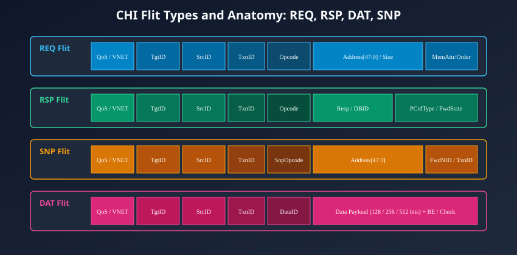

# Layered Architecture & Packet/Flit Formatting

## The Three-Tier Protocol Stack

Unlike legacy bus protocols where address, data, and handshakes are coupled directly to physical pin assertions, AMBA 5 CHI implements a formal, three-tier architectural hierarchy:

1. **The Protocol Layer**
2. **The Network Layer**
3. **The Link Layer**

This separation of concerns ensures that coherency semantics (such as MOESI state transitions and transaction ordering) remain independent of physical implementation details (such as whether the chip uses a 128-bit crossbar or a 512-bit 2D mesh network).

---

## Deep-Dive into Stack Responsibilities

### Protocol Layer (End-to-End Coherency & Semantics)

The Protocol Layer sits at the top of the CHI stack. It is responsible for:

- Translating CPU memory instructions (loads, stores, barriers, atomics) into coherent **CHI Transactions**.
- Managing cache line coherency lifecycles using the MOESI/MESI state models.
- Defining transaction opcodes (e.g., `ReadShared`, `WriteUnique`, `SnpCleanInvalid`).
- Generating end-to-end transaction identifiers (**`TxnID`**) to track in-flight memory requests.
- Assembling transaction contents into **Packets**.

### Network Layer (End-to-End Routing & Segmentation)

The Network Layer handles packet routing across the multi-node NoC fabric:

- Attaches the routing header containing the **Source NodeID (`SrcID`)** and **Target NodeID (`TgtID`)**.
- Determines which **Virtual Network (`VNET`)** the packet belongs to (Request, Snoop, Data, or Response) to avoid protocol deadlocks.
- Segments large packets into discrete **Flow Control Units (Flits)** if the packet payload exceeds the physical link width.

### Link Layer (Point-to-Point Flow Control & Electrical Framing)

The Link Layer governs point-to-point transfer between two physically adjacent entities (e.g., between an RN-F and a router, or between two adjacent mesh routers):

- Encodes physical flit framing and link control signals.
- Manages **Credit-Based Flow Control (`LCRDV`)** to prevent input buffer overruns.
- Controls link activation, clock gating, and low-power power-down states.

---

## What is a Flit? (Flow Control Unit)

In AMBA CHI terminology, a **Flit** is the smallest indivisible, atomic transfer unit that can cross a physical link in a single clock cycle.

- A **Packet** is a complete architectural message defined at the Protocol Layer (for example, a complete 64-byte write data payload).
- A **Flit** is the physical unit into which a packet is formatted for transmission over the wire.
- If the physical data bus width matches the packet size (e.g., a 512-bit data link transferring a 64-byte cache line), the packet fits entirely within a **single flit**.
- If the physical data bus is narrower (e.g., a 128-bit or 256-bit link), the packet is serialized into **multiple consecutive flits** (e.g., four 128-bit flits or two 256-bit flits), tracked using a sub-field called **`DataID`**.

---

## Physical Link Layer Interface Signals

A bidirectional CHI link between two adjacent nodes consists of two independent, symmetrical transmit (`TX`) and receive (`RX`) signal groups.

| Signal Name      | Direction (rel. to TX) |        Width (bits)         | Protocol Function                                                                                |
| :--------------- | :--------------------: | :-------------------------: | :----------------------------------------------------------------------------------------------- |
| **`CLK`**        |         Input          |              1              | Common link clock source. Signals sampled on rising edge.                                        |
| **`RESETn`**     |         Input          |              1              | Active-LOW synchronous link reset.                                                               |
| **`TXFLITV`**    |         Output         |              1              | **Transmitter Flit Valid:** Driven HIGH when valid flit payload is presented on `TXFLIT`.        |
| **`TXFLITPEND`** |         Output         |              1              | **Transmitter Flit Pending:** Indicates that TX has a flit ready to send, used for link wakeup.  |
| **`TXFLIT`**     |         Output         | Configurable (e.g. 100–600) | **Flit Payload Bus:** Carries the multiplexed protocol, network, and data fields.                |
| **`TXLCRDV`**    |         Output         |              1              | **Transmitter Link Credit Valid:** Pulse emitted to return a buffer credit back to the receiver. |
| **`RXLCRDV`**    |         Input          |              1              | **Receiver Link Credit Valid:** Pulse received from remote partner granting one credit.          |

_Note: There is no `READY` signal on a CHI link!_ Flow control is managed strictly via credits (`LCRDV`), which guarantees that whenever `TXFLITV` is asserted, the receiver has pre-allocated buffer storage and cannot reject the flit.

---

## The Four Primary CHI Flit Types

Every flit transmitted across a CHI network belongs to one of four standardized flit classes:

1. **`REQ` (Request Flit):** Initiates a memory read, write, barrier, atomic, or DVM operation.
2. **`RSP` (Response Flit):** Returns status, write buffer allocations, or completion receipts.
3. **`SNP` (Snoop Flit):** Inbound coherency inquiry dispatched by Home Nodes to Request Nodes.
4. **`DAT` (Data Flit):** Carries actual cache line data payloads.

---

## Detailed Flit Field Anatomy

### Request Flit (`REQ`) Field Breakdown

A Request Flit is driven by an RN-F or RN-I to initiate a transaction at the target Home Node:

| Field Name       | Typical Width | Description                                                                                            |
| :--------------- | :-----------: | :----------------------------------------------------------------------------------------------------- |
| **`QoS`**        |    4 bits     | Quality of Service priority level (0x0 = lowest, 0xF = highest). Used by routers to arbitrate traffic. |
| **`TgtID`**      |   7–11 bits   | Target NodeID: The physical address of the receiving Home Node (HN-F).                                 |
| **`SrcID`**      |   7–11 bits   | Source NodeID: The physical address of the initiating Request Node (RN-F).                             |
| **`TxnID`**      |   8–12 bits   | Transaction ID: Local tag generated by the requestor to uniquely identify this transaction.            |
| **`Opcode`**     |   6–7 bits    | Request command type (e.g., `ReadShared`, `ReadUnique`, `WriteUniquePtl`, `CleanShared`).              |
| **`Addr`**       |  44–52 bits   | Physical byte or cache-line address targeted by this request.                                          |
| **`Size`**       |    3 bits     | Size of the transfer (1 byte up to 64 bytes).                                                          |
| **`MemAttr`**    |    4 bits     | Memory attributes (Device, Non-cacheable, Write-Through, Write-Back).                                  |
| **`Order`**      |    2 bits     | Enforces memory ordering constraints (e.g., Request Order, Endpoint Order).                            |
| **`AllowRetry`** |     1 bit     | Indicates whether the requestor can accept a `RetryAck` if the Home Node's buffers are full.           |

---

### Response Flit (`RSP`) Field Breakdown

Response Flits carry transaction metadata, write credits, and acknowledgments without data payloads:

| Field Name                    | Typical Width | Description                                                                                                                        |
| :---------------------------- | :-----------: | :--------------------------------------------------------------------------------------------------------------------------------- |
| **`QoS` / `TgtID` / `SrcID`** |   Variable    | Standard network routing header.                                                                                                   |
| **`TxnID`**                   |   8–12 bits   | Matches the original `TxnID` of the transaction being acknowledged.                                                                |
| **`Opcode`**                  |   4–5 bits    | Response type: `Comp` (Complete), `CompAck` (Complete Acknowledge), `DBIDResp` (Data Buffer ID Response), `RetryAck`, `PCrdGrant`. |
| **`Resp`**                    |    3 bits     | Error status or cache state granted: `OKAY`, `EXOKAY`, `SLVERR`, `DECERR`.                                                         |
| **`DBID`**                    |   8–12 bits   | Data Buffer ID: Allocates a buffer slot at the recipient for subsequent write data.                                                |
| **`PCrdType`**                |    4 bits     | Protocol Credit Type: Identifies the resource pool granted during retry sequences.                                                 |

---

### Snoop Flit (`SNP`) Field Breakdown

Snoop Flits are sent from Home Nodes to cached RN-Fs to interrogate cache tags:

| Field Name                    | Typical Width | Description                                                                                       |
| :---------------------------- | :-----------: | :------------------------------------------------------------------------------------------------ |
| **`QoS` / `TgtID` / `SrcID`** |   Variable    | Standard routing header (SrcID = HN-F, TgtID = RN-F).                                             |
| **`TxnID`**                   |   8–12 bits   | Unique snoop transaction identifier allocated by the HN-F tracker.                                |
| **`Opcode`**                  |    5 bits     | Snoop command: `SnpShared`, `SnpUnique`, `SnpCleanInvalid`, `SnpSharedFwd`.                       |
| **`Addr`**                    |  41–49 bits   | Cache-line-aligned physical address (bits [47:3] or [51:3]).                                      |
| **`FwdNID`**                  |   7–11 bits   | Forwarding NodeID: Used in Direct Cache Transfer to instruct the snooped core where to send data. |
| **`FwdTxnID`**                |   8–12 bits   | Forwarding Transaction ID: Passed to the target to match the original request.                    |

---

### Data Flit (`DAT`) Field Breakdown

Data Flits transport cache-line payloads between masters, home nodes, and memory controllers:

| Field Name                    |  Typical Width  | Description                                                                                   |
| :---------------------------- | :-------------: | :-------------------------------------------------------------------------------------------- |
| **`QoS` / `TgtID` / `SrcID`** |    Variable     | Standard routing header.                                                                      |
| **`TxnID`**                   |    8–12 bits    | Transaction ID matching the associated request or snoop.                                      |
| **`Opcode`**                  |    3–4 bits     | Data type: `CompData` (Read data fill), `NCBWrData` (Write data), `SnpRespData` (Snoop data). |
| **`HomeNID`**                 |    7–11 bits    | Identifies the Home Node coordinating the transaction (used during DCT).                      |
| **`DataID`**                  |     2 bits      | Sub-chunk indicator for serialized cache lines (Beat 0, 1, 2, or 3).                          |
| **`BE`**                      |   16–64 bits    | Byte Enables: Active-HIGH byte strobe vector for partial writes.                              |
| **`Data`**                    | 128 / 256 / 512 | Actual memory data payload.                                                                   |
| **`DataCheck`**               |   16–64 bits    | Optional parity or CRC check bits for end-to-end data integrity.                              |

---

## Chapter Summary

- AMBA 5 CHI employs a 3-layer stack: **Protocol Layer** (semantics), **Network Layer** (routing), and **Link Layer** (credits).
- A **Flit** is the fundamental atomic unit of physical transmission across a link.
- Point-to-point links feature no reactive `READY` signals; flow control is governed proactively by **Link Credits (`LCRDV`)**.
- The four universal flit types are **`REQ`** (Requests), **`RSP`** (Responses & Tokens), **`SNP`** (Coherency Snoops), and **`DAT`** (Data Payloads).

---

## Review Questions

1. **Why does the CHI Link Layer omit a traditional reactive `READY` handshake signal (such as `ARREADY` or `WREADY` in AXI)?**
   

   
Click to view answer

   In traditional AXI, `READY` is a reactive backpressure signal. If a receiver becomes full, it deasserts `READY`, which must propagate back through combinational logic to stall the transmitter. At gigahertz frequencies across long on-chip routing wires, this combinational feedback loop creates severe timing closure bottlenecks. CHI replaces `READY` with proactive Credit-Based Flow Control (`LCRDV`): transmitters can only drive flits when they possess pre-allocated credits, guaranteeing that the receiver always has available buffer space and eliminating the need for reactive stalls.
   

2. **What is the architectural difference between a "Packet" and a "Flit" in AMBA CHI?**
   

   
Click to view answer

   A Packet is an architectural message constructed at the Protocol Layer (such as a 64-byte write command or a read data payload). A Flit (Flow Control Unit) is the physical unit of transmission across an NoC link in a single clock cycle. If the physical link is 512 bits wide, a 64-byte data packet fits in a single flit. If the link is 128 bits wide, the network layer segments the packet into four consecutive flits, each identified by a `DataID` index.
   

3. **What is the purpose of the `FwdNID` and `FwdTxnID` fields inside a Snoop Flit (`SNP`)?**
   

   
Click to view answer

   `FwdNID` (Forwarding NodeID) and `FwdTxnID` are used in Direct Cache Transfer (DCT) operations. Instead of instructing the snooped core to return data back to the Home Node, the Home Node populates `FwdNID` with the NodeID of the original requesting CPU. This instructs the snooped core to transmit the cache line data *directly* to the requesting core, bypassing the Home Node and significantly reducing read latency and interconnect traffic.
   

4. **Which field in the Request Flit (`REQ`) prevents high-priority memory accesses from being blocked behind low-priority streaming traffic in the NoC?**
   

   
Click to view answer

   The 4-bit `QoS` (Quality of Service) field. Every crosspoint router (XP) in the NoC inspects the `QoS` field during link arbitration. Flits with higher QoS values (e.g., latency-sensitive CPU instruction fetches) are prioritized over lower QoS flits (e.g., background DMA buffer copies), preventing head-of-line blocking and ensuring deterministic execution latencies.
   

---

##### Copyright (c) 2026 squared-studio
