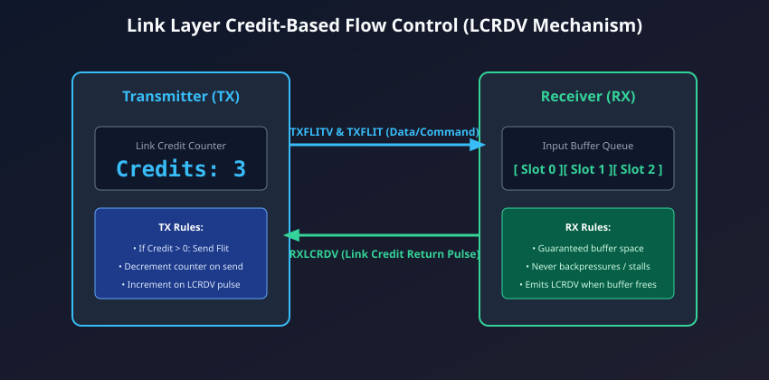
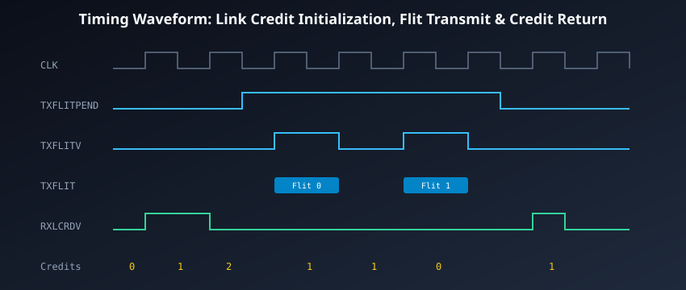

# Credit-Based Flow Control & Link Layer Handshake

## The Flaws of Reactive `VALID`/`READY` Handshaking

In classical bus protocols such as AXI and ACE, every channel uses a two-way reactive handshake:

- The transmitter asserts `VALID` when data is ready.
- The receiver asserts `READY` when it has capacity to accept data.
- The transfer commits on the clock cycle where both `VALID` and `READY` are HIGH.

While intuitive and simple for local, low-speed point-to-point buses, this reactive mechanism suffers from a severe physical flaw at gigahertz clock speeds: **Combinational Feedback Loops**.

```
[Transmitter (TX)]                                [Receiver (RX)]
       |                                                 |
       |--- TX asserts VALID --------------------------->|
       |                                                 |-- RX checks buffer full!
       |<-- RX deasserts READY (Combinational Stall!) ---|
       |                                                 |
(Critical Path: Long wire delay + logic delay violates setup time t_su)
```

If a receiver's internal FIFO fills up, it must immediately deassert `READY`. That deassertion signal must traverse physical interconnect wiring back to the transmitter within the same clock cycle, stalling the transmitter's output registers. As clock frequencies surpass 1.5–2.5 GHz and physical wire lengths stretch across several millimeters of silicon, the round-trip delay of `VALID`-to-`READY` violates timing setup constraints ($t_{su}$), forcing chip designers to insert pipeline registers that throttle bus throughput.

---

## Proactive Credit-Based Flow Control (`LCRDV`)

To eliminate reactive stalls, AMBA 5 CHI replaces `VALID`/`READY` with **Proactive Credit-Based Flow Control**.

In a credit-based regime, the transmitter does not ask permission to send a flit. Instead, the receiver grants **Link Credits** in advance. Each credit represents a guaranteed, pre-allocated storage slot in the receiver's input buffer.



### The Core Invariants of the Credit Protocol:

1. **Transmitter Credit Counter:**
   - The transmitter maintains an internal integer counter tracking available link credits.
   - Upon system reset, the counter initializes to `0`.
2. **Credit Acquisition:**
   - Whenever the receiver has an empty buffer slot, it emits a single-cycle pulse on **`RXLCRDV`** (Receiver Link Credit Valid).
   - Each pulse on `RXLCRDV` increments the transmitter's credit counter by 1.
3. **Flit Transmission (Credit Consumption):**
   - The transmitter is permitted to assert **`TXFLITV`** and drive flit data if and only if its credit counter is strictly greater than zero ($\text{Credits} > 0$).
   - Driving a flit automatically decrements the credit counter by 1.
4. **Guaranteed Buffer Capacity:**
   - Because a flit is only launched when a credit has been pre-allocated, the receiver is **physically incapable of being full**. The receiver _must_ accept the flit unconditionally on that clock cycle. There is zero backpressure!

---

## Link Initialization and Credit Exchange

Before any memory transaction can cross a CHI link, the link must undergo an explicit initialization handshake to exchange buffer credits.

```
Cycle Phase:
 1. Reset Deassertion        : RESETn goes HIGH on rising CLK edge.
 2. Credit Injection (RX)    : RX asserts RXLCRDV for N consecutive cycles.
 3. Counter Initialization   : TX increments credit counter to N (Buffer Depth).
 4. Active Transmission State: Link is fully initialized and operational.
```

### The Initialization Sequence:

1. **Reset Phase:** During active reset (`RESETn = 0`), all link outputs are driven LOW (`TXFLITV = 0`, `TXFLITPEND = 0`, `TXLCRDV = 0`), and the transmitter's credit counter is cleared to `0`.
2. **Credit Granting Phase:** Upon coming out of reset, the receiver inspects its available input FIFO depth (e.g., 4 buffer slots). Over the next 4 clock cycles, the receiver pulses `TXLCRDV` HIGH four times.
3. **Credit Registration:** The transmitter samples each incoming credit pulse and increments its credit counter until it reaches `4`.
4. **Steady-State Operation:** The transmitter can now transmit up to 4 flits consecutively in back-to-back clock cycles without waiting for any acknowledgments.

---

## Flit Pending Signaling (`TXFLITPEND`) and Power Optimization

In battery-powered mobile devices and energy-conscious data centers, idle interconnect links are aggressively power-gated or clock-gated. If the link clock is disabled, how can the transmitter notify the receiver that it has traffic to send?

CHI solves this using the **`TXFLITPEND`** (Transmitter Flit Pending) signal:

```
[Link Power-Down / Clock-Gated State]
 TX has flit to send --> Asserts TXFLITPEND HIGH
 Interconnect Power Controller detects TXFLITPEND --> Enables Link Clock PLL
 Clock stabilizes (e.g. 4-8 cycles later)
 TX asserts TXFLITV and transmits flit payload!
```

- **`TXFLITPEND`** is driven asynchronously or synchronously ahead of the actual flit transmission.
- It indicates: _"I have at least one flit queued and intend to transmit as soon as credits and clocks are ready."_
- This early warning signal allows the receiver's power management logic to un-gate local clocks and wake up input buffer FIFOs before the first data flit arrives, avoiding dropped packets or pipeline stalls.

---

## Detailed Timing Waveform Analysis

The timing diagram below illustrates a complete sequence: link credit acquisition, back-to-back flit transmission, credit exhaustion, and credit restoration via `RXLCRDV`:



### Cycle-by-Cycle Waveform Breakdown:

```
Cycle:          1      2      3      4      5      6      7      8      9
CLK:         __/¯¯\__/¯¯\__/¯¯\__/¯¯\__/¯¯\__/¯¯\__/¯¯\__/¯¯\__/¯¯\__/¯¯\__
RXLCRDV:     _______/¯¯¯¯¯¯\______/¯¯¯¯¯¯\________________________/¯¯¯¯¯¯\__
Credits:        0      1      1      2      1      1      0      0      1

TXFLITPEND:  ______________/¯¯¯¯¯¯¯¯¯¯¯¯¯¯¯¯¯¯¯¯¯¯¯¯¯¯¯¯¯¯\_________________
TXFLITV:     _____________________/¯¯¯¯¯¯\______________/¯¯¯¯¯¯\____________
TXFLIT:      ---------------------< Flit0 >-------------< Flit1 >-----------
```

1. **Cycle 2 & Cycle 4:** The receiver emits two `RXLCRDV` pulses. The transmitter's credit counter increments from `0` to `1` in Cycle 2, and from `1` to `2` in Cycle 4.
2. **Cycle 3:** The transmitter prepares outbound traffic and asserts `TXFLITPEND` HIGH.
3. **Cycle 5 (First Flit Transmitted):** Because $\text{Credits} == 2$, the transmitter asserts `TXFLITV = 1` and drives `Flit 0`. The credit counter automatically decrements from `2` to `1`.
4. **Cycle 6:** No flit is transmitted. The credit counter remains at `1`.
5. **Cycle 7 (Second Flit Transmitted):** The transmitter asserts `TXFLITV = 1` and drives `Flit 1`. The credit counter decrements from `1` to `0`.
6. **Cycle 8 (Credit Exhaustion):** The transmitter has additional data to send, but its credit counter is `0`! It **must deassert `TXFLITV`** and stall transmission.
7. **Cycle 9 (Credit Replenishment):** The receiver processes a flit out of its input FIFO, freeing a buffer slot, and pulses `RXLCRDV` HIGH. The credit counter increments to `1`, allowing the transmitter to resume sending on Cycle 10.

---

## Link Deactivation and Low-Power Disconnect

When an SoC enters deep sleep or when a CPU cluster is dynamically powered down (CPU Hotplug), the CHI link must be cleanly deactivated to ensure that in-flight credits and flits are not corrupted:

1. **Deactivation Request:** The transmitter stops issuing new flits and waits for all outstanding flits to cross the link.
2. **Credit Draining:** The receiver drains all flits from its input FIFOs and emits `TXLCRDV` pulses until the transmitter's credit counter equals the receiver's total buffer capacity.
3. **Link Idle Acknowledgment:** Once all credits are accounted for, the Link Layer controllers enter the **Link Inactive** state. Clocks can now be safely stopped and power rails shut down without data loss.

---

## Chapter Summary

- Classical `VALID`/`READY` handshakes suffer from **combinational feedback paths** that restrict operating frequencies at high core counts.
- AMBA 5 CHI replaces reactive handshaking with **Proactive Credit-Based Flow Control (`LCRDV`)**.
- A transmitter may only drive flits when its internal **Credit Counter > 0**; the receiver is guaranteed to have pre-allocated buffer space.
- **`TXFLITPEND`** provides an early warning mechanism to wake up clock-gated links before data transmission commences.
- Credit exchanges during link initialization and link deactivation ensure safe, lossless transitions between active and low-power states.

---

## Review Questions

1. **How does credit-based flow control eliminate the critical timing path associated with classical AXI `READY` signals?**
   <details>
   <summary>Click to view answer</summary>
   In AXI, `READY` is generated reactively based on instantaneous buffer occupancy, creating a combinational path from receiver buffer state, across the bus, into transmitter control logic within a single cycle. In CHI credit flow control, buffer availability is communicated proactively via `LCRDV` pulses that increment a local counter. Flits are only sent when credits exist, meaning the receiver is guaranteed to accept the flit. Transmission decisions depend purely on the local credit counter, completely severing the combinational cross-link timing loop.
   </details>

2. **What occurs if a CHI transmitter possesses flits ready to send, but its Link Credit Counter is at zero?**
   <details>
   <summary>Click to view answer</summary>
   The transmitter is strictly forbidden from driving `TXFLITV` HIGH. It must hold its flit in its internal output queue and keep `TXFLITV` deasserted until it receives an `RXLCRDV` credit return pulse from the receiver. Driving a flit with zero credits would violate protocol invariants and cause an unrecoverable input buffer overflow at the receiver.
   </details>

3. **What is the functional purpose of `TXFLITPEND`, and why does it assert before `TXFLITV`?**
   <details>
   <summary>Click to view answer</summary>
   `TXFLITPEND` (Transmitter Flit Pending) informs the link receiver and power management logic that the transmitter has traffic queued and will soon transmit. In power-optimized systems where the link clock is dynamically gated or the physical interface is in a low-power sleep state, `TXFLITPEND` triggers clock restoration and FIFO wakeup in advance, ensuring the link is fully powered and active before `TXFLITV` asserts.
   </details>

4. **Why must all credits be returned to the transmitter before a CHI link is allowed to enter a powered-down inactive state?**
   <details>
   <summary>Click to view answer</summary>
   If a link were powered down while credits were still unreturned (meaning flits were still being processed in receiver buffers), the transmitter and receiver would lose synchronization regarding available buffer capacity upon wake-up. Draining all flits and returning all credits ensures that both sides know the exact buffer depth, enabling deterministic and error-free link reactivation.
   </details>

---

##### Copyright (c) 2026 squared-studio
