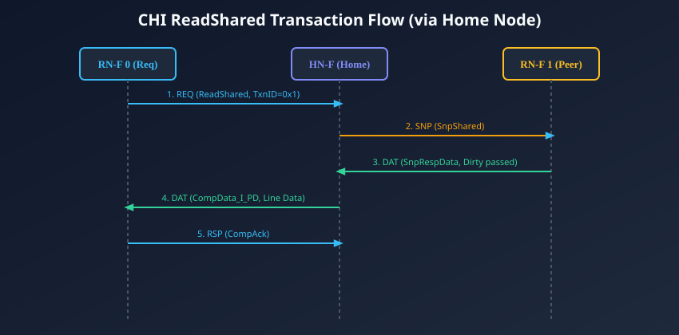
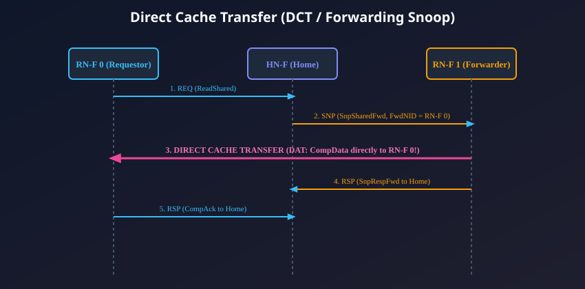

# Coherent Read Transactions and Direct Data Transfer (DDT)

## The Taxonomy of CHI Read Transactions

In an AMBA 5 CHI system, read operations are initiated by an **RN-F** (or **RN-I**) issuing a Request Flit (**`REQ`**) to the target Home Node (**`HN-F`**). Just as in the ACE protocol, the requesting master communicates its caching intentions through the transaction **Opcode**.

The primary coherent read transactions in CHI include:

| Request Opcode           | Requestor Caching Intent                                        |          Permitted Final Master State          |               Peer Invalidation Required?               | Typical Use Case                                            |
| :----------------------- | :-------------------------------------------------------------- | :--------------------------------------------: | :-----------------------------------------------------: | :---------------------------------------------------------- |
| **`ReadShared`**         | Core intends to read and cache line in a read-only state.       | **SC** (Shared Clean) or **UC** (Unique Clean) |              **No** (Peers retain copies)               | General multi-threaded memory loads, data sharing.          |
| **`ReadClean`**          | Core intends to cache line; cannot accept dirty responsibility. |                **SC** or **UC**                | **No** (Peers retain copies; dirty peer cleans to DRAM) | Processors with pure MESI caches lacking Owned state logic. |
| **`ReadNotSharedDirty`** | Core can accept dirty data only if granted exclusive ownership. |    **SC**, **UC**, or **UD** (Unique Dirty)    |                Depends on peer response                 | High-performance CPU memory reads with speculative writes.  |
| **`ReadOnce`**           | Master will read data but **will not allocate** in cache.       |                **I** (Invalid)                 |                **No** (Peers untouched)                 | DMA engines, display controllers, streaming PCIe reads.     |

---

## Standard Coherent Read via Home Node (HN-F)

In a standard read sequence, the Home Node orchestrates the entire operation, acting as the intermediary for all control, snoop, and data traffic.

### Step-by-Step Execution Sequence:

### Phase 1: Request Launch (`REQ`)

1. The requesting core (`RN-F 0`) experiences an L1/L2 cache read miss on physical address `0x5000_0000`.
2. `RN-F 0` hashes the address to locate the responsible Home Node (`HN-F`), allocates a local tracking tag (`TxnID = 0x1`), and launches a `REQ` flit with `Opcode = ReadShared`.

### Phase 2: Serialization and Directory Lookup

1. The `HN-F` receives the `REQ` flit and registers it at its **Point of Serialization (PoS)**.
2. The `HN-F` queries its internal **Snoop Filter (Directory)**. The directory reveals that `RN-F 1` currently holds that address in a valid, modified state.

### Phase 3: Targeted Snoop Dispatch (`SNP`)

1. The `HN-F` generates a Snoop Flit (`SNP`) with `Opcode = SnpShared` and sends it directly to `RN-F 1`.
2. Innocent cores (`RN-F 2`, `RN-F 3`) receive no snoops, preserving their tag bandwidth and dynamic power.

### Phase 4: Peer Snoop Response and Data Return (`DAT`)

1. `RN-F 1` receives the snoop, inspects its cache tags, and demotes its local cache state from **Modified (UD)** to **Shared (SD)** or **Owned**.
2. `RN-F 1` transmits the 64-byte dirty cache line back to the `HN-F` using a Data Flit: `DAT (SnpRespData)`.

### Phase 5: Data Delivery to Requestor (`DAT`)

1. The `HN-F` receives the data flit from `RN-F 1`. (If configured with an SLC, the HN-F updates its internal cache).
2. The `HN-F` forwards the data to `RN-F 0` using a `DAT` flit with `Opcode = CompData_SC` (or `CompData_UD_PD` if dirty ownership is passed).
3. `RN-F 0` receives the data, satisfies the CPU's load instruction, and allocates the line in its private cache.

### Phase 6: Completion Acknowledgment (`CompAck`)

1. Once `RN-F 0` receives all data flits, it emits a Response Flit: **`RSP (CompAck)`** back to the `HN-F`.
2. The `CompAck` informs the `HN-F` that the requestor has safely received and registered the data. The `HN-F` updates its Snoop Filter directory (marking both `RN-F 0` and `RN-F 1` as sharers) and deallocates its tracker entry.

---

## Direct Data Transfer (DDT / Direct Cache Transfer - DCT)

While the standard read sequence is robust, routing 64 bytes of cache line data from `RN-F 1` to `HN-F`, and then _again_ from `HN-F` to `RN-F 0`, incurs two round trips across the NoC fabric. This burns significant interconnect routing bandwidth and adds 15 to 30 clock cycles of latency.

To eliminate this intermediate hop, AMBA 5 CHI introduces **Direct Data Transfer (DDT)**, commonly called **Direct Cache Transfer (DCT)**.

### How Direct Cache Transfer Works:

Instead of sending a normal snoop, the Home Node issues a **Forwarding Snoop Flit**:

- `Opcode = SnpSharedFwd` (or `SnpCleanFwd`, `SnpNotSharedDirtyFwd`).
- **`FwdNID`:** Populated with the NodeID of the original requesting core (`RN-F 0`).
- **`FwdTxnID`:** Populated with `RN-F 0`'s original transaction ID (`TxnID = 0x1`).

### The DCT Protocol Sequence:

1. **Forwarding Instruction:** When `RN-F 1` receives `SnpSharedFwd`, it notices the valid `FwdNID`.
2. **Direct Cache-to-Cache Transfer:** `RN-F 1` extracts the cache line data and transmits the `DAT (CompData)` flit **directly across the mesh to `RN-F 0`**, completely bypassing the Home Node!
3. **Response to Home:** Simultaneously, `RN-F 1` sends an empty Response Flit: `RSP (SnpRespFwd)` back to the `HN-F`, confirming that data forwarding has been executed and reporting its final cache state.
4. **Completion Handshake:** Once `RN-F 0` receives the forwarded data directly from `RN-F 1`, it transmits `RSP (CompAck)` to the `HN-F` using the `HomeNID` embedded in the data header.

### Performance Gains of DCT:

- **Latency Reduction:** Cuts cache-to-cache sharing latency by 30% to 45%.
- **Bandwidth Multiplication:** Eliminates redundant data flit hops through Home Node crossbars, freeing up central NoC routing buffers for other traffic.

---

## Cache State Grants via `CompData` Responses

When an RN-F receives a data response (`CompData`) from the Home Node or via DCT, the `Resp` subfield specifies the exact cache state the master is granted to assume:

| Response Opcode      |  Granted Cache State  | Description                                                                            |
| :------------------- | :-------------------: | :------------------------------------------------------------------------------------- |
| **`CompData_I`**     |    **Invalid (I)**    | Master must read data but **must not cache** it (returned for `ReadOnce`).             |
| **`CompData_SC`**    | **Shared Clean (SC)** | Line is clean and shared with other peer caches. Future writes require invalidation.   |
| **`CompData_SD_PD`** | **Shared Dirty (SD)** | Line is dirty and shared. Master assumes **PassDirty** writeback responsibility!       |
| **`CompData_UC`**    | **Unique Clean (UC)** | Line exists **only** in this local cache. Future stores can upgrade to dirty silently! |
| **`CompData_UD_PD`** | **Unique Dirty (UD)** | Line exists only in this cache and is dirty relative to main memory.                   |

---

## Chapter Summary

- Coherent reads convey caching intent via `REQ` opcodes: **`ReadShared`**, **`ReadClean`**, **`ReadNotSharedDirty`**, and **`ReadOnce`**.
- Standard read flows route data through the Home Node (`HN-F`), concluding with a **`CompAck`** acknowledgment that commits directory updates.
- **Direct Cache Transfer (DCT)** uses forwarding snoops (`SnpSharedFwd`) to stream cache data **directly from peer cache to requestor**, slashing latency and saving NoC bandwidth.
- The `CompData` response explicitly dictates the master's resulting cache state (Unique Clean, Shared Clean, Unique Dirty, or Shared Dirty).

---

## Review Questions

1. **What is the critical performance advantage of Direct Cache Transfer (DCT) over a standard Home-Node-routed read?**
   

   
Click to view answer

   In a standard read flow, cache line data must travel from the peer core to the Home Node, and then from the Home Node to the requesting core—requiring two full traversals of the NoC and double the buffer allocations. In Direct Cache Transfer (DCT), the peer core transmits the data flit directly to the requesting core across the shortest mesh path, cutting latency by 30-45% and halving the data bandwidth consumed across central interconnect routers.
   

2. **Why is the `CompAck` response flit strictly required from the requesting RN-F back to the HN-F at the end of a read transaction?**
   

   
Click to view answer

   `CompAck` is an indispensable architectural handshake. It informs the Home Node that the requesting core has safely received the cache line data and committed it into its local cache. Until `CompAck` arrives, the HN-F cannot deallocate its transaction tracker entry or commit the new sharer bitmask to the Snoop Filter. Releasing the tracker prematurely would permit race conditions if another core attempted to invalidate or read the same line.
   

3. **Under what circumstances does an HN-F grant a requesting core the `Unique Clean (UC)` state instead of `Shared Clean (SC)` upon a `ReadShared` request?**
   

   
Click to view answer

   An HN-F grants `Unique Clean (UC)` via `CompData_UC` if its Snoop Filter / Directory reveals that no other RN-F in the entire system holds a valid copy of that cache line (or if all peer snoops return cache misses). Granting `UC` is a massive optimization: it allows the requesting core to perform future local write operations silently (upgrading from `UC` to `UD`) without issuing a bus invalidation transaction.
   

4. **What does the `PassDirty` attribute signify when encoded in a `CompData_SD_PD` response flit?**
   

   
Click to view answer

   `PassDirty` (`PD`) signifies that the recipient master is being transferred the sole architectural responsibility for eventually writing that dirty cache line back to downstream memory (DRAM) upon eviction. While other cores may hold read-only shared copies (`SC`), the master holding the line with `PassDirty` acts as the designated Owner (equivalent to the `Owned` state in MOESI).
   

---

##### Copyright (c) 2026 squared-studio
