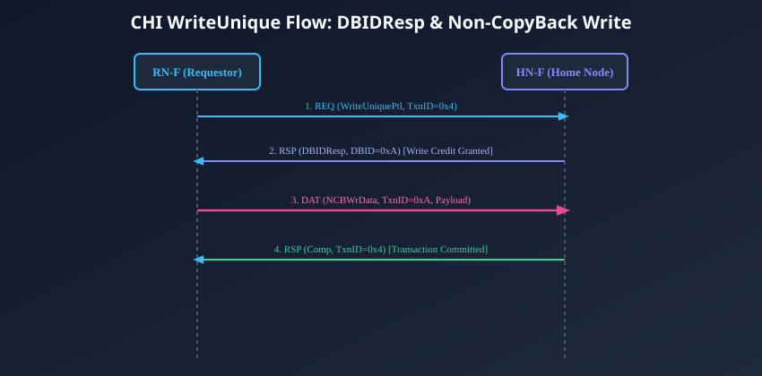
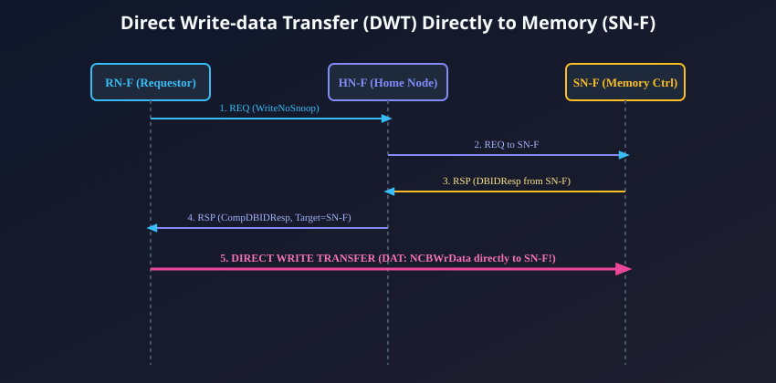

# Coherent Write, Eviction, and Direct Write Transactions

## The Mechanics of Coherent Writes in CHI
Modifying shared memory in a distributed multi-core system requires absolute enforcement of the **Single-Writer Multiple-Readers (SWMR)** invariant. Before any core can write to a cache line, hardware must ensure that all peer caches holding copies are invalidated, and any existing dirty data is either preserved or cleanly overwritten.

In AMBA 5 CHI, write operations are categorized into three distinct operational domains:
1. **Ownership Acquisition (Cache-Allocating Stores):** Transactions like `ReadUnique`, `MakeUnique`, and `CleanUnique` that acquire exclusive write permission for private L1/L2 caches.
2. **Non-CopyBack Writes (Direct Writes):** Transactions like `WriteUniquePtl` and `WriteUniqueFull` that write data out onto the interconnect without allocating the line locally (used by DMA, GPUs, and streaming CPU stores).
3. **CopyBack Evictions:** Transactions like `WriteEvictFull` and `WriteCleanFull` that flush dirty or unique cache lines back to the Home Node or main memory upon replacement.

---

## Ownership Acquisition: `ReadUnique`, `MakeUnique`, `CleanUnique`
When a CPU core executes a store instruction to an address that is not uniquely owned in its local cache, it must acquire write exclusivity:

| Transaction Opcode | Initial Local State | Data Fetched? | Peer Action | Description |
| :--- | :---: | :---: | :---: | :--- |
| **`ReadUnique`** | **I** (Miss) | **Yes** (64B line) | Invalidate all peer copies; dirty peer provides data. | Standard store miss. Line data is fetched into L1, peers invalidated, line becomes **UD** (Unique Dirty). |
| **`MakeUnique`** | **I** or **SC** | **No** (Zero bytes) | Invalidate all peer copies; discard dirty peer data. | Master intends to overwrite the entire 64-byte line (e.g. `memset`). Zero read bandwidth consumed! |
| **`CleanUnique`** | **SC** (Shared Hit) | **No** (Zero bytes) | Invalidate all peer copies. | Core already holds valid data in Shared state. Upgrades line to **UC** / **UD** without re-reading. |

---

## Non-CopyBack (NCB) Writes and the `DBIDResp` Credit Protocol
When an agent writes data out onto the interconnect (e.g., an `RN-I` DMA engine writing an incoming network packet, or a CPU executing non-temporal streaming writes), the master issues a **Non-CopyBack (NCB) Write**.

Unlike read transactions where data flows toward the requestor, write transactions require the requestor to send data. However, **a master cannot simply dump write data onto the NoC without prior coordination!** The receiving Home Node must first allocate an internal write buffer to receive the payload.

This coordination is governed by the **`DBIDResp` (Data Buffer ID Response)** protocol.



### Step-by-Step Execution Sequence:
1. **Step 1 (Write Request):**
   The master (`RN-F`) issues a Request Flit: `REQ (WriteUniquePtl, TxnID = 0x4)`. It does *not* transmit the data yet.
2. **Step 2 (Write Buffer Allocation via `DBIDResp`):**
   The Home Node (`HN-F`) serializes the request, invalidates any peer caches holding the line, allocates an internal write buffer slot (e.g., Buffer Slot `0xA`), and returns a Response Flit:
   - `Opcode = DBIDResp`
   - **`DBID = 0xA`** (Data Buffer Identifier)
   - `TxnID = 0x4` (Matches the master's original transaction ID)
   *This `DBIDResp` serves as an explicit grant of Write Credit!*
3. **Step 3 (Write Data Transmission):**
   Having received write credit, the master transmits the data payload using a Data Flit:
   - `Opcode = NCBWrData`
   - **`TxnID = 0xA`** (The master sets `TxnID` equal to the received `DBID` so the HN-F router can direct the data straight into Buffer Slot `0xA`!)
4. **Step 4 (Completion Handshake):**
   Once the Home Node commits the write data to its internal System Level Cache or downstream memory, it returns a completion response: `RSP (Comp, TxnID = 0x4)`. The master can now retire the write instruction.

---

## Direct Write-data Transfer (DWT)
In enterprise server SoCs, routing write data from an RN-F into the Home Node, and then from the Home Node out to the external memory controller (`SN-F`), creates a severe throughput bottleneck inside the HN-F data buffers.

To achieve maximum write bandwidth, AMBA 5 CHI provides **Direct Write-data Transfer (DWT)**.



### How Direct Write-data Transfer Operates:
1. **Request:** The master issues `REQ (WriteNoSnoop)` or `REQ (WriteUniqueFull)` to the Home Node.
2. **Memory Buffer Reservation:** The `HN-F` serializes the address and sends a request to the target memory controller (`SN-F`), asking the memory controller to allocate an internal write FIFO slot.
3. **SN-F Grants DBID:** The memory controller (`SN-F`) allocates a buffer slot (`DBID = 0x7F`) and informs the `HN-F`.
4. **Combined Response (`CompDBIDResp`):** The `HN-F` transmits a combined response to the master:
   - `Opcode = CompDBIDResp`
   - **`TgtID = SN-F`** (Tells the master to send data to the memory controller, NOT to the Home Node!)
   - **`DBID = 0x7F`**
5. **DIRECT WRITE STREAMING:** The master transmits the write data flits: `DAT (NCBWrData)` **directly across the mesh to the `SN-F`**, completely bypassing the Home Node!

### Architectural Benefits of DWT:
- **Zero HN-F Data Buffer Consumption:** Eliminates 100% of write data buffering from the Home Node.
- **Lower Memory Latency:** Write data takes the shortest physical mesh route directly to the DRAM controller queues.
- **Maximized Bus Utilization:** Frees up Home Node routers to focus entirely on low-latency read orchestration and snoop filtering.

---

## Eviction and CopyBack Transactions
When a master's private L1/L2 cache becomes full, the replacement algorithm must evict an existing cache line (the "victim") to make room for newly fetched data.

```
+--------------------------------------------------------------------------+
|                       CACHE VICTIM DISPOSITION                           |
|                                                                          |
|  Case 1: Victim is Dirty (Modified / UD / SD)                            |
|          --> MUST issue WriteEvictFull (Push dirty data to HN-F/DRAM)     |
|                                                                          |
|  Case 2: Victim is Unique Clean (UC)                                     |
|          --> Issues WriteCleanFull or Evict (Notifies Directory)        |
|                                                                          |
|  Case 3: Victim is Shared Clean (SC)                                     |
|          --> Issues Evict (Deregisters sharer bit in Snoop Filter)       |
+--------------------------------------------------------------------------+
```

### The Eviction Transaction Catalog:
1. **`WriteEvictFull`:**
   - Used when evicting a **dirty** cache line.
   - Master issues `REQ (WriteEvictFull)`, receives a `DBIDResp` from the Home Node, and transfers the 64-byte dirty payload using `DAT (CopyBackWrData)`.
2. **`WriteCleanFull`:**
   - Used when evicting a line held in the **Unique Clean (UC)** state when the master desires to write it back to the System Level Cache (SLC) to prevent a DRAM read if another core needs it later.
3. **`Evict` (Address-Only Eviction):**
   - Transmits **zero data**.
   - Serves as a vital notification to the Home Node's Snoop Filter: *"I have silently dropped address X from my local cache. Please clear my bit in your sharer bitmask."*
   - This prevents the directory from sending future useless snoop broadcasts to this core.

---

## Chapter Summary
- Coherent store allocation relies on **`ReadUnique`** (fetches data + invalidates peers), **`MakeUnique`** (invalidates peers without data fetch), and **`CleanUnique`** (upgrades shared lines).
- Non-CopyBack writes use the **`DBIDResp` write credit protocol** to ensure buffer space is pre-allocated at the receiver before data is launched.
- **Direct Write-data Transfer (DWT)** streams write data **directly to the memory controller (`SN-F`)**, completely bypassing Home Node data buffers.
- Evictions use **`WriteEvictFull`** for dirty lines and address-only **`Evict`** flits to deregister clean lines from the central Snoop Filter.

---

## Review Questions

1. **Why does a CHI master require a `DBIDResp` response flit before it is allowed to transmit write data onto the NoC?**
   <details>
   <summary>Click to view answer</summary>
   Unlike read transactions where data is requested by the master, write transactions push data into the interconnect. If a master launched large 64-byte write data flits without coordination, the receiving Home Node or memory controller might have full input FIFOs, resulting in packet drops or network stalling. The `DBIDResp` allocates a specific, pre-reserved buffer slot (identified by the `DBID`) at the receiver, acting as a write credit and ensuring that write data can be accepted immediately upon arrival.
   </details>

2. **How does `MakeUnique` optimize performance and energy during large memory zeroing operations (such as `bzero` or `memset`)?**
   <details>
   <summary>Click to view answer</summary>
   During a store miss under normal circumstances, a core issues `ReadUnique`, which forces the interconnect to fetch the entire 64-byte cache line from memory, only for the core to overwrite all 64 bytes with zeros a cycle later. `MakeUnique` invalidates all peer caches without fetching any data from memory. This saves 100% of read memory bandwidth and DRAM activation power for the entire buffer allocation.
   </details>

3. **What is the functional mechanism of Direct Write-data Transfer (DWT), and how does it reduce Home Node congestion?**
   <details>
   <summary>Click to view answer</summary>
   In DWT, when a master issues a write request, the Home Node coordinates with the target memory controller (`SN-F`) to allocate a buffer at the memory controller. The Home Node then returns a `CompDBIDResp` containing the `NodeID` of the `SN-F`. The master drives write data directly to the memory controller across the mesh, completely bypassing Home Node data buffers. This eliminates write buffer consumption at the Home Node and cuts write latency.
   </details>

4. **Why is the address-only `Evict` transaction necessary if clean cache lines can theoretically be dropped silently without data loss?**
   <details>
   <summary>Click to view answer</summary>
   While dropping a clean line does not cause data loss, dropping it silently leaves a stale entry in the Home Node's Snoop Filter / Directory, which still believes the core holds a copy. Future memory accesses by other cores to that address would continue to dispatch snoop flits to this core, burning dynamic power and stalling its tag RAM. The `Evict` flit deregisters the core from the directory, eliminating future useless snoops.
   </details>

---

##### Copyright (c) 2026 squared-studio

