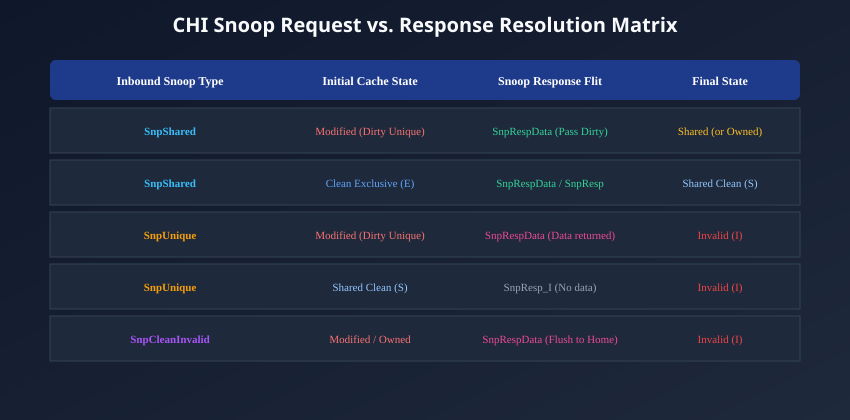
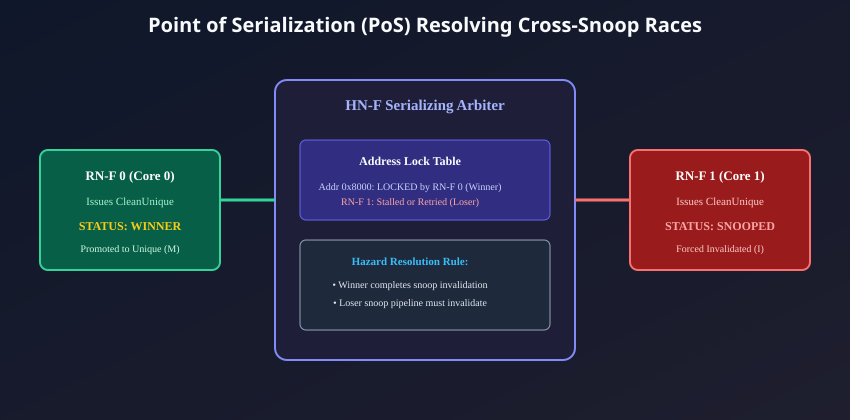

# Snoop Mechanics, Response Tracking, and Cache Coherency

## The Inbound Snoop Pipeline

In an AMBA 5 CHI system, cache coherency is maintained through proactive snooping coordinated by the Home Node (**`HN-F`**). When a core executes a memory transaction requiring cache line status checks or peer invalidations, the Home Node dispatches **Snoop Flits (`SNP`)** across the NoC to the target Request Nodes (**`RN-F`**).

Upon arriving at an RN-F, a snoop flit enters the core's **Inbound Snoop Pipeline**:

```
[NoC Mesh Link] ===> Inbound SNP Flit
                           |
                           v
              +--------------------------+
              |   Inbound Snoop Queue    |  (Must never block; deadlock rule!)
              +------------+-------------+
                           |
                           v
              +--------------------------+
              |   Dual-Ported Tag RAM    |  (Probes L1/L2 tags concurrently)
              +------------+-------------+
                           |
                           +-------------------+
                           |                   |
                           v                   v
              +---------------------+ +----------------------+
              | RSP (SnpResp) Flit  | | DAT (SnpRespData)    |
              | (To Home Node)      | | (To Home or via DCT) |
              +---------------------+ +----------------------+
```

1. **Inbound Snoop Queue:** Snoop flits are queued immediately. To prevent routing deadlocks, an RN-F must **never backpressure or reject a snoop flit** due to internal read/write stalls.
2. **Tag RAM Lookup:** The controller probes its private tag arrays. High-performance cores implement dual-ported tag RAMs or duplicate snoop tag arrays so that external snoops do not interrupt ongoing CPU instruction execution.
3. **Cache Line State Mutation:** The local cache line state is updated (e.g., demoting from `Unique Dirty` to `Shared Dirty`, or invalidating to `Invalid`).
4. **Response Egress:** The core transmits a snoop response flit (**`RSP`**) and, if required, a data flit (**`DAT`**).

---

## The Snoop Request and Response Resolution Matrix

The matrix below catalogs the primary snoop request types dispatched by the Home Node, how they interact with each private cache state, and the resulting response flits:



| Inbound Snoop Opcode  | Initial Cache State | Required Master Action                 | Snoop Response Opcode     |   Final Cache State   |
| :-------------------- | :-----------------: | :------------------------------------- | :------------------------ | :-------------------: |
| **`SnpShared`**       |  **UD** (Modified)  | Supply dirty data; retain copy.        | `DAT (SnpRespData_SD_PD)` | **SD** (Shared Dirty) |
| **`SnpShared`**       | **UC** (Exclusive)  | Retain shared copy.                    | `RSP (SnpResp_SC)`        | **SC** (Shared Clean) |
| **`SnpShared`**       |   **SC** (Shared)   | Retain shared copy.                    | `RSP (SnpResp_SC)`        | **SC** (Shared Clean) |
| **`SnpShared`**       |   **I** (Invalid)   | Snoop Miss.                            | `RSP (SnpResp_I)`         |    **I** (Invalid)    |
| **`SnpUnique`**       |  **UD** (Modified)  | Supply dirty data; **invalidate**.     | `DAT (SnpRespData_I_PD)`  |    **I** (Invalid)    |
| **`SnpUnique`**       | **UC** (Exclusive)  | Invalidate copy; no data needed.       | `RSP (SnpResp_I)`         |    **I** (Invalid)    |
| **`SnpUnique`**       |   **SC** (Shared)   | Invalidate copy; no data needed.       | `RSP (SnpResp_I)`         |    **I** (Invalid)    |
| **`SnpCleanInvalid`** |   **UD** / **SD**   | Flush dirty data to Home; invalidate.  | `DAT (SnpRespData_I_PD)`  |    **I** (Invalid)    |
| **`SnpMakeInvalid`**  |      Any State      | Discard copy immediately without data. | `RSP (SnpResp_I)`         |    **I** (Invalid)    |

---

## Snoop Response Flit Semantics

### Pure Status Responses (`RSP` Flits)

When a snoop hits a clean line or misses entirely, no data payload is returned. The master drives a Response Flit:

- **`SnpResp_I`:** The master holds no valid copy of the line (either a snoop miss or a clean invalidation).
- **`SnpResp_SC`:** The master continues to retain a valid copy in the **Shared Clean (SC)** state.

### Data-Carrying Responses (`DAT` Flits)

When an inbound snoop hits a line containing modified (dirty) data, or when the Home Node requests data forwarding, the master transmits a Data Flit:

- **`SnpRespData`:** Carries the full 64-byte cache line back to the Home Node.
- **`PassDirty` (`PD`):** Embedded inside the response opcode, indicating that dirty writeback responsibility has been transferred out of this core.

### Forwarding Responses (`SnpRespDataFwd`)

During Direct Cache Transfer (DCT), the core transmits the data flit directly to the requesting peer core, and concurrently returns `RSP (SnpRespFwd)` back to the Home Node to report that the forwarding obligation has been discharged.

---

## Multi-Core Response Aggregation at the Home Node

When a transaction requires snooping multiple cores (e.g., a core issuing `ReadUnique` to an address cached across four separate RN-F clusters in the Shared state), the Home Node must **aggregate** all responses before committing the transaction:

```
[HN-F Tracker Slot for Addr 0x9000]
  - Expected Snoop Responses : RN-F 1, RN-F 2, RN-F 3
  - Received Responses:
      Cycle 12: RN-F 1 returns RSP (SnpResp_I)      [OK - 1 of 3]
      Cycle 15: RN-F 2 returns RSP (SnpResp_I)      [OK - 2 of 3]
      Cycle 18: RN-F 3 returns DAT (SnpRespData_PD)  [OK - 3 of 3 - ALL RECEIVED!]
  - Aggregation Complete:
      HN-F forwards Data to Requestor with CompData_UD_PD!
```

### The Invariant Rule of Response Aggregation:

The Home Node **must never return `Comp` or `CompData` granting unique ownership** to a requesting master until **every single dispatched snoop has been acknowledged**. If the Home Node granted write ownership while an in-flight snoop was still traveling across the mesh toward a peer, that peer could read stale data or overwrite memory, causing catastrophic coherency violations.

---

## Resolving Cross-Snoop Races at the Point of Serialization

A notorious race condition occurs when **two CPU cores simultaneously issue write invalidation requests for the exact same cache line**:

```
[Cross-Snoop Race Hazard]
 Core 0: Holds Addr 0x8000 in Shared (SC) --> Issues CleanUnique
 Core 1: Holds Addr 0x8000 in Shared (SC) --> Issues CleanUnique
 Both REQ flits arrive at the NoC simultaneously!
```

If Core 0 waits for Core 1 to invalidate, and Core 1 simultaneously waits for Core 0 to invalidate, a circular dependency deadlock would freeze the interconnect.



### The Point of Serialization (PoS) Resolution Invariant:

1. **Physical Arrival Arbitration:** Whichever `REQ` flit reaches the Home Node's internal Point of Serialization (PoS) first is declared the **Winner** (e.g., `Core 0`).
2. **Winner Granted Exclusivity:**
   - The PoS locks address `0x8000`.
   - The HN-F generates an inbound snoop: `SNP (SnpUnique)` and dispatches it to `Core 1`.
3. **Loser Must Invalidate:**
   - Even though `Core 1` has an outstanding `CleanUnique` request pending at the Home Node, its inbound snoop pipeline **is architecturally required to accept `Core 0`'s snoop**.
   - `Core 1` invalidates its local copy (`SC` $\rightarrow$ `I`) and returns `RSP (SnpResp_I)` to the Home Node.
4. **Loser Transaction Transformation:**
   - The Home Node receives `Core 1`'s snoop response, completing `Core 0`'s invalidation. `Core 0` is granted `Comp` and commits its write.
   - Now, the PoS evaluates `Core 1`'s pending request. Because `Core 1`'s local copy has been invalidated, `Core 1` no longer holds valid data!
   - The Home Node automatically transforms `Core 1`'s pending `CleanUnique` into a full **`ReadUnique`** miss, fetches the newly updated data from `Core 0`, and delivers it to `Core 1`.

This hardware serialization deterministically resolves race conditions without software retries or bus deadlocks.

---

## Chapter Summary

- Inbound snoops query private core tag arrays concurrently without interrupting CPU instruction execution.
- Inbound snoop requests must **never be backpressured** or stalled by local core memory reads/writes.
- The Home Node **aggregates all peer snoop responses** before granting write ownership or retiring tracker entries.
- Cross-snoop race conditions are resolved decisively by the **Point of Serialization (PoS)**, which enforces a strict arrival order and invalidates losing peer copies.

---

## Review Questions

1. **Why is an RN-F strictly prohibited from asserting backpressure or delaying acceptance of an incoming Snoop Flit (`SNP`)?**
   <details>
   <summary>Click to view answer</summary>
   If an RN-F were permitted to delay or block incoming snoop flits because its own local read or write request was stalled waiting for the interconnect, a circular dependency deadlock would occur. For example, Master A's write might wait for Master B to be snooped, while Master B's inbound snoop pipeline stalls waiting for Master B's own read to complete. Requiring every RN-F to accept and process snoop flits unconditionally breaks this circular wait, guaranteeing forward progress across the entire SoC.
   </details>

2. **Under what scenario does an RN-F respond to a snoop request with `SnpResp_SC` instead of `SnpResp_I`?**
   <details>
   <summary>Click to view answer</summary>
   An RN-F responds with `SnpResp_SC` when it receives a `SnpShared` snoop request and currently holds the cache line in a valid, clean state (either `Shared Clean` or `Unique Clean`). Because the snoop request only asks for sharing (`SnpShared`) rather than invalidation, the core is permitted to retain a shared, read-only copy of the line, transitioning its state to (or remaining in) `Shared Clean (SC)`.
   </details>

3. **How does the Point of Serialization (PoS) inside an HN-F handle the situation where two cores issue `CleanUnique` for the exact same address at the same time?**
   <details>
   <summary>Click to view answer</summary>
   The PoS arbitrates between the two requests, granting one core arrival priority (the Winner) and locking the address. The HN-F sends an invalidating snoop (`SnpUnique`) to the losing core. The losing core must process this snoop, invalidate its local cache copy to `Invalid`, and acknowledge the snoop. Once the winner's write completes, the losing core's pending `CleanUnique` is converted by the HN-F into a full `ReadUnique` miss, ensuring strict serial execution.
   </details>

4. **Why must a Home Node wait for all peer snoop responses to arrive before returning a `Comp` response to a core requesting `ReadUnique`?**
   <details>
   <summary>Click to view answer</summary>
   If the Home Node returned `Comp` before all peer snoops were acknowledged, the requesting core would immediately commit store instructions into its local cache. Meanwhile, a slow or distant peer core that had not yet processed its snoop flit might read or write its local, stale copy of the line. Waiting for all peer snoop acknowledgments guarantees that all conflicting copies have been completely eradicated from the system before new modifications are permitted.
   </details>

---

##### Copyright (c) 2026 squared-studio
