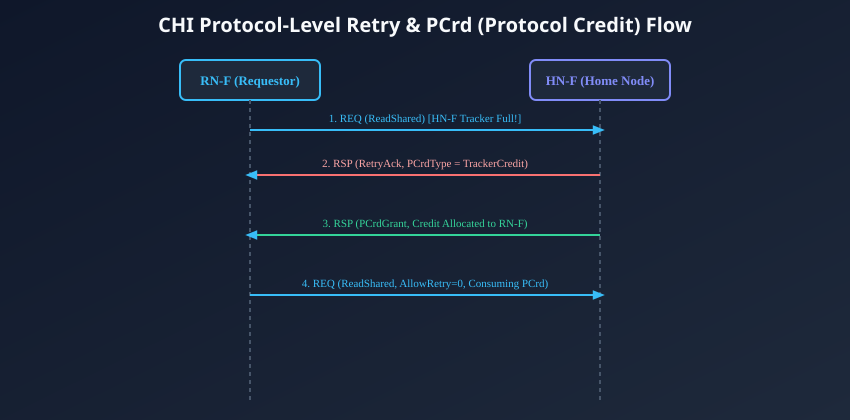
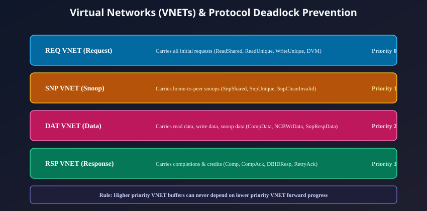

# Retry Mechanisms, Protocol QoS, and Deadlock Avoidance

## Resource Saturation at the Home Node
In an enterprise multi-core SoC under heavy computational workloads, dozens of high-performance CPU cores, GPUs, and DMA engines continuously launch memory requests. While the physical Link Layer uses credit-based flow control to ensure that routers never drop individual flits, the **Protocol Layer** inside the Home Node (**`HN-F`**) faces an entirely different challenge: **Finite Tracker Capacity**.

Inside every HN-F, there is a fixed hardware pool of **Transaction Tracker Entries** (typically 32 to 64 slots per HN-F slice). Each tracker entry holds the state, address, snoop tracking masks, and routing IDs for one active transaction.

What happens when an RN-F sends a `REQ` flit, but the target HN-F has **exhausted all tracker slots**?
- **Option A (Network Backpressure):** Stalling the router queues outside the HN-F. *Disastrous:* Stalled request flits quickly back up through the NoC mesh, blocking adjacent routers and causing gridlock across the entire chip.
- **Option B (Silent Dropping):** Packet dropping is unacceptable in cache-coherent shared memory hardware.
- **The AMBA CHI Solution (Option C):** **Protocol-Level Retry with Protocol Credits (`PCrd`)**.

---

## The Protocol-Level Retry Mechanism
The CHI Retry protocol is an elegant, non-blocking mechanism that offloads transaction waiting queues from the network routers back to the initiating masters.



### The Complete Retry Protocol Lifecycle:

### Step 1: Initial Request with `AllowRetry = 1`
When an RN-F launches a memory request, it sets the bitfield flag **`AllowRetry = 1`** in the `REQ` flit header. This tells the Home Node: *"I am sending this request speculatively. If your tracker resources are currently saturated, you have permission to reject me."*

### Step 2: The `RetryAck` Rejection Handshake
1. The `REQ` arrives at the HN-F. The HN-F checks its internal tracker pool and discovers that all entries are occupied.
2. Because `AllowRetry == 1`, the HN-F **does not stall the link**. Instead, it consumes the flit and immediately returns a Response Flit:
   - `Opcode = RetryAck`
   - `TxnID = Original TxnID`
   - **`PCrdType` (Protocol Credit Type):** Specifies the resource class that was exhausted (e.g., Tracker Credit, Write Buffer Credit).
3. The HN-F registers the master's `SrcID` and `TxnID` in a low-cost, internal **Retry Queue**.
4. The RN-F receives the `RetryAck`. It pauses this transaction, transitions it to the **Waiting for Credit** state, and frees up its outbound link to send other requests.

### Step 3: Credit Allocation via `PCrdGrant`
1. Sometime later, an earlier transaction completes at the HN-F, freeing up a tracker slot.
2. The HN-F inspects its internal Retry Queue, selects the waiting request, and sends a Response Flit:
   - **`Opcode = PCrdGrant`**
   - `TxnID = Original TxnID`
   - `PCrdType = TrackerCredit`
3. The `PCrdGrant` informs the RN-F: *"A dedicated tracker slot has been permanently reserved for you. You may now re-issue your request."*

### Step 4: Re-issuing the Guaranteed Request (`AllowRetry = 0`)
1. The RN-F re-launches the original request flit, but this time sets **`AllowRetry = 0`**!
2. When the HN-F receives a request with `AllowRetry == 0`, it **cannot reject it**. The request immediately claims the pre-reserved tracker entry and proceeds to execution.

---

## Quality of Service (QoS) and Dynamic Throttling
In heterogeneous SoCs, low-priority streaming traffic (e.g., background bulk DMA copies) must not starve latency-sensitive traffic (e.g., CPU L1 instruction misses or operating system interrupt handlers).

AMBA 5 CHI embeds a 4-bit **`QoS[3:0]`** field in every flit header:
- `0x0`: Lowest priority (background maintenance, bulk streaming).
- `0x7`: Normal priority (standard CPU loads and stores).
- `0xF`: Highest priority (real-time video display pipelines, critical CPU exceptions).

### Router Arbitration and Starvation Prevention:
1. **Priority Arbitration:** At every crosspoint router (XP) in the NoC mesh, when multiple flits contend for the same physical egress link, the router arbitrates in favor of the higher `QoS` value.
2. **Dynamic Priority Escalation (Aging):** To prevent low-priority flits from starving indefinitely during periods of high bus congestion, routers implement **aging counters**. If a low-QoS flit remains queued at a router input for longer than a programmed threshold, its effective internal arbitration priority is automatically escalated until it clears the switch.

---

## Virtual Networks (VNETs) & Protocol Deadlock Avoidance
In any packet-switched interconnect where multiple transaction phases share physical wires, a deadly condition called **Protocol Deadlock** can occur.

### The Circular Dependency Nightmare:
Consider what happens if all network buffers become full of Request flits (`REQ`). A Request flit at a Home Node cannot complete until it receives a Snoop Response (`RSP`). However, the Snoop Response cannot travel across the network because all router buffers are completely clogged with pending Request flits! The system enters a fatal circular wait where:
$$\text{Requests wait for Responses} \land \text{Responses wait for Request buffer space}$$

To guarantee mathematical deadlock freedom, AMBA 5 CHI partitions the entire interconnect into **Four Physically or Logically Independent Virtual Networks (VNETs)**.



### The Four CHI Virtual Networks:
1. **`REQ VNET` (Request Virtual Network):**
   - Carries all initial transaction requests: `ReadShared`, `ReadUnique`, `WriteUnique`, `CleanShared`, `DVM Operations`.
2. **`SNP VNET` (Snoop Virtual Network):**
   - Carries inbound snoops dispatched from Home Nodes to Request Nodes: `SnpShared`, `SnpUnique`, `SnpCleanInvalid`.
3. **`DAT VNET` (Data Virtual Network):**
   - Carries all memory data payloads: `CompData`, `NCBWrData`, `CopyBackWrData`, `SnpRespData`.
4. **`RSP VNET` (Response Virtual Network):**
   - Carries transaction completions and tokens: `Comp`, `CompAck`, `DBIDResp`, `RetryAck`, `PCrdGrant`.

---

## The Strict VNET Dependency Hierarchy
Within the NoC routers and endpoint buffers, CHI enforces a strict **unidirectional dependency ordering rule**:

```
[STRICT VNET FORWARD PROGRESS HIERARCHY]

  REQ VNET (Lowest Dependency Priority)
     |
     v  (Can depend on SNP, DAT, RSP)
  SNP VNET
     |
     v  (Can depend on DAT, RSP)
  DAT VNET
     |
     v  (Can depend on RSP)
  RSP VNET (Highest Dependency Priority - SINK OF SYSTEM)
        (CANNOT DEPEND ON ANY OTHER VNET!)
```

### The Invariant Rules:
1. **Independent Buffer Pools:** Every router crosspoint must maintain separate physical FIFO buffers for each VNET (or dedicate non-blocking virtual channels). Even if the `REQ` FIFO is 100% full, the `RSP`, `DAT`, and `SNP` FIFOs remain completely unimpeded!
2. **No Reverse Dependencies:** An entity processing a higher-priority VNET (such as `RSP`) must **never** require forward progress on a lower-priority VNET (such as `REQ`) to accept the flit.
3. **The Response Sink Rule:** `RSP` flits (such as `CompAck` or `Comp`) must always be accepted and absorbed immediately by their target nodes without initiating secondary network requests.

Because dependencies flow strictly in one direction ($REQ \rightarrow SNP \rightarrow DAT \rightarrow RSP$) without any backwards edges, circular dependency cycles cannot exist. The system is provably deadlock-free under all traffic loads.

---

## Chapter Summary
- When Home Node tracker capacity is saturated, the non-blocking **Retry Protocol** returns **`RetryAck`**, preventing network congestion.
- The Home Node reserves a tracker entry and later issues **`PCrdGrant`**, allowing the master to re-issue its request with **`AllowRetry = 0`** for guaranteed acceptance.
- The 4-bit **`QoS`** field enables priority-based arbitration across routers, backed by aging counters to prevent starvation.
- To eliminate protocol deadlocks, the interconnect is segregated into **Four Virtual Networks (REQ, SNP, DAT, RSP)** governed by a strict unidirectional dependency hierarchy.

---

## Review Questions

1. **Why does a Home Node issue a `RetryAck` instead of stalling the incoming `REQ` flit on the physical link when its tracker entries are full?**
   <details>
   <summary>Click to view answer</summary>
   If the Home Node stalled the physical link when its trackers filled up, the backpressure would propagate backward into the crosspoint routers of the NoC mesh. Within a few clock cycles, router FIFOs along that path would fill completely, causing head-of-line blocking that prevents unrelated traffic (including snoops and data responses) from traversing the mesh. By consuming the flit and returning a lightweight `RetryAck`, the physical link stays clear, and the waiting transaction is parked off-network at the master.
   </details>

2. **What is the significance of the `AllowRetry` flag being set to `0` when an RN-F re-issues a transaction after receiving a `PCrdGrant`?**
   <details>
   <summary>Click to view answer</summary>
   `AllowRetry = 0` informs the Home Node that this request is consuming a pre-allocated Protocol Credit (`PCrd`) that was explicitly granted via `PCrdGrant`. The Home Node already has a dedicated tracker slot reserved in silicon for this specific transaction. Therefore, the Home Node is strictly forbidden from returning a `RetryAck`; it must accept and process the transaction immediately.
   </details>

3. **Explain how separating traffic into four independent Virtual Networks (REQ, SNP, DAT, RSP) prevents protocol deadlocks in a CHI system.**
   <details>
   <summary>Click to view answer</summary>
   A protocol deadlock occurs when requests cannot finish because they are waiting for responses, while responses cannot move through the network because all buffers are clogged with requests. By providing physically or logically isolated buffer queues for each of the four Virtual Networks, traffic on the `RSP` and `DAT` networks can always bypass stalled `REQ` traffic. Because dependencies flow strictly downhill ($REQ \rightarrow SNP \rightarrow DAT \rightarrow RSP$), responses can always drain, breaking circular wait conditions.
   </details>

4. **How do crosspoint routers prevent low-QoS streaming traffic from being permanently starved by continuous bursts of high-QoS CPU requests?**
   <details>
   <summary>Click to view answer</summary>
   NoC routers incorporate dynamic priority escalation (aging) mechanisms. When a low-QoS flit is blocked at a router input port, an internal cycle timer increments. If the flit remains blocked longer than a programmed latency threshold, the router dynamically elevates the flit's internal arbitration priority, temporarily allowing it to bypass incoming high-QoS flits and ensuring forward progress without starvation.
   </details>

---

##### Copyright (c) 2026 squared-studio

