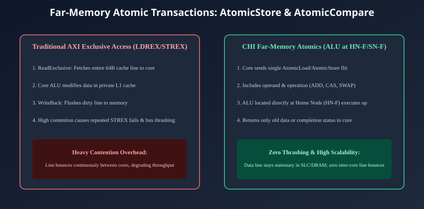
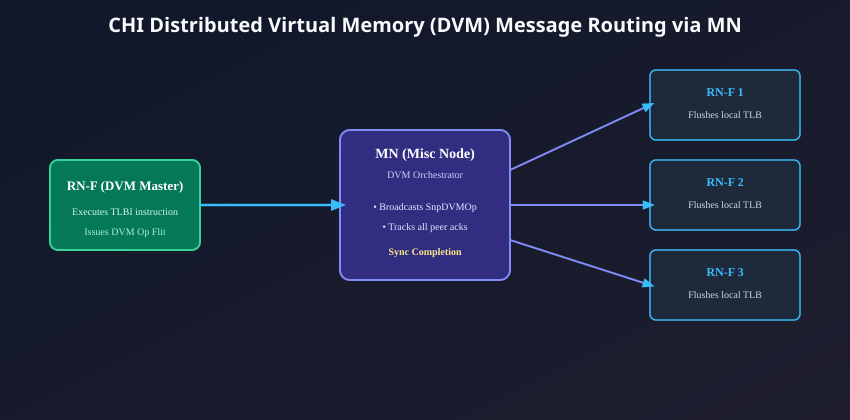

# Barriers, Atomics, and Distributed Virtual Memory (DVM)

## Advanced Synchronization in Enterprise Multi-Core
As multi-core architectures scale to dozens or hundreds of asynchronous processing threads, software algorithms require robust hardware primitives to enforce memory consistency, manage spinlocks, and synchronize virtual memory translations.

In legacy bus protocols, synchronization operations imposed massive interconnect penalties:
- Traditional exclusive memory accesses (e.g., AXI `LDREX`/`STREX`) required bouncing full 64-byte cache lines back and forth between contending cores.
- Software TLB shootdowns required high-overhead Inter-Processor Interrupts (IPIs) that flushed core pipelines.

To deliver peak multi-threaded throughput, AMBA 5 CHI integrates three native architectural facilities:
1. **In-Band Hardware Barriers & Ordering Guarantees**
2. **Far-Memory Atomic Transactions**
3. **Distributed Virtual Memory (DVM) Orchestration**

---

## Memory Ordering and Hardware Barriers in CHI
In AMBA CHI, ordering guarantees can be requested directly inside normal memory request flits, or enforced explicitly through dedicated barrier transactions.

### The `Order[1:0]` Field in Request Flits:
Every `REQ` flit contains a 2-bit **`Order`** field that informs the Home Node of the ordering constraints governing this transaction:

| `Order[1:0]` Value | Ordering Mode | Protocol Semantics |
| :---: | :--- | :--- |
| **`0b00`** | **None** | No ordering constraints. Interconnect and memory can re-order freely to optimize throughput. |
| **`0b01`** | **Request Order** | Guarantees that transactions issued by this master with the same `Order` value are observed at the Home Node in strict program order. |
| **`0b10`** | **Endpoint Order** | Stronger guarantee: Ensures that transactions are committed at the final memory endpoint (SN-F/DRAM) in strict order. |
| **`0b11`** | **Ordered Write Observation** | Guarantees that write transactions are made globally visible to all observers before subsequent reads can proceed. |

### Dedicated Barrier Transactions
When software executes a synchronization barrier instruction (such as an Arm `DMB` or `DSB`), the RN-F issues an explicit Barrier Request Flit:
- **`REQ (BarrierReq)`:** Specifies the barrier domain (Non-shareable, Inner Shareable, Outer Shareable, System).
- The Home Node drains all outstanding transactions issued prior to the barrier, confirms that all peer snoop invalidations have completed, and returns a Response Flit: **`RSP (Comp)`**. The core retires the barrier only after receiving `Comp`.

---

## Near-Memory vs. Far-Memory Atomics
In multi-threaded software, synchronization primitives (mutexes, spinlocks, reference counters, and work queues) rely heavily on atomic read-modify-write operations:
$$\text{Value} \leftarrow \text{Value} + 1 \quad \text{or} \quad \text{Compare-And-Swap}(\text{Old}, \text{New})$$

### The Failure of Near-Memory Atomics (Cache Line Bouncing)
In classical architectures, atomics are executed **Near-Memory** (inside the CPU's local arithmetic logic unit):
1. Core 0 issues `ReadUnique` to fetch the 64-byte lock line into its L1 cache.
2. Core 0 executes the atomic instruction locally in its private ALU.
3. Simultaneously, Core 1 attempts to acquire the lock and issues `ReadUnique`, forcing Core 0 to invalidate its cache and flush the line across the bus to Core 1.
4. Core 1 executes its store, only for Core 2 to immediately snoop the line away.

Under high thread contention, the 64-byte cache line bounces endlessly between core caches (**Cache Line Bouncing / Ping-Ponging**), saturating interconnect bandwidth and collapsing system performance.

---

## CHI Far-Memory Atomics: Moving Computation to the Data
AMBA 5 CHI fundamentally solves this crisis by introducing **Far-Memory Atomic Transactions**. 

Instead of moving the data to the CPU core, **CHI moves the operation to the memory hub!** The CPU transmits a single request flit containing the atomic operand. A dedicated Arithmetic Logic Unit (ALU) located directly inside the Home Node (**`HN-F`**) or external Memory Controller (**`SN-F`**) executes the operation directly in place!

### The Four Classes of CHI Atomic Transactions:

| Atomic Opcode | Return Value? | Operation Performed | Typical Use Case |
| :--- | :---: | :--- | :--- |
| **`AtomicStore`** | **No** (Fire-and-forget) | Computes operation at Home Node; writes result; returns only `Comp`. | Incrementing statistics counters, updating reference counts. |
| **`AtomicLoad`** | **Yes** (Returns original data) | Fetches original value, performs operation, returns original data via `CompData`. | Fetch-and-Add, ticket locks, semaphore acquisition. |
| **`AtomicCompare`** | **Yes** (Compare-and-Swap) | Compares target with `CompareValue`; if equal, writes `SwapValue`; returns original data. | Lock-free data structures, atomic pointer updates (CAS). |
| **`AtomicSwap`** | **Yes** (Unconditional Swap) | Writes new value and returns original data. | Spinlock acquisition (test-and-set). |

### Supported Arithmetic and Logical Operations:
The `AtomicOp` subfield encodes a rich set of hardware operations:
- **`ADD`:** Integer addition (signed or unsigned).
- **`CLR`:** Bitwise Clear (`Data = Data & ~Operand`).
- **`SET`:** Bitwise Set (`Data = Data | Operand`).
- **`EOR`:** Bitwise Exclusive-OR (`Data = Data ^ Operand`).
- **`SMAX` / `SMIN`:** Signed Maximum / Signed Minimum.
- **`UMAX` / `UMIN`:** Unsigned Maximum / Unsigned Minimum.

### Architectural Advantages:
- **Zero Cache Line Bouncing:** The cache line remains stationary inside the HN-F System Level Cache or DRAM; it is never transferred to the requesting cores.
- **Massive Bandwidth Savings:** Replaces multiple 64-byte cache line transfers with a single lightweight 8-byte request flit and a completion token.
- **Superior Contention Scaling:** Throughput scales linearly even when hundreds of threads contend for the exact same lock variable!

---

## Distributed Virtual Memory (DVM) in AMBA CHI
In virtualized, multi-core operating systems, modifying a page table mapping requires invalidating Translation Lookaside Buffers (TLBs) across all participating cores. 

In AMBA 5 CHI, the orchestration of DVM operations is centralized under the **Miscellaneous Node (`MN`)**.

### The DVM Operational Sequence:

### Phase 1: Initiation
1. A processor core (`RN-F 0`) executes a TLB invalidation instruction (e.g., `TLBI`).
2. `RN-F 0` issues a Request Flit: **`REQ (DVMOp)`** addressed to the centralized **Miscellaneous Node (`MN`)**.
3. For operations requiring extensive metadata (e.g., 64-bit virtual address, ASID, and VMID), the DVM command is packaged across two consecutive flits: Part 0 and Part 1.

### Phase 2: Centralized Broadcast
1. The `MN` captures the `DVMOp` flit and decodes its shareability domain and invalidation scope.
2. The `MN` translates the request into a series of inbound Snoop Flits: **`SNP (SnpDVMOp)`**.
3. The `MN` broadcasts `SnpDVMOp` across the NoC to every DVM-capable core (`RN-F 1`, `RN-F 2`, `RN-F 3`, and `RN-D` accelerators).

### Phase 3: Local Invalidation and Acknowledgment
1. Each snooped core receives `SnpDVMOp`, flushes the targeted page translation entry from its local TLB, and returns a Response Flit: **`RSP (SnpResp)`** back to the `MN`.
2. The `MN` tracks incoming acknowledgments in an internal DVM completion scoreboard.

### Phase 4: Synchronization Handshake (`DVMSync`)
1. Once `RN-F 0` has queued all its DVM invalidations, it issues a **`REQ (DVMOp, Opcode = DVMSync)`** to the `MN`.
2. The `MN` verifies that every snooped core has acknowledged all preceding `SnpDVMOp` broadcasts.
3. Once all peer cores are synchronized, the `MN` returns a Response Flit: **`RSP (Comp)`** back to `RN-F 0`.
4. `RN-F 0` retires its software synchronization barrier (`DSB`). The operating system can now safely deallocate the physical memory page with zero risk of stale TLB accesses.

---

## Chapter Summary
- Transaction ordering is controlled at runtime via the 2-bit **`Order`** field in `REQ` headers, complemented by explicit **`BarrierReq`** transactions.
- **Near-Memory atomics** cause severe cache line bouncing and bus saturation under multi-core lock contention.
- **Far-Memory Atomics** (`AtomicStore`, `AtomicLoad`, `AtomicCompare`, `AtomicSwap`) move computation to the data, executing operations directly inside Home Node or Memory Controller ALUs.
- **Distributed Virtual Memory (DVM)** is orchestrated centrally by the **Miscellaneous Node (`MN`)**, broadcasting `SnpDVMOp` flits and guaranteeing synchronized TLB invalidations without software interrupt overhead.

---

## Review Questions

1. **Why does executing atomic operations using Far-Memory Atomics at the Home Node dramatically improve throughput compared to classical `LDREX`/`STREX` mechanisms?**
   

   
Click to view answer

   In classical near-memory atomics (`LDREX`/`STREX`), the contending core must fetch the entire 64-byte cache line into its local L1 cache before modifying it. When multiple cores contend for the same lock or counter, the 64-byte line bounces constantly across the NoC from core to core, causing severe bus thrashing, latency spikes, and frequent store-exclusive failures. Far-Memory Atomics transmit only a small request flit containing the operand to the Home Node. The Home Node's ALU modifies the line in place, eliminating line bouncing, halving network traffic, and guaranteeing deterministic single-cycle execution.
   

2. **What is the functional difference between `AtomicStore` and `AtomicLoad` in AMBA CHI?**
   

   
Click to view answer

   `AtomicStore` is a non-returning (fire-and-forget) operation: the Home Node performs the arithmetic or logical computation on the target memory line and updates it, returning only a simple `Comp` status token without any data. It is ideal for incrementing statistics counters. `AtomicLoad` fetches the original data value, performs the arithmetic operation, and returns the original pre-modification data back to the requesting master via a `CompData` flit. It is essential for ticket locks and fetch-and-add primitives.
   

3. **What central role does the Miscellaneous Node (`MN`) play during Distributed Virtual Memory (DVM) operations?**
   

   
Click to view answer

   The Miscellaneous Node (`MN`) acts as the centralized broadcast orchestrator for DVM operations. When an RN-F needs to invalidate a virtual page translation across the system, it sends a `DVMOp` request to the `MN`. The `MN` translates this into snoop flits (`SnpDVMOp`), broadcasts them to all DVM-capable cores, tracks their snoop acknowledgments in an internal scoreboard, and ensures that a subsequent `DVMSync` only completes when all peer cores have fully committed their local TLB flushes.
   

4. **How does the `Order` field in a CHI Request Flit (`REQ`) allow an interconnect to maximize memory bandwidth while preserving software correctness?**
   

   
Click to view answer

   The `Order` field allows software and compilers to explicitly declare the required consistency constraint on a per-transaction basis. If a transaction has `Order = None` (the default for independent memory reads and writes), the interconnect routers and memory controllers are free to re-order and pipeline the transaction to optimize DRAM bank utilization and latency hiding. If ordering is strictly required (e.g., `RequestOrder` or `EndpointOrder` for lock releases), the interconnect serializes only those designated transactions, preserving program correctness without unnecessarily stalling independent memory traffic.
   

---

##### Copyright (c) 2026 squared-studio

