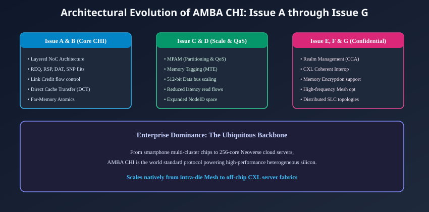
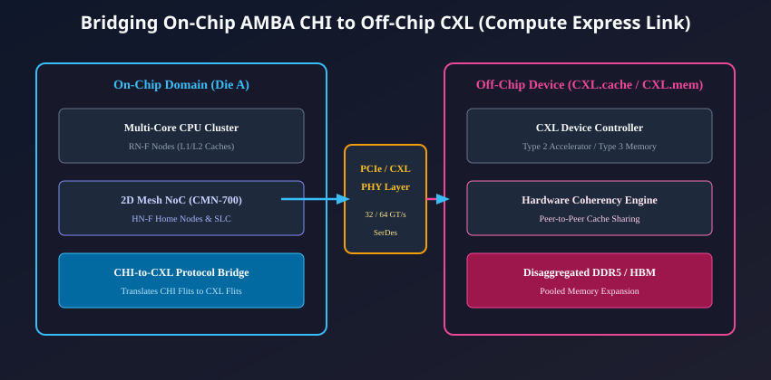

# Advanced CHI Features, Verification, and Future Horizons

## The Continuous Evolution of the AMBA CHI Specification

Since its inception, the AMBA Coherent Hub Interface (CHI) has expanded continuously to meet the demands of enterprise cloud computing, artificial intelligence accelerators, confidential computing, and off-chip memory disaggregation.

Unlike rigid parallel bus standards, the layered, packetized nature of CHI has allowed ARM to release successive protocol iterations (termed **Issues**) while preserving fundamental backward compatibility across protocol, network, and link layers.



---

## Architectural Milestones: Issue A through Issue G

### CHI Issue A & Issue B (The Architectural Foundation)

- Established the 3-layer stack (Protocol, Network, Link).
- Introduced standardized Flit formats (`REQ`, `RSP`, `DAT`, `SNP`) and `LCRDV` credit-based flow control.
- Pioneered **Direct Cache Transfer (DCT)** and **Far-Memory Atomics** (`AtomicStore`, `AtomicLoad`, `AtomicCompare`, `AtomicSwap`).
- Established the fundamental Node taxonomy (RN-F, RN-I, HN-F, HN-I, SN-F, SN-I, MN).

### CHI Issue C & Issue D (Scalability, Security & QoS)

- **Memory System Resource Partitioning and Monitoring (MPAM):**
  - Allows hypervisors and operating systems to partition System Level Cache (SLC) capacity and memory bandwidth among different virtual machines (VMs) to prevent "noisy neighbor" cache thrashing.
- **Memory Tagging Extension (MTE) Support:**
  - Carries hardware security allocation tags across data flits to detect buffer overflows and use-after-free bugs in memory at hardware speed.
- **512-Bit Datapath Scaling:**
  - Expanded data flits from 128/256 bits to native 512-bit wide channels, allowing a full 64-byte cache line to transfer in a **single clock cycle**.

### CHI Issue E, Issue F & Issue G (Confidential Compute & Disaggregation)

- **Arm Confidential Compute Architecture (Arm CCA / Realms):**
  - Introduces hardware isolation mechanisms that protect virtualized workloads and sensitive AI model weights even from root hypervisors.
  - Adds Realm physical address space filtering and cryptographic memory encryption tags.
- **Enhanced Direct Write Transfer (DWT):**
  - Refined direct streaming write-data flows bypassing Home Node buffers directly to CXL/PCIe endpoints.
- **CXL Coherent Interoperability:**
  - Optimizations specifically designed to bridge on-chip CHI packets directly into off-chip Compute Express Link (CXL) protocols.

---

## Bridging On-Chip AMBA CHI to Off-Chip Compute Express Link (CXL)

In modern hyperscale cloud data centers, single-socket servers are giving way to **Composable, Disaggregated Rack Architectures**. A CPU host needs to share a single, massive pool of external DDR5 or HBM3 memory with high-performance GPUs, TPUs, and FPGA accelerators located across physical circuit boards.

To bridge on-chip coherency across external PCIe Gen5/Gen6 SerDes physical layers, the industry established **Compute Express Link (CXL)**. Because both AMBA CHI and CXL are layered, packetized coherency protocols, they map onto one another with extraordinary architectural synergy!



### The CHI-to-CXL Protocol Translation:

Inside the SoC, a dedicated **CHI-to-CXL Bridge** translates transactions at line rate:

1. **`CHI REQ` $\leftrightarrow$ `CXL.mem M2S (Master to Subordinate)`:**
   - A CHI read (`ReadShared` or `ReadOnce`) targeting an external memory address is converted into a `CXL.mem` read request packet routed across PCIe lanes.
2. **`CHI SNP` $\leftrightarrow$ `CXL.cache D2H / H2D`:**
   - When an external CXL Type-2 accelerator caches a host memory line, the SoC's Home Node issues a CHI snoop. The bridge translates this snoop into a `CXL.cache` invalidation packet sent to the accelerator.
3. **`CHI CompData` $\leftrightarrow$ `CXL.mem S2M (Subordinate to Master)`:**
   - Read data returning from pooled DRAM over CXL is repacked into native CHI `DAT (CompData)` flits and routed across the local 2D mesh to the requesting CPU core.

This bridge enables heterogeneous accelerators to participate in a single, hardware-coherent memory address space spanning multiple physical chips and circuit boards.

---

## System-Level Verification Challenges in CHI Designs

Designing and verifying an AMBA 5 CHI interconnect is among the most demanding tasks in modern digital hardware engineering. A subtle bug in coherency tracking, credit counting, or race arbitration can cause silent data corruption or permanent system lockup that only manifests after billions of operating cycles.

Verification teams deploy rigorous, multi-layered verification strategies:

```
+--------------------------------------------------------------------------+
|                      CHI VERIFICATION PYRAMID                            |
|                                                                          |
|  [ Level 1: Link Layer Credit Verification ]                             |
|  - Formal property verification checking zero link credit leakage.       |
|  - Assertions ensuring TXFLITV never asserts when Credit == 0.           |
|                                                                          |
|  [ Level 2: Point of Serialization & Race Arbitration ]                  |
|  - Constrained-random VIPs injecting simultaneous conflicting requests.  |
|  - Verifying loser invalidation and winner commit determinism.           |
|                                                                          |
|  [ Level 3: System-Wide Coherency Assertions (Scoreboarding) ]           |
|  - Scoreboards tracking the Single-Writer Multiple-Readers (SWMR) rule.  |
|  - Validating dirty ownership conservation across all MOESI transitions.  |
+--------------------------------------------------------------------------+
```

### Critical Verification Imperatives:

1. **Link Credit Conservation Assertions:**
   $$\text{Transmitter Credits} + \text{In-Flight Flits} + \text{In-Flight LCRDV Pulses} + \text{Occupied RX Slots} == \text{Total Buffer Capacity}$$
   Formal mathematical assertions verify that this sum remains invariant across every clock cycle, guaranteeing zero credit leakage or phantom credit creation.
2. **Deadlock Freedom Fuzzing:**
   Constrained-random Verification IP (VIP) injects synthetic traffic bursts designed to deliberately fill `REQ`, `SNP`, and `DAT` FIFOs to maximum capacity, verifying that the `RSP` Virtual Network always remains clear to drain pending transactions.
3. **Cache State Fuzzing:**
   Automated fuzzers randomly trigger asynchronous evictions (`Evict`, `WriteEvictFull`), peer reads, and writes to identical memory lines simultaneously, validating that the Home Node's Snoop Filter never corrupts sharer bitmasks.

---

## Course Conclusion: The Global Ubiquity of AMBA CHI

From high-end mobile application processors to the world's most powerful 128-core and 256-core supercomputing processors (such as AWS Graviton, Nvidia Grace, Ampere Altra, and Arm Neoverse), **AMBA 5 CHI is the undisputed world standard for high-performance on-chip communication**.

By replacing physical wire bundles with packetized NoC flits, separating concerns across clean architectural layers, and introducing proactive flow control, Direct Cache Transfers, and Far-Memory Atomics, AMBA CHI has established the architectural foundation that will power heterogeneous computing for decades to come.

---

## Chapter Summary

- AMBA CHI has evolved through successive specification milestones: **Issue A/B** (foundations), **Issue C/D** (MPAM, MTE, 512-bit datapaths), and **Issue E/F/G** (Confidential Compute / Arm CCA, CXL bridging).
- **MPAM** provides memory partitioning to eliminate noisy-neighbor issues, while **MTE** provides hardware memory safety tagging.
- CHI bridges seamlessly to **Compute Express Link (CXL)**, extending on-chip cache coherency across physical PCIe SerDes links to disaggregated memory pools.
- Verifying CHI interconnects requires formal link-credit invariants, deadlock-freedom stress testing, and multi-node coherency scoreboards.

---

## Review Questions

1. **How does Memory System Resource Partitioning and Monitoring (MPAM) in CHI Issue C/D improve virtualization performance in multi-tenant cloud data centers?**
   <details>
   <summary>Click to view answer</summary>
   In multi-tenant cloud servers, multiple virtual machines (VMs) share the same physical System Level Cache (SLC) and memory controllers. Without partitioning, an aggressive or poorly written VM running a memory-heavy workload can evict all other VMs' data from the cache (the "noisy neighbor" problem). MPAM allows hypervisors to assign partition IDs to memory flits, strictly partitioning cache capacity and throttling memory bandwidth allocation per VM to guarantee deterministic quality of service and service-level agreements (SLAs).
   </details>

2. **Why is the architectural mapping between AMBA CHI and Compute Express Link (CXL) considered exceptionally natural and efficient?**
   <details>
   <summary>Click to view answer</summary>
   Both AMBA CHI and CXL are layered, packet-based protocols designed around transaction opcodes, request/response tracking, and discrete data flits. CHI Request flits map directly onto CXL.mem memory requests, CHI Snoop flits map directly onto CXL.cache invalidations, and data flits translate with minimal serialization overhead. This allows low-latency, silicon-efficient hardware bridges that extend cache coherency seamlessly from on-chip 2D meshes to off-chip pooled DRAM and GPU accelerators.
   </details>

3. **What fundamental mathematical property must hold true at all times to verify that a CHI link layer implementation has zero credit leakage?**
   <details>
   <summary>Click to view answer</summary>
   The total credit conservation invariant must be maintained across all clock cycles: the sum of the transmitter's available credit counter, plus all in-flight flits traveling across the link, plus all in-flight `LCRDV` credit return pulses, plus the number of flits currently stored in the receiver's input buffer must exactly equal the receiver's total buffer depth. Any deviation indicates a credit leak (causing eventual link stall) or credit duplication (causing FIFO overflow).
   </details>

4. **How does Arm Confidential Compute Architecture (Arm CCA / Realms) in CHI Issue E/F protect secure workloads from untrusted hypervisors?**
   <details>
   <summary>Click to view answer</summary>
   Arm CCA introduces a hardware-enforced "Realm" security state that extends beyond traditional TrustZone. CHI Issue E/F augments request and snoop flits with Realm physical address space attributes and cryptographic memory tags. Even if a host operating system or root hypervisor attempts to read or modify a Realm memory line, the interconnect's hardware firewalls and encryption engines block or scramble the access, protecting sensitive code and data in hardware.
   </details>

---

##### Copyright (c) 2026 squared-studio
