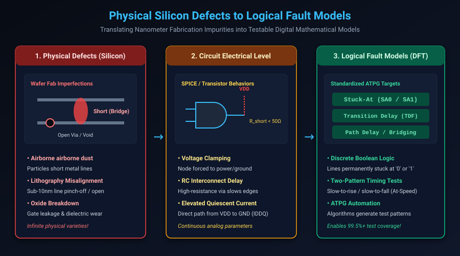

# Foundations of Manufacturing Test & Fault Modeling

## Introduction: The Reality of Silicon Defects

In electronic system design, digital logic exists in two distinct worlds: the ideal, simulated mathematical realm of Verilog Register-Transfer Level (RTL) code, and the harsh physical reality of silicon semiconductor manufacturing.

A 3nm or 5nm System-on-Chip (SoC) contains over 20 billion transistors interconnected by more than 15 layers of copper wiring, with metal trace widths measuring less than 20 nanometers. In fabrication foundries (such as TSMC, Samsung, or Intel), nanometer-scale airborne dust particles, chemical-mechanical planarization (CMP) irregularities, crystal lattice dislocations, and extreme ultraviolet (EUV) lithography optical aberrations inevitably cause physical defects.

Without dedicated **Design for Testability (DFT)** circuitry built into the silicon, detecting which manufactured chips work and which contain microscopic flaws is virtually impossible.

This chapter covers:
1. **Design Verification vs. Silicon Manufacturing Test**.
2. **The Economics of Test & The Rule of Tens**.
3. **Physical Defects to Logical Fault Model Abstraction**.
4. **Classical Fault Models: Stuck-At, Transition Delay, Path Delay, and $I_{DDQ}$**.
5. **Controllability, Observability & SCOAP Testability Metrics**.
6. **Hands-On Exercises & Review Questions**.

---

## Design Verification vs. Manufacturing Test

Engineers frequently confuse **Verification** with **Test**:

| Dimension | Design Verification | Manufacturing Test (DFT) |
| :--- | :--- | :--- |
| **Question Answered** | *"Did we design the right circuit according to specification?"* | *"Was this specific physical piece of silicon fabricated without defects?"* |
| **Object Tested** | Verilog/VHDL simulation models, netlists, software emulators | Physical fabricated silicon dies and packaged microchips |
| **Defect Source** | Human designer logic bugs, specification errors, timing misses | Dust particles, metal bridges, open vias, oxide pinholes |
| **Execution Tool** | EDA software simulators (VCS, Xcelium, Questa), formal tools | Automated Test Equipment (ATE) testers on factory floors (Advantest, Teradyne) |
| **Frequency** | Run during engineering design phase before tape-out | Executed on **100% of manufactured chips** post-fabrication |
| **Test Duration** | Hours to weeks of simulation regression runs | **0.5 to 5.0 seconds per chip** on ATE tester |

### The Economics of Test: The Rule of Tens
The cost of catching a defective chip escalates by an order of magnitude at every subsequent stage of product integration:
- **Wafer Sort (Die level)**: \$0.10 to detect and discard a bad die.
- **Packaged Chip Test**: \$1.00 to discard a packaged IC (packaging cost wasted).
- **Printed Circuit Board (PCB)**: \$10.00 to troubleshoot and unsolder a board.
- **System Integration**: \$100.00 to debug an assembled automotive/datacenter rack.
- **Escaped to Field**: \$1,000.00+ in warranty claims, product recalls, brand damage, or catastrophic safety failures.

The objective of DFT is achieving defect levels below **1 DPM (Defect Per Million)** at the earliest possible stage.

---

## Translating Physical Defects to Logical Fault Models

Testing every possible physical failure mechanism (millions of potential shorts, opens, and leakage paths) directly at the transistor level is computationally intractable:

Instead, DFT relies on **Fault Models**—mathematical abstractions that model the logical behavior of physical defects at circuit interconnects and gates.

---

## Classical Digital Fault Models

### 1. Single Stuck-At Fault Model (SSA)
The foundational fault model introduced by Eldred in 1959. It assumes that a defect causes an interconnection wire to be permanently tied to logic 0 or logic 1:
- **Stuck-At-0 (SA0)**: Net permanently behaves as Boolean 0 regardless of driving logic.
- **Stuck-At-1 (SA1)**: Net permanently behaves as Boolean 1.

In a circuit with $N$ structural nets, there are exactly $2N$ possible single stuck-at faults.

#### Fault Equivalence & Fault Collapsing
Many faults produce identical circuit behavior under all possible input vectors. For example, on a 2-input AND gate ($Y = A \cdot B$):
- Input $A$ stuck-at-0 causes $Y = 0$.
- Input $B$ stuck-at-0 causes $Y = 0$.
- Output $Y$ stuck-at-0 causes $Y = 0$.

All three faults are **equivalent**. DFT software collapses these 3 faults into a single representative fault, reducing total ATPG test generation time by over 50%.

### 2. Transition Delay Fault Model (TDF / At-Speed Test)
As process nodes shrank below 65nm, resistive vias and marginal transistors caused timing delays without completely preventing logic transitions.
- **Slow-to-Rise (STR)**: A 0-to-1 transition fails to arrive within the rated clock period.
- **Slow-to-Fall (STF)**: A 1-to-0 transition fails to arrive within the rated clock period.

#### Two-Pattern Testing Requirement:
Detecting a delay fault requires a pair of vectors $\langle V_1, V_2 \rangle$:
1. **$V_1$ (Initialization Vector)**: Sets the target node to its initial value (e.g. 0 for Slow-to-Rise).
2. **$V_2$ (Launch & Capture Vector)**: Applied at the chip's rated functional clock frequency (e.g. 2 GHz). Launches the 0-to-1 transition and captures the result in a receiving flip-flop.

### 3. Path Delay Fault Model (PDF)
Unlike TDF (which models lumped delay at a single pin), Path Delay testing measures the cumulative propagation delay along an entire critical path from input register to output register.

### 4. Quiescent Current Testing ($I_{DDQ}$)
In CMOS technology, steady-state leakage current is minimal. A physical short between VDD and GND causes massive quiescent current draw ($I_{DDQ}$) when inputs are held static. ATE testers monitor supply current to catch bridging defects that escape logic voltage testing.

---

## Controllability, Observability & SCOAP Metrics

In 1980, L.H. Goldstein at Sandia National Laboratories formulated **SCOAP (Sandia Controllability/Observability Analysis Program)** to mathematically quantify test difficulty:

### 1. Controllability
The difficulty of setting an internal node to a specific logic state from the primary chip inputs (PI):
- **$CC0(N)$**: Combinational Controllability to 0 (minimum number of primary input assignments required to force node $N$ to 0).
- **$CC1(N)$**: Combinational Controllability to 1 (minimum number of primary input assignments required to force node $N$ to 1).

### 2. Observability
- **$CO(N)$**: Combinational Observability (difficulty of propagating a logic change at node $N$ to a primary chip output pin, PO).

### SCOAP Calculation Example: 2-Input AND Gate ($Y = A \cdot B$)
- To force $Y = 1$, both inputs must be 1:
  $$CC1(Y) = CC1(A) + CC1(B) + 1$$
- To force $Y = 0$, setting either input to 0 suffices:
  $$CC0(Y) = \min(CC0(A), CC0(B)) + 1$$
- To observe input $A$ at output $Y$, input $B$ must be held at non-controlling value 1:
  $$CO(A) = CO(Y) + CC1(B) + 1$$

### The Sequential Test Problem
In purely combinational logic, SCOAP values remain small. However, in sequential circuits with hundreds of feedback flip-flops, $SC$ and $SO$ grow exponentially ($O(2^N)$). Setting a state deep inside an FSM may require thousands of clock cycles.

This observation led directly to the greatest breakthrough in test engineering: **Scan Design** (Chapter 2).

---

## Hands-On Exercise

### The Problem
You are analyzing a 2-to-1 Multiplexer with inputs $A, B$, select line $S$, and output $Y$:
$$Y = (A \cdot \overline{S}) + (B \cdot S)$$

1. Enumerate the total possible single stuck-at faults in the gate-level implementation.
2. Determine the minimal test vector $\langle A, B, S \rangle$ required to detect the fault: **Input $A$ Stuck-At-0 ($A / SA0$)**.
3. Calculate the fault coverage of the single test vector $\langle A=1, B=0, S=0 \rangle$.

### The Solution

#### 1. Total Fault Count:
The gate-level circuit contains 6 nodes (A, B, S, S_bar, Term1, Term2, Y).
Each node can be SA0 or SA1 $\implies 6 \times 2 = 12$ uncollapsed faults.
After equivalence collapsing, 8 structural faults remain.

#### 2. Vector to Detect $A / SA0$:
- **Fault Activation**: To test for SA0 on $A$, we must drive $A = 1$ (if fault is present, node stays 0; if fault-free, node is 1).
- **Fault Propagation**: We must propagate $A$'s value to output $Y$:
  - Set $S = 0$ (so $\overline{S} = 1$, enabling the $A \cdot \overline{S}$ term).
  - The second term $(B \cdot S)$ evaluates to 0 because $S = 0$.
  - Therefore $B$ is a "Don't Care" ($X$), though conventionally tied to 0.
- **Resulting Test Pattern**: $\mathbf{\langle A=1, B=0, S=0 \rangle}$.
  - Fault-Free Output: $Y = 1$.
  - Faulty Output ($A/SA0$): $Y = 0$.
  - The ATE tester observes the mismatch and flags the die as defective!

---

## Review Questions & Self-Assessment

1. **What is the difference between Design Verification and Manufacturing Test?**
   *Answer:* Design Verification proves that the logic design conforms to specification before manufacturing. Manufacturing Test screens physical fabricated chips post-production to detect microscopic silicon defects introduced during semiconductor processing.
2. **Explain the "Rule of Tens" in test economics.**
   *Answer:* The financial cost of catching a defective semiconductor component increases by approximately 10x at each subsequent stage of packaging and assembly: \$0.10 at wafer sort, \$1.00 at packaged chip test, \$10.00 at PCB assembly, \$100.00 at system integration, and over \$1,000.00 if it fails in customer equipment.
3. **Why is the Single Stuck-At Fault model still widely used despite modern physical defects being complex 3D bridging and open voids?**
   *Answer:* Even though real physical defects are analog and complex, test patterns generated targeting 100% stuck-at fault coverage inadvertently activate and propagate over 95% of real physical defects through combinational excitation, while keeping computational test generation tractable.
4. **What is the difference between Controllability and Observability in SCOAP?**
   *Answer:* Controllability measures the ease of driving an internal circuit node to a desired logic state (0 or 1) using primary inputs. Observability measures the ease of propagating the state of an internal node to a primary output pin where it can be monitored.

---

##### Copyright (c) 2026 squared-studio
