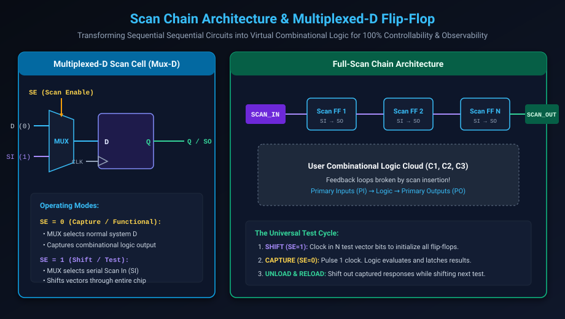

# Scan Design & Scan Insertion Architecture

## Introduction: The Sequential Test Bottleneck

In pure combinational circuits, Automatic Test Pattern Generation (ATPG) is straightforward: an algorithm assigns inputs to activate a fault and observes the output. 

However, synchronous digital circuits are **sequential**: they contain thousands or millions of flip-flops forming complex state-feedback loops. In a sequential circuit:
- To set a flip-flop deep inside a state machine to a specific state, an algorithm must calculate a complex sequence of hundreds of input vectors over dozens of clock cycles.
- To observe the output of a flip-flop, the state must be propagated through multiple sequential stages to reach a primary output pin.

Sequential ATPG is mathematically proven to be **NP-complete**. For an SoC with millions of flip-flops, sequential test generation without DFT would require centuries of compute time and still achieve less than 60% fault coverage.

**Scan Design** eliminates the sequential test problem entirely by converting all internal flip-flops into a giant serial shift register during test mode—transforming a complex sequential circuit into **virtual combinational logic**.

This chapter covers:
1. **The Fundamental Scan Principle**.
2. **Scan Cell Architectures: Mux-D, Clocked-Scan, and LSSD**.
3. **Full-Scan vs. Partial-Scan Design**.
4. **Shift Mode (`SE=1`) vs. Capture Mode (`SE=0`) Walkthrough**.
5. **Critical Scan Design Rules (Scan DRCs) & Violations**.
6. **Clock Domain Crossing & Lockup Latch Architecture**.
7. **Hands-On Exercises & Review Questions**.

---

## The Scan Architecture & Multiplexed-D Flip-Flop

The universal standard in modern ASIC design is the **Multiplexed-D (Mux-D) Scan Flip-Flop**:



### 1. Internal Scan Cell Anatomy
A Mux-D scan cell places a 2-to-1 multiplexer directly in front of the data input ($D$) of a standard D flip-flop:
- **Port `D` (Functional Data)**: Connected to the upstream combinational user logic.
- **Port `SI` (Scan In)**: Connected to the `SO` (Scan Out) of the preceding flip-flop in the scan chain.
- **Port `SE` (Scan Enable)**: Global test mode control signal.
- **Port `CLK`**: System clock.
- **Port `Q` / `SO`**: Feeds both downstream functional logic and the next scan flip-flop's `SI`.

### 2. Physical Design Trade-Offs
- **Area Overhead**: The 2:1 MUX increases flip-flop area by approximately 10%–15%. At the chip level, total die area increases by **2% to 4%**.
- **Timing Overhead**: Inserting the multiplexer adds one MUX delay (~20–40 picoseconds) into the functional setup-time path of pin $D$. High-frequency processor paths must budget for this delay during synthesis.

---

## Scan Cell Architectures

While Mux-D dominates modern commercial ASIC libraries, alternative scan cell architectures exist for specialized applications:

| Architecture | Mechanism | Advantages | Disadvantages |
| :--- | :--- | :--- | :--- |
| **Mux-D Scan** | 2:1 MUX on data input, single clock | Standard single-clock design; universal tool support (Synopsys, Cadence, Siemens) | Adds MUX delay to functional timing path |
| **Clocked-Scan** | Dual independent clocks ($CLK_F$ for functional, $CLK_S$ for shift) | Zero timing delay added to functional data path $D$ | Requires routing two full clock trees across the die |
| **LSSD (Level-Sensitive Scan Design)** | Dual non-overlapping latch pairs ($L_1, L_2$) driven by Clocks $A, B$ | Completely race-free; immune to clock skew | IBM proprietary heritage; complex multi-phase latch routing |

---

## The Universal Two-Phase Scan Test Cycle

Testing an ASIC with a scan chain operates across repeating cycles of **Shift** and **Capture**:

```text
================================================================================
                         THE SCAN TEST SEQUENCE
================================================================================
  [Phase 1: SHIFT (SE = 1)]
   --> Apply N clock pulses to TCK.
   --> Serially loads new stimulus vector into all scan flip-flops (Scan-In).
   --> Simultaneously unloads previous test response bits (Scan-Out).

  [Phase 2: CAPTURE (SE = 0)]
   --> Switch SE to 0 (Functional Mode).
   --> Internal flip-flops now sample combinational cloud outputs (D).
   --> Apply 1 system clock pulse (At-Speed functional frequency).
   --> New response is captured into the flip-flops.

  [Repeat]
   --> Switch SE to 1 and repeat Shift to unload response while loading next test.
================================================================================
```

Through this mechanism, **100% Controllability** (we can load any state into any flip-flop) and **100% Observability** (we can read out the state of every flip-flop) are achieved!

---

## Critical Scan Design Rules (Scan DRCs)

Before an ATPG tool can generate patterns, the gate-level netlist must pass strict **Design Rule Checks (DRC)**. Violating these rules prevents the scan chains from shifting properly:

### Rule 1: Clock Controllability During Shift
All clock pins of all scan flip-flops must be directly controllable from the chip's primary input pins during test mode:
- **Violation**: An internal clock generated by a PLL, counter divider, or gated-clock cell.
- **Fix**: Insert a **Test Clock MUX** that bypasses internal clock generators, forcing external ATE clock control during scan shift:
  ```verilog
  assign scan_clk = (test_mode) ? ate_clk : functional_pll_clk;
  ```

### Rule 2: Asynchronous Set/Reset Controllability
Asynchronous set or reset pins on flip-flops must NOT fire during scan shifting:
- **Violation**: An asynchronous reset tied to an internal power-on reset (POR) or logic gate that toggles mid-shift flushes the scan chain to zero.
- **Fix**: Gate asynchronous reset lines with `test_mode` so they remain strictly deactivated during scan shift.

### Rule 3: Tristate Bus Contention
Internal on-chip tristate buses can suffer from electrical contention (two drivers fighting, causing short-circuit currents and melting the die) when random bits are shifted through driver enable flip-flops:
- **Fix**: Force all bus enables to safe, non-conflicting pull-up/pull-down states during `SE=1`.

---

## Clock Domain Crossing & The Lockup Latch

In multi-clock SoCs, a single scan chain frequently traverses flip-flops belonging to different clock domains (e.g. Domain A running at 800 MHz and Domain B running at 400 MHz), or clock domains with significant physical clock skew across the die.

### The Race Condition Problem
When shifting data from Flip-Flop $A$ to Flip-Flop $B$:
- If the clock edge arrives at Flip-Flop $B$ slightly later than Flip-Flop $A$ (clock skew $\Delta t > t_{cq}$), Flip-Flop $B$ will sample the *new* data launched by $A$ on the current cycle instead of the *old* data!
- The scan chain suffers a **Hold Time Violation**, corrupting the shift sequence.

### The Solution: The Lockup Latch
A **Lockup Latch** is an active-low, negative-edge triggered transparent latch inserted at the boundary between clock domains:

```text
[FF A (Domain 1)]            [Lockup Latch]            [FF B (Domain 2)]
  Posedge CLK_A               Negedge CLK_A              Posedge CLK_B
+---------------+            +--------------+            +---------------+
| Q ------------+----------> | D          Q +----------> | SI          Q |
| CLK_A (posedge)            | CLK_A (neg)  |            | CLK_B (posedge)
+---------------+            +--------------+            +---------------+
```

### How the Lockup Latch Operates:
1. On the positive edge of `CLK_A`, Flip-Flop $A$ launches new data.
2. Because the Lockup Latch is transparent only when `CLK_A` is **low**, it remains closed (opaque) during the positive half-cycle, holding the *previous* data stable for Flip-Flop $B$.
3. Half a clock period later, when `CLK_A` drops to 0, the Lockup Latch opens and captures the new data.
4. By delaying the data handoff by a **half-clock period**, the hold-time margin is increased by nanoseconds, completely eliminating hold violations caused by inter-domain clock skew!

---

## Hands-On Exercise

### The Problem
You are given a 3-bit binary counter in Verilog:
```verilog
module counter_3bit (
    input  wire       clk,
    input  wire       rst_n,
    input  wire       en,
    output reg  [2:0] count
);
    always @(posedge clk or negedge rst_n) begin
        if (!rst_n)
            count <= 3'b000;
        else if (en)
            count <= count + 1'b1;
    end
endmodule
```
1. Perform manual scan insertion: replace standard flip-flops with Mux-D scan flip-flops.
2. Stitch the 3 scan cells into a single scan chain with ports `scan_in`, `scan_out`, and `scan_en`.
3. Provide the SystemVerilog behavioral testbench showing how to shift the pattern `3'b101` into the counter.

### The Solution

#### 1 & 2. Scan-Inserted Verilog Implementation:

```verilog
module counter_3bit_scan (
    input  wire       clk,
    input  wire       rst_n,
    input  wire       en,
    output wire [2:0] count,

    // Dedicated Scan Ports
    input  wire       scan_in,
    input  wire       scan_en,
    output wire       scan_out
);

    wire [2:0] next_count;
    wire [2:0] d_muxed;
    reg  [2:0] q_reg;

    // Combinational next-state logic
    assign next_count = en ? (q_reg + 1'b1) : q_reg;

    // MUX-D Scan Insertion Logic:
    // When scan_en == 1, input is chained from scan_in -> FF0 -> FF1 -> FF2
    assign d_muxed[0] = scan_en ? scan_in   : next_count[0];
    assign d_muxed[1] = scan_en ? q_reg[0]  : next_count[1];
    assign d_muxed[2] = scan_en ? q_reg[1]  : next_count[2];

    always @(posedge clk or negedge rst_n) begin
        if (!rst_n)
            q_reg <= 3'b000;
        else
            q_reg <= d_muxed;
    end

    assign count    = q_reg;
    assign scan_out = q_reg[2]; // Scan Out taken from last cell

endmodule
```

#### 3. Shift Waveform Sequence:
```systemverilog
// Testbench shifting 3'b101 into counter:
initial begin
    rst_n = 0; scan_en = 0; scan_in = 0; #20;
    rst_n = 1; #10;

    // Enter Shift Mode:
    scan_en = 1;
    
    // Cycle 1: Shift bit 1 (MSB of desired state)
    scan_in = 1; @(posedge clk);
    
    // Cycle 2: Shift bit 0
    scan_in = 0; @(posedge clk);
    
    // Cycle 3: Shift bit 1 (LSB of desired state)
    scan_in = 1; @(posedge clk);

    // State of q_reg is now exactly 3'b101!
    scan_en = 0; // Return to functional capture mode
end
```

---

## Review Questions & Self-Assessment

1. **Why is sequential ATPG considered computationally intractable, and how does scan design resolve it?**
   *Answer:* Sequential ATPG must calculate multi-cycle paths through feedback loops to set and observe states, which is NP-complete ($O(2^N)$). Scan design connects all flip-flops into a serial shift register, allowing direct reading and writing of internal states. This converts sequential testing into simple, highly scalable combinational ATPG.
2. **What are the two physical penalties of adopting Mux-D scan design?**
   *Answer:* (1) Die area overhead: 2:1 multiplexers increase flip-flop size by 10–15% (2–4% chip-level). (2) Timing penalty: The MUX introduces a propagation delay directly into the functional data path, increasing setup time.
3. **What is a Lockup Latch, and where must it be inserted in a scan chain?**
   *Answer:* A lockup latch is an active-low transparent latch inserted at the physical boundary where a scan chain transitions between different clock domains or cross-chip skew boundaries. It delays the data handoff by a half-clock period, preventing hold-time race violations during scan shift.
4. **What happens during the Capture phase (`SE = 0`) of a scan test?**
   *Answer:* The multiplexers select the normal functional data inputs ($D$). A single clock pulse is applied, allowing the combinational logic to evaluate the stimulus loaded into the scan flip-flops and capturing the resulting responses into the receiving scan cells.

---

##### Copyright (c) 2026 squared-studio
