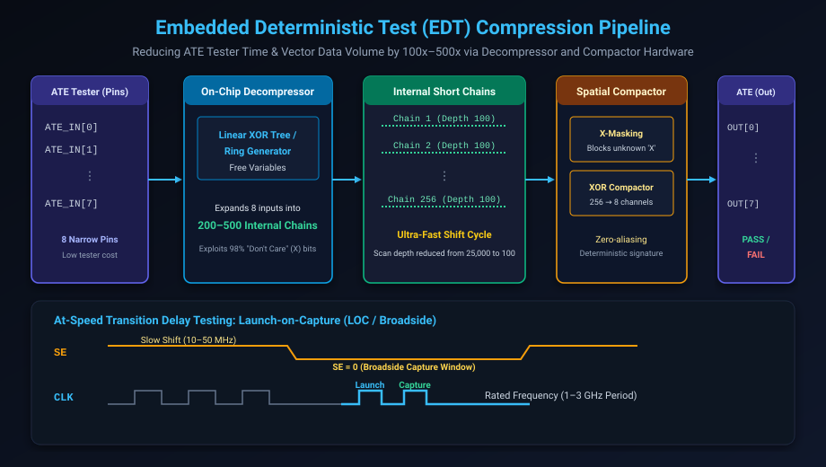

# Automatic Test Pattern Generation (ATPG) & Test Compression

## Introduction: The Test Data Explosion Crisis

As SoCs scaled past 100 million flip-flops, test engineering collided with a physical economic wall: **the Test Data Volume & Test Time bottleneck**.

In a pure uncompressed scan architecture:
- A chip with 500,000 flip-flops and only 16 external ATE tester pins requires 32,000 shift clock cycles to load a single test pattern.
- If 10,000 test patterns are required to achieve 99.5% stuck-at and transition fault coverage, testing a single chip requires over 320 million clock cycles.
- At a 20 MHz shift clock, testing one chip takes **16 seconds** of ATE tester time. 
- With industrial ATE testers costing upwards of \$2 million each and testing billions of chips annually, an uncompressed test flow would bankrupt semiconductor business models.

The industry resolved this crisis through two revolutions:
1. **Algorithmic ATPG Optimization**: Transitioning from heuristic search to high-performance Boolean SAT-based pattern generation.
2. **Embedded Deterministic Test (EDT) Compression**: Compressing test vectors by 100x to 500x using on-chip decompressors and spatial compactors.

This chapter covers:
1. **ATPG Algorithms & The D-Calculus ($0, 1, D, \overline{D}, X$)**.
2. **Classical vs. SAT-Based ATPG: PODEM and FAN**.
3. **At-Speed Transition Delay Testing: Launch-on-Capture (LOC) vs. Launch-on-Shift (LOS)**.
4. **Embedded Deterministic Test (EDT) Compression Architecture**.
5. **The Unknown ('X') State Problem & X-Masking Logic**.
6. **Hands-On Exercises & Review Questions**.

---

## ATPG Algorithms & Roth's D-Calculus

In 1966, J. Paul Roth invented the **D-Calculus** to mathematically represent signal differences between a good (fault-free) circuit and a faulty circuit:

| Symbol | Fault-Free Value | Faulty Circuit Value | Meaning |
| :---: | :---: | :---: | :--- |
| **$0$** | 0 | 0 | Logic 0 in both circuits |
| **$1$** | 1 | 1 | Logic 1 in both circuits |
| **$D$** | 1 | 0 | Value is 1 in good machine, 0 in faulty machine |
| **$\overline{D}$** | 0 | 1 | Value is 0 in good machine, 1 in faulty machine |
| **$X$** | Unassigned / Don't Care | Unassigned / Don't Care | Unknown / Unconstrained |

### The Three Steps of ATPG:
1. **Fault Activation**: Assign inputs to force the faulty net to the opposite logic state (e.g. drive a 1 to test for Stuck-At-0, creating a $D$ at the fault site).
2. **Fault Propagation (D-Drive)**: Sensitize a path from the fault site to an observable primary output (PO) or scan flip-flop, setting non-controlling values on side-inputs so $D$ or $\overline{D}$ propagates through logic gates.
3. **Line Justification**: Work backward through the circuit to determine the primary input assignments required to produce the values assigned in Steps 1 and 2.

### Evolution of ATPG Engines
- **D-Algorithm (1966)**: First algorithmic approach; exhaustive branch-and-bound search at all internal gates. Suffered from exponential backtracking on XOR trees.
- **PODEM (Goel 1981)**: *Path-Oriented Decision Making*. Backtracks only at Primary Inputs (PIs) rather than internal gates, dramatically reducing search space.
- **FAN (Fujiwara 1983)**: Adds multiple-backtrace heuristics and fanout-point analysis.
- **Modern SAT-Based ATPG**: Formulates fault activation and propagation as a Boolean Satisfiability (SAT) problem in Conjunctive Normal Form (CNF), solved by high-performance CDCL engines in seconds.

---

## At-Speed Testing: Launch-on-Capture (LOC) vs. Launch-on-Shift (LOS)

Transition Delay Faults (TDF) cannot be detected by a static clock; they require two vectors applied at the chip's rated functional clock frequency (e.g. 2.0 GHz):

There are two primary methodologies for delivering the two-pattern sequence $\langle V_1, V_2 \rangle$:

### 1. Launch-on-Shift (LOS / Last-Shift Launch)
- In LOS, the initialization vector $V_1$ is shifted into the scan chain up to cycle $N-1$.
- The launch vector $V_2$ is launched by the **very last shift clock cycle** (cycle $N$) while `Scan Enable (SE)` is still high.
- `SE` must immediately transition from 1 to 0 before the next clock pulse captures the response.
- **The Fatal Challenge**: `SE` must switch from 1 to 0 within a **single at-speed clock period** (e.g. 500 picoseconds). Because `SE` connects to hundreds of thousands of flip-flops across the entire die, closing timing on a global at-speed `SE` network requires massive buffer trees and consumes excessive power.

### 2. Launch-on-Capture (LOC / Broadside) — The Industry Standard
- In LOC, the scan chain is shifted at a slow, comfortable test clock frequency (e.g. 25 MHz).
- Once shifting finishes, `SE` is brought low (0) while the clock is completely idle.
- An **On-Chip Clock Controller (OCC)** or PLL then pulses two rapid, at-speed functional clock bursts:
  - **Launch Pulse**: Evaluates combinational logic from $V_1$ to create the $0 \rightarrow 1$ or $1 \rightarrow 0$ transition ($V_2$).
  - **Capture Pulse**: Captures the transition response into the destination flip-flop at rated speed.
- **Advantage**: `SE` is completely static during at-speed clocking, completely eliminating the need for an at-speed `SE` distribution tree. Over 90% of commercial ASIC designs utilize LOC.

---

## Embedded Deterministic Test (EDT) Compression

The breakthrough that saved semiconductor manufacturing from test cost collapse was the realization of **Don't Care Sparsity**:
- In a typical ATPG pattern targeting a specific fault, **only 2% to 5% of the scan flip-flop bits are strictly required (Care Bits)** to activate and propagate the fault.
- The remaining **95% to 98% of bits are Don't Care ($X$) bits**!

### The EDT Architecture:
Instead of shifting fully specified patterns from expensive ATE memory, the chip incorporates on-chip decompression and compaction hardware:

#### 1. On-Chip Decompressor
- Connects to a small number of external ATE channels (e.g. 8 to 16 pins).
- Internally drives hundreds or thousands of **short scan chains** (e.g. 300 chains, each only 100 flip-flops deep).
- Uses a **Linear Feedback Network (Ring Generator)** and an **XOR Phase Shifter** to expand the 8 external input channels into 300 internal channels, solving a system of linear equations over Galois Field $GF(2)$ to satisfy all Care Bits.

#### 2. On-Chip Compactor
- Collects the outputs of all 300 short scan chains.
- XORs them down into 8 external output pins observed by the ATE tester.
- Achieves **100x to 500x reduction** in both tester data volume and test time!

---

## The Unknown ('X') State Problem & X-Masking

A critical hazard in spatial compression is the presence of **Unknown ($X$) states** in digital circuits:
- Uninitialized analog-to-digital converters, floating buses, asynchronous clock crossings, and unmodeled memories can output non-deterministic $X$ values into scan flip-flops.
- In an XOR compactor, a single $X$ bit corrupts the entire XOR tree ($\text{ANYTHING} \oplus X = X$), masking valid fault signatures on all adjacent chains.

### The Solution: Dynamic X-Masking Logic
EDT decompressors incorporate **X-Masking Registers**:
- ATPG tools calculate which scan chains will capture $X$ values for each specific pattern.
- The decompressor shifts masking control bits that dynamically disable (gate to 0) the outputs of failing chains before they enter the XOR compactor.
- This guarantees zero-aliasing signature integrity at the ATE comparator pins.

---

## Hands-On Exercise

### The Problem
You are configuring an on-chip test compression system for a processor block with:
- Total Flip-Flops: $N_{FF} = 240,000$.
- Available ATE tester channels: $N_{ATE} = 12$ input pins, $12$ output pins.
- Target Shift Clock Frequency: $f_{shift} = 40\text{ MHz}$ ($T_{shift} = 25\text{ ns}$).
- Total ATPG patterns required: $P = 8,000$ patterns.

1. Calculate the test time **without compression** (12 scan chains).
2. Design an EDT compression architecture with an internal chain depth of **100 flip-flops**.
3. Calculate the number of internal chains and the resulting test time.
4. Compute the compression speedup factor.

### The Solution

#### 1. Uncompressed Test Time:
- Chain length: $L_{uncomp} = \frac{240,000}{12} = 20,000\text{ flip-flops per chain}$.
- Shift time per pattern: $t_{pattern} = 20,000 \times 25\text{ ns} = 500\text{ }\mu\text{s}$.
- Total Test Time: $T_{total} = 8,000 \times 500\text{ }\mu\text{s} = \mathbf{4.00\text{ seconds}}$.

#### 2 & 3. Compressed Test Architecture (Target Depth = 100):
- Number of internal short chains:
  $$N_{chains} = \frac{240,000}{100} = \mathbf{2,400\text{ internal chains}}$$
- On-Chip Decompressor: Expands 12 ATE inputs $\rightarrow$ 2,400 internal chains.
- Shift time per pattern: $t_{comp\_pattern} = 100 \times 25\text{ ns} = 2.5\text{ }\mu\text{s}$.
- Total Compressed Test Time:
  $$T_{comp\_total} = 8,000 \times 2.5\text{ }\mu\text{s} = \mathbf{0.02\text{ seconds (20 milliseconds!)불}}$$

#### 4. Speedup Factor:
$$\text{Speedup} = \frac{4.00\text{ s}}{0.02\text{ s}} = \mathbf{200\times\text{ Compression Factor}}$$

The test time on the expensive ATE tester is slashed from 4 seconds down to 20 milliseconds, reducing production test cost by over 95%!

---

## Review Questions & Self-Assessment

1. **What is the mathematical meaning of the symbol $D$ in Roth's D-Calculus?**
   *Answer:* $D$ represents a logic value of 1 in the good (fault-free) circuit, and a logic value of 0 in the faulty circuit ($1/0$). $\overline{D}$ represents the opposite ($0/1$).
2. **Why does Launch-on-Capture (LOC) dominate over Launch-on-Shift (LOS) in commercial at-speed test flows?**
   *Answer:* In LOS, the global `Scan Enable (SE)` signal must switch from 1 to 0 within an at-speed clock period (e.g. $< 1\text{ ns}$), which requires a massive, power-hungry clock-tree-like routing network. In LOC, `SE` switches while the clock is idle and remains static at 0 during both the launch and capture pulses, completely avoiding the need for an at-speed `SE` distribution tree.
3. **What fundamental property of digital test patterns enables 100x+ test compression?**
   *Answer:* Don't Care ($X$) Sparsity. In any given ATPG pattern, only 2% to 5% of flip-flop bits are strictly required to activate and observe the target fault; the remaining 95%+ of bits are "Don't Care" ($X$) bits that can be generated pseudorandomly by linear decompressors.
4. **How do Unknown ($X$) states threaten spatial XOR compactors, and how does X-masking solve it?**
   *Answer:* A single $X$ bit entering an XOR tree propagates to the output and masks all valid response bits on that channel ($\text{bit} \oplus X = X$). Dynamic X-masking logic uses programmable control registers to gate off (force to 0) failing scan chain outputs before they reach the XOR compactor.

---

##### Copyright (c) 2026 squared-studio
