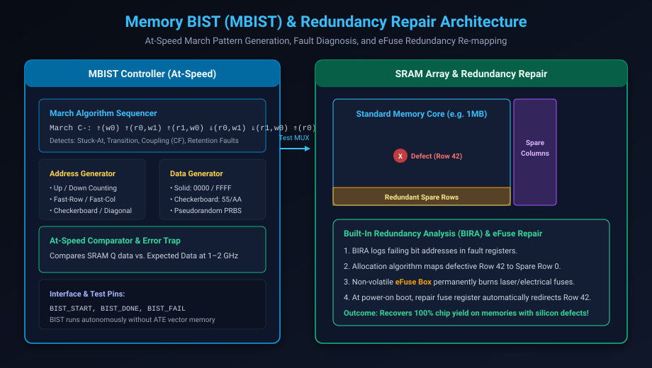

# Memory Built-In Self-Test (MBIST) & Redundancy Repair

## Introduction: The Memory Dominance in Modern SoCs

In modern high-performance microprocessors, AI accelerators, and mobile application processors, **embedded SRAM memories (L1, L2, and L3 caches, scratchpads, and FIFO buffers) occupy over 70% of total silicon die area**.

Because memory arrays push foundry design rules to the absolute physical limits—utilizing dense 6-transistor (6T) SRAM bit-cells measuring less than $0.02\text{ }\mu\text{m}^2$ each—they are exponentially more susceptible to silicon defects than standard combinational logic. A single particulate impurity on a 50-megabyte cache will short a bitline or destroy a storage cell, rendering an entire \$500 chip useless unless self-testing and self-repair capabilities are incorporated directly on-chip.

Testing gigabits of embedded memory through external ATE scan pins is completely unfeasible due to pin bandwidth limits and the necessity of testing memories at their full rated operational frequency (e.g. 1.5 to 3.0 GHz). 

The industry solves this through **Memory Built-In Self-Test (MBIST)** paired with **Built-In Redundancy Analysis (BIRA)** and **eFuse Repair**.

This chapter covers:
1. **Embedded Memory Fault Modeling (SAF, AF, CF, DRF, RDF)**.
2. **The March Algorithm Family: MATS+, March C-, and March C+**.
3. **The At-Speed MBIST Controller Architecture**.
4. **Memory Redundancy: Spare Rows, Spare Columns, and BIRA Algorithms**.
5. **eFuse Non-Volatile Memory Repair & Silicon Yield Recovery**.
6. **Hands-On Exercises & Review Questions**.

---

## Memory Defect Mechanisms & Fault Models

Unlike standard digital logic where nets are abstract wires, memory arrays suffer from unique physical interactions between adjacent dense bit-cells, shared wordlines, and differential bitline pairs:

| Memory Fault Model | Symbol | Physical Description |
| :--- | :---: | :--- |
| **Stuck-At Fault** | **SAF** | A memory cell permanently reads 0 (SA0) or 1 (SA1) due to power/ground shorts. |
| **Transition Fault** | **TF** | A cell fails to transition from $0 \rightarrow 1$ (Fail-to-Rise) or $1 \rightarrow 0$ (Fail-to-Fall). |
| **Address Decoder Fault** | **AF** | Decoder defect causes: (1) Address $A$ accesses no cell; (2) Address $A$ accesses multiple cells; (3) Multiple addresses access cell $A$. |
| **Coupling Fault** | **CF** | Writing to or reading cell $j$ (aggressor) accidentally flips the contents of cell $i$ (victim). Subtypes: Inversion (CFin), Idempotent (CFid), State (CFs). |
| **Data Retention Fault** | **DRF** | Cell loses its stored charge over time due to broken pull-up PMOS load resistors. |
| **Read Disturb Fault** | **RDF** | Reading cell $i$ inadvertently overwrites or flips its stored logic state. |

---

## The March Test Family

The universal standard for testing embedded SRAMs is the **March Algorithm**. A March test consists of a finite sequence of **March Elements** applied sequentially across all memory addresses from 0 to $N-1$:

### Standard March Notation:
- **$\Uparrow$**: Address sequence ascending ($0 \rightarrow N-1$).
- **$\Downarrow$**: Address sequence descending ($N-1 \rightarrow 0$).
- **$\Updownarrow$**: Address sequence in either direction.
- **$w0, w1$**: Write 0 or Write 1 to current address.
- **$r0, r1$**: Read and verify 0 or Read and verify 1 from current address.

---

### The Universal Industry Standard: March C- ($10N$)

The **March C-** algorithm has an execution complexity of exactly $10N$ operations (where $N$ is the total number of memory words) and provides complete coverage of Stuck-At, Transition, Address Decoder, and Inversion Coupling faults:

$$\text{March C-} = \{ \Updownarrow(w0); \Uparrow(r0, w1); \Uparrow(r1, w0); \Downarrow(r0, w1); \Downarrow(r1, w0); \Updownarrow(r0) \}$$

```text
================================================================================
                    STEP-BY-STEP MARCH C- WALKTHROUGH
================================================================================
  Element 1: ⇕ (w0)
   --> Initialize every cell in the memory to 0 (all addresses).

  Element 2: ⇑ (r0, w1)  [Ascending: 0 -> N-1]
   --> Read address i (verify 0).
   --> Write 1 to address i.
   --> Catches SAF, TF(0->1), and coupling faults from lower to higher cells.

  Element 3: ⇑ (r1, w0)  [Ascending: 0 -> N-1]
   --> Read address i (verify 1).
   --> Write 0 to address i.

  Element 4: ⇓ (r0, w1)  [Descending: N-1 -> 0]
   --> Read address i (verify 0).
   --> Write 1 to address i.
   --> Catches coupling faults from higher to lower address cells!

  Element 5: ⇓ (r1, w0)  [Descending: N-1 -> 0]
   --> Read address i (verify 1).
   --> Write 0 to address i.

  Element 6: ⇕ (r0)
   --> Final verification read across all cells to confirm solid 0 state.
================================================================================
```

---

## MBIST Controller Architecture

To execute March C- at the full functional clock speed (e.g. 2 GHz), an autonomous hardware controller is wrapped around each SRAM instance:



### The Core MBIST Hardware Components:
1. **March Sequencer FSM**: A microcoded or hardwired state machine that cycles through March elements, issuing read and write strobes.
2. **Address Generator**: Generates physical row/column addresses. Supports linear increment, Gray-code sequences, fast-row, and fast-column modes to exercise wordline and bitline coupling mechanisms.
3. **Data Pattern Generator**: Generates data backgrounds:
   - **Solid**: `0x0000` and `0xFFFF`.
   - **Checkerboard**: Alternating `0x5555` and `0xAAAA` across physical physical layout to maximize adjacent capacitive coupling stress.
   - **Row / Column Stripe**: Isolates adjacent wordline shorts.
4. **At-Speed Comparator**: Compares data read from SRAM against expected data in real time, latching any mismatch into the **Error Trap Register**.

---

## Built-In Redundancy Analysis (BIRA) & eFuse Repair

Fabricating a massive 64MB cache without a single defective bit-cell is statistically impossible across thousands of silicon wafers. Without repair, wafer yields would plummet below 20%.

### 1. Physical Redundancy
Foundry memory compilers automatically embed **Spare Rows** and **Spare Columns** around the active memory array (e.g. 2 spare rows and 2 spare columns per 1MB bank).

### 2. The BIRA Allocation Algorithm
During wafer sort, the MBIST controller runs alongside an on-chip **BIRA (Built-In Redundancy Analysis)** engine:
1. When a read comparison fails, BIRA logs the failing `Row_Addr`, `Col_Addr`, and `Bit_Index` in a local Fault Queue.
2. **Must-Repair Phase**:
   - If a single row contains 3 failing bits, it cannot be repaired by spare columns alone; it **must** be allocated to a Spare Row.
   - If a single column contains multiple defects, it is allocated to a Spare Column.
3. **Orthogonal Optimization**: If random single-bit defects remain, BIRA executes a 2D integer programming heuristic to allocate the remaining spare rows and columns to achieve 100% repair coverage.

### 3. eFuse Burning & Silicon Yield Recovery
Once BIRA finalizes the repair solution:
- The repair coordinates are permanently burned into an on-chip **eFuse Array** using high-voltage electrical programming pulses on the wafer sort tester.
- At every subsequent power-on boot, the chip reads the eFuse values and programs the **Memory Address Remapping Latches**.
- When the CPU requests an access to defective Row 42, the remapping hardware automatically redirects the access to Spare Row 0 transparently, with **zero timing performance penalty**.

Through MBISR, semiconductor manufacturers boost raw silicon yields from **40% up to 98%**, saving tens of millions of dollars in fabrication costs!

---

## Hands-On Exercise

### The Problem
You are verifying an SRAM bit array under test with March C-.
A physical bridging defect creates an **Idempotent Coupling Fault (CFid)**:
- Whenever Cell $A$ (Address 2) transitions from $0 \rightarrow 1$, Cell $B$ (Address 5) is forced to 1.
- Initial state of all cells is 0.

Trace the execution of March C- and identify the exact March Element and step that detects this defect.

### The Solution

#### Execution Trace:
1. **Element 1 $\Updownarrow(w0)$**: All cells set to 0. Cell $A = 0$, Cell $B = 0$.
2. **Element 2 $\Uparrow(r0, w1)$ [Ascending: $0 \rightarrow N-1$]**:
   - At Address 2 (Cell $A$):
     - Read 0 $\rightarrow$ **PASS**.
     - Write 1 to Cell $A$.
     - **Defect Trigger**: Cell $A$ transitions $0 \rightarrow 1$, which triggers the coupling fault! Cell $B$ (Address 5) is forced from 0 to 1!
   - At Address 3 and 4: Normal operation.
   - At Address 5 (Cell $B$):
     - Element 2 specifies: **Read 0 from Address 5**.
     - Hardware attempts to read Cell $B$.
     - **MISMATCH!** Cell $B$ returns **1** instead of expected **0**!
3. **Detection Point**:
   - The fault is caught immediately during **March Element 2 $\Uparrow(r0, w1)$ at Address 5**.
   - The MBIST comparator asserts `BIST_FAIL`, and the BIRA engine records Address 5 for spare row/column remapping.

---

## Review Questions & Self-Assessment

1. **Why is external scan testing unsuited for embedded memories, requiring dedicated MBIST?**
   *Answer:* Embedded memories occupy over 70% of SoC area and must be tested at their full gigahertz operational clock frequency. External ATE pins lack the bandwidth and clock speed to test gigabits of memory within reasonable test times. MBIST generates at-speed test patterns autonomously on-chip.
2. **Explain the operations performed in March Element $\Uparrow(r0, w1)$.**
   *Answer:* It steps through memory addresses in ascending order ($0 \rightarrow N-1$). For each address, it first reads the cell to verify it holds 0, and then immediately writes a 1 to that cell before proceeding to the next address.
3. **What is an Address Decoder Fault (AF), and how does March C- catch it?**
   *Answer:* An AF occurs when decoder defects cause an address to access no cell, multiple cells, or multiple addresses to access the same physical cell. March C- catches AFs through its complementary ascending ($\Uparrow$) and descending ($\Downarrow$) write/read phases, ensuring that writing to address $j$ does not corrupt data previously verified at address $i$.
4. **How does Built-In Redundancy Analysis (BIRA) collaborate with eFuses to recover chip yield?**
   *Answer:* BIRA logs memory failure addresses during test and runs an allocation algorithm to map defective rows and columns to on-chip spare rows/columns. The calculated repair mapping is permanently burned into non-volatile eFuses, which dynamically redirect accesses around defective memory cells upon chip boot.

---

##### Copyright (c) 2026 squared-studio
