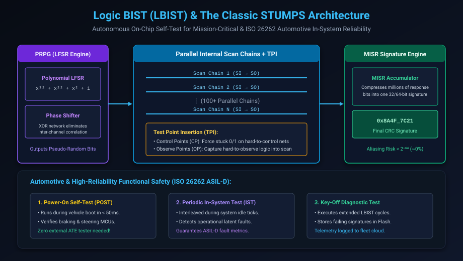

# Logic Built-In Self-Test (LBIST) & At-Speed Structural Test

## Introduction: Autonomous Self-Test for High-Reliability Systems

While deterministic ATPG (Chapter 3) provides superior fault coverage during factory manufacturing, it suffers from a fundamental limitation: **it cannot be executed once the chip leaves the factory floor**. 

An ATE tester cannot be installed inside an automobile driving down a highway, inside an aerospace satellite orbiting the Earth, or inside a medical pacemaker implant. Yet in these mission-critical applications, silicon aging, electromigration, thermal thermal cycling, and cosmic radiation can cause physical transistors and vias to degrade over years of operational life.

**Logic Built-In Self-Test (LBIST)** provides completely autonomous on-chip hardware engines capable of generating pseudo-random test patterns and evaluating circuit responses **in-system**, with **zero external tester equipment**.

Under international functional safety standards such as **ISO 26262 ASIL-D** for automotive electronics, LBIST is a mandatory requirement to guarantee that steering, braking, and autonomous driving SoCs are mathematically free of latent structural defects before the vehicle shifts into drive.

This chapter covers:
1. **Deterministic ATPG vs. Autonomous LBIST**.
2. **The Classic STUMPS Architecture (PRPG, Scan, MISR)**.
3. **LFSR Polynomial Mechanics & The Phase Shifter**.
4. **Signature Compaction & Aliasing Probability ($P_{alias} \approx 2^{-M}$)**.
5. **Random Pattern Resistant Faults (RPRF) & Test Point Insertion (TPI)**.
6. **Automotive Functional Safety (ISO 26262 ASIL-D) & In-System Test (IST)**.
7. **Hands-On Exercises & Review Questions**.

---

## Deterministic ATPG vs. Autonomous LBIST

| Feature | Deterministic ATPG | Logic Built-In Self-Test (LBIST) |
| :--- | :--- | :--- |
| **Pattern Generation** | Generated by EDA tools, stored in ATE memory | Generated autonomously on-chip by PRPG (LFSR) |
| **Response Evaluation** | Pin-by-pin comparator on ATE tester | Compacted into a single on-chip MISR signature |
| **External Equipment** | Mandatory: \$2M+ factory ATE tester | **None required**: Runs autonomously using on-chip clocks |
| **Typical Fault Coverage** | **99.5%+** (Deterministic Care Bits) | **85% to 95%** (Limited by random-resistant faults) |
| **Execution Window** | Manufacturing wafer sort & package test only | **In-Field**: Power-On (POST), Run-Time (IST), Key-Off |
| **Silicon Area Overhead** | Very low (only scan cells and EDT logic) | Moderate (PRPG, Phase Shifter, MISR, TPI points) |

---

## The Classic STUMPS Architecture

The universal industry standard for implementing LBIST is the **STUMPS (Self-Test Using MISR and Parallel Scan)** architecture, developed by IBM in the early 1980s:

### The Three Core Hardware Blocks:

#### 1. Pseudo-Random Pattern Generator (PRPG)
- Built using a **Linear Feedback Shift Register (LFSR)** based on a primitive characteristic polynomial (e.g. $P(x) = x^{32} + x^{22} + x^2 + x^1 + 1$).
- Generates an exhaustive pseudo-random sequence of $2^{32} - 1$ non-repeating binary states.
- **The Phase Shifter**: Direct LFSR tap outputs suffer from high shift correlation between adjacent scan chains. A Phase Shifter (a network of multi-input XOR gates) creates independent, uncorrelated pseudo-random bit streams across hundreds of parallel scan channels.

#### 2. Internal Parallel Scan Chains
- Identical to standard scan chains inserted during physical synthesis.
- Loaded with pseudo-random bits during Shift (`SE=1`), followed by one or two functional capture pulses (`SE=0`) to exercise combinational logic at rated operational speed.

#### 3. Multiple-Input Signature Register (MISR)
- A multi-channel linear accumulator based on an LFSR with XOR inputs on every flip-flop.
- Compresses tens of millions of response bits generated across all scan chains into a single **32-bit or 64-bit Golden CRC Signature**.
- At the conclusion of the self-test, the on-chip BIST controller compares the final MISR signature against a pre-computed golden reference stored in read-only memory (ROM) or eFuses.

---

## MISR Signature Compaction & The Aliasing Risk

A frequent question in test theory is: *"If millions of bits are compressed into a single 64-bit signature, is it possible for a defective chip to produce the golden signature by pure coincidence?"*

This scenario is known as **Aliasing** (or signature masking).

Mathematically, for a MISR of bit-width $M$, assuming independent uniform error distributions, the asymptotic probability of aliasing is:

$$P_{alias} = \frac{1}{2^M} = 2^{-M}$$

For a standard **64-bit MISR**:
$$P_{alias} = 2^{-64} \approx 5.42 \times 10^{-20}$$

The probability of an error aliasing into the correct signature is less than one in fifty quintillion—making the risk of a false pass statistically zero in practical silicon manufacturing.

---

## The Random Pattern Resistant Fault (RPRF) Problem

While pseudo-random patterns easily detect 75% to 80% of faults within a few thousand cycles, achieving the final 20% coverage stalls exponentially due to **Random Pattern Resistant Faults (RPRF)**.

### Why Do Faults Resist Random Patterns?
Consider a 32-input AND gate:
- To detect a Stuck-At-0 on the output, all 32 inputs must simultaneously be set to logic 1.
- Under random stimulus, the mathematical probability of driving all 32 inputs to 1 in any given cycle is:
  $$P(\text{all 1}) = \left(\frac{1}{2}\right)^{32} \approx \frac{1}{4,294,967,296}$$
- A random BIST running 100,000 cycles has an infinitesimally small chance ($< 0.002\%$) of ever detecting this fault!

### The Solution: Test Point Insertion (TPI)
Automated DFT synthesis tools analyze the circuit graph using SCOAP metrics and insert physical **Test Points**:
1. **Control Points (CP-0 and CP-1)**: Specialized gates inserted into high-fanin nets. During test mode, the PRPG drives the control point to temporarily force the net to 0 or 1, breaking up monolithic logic cones.
2. **Observation Points (OP)**: Additional scan flip-flops inserted into buried nets with poor observability, allowing intermediate logic states to be captured directly into scan chains.

By inserting fewer than **1% to 2% test points**, LBIST fault coverage is boosted from **78% to over 95%** with minimal timing impact!

---

## Automotive Functional Safety: ISO 26262 ASIL-D

In automotive electronics (governed by the **ISO 26262** functional safety standard), safety-critical applications—such as Brake-by-Wire, Electronic Power Steering (EPS), and Advanced Driver Assistance Systems (ADAS)—must comply with **ASIL-D** (Automotive Safety Integrity Level D).

ASIL-D mandates two quantitative hardware metrics:
1. **Single-Point Fault Metric (SPFM) $\ge 99\%$**: 99% of all faults that could directly cause safety goal violations must be detected.
2. **Latent Fault Metric (LFM) $\ge 90\%$**: 90% of latent dormant faults must be detected.

### In-System Test (IST) Operational Windows:
- **Power-On Self-Test (POST)**: When the driver taps the ignition button, LBIST executes a rapid 50ms burst across all microcontrollers before engine start.
- **Periodic Run-Time Self-Test (Heartbeat IST)**: While driving on the highway, during microsecond idle frames (e.g. between sensor acquisition cycles), the CPU core states are saved, an LBIST burst is executed to verify hardware integrity, and the CPU resumes normal operation.
- **Key-Off Self-Test**: When the vehicle is parked, an exhaustive 2-second LBIST sequence executes to log silicon aging metrics into non-volatile memory for fleet telemetry.

---

## Hands-On Exercise

### The Problem
You are designing a 4-bit Linear Feedback Shift Register (LFSR) with characteristic polynomial:
$$P(x) = x^4 + x^3 + 1$$
The feedback bit $D_0$ is computed as:
$$D_0 = Q_3 \oplus Q_2$$
The LFSR shifts right on every clock cycle: $Q_3 \leftarrow Q_2$, $Q_2 \leftarrow Q_1$, $Q_1 \leftarrow Q_0$, $Q_0 \leftarrow D_0$.

1. Given the initial seed state $Q = 4'b1000$ (where $Q_3=1, Q_2=0, Q_1=0, Q_0=0$), compute the first 6 cycle states.
2. What is the maximum cycle length before the pattern repeats?
3. What happens if the seed is initialized to all zeros (`4'b0000`)?

### The Solution

#### 1. Cycle-by-Cycle State Execution:
- **Cycle 0 (Initial Seed)**: $Q = \mathbf{1000}$ ($Q_3=1, Q_2=0, Q_1=0, Q_0=0$).
- **Cycle 1**:
  - $D_0 = Q_3 \oplus Q_2 = 1 \oplus 0 = 1$.
  - Shift right: $Q_3 \leftarrow 0$, $Q_2 \leftarrow 0$, $Q_1 \leftarrow 0$, $Q_0 \leftarrow 1$.
  - State: $\mathbf{0001}$.
- **Cycle 2**:
  - $D_0 = 0 \oplus 0 = 0$.
  - Shift right: State: $\mathbf{0010}$.
- **Cycle 3**:
  - $D_0 = 0 \oplus 0 = 0$.
  - Shift right: State: $\mathbf{0100}$.
- **Cycle 4**:
  - $D_0 = 0 \oplus 1 = 1$.
  - Shift right: State: $\mathbf{1001}$.
- **Cycle 5**:
  - $D_0 = 1 \oplus 0 = 1$.
  - Shift right: State: $\mathbf{0011}$.
- **Cycle 6**:
  - $D_0 = 0 \oplus 0 = 0$.
  - Shift right: State: $\mathbf{0110}$.

#### 2. Maximum Sequence Length:
For an $n$-bit primitive polynomial LFSR, the maximum sequence period is:
$$\text{Period} = 2^n - 1 = 2^4 - 1 = \mathbf{15\text{ non-repeating states}}.$$

#### 3. The All-Zero Trap:
If seeded with `4'b0000`, the feedback computes $0 \oplus 0 = 0$. The LFSR remains permanently trapped in `4'b0000` forever. A non-zero seed is mandatory!

---

## Review Questions & Self-Assessment

1. **Why is Logic BIST mandatory for ISO 26262 automotive electronics, even if 99.8% ATPG coverage was achieved at the wafer factory?**
   *Answer:* Factory ATPG only screens defects present at the moment of manufacturing. During years of vehicle operation, environmental stress, thermal cycles, and transistor aging cause new latent physical faults. LBIST allows the vehicle to autonomously test its own silicon integrity throughout its 15-year operational lifespan.
2. **What is the function of the Phase Shifter in the STUMPS architecture?**
   *Answer:* A phase shifter uses an XOR network to eliminate linear shift correlation between adjacent scan chains fed by the same LFSR, preventing lockstep bit patterns that would severely degrade random fault coverage.
3. **What is the mathematical probability of a 64-bit MISR aliasing a defective circuit response into the golden signature?**
   *Answer:* $P_{alias} \approx 2^{-64} \approx 5.42 \times 10^{-20}$. It is statistically impossible for an error to escape detection through random aliasing.
4. **How do Test Points resolve the Random Pattern Resistant Fault (RPRF) problem?**
   *Answer:* Control Points temporarily break large combinational logic fan-in trees by forcing nets to 0 or 1 during test, while Observation Points capture deeply buried signals directly into scan cells, dramatically increasing controllability and observability.

---

##### Copyright (c) 2026 squared-studio
