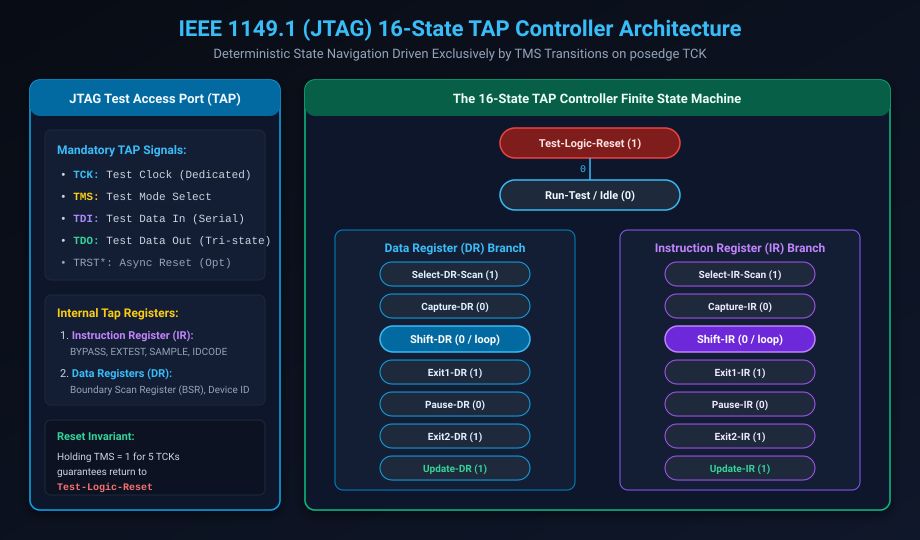

# Boundary Scan & IEEE Standards: IEEE 1149.1, 1149.6, 1500 & 1687

## Introduction: The Vanishing Probe Access Problem

In the 1980s, Printed Circuit Board (PCB) testing relied on mechanical **"Bed-of-Nails"** in-circuit testers (ICT). These test fixtures used thousands of spring-loaded physical metal pins that pressed directly against copper test pads on the surface of the circuit board to verify traces and solder joints.

However, modern electronics packaging rendered physical probing obsolete:
- **Ball Grid Array (BGA)** and **Flip-Chip** packages place thousands of solder balls underneath the silicon package, completely concealed from physical sight and probe contact.
- Multi-layer PCBs with blind and buried micro-vias leave no surface test pads.
- Signal integrity requirements on 25+ Gbps traces prohibit adding capacitive stubs or test pads.

To solve this dilemma, the Joint Test Action Group (JTAG) developed the **IEEE 1149.1 Boundary Scan Standard**. Boundary scan moves test probes inside the silicon: a boundary scan cell is placed at every chip pin, transforming the perimeter of the chip into a digital shift register that tests board interconnects electronically.

This chapter covers:
1. **The IEEE 1149.1 (JTAG) Architecture & Boundary Scan Cell (BSC)**.
2. **The 16-State TAP Controller Finite State Machine**.
3. **Mandatory JTAG Instructions: BYPASS, EXTEST, SAMPLE, IDCODE**.
4. **IEEE 1149.6 for AC-Coupled Differential Interconnects**.
5. **IEEE 1500 Embedded Core Test Standard**.
6. **IEEE 1687 (IJTAG) & The Segment Insertion Bit (SIB) Network**.
7. **Hands-On Exercises & Review Questions**.

---

## The IEEE 1149.1 Architecture & The 16-State TAP FSM

The core of JTAG is the **Test Access Port (TAP)** controller, a synchronous 16-state finite state machine controlled entirely by two signals: `TCK` (clock) and `TMS` (mode select):



### 1. The 4 Mandatory (+1 Optional) TAP Signals
- **`TCK` (Test Clock)**: Dedicated, free-running test clock independent of functional system clocks.
- **`TMS` (Test Mode Select)**: Sampled on the rising edge of `TCK` to steer state transitions within the TAP FSM.
- **`TDI` (Test Data In)**: Serial data input line sampled on posedge `TCK`.
- **`TDO` (Test Data Out)**: Serial data output line driven on negedge `TCK` (tri-stated except during `Shift-DR` and `Shift-IR`).
- **`TRST*` (Test Reset - Optional)**: Asynchronous active-low reset.

### 2. The 16-State TAP Controller Mechanics
The state machine exhibits a beautiful, elegant symmetry between the **Data Register (DR)** branch and the **Instruction Register (IR)** branch:
- **`Test-Logic-Reset`**: Reset state.
  > [!IMPORTANT]
  > **The 5-Cycle Reset Invariant**:
  > Regardless of which of the 16 states the controller currently occupies, **applying `TMS = 1` for exactly 5 consecutive rising edges of `TCK` is mathematically guaranteed to force the FSM back to `Test-Logic-Reset`**. This guarantees safe recovery even if `TRST*` is omitted.
- **`Capture-DR / Capture-IR`**: Parallel-loads data into the shift register.
- **`Shift-DR / Shift-IR`**: Shifts serial data from `TDI` through the active register to `TDO`.
- **`Update-DR / Update-IR`**: Latches the shifted data onto parallel output pins on the falling edge of `TCK`.

---

## Anatomy of the Boundary Scan Cell (BSC)

Every physical input and output pad on an IEEE 1149.1 compliant chip is equipped with a **Boundary Scan Cell (BSC)**:

```text
Functional In / Pad In  ----------------+
                                        | (0)
Scan In (TDI / Prev SO) -----> [Capture / Shift FF] ---> [Update Latch]
                                        | (1)                |
                                     [2:1 MUX] <-------------+ (Mode Control)
                                        |
Functional Out / Pad Out <--------------+
```

### Modes of Operation:
1. **Normal Functional Mode**: The multiplexer selects input (0). Data passes transparently through the cell with only a negligible gate delay.
2. **EXTEST (External Interconnect Test)**:
   - Chip $A$ shifts output test vectors into its boundary scan cells.
   - In `Update-DR`, Chip $A$ drives the pins onto PCB traces.
   - Chip $B$ samples its input pins in `Capture-DR` and shifts the results out to `TDO`.
   - **Result**: Detects PCB solder bridges, open traces, and cold solder joints without mechanical probes!
3. **INTEST (Internal Logic Test)**: Isolates the internal chip logic from external PCB noise, applying test vectors directly from the boundary cells into core logic.

---

## Mandatory & Standard JTAG Instructions

JTAG operations are configured by shifting an opcode into the **Instruction Register (IR)**:

| Instruction | Opcode Standard | Functionality |
| :--- | :---: | :--- |
| **`BYPASS`** | All 1s (`11...1`) | Selects the 1-bit Bypass Register, shortening the scan path from `TDI` to `TDO` to a single cycle. Used to bypass chips on a PCB board that are not currently under test. |
| **`EXTEST`** | All 0s (`00...0`) | Connects Boundary Scan Register (BSR) to pads to test external PCB traces between chips. |
| **`SAMPLE / PRELOAD`** | Mandatory | **Sample**: Captures pin states during normal functional operation. **Preload**: Pre-loads desired states into boundary cells before switching into `EXTEST` to prevent bus glitches. |
| **`IDCODE`** | Optional / Standard | Connects the 32-bit Device Identification Register to `TDO` (encodes Manufacturer JEDEC code, Part Number, and Silicon Stepping Revision). |
| **`CLAMP`** | Optional | Forces fixed output states while selecting the 1-bit Bypass Register. |

---

## High-Speed AC-Coupled Testing: IEEE 1149.6

Modern high-speed differential standards (PCIe Gen 5/6, 100G Ethernet, USB4) incorporate **AC-coupling series capacitors** ($0.1\text{ }\mu\text{F}$) to block DC bias voltages between chips.

- **The Problem**: IEEE 1149.1 relies on steady-state DC logic levels. The capacitor blocks DC signals, causing the receiver to see 0 volts during prolonged static shift cycles.
- **The IEEE 1149.6 Solution**: Introduces dynamic edge-generating boundary cells that emit high-frequency AC pulse transitions, and specialized hysteresis receivers that detect step and pulse edges across the capacitor.

---

## Core Wrapping Standard: IEEE 1500

As chips evolved into Systems-on-Chip integrating dozens of 3rd-party intellectual property (IP) cores (ARM CPUs, Synopsys USB PHYs, Imagination GPUs), testing individual IP blocks in isolation became essential.

**IEEE 1500** standardizes embedded core test wrappers:
- **Wrapper Instruction Register (WIR)**: Local instruction register controlling the IP core test modes.
- **Wrapper Boundary Register (WBR)**: Boundary cells surrounding the IP core's boundary ports.
- **Test Modes**:
  - **Inward Test (Intest)**: Tests the internal logic of the IP block using internal scan chains.
  - **Outward Test (Extest)**: Tests the on-chip interconnect routing between IP Block $A$ and IP Block $B$.

---

## Reconfigurable Instrument Access: IEEE 1687 (IJTAG)

Modern SoCs contain hundreds of embedded test and monitoring instruments: temperature sensors, voltage monitors, phase-locked loop (PLL) BIST, SerDes eye monitors, and MBIST controllers.

Routing a fixed, monolithic JTAG shift register through hundreds of instruments causes severe latency bottlenecks.

**IEEE 1687 (Internal JTAG / IJTAG)** introduces the **Segment Insertion Bit (SIB)**:

```text
TDI ----> [ SIB 1 ] --------> [ SIB 2 ] --------> TDO
             |                   |
        (Closed)            (Open Branch)
             |                   |
          Bypassed          +----+----+
                            | Inst 1  |
                            | Inst 2  |
                            +---------+
```

### The SIB Mechanism:
- When a SIB is **closed**, its local scan segment is excluded, and data passes through in 1 clock cycle.
- When a SIB is programmed to **open**, the local scan chain containing target instruments is dynamically switched into the active scan path.
- This creates an extensible, hierarchical network allowing software to communicate directly with on-chip silicon instruments!

---

## Hands-On Exercise

### The Problem
You are setting up an EXTEST boundary scan test between two chips on a PCB:
- Chip $A$ has an output pin connected via a PCB trace to an input pin on Chip $B$.
- You want to verify that the copper trace between Chip $A$ and Chip $B$ is not broken (open circuit) and not shorted to ground.

1. Write the sequence of JTAG TAP controller states and operations to configure Chip $A$ and Chip $B$ to execute the test.
2. Show how an open-circuit defect is detected.

### The Solution

#### 1. JTAG Test Sequence:
- **Step 1: Reset**: Apply `TMS = 1` for 5 cycles $\rightarrow$ forces both chips into `Test-Logic-Reset`.
- **Step 2: Load Instruction**:
  - Transition to `Select-IR-Scan` $\rightarrow$ `Capture-IR` $\rightarrow$ `Shift-IR`.
  - Shift opcode for `EXTEST` into both Chip $A$ and Chip $B$.
  - Transition to `Update-IR` (both chips enter EXTEST mode).
- **Step 3: Preload Stimulus**:
  - Transition to `Select-DR-Scan` $\rightarrow$ `Shift-DR`.
  - Shift a logic **`1`** into Chip $A$'s output boundary cell.
  - Transition to `Update-DR` $\rightarrow$ Chip $A$ drives `1` onto the PCB trace.
- **Step 4: Capture Response**:
  - On the same cycle, transition Chip $B$'s TAP into `Capture-DR` $\rightarrow$ Chip $B$'s input boundary scan cell samples the logic state of the trace.
- **Step 5: Shift Out & Verify**:
  - Transition to `Shift-DR` $\rightarrow$ Shift captured bit out through Chip $B$'s `TDO` pin to the ATE tester.
  - Repeat the test with a logic **`0`** to check for shorts to VDD.

#### 2. Defect Detection:
- If the trace has an open solder void, Chip $B$'s input buffer floats (pulled down by internal weak pull-down resistor to 0).
- The ATE reads `0` on TDO when expecting `1` $\implies$ **Defect Confirmed on Net $A \rightarrow B$!**

---

## Review Questions & Self-Assessment

1. **Why did the semiconductor and electronics industry develop IEEE 1149.1 Boundary Scan?**
   *Answer:* Advanced IC packaging (such as Ball Grid Arrays, BGA) and high-density multi-layer PCBs placed solder connections underneath packages, eliminating physical access for mechanical "bed-of-nails" test probes. Boundary scan embeds test logic at every chip pin, allowing PCB interconnect testing electronically through serial scan commands.
2. **How does the JTAG TAP Controller guarantee reset without relying on the optional physical `TRST*` pin?**
   *Answer:* The TAP FSM is mathematically architected such that holding the `TMS` signal at logic 1 for 5 consecutive rising edges of `TCK` will navigate the controller to `Test-Logic-Reset` from any arbitrary starting state.
3. **What is the function of the `BYPASS` instruction in IEEE 1149.1?**
   *Answer:* `BYPASS` connects the serial `TDI` pin directly to `TDO` through a single 1-bit register. This shortens the scan chain to 1 cycle for unselected chips on a multi-chip circuit board, dramatically accelerating access to target chips under test.
4. **How does an IEEE 1687 (IJTAG) Segment Insertion Bit (SIB) improve on-chip instrument access over fixed IEEE 1149.1 scan chains?**
   *Answer:* A standard JTAG chain is fixed in length, requiring shifting through every instrument on chip. An IJTAG SIB acts as a dynamic switch: when closed, it bypasses unneeded instruments; when open, it inserts only the desired instrument scan segment into the active path, enabling fast, modular access to thousands of on-chip sensors and BIST engines.

---

##### Copyright (c) 2026 squared-studio
