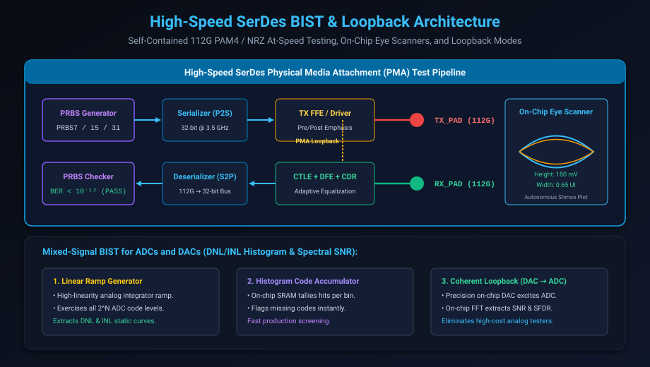

# Analog, Mixed-Signal, IO & High-Speed SerDes Test

## Introduction: Testing Multi-Gigabit Interfaces

In modern datacenter switches, high-performance computing (HPC) nodes, and AI superclusters, chip performance is no longer gated by core computation alone, but by **Input/Output (I/O) bandwidth**.

Modern high-speed interfaces—such as **PCI Express Gen 5/6 (32–64 GT/s)**, **112 Gbps / 224 Gbps PAM4 Ethernet**, and **DDR5 / HBM3 memory PHYs**—operate at microwave analog frequencies. At these speeds:
- External ATE tester channels cannot connect directly to chip pins: physical tester trace parasitic capacitance and socket inductance distort high-frequency eye diagrams beyond recognition.
- Ultra-high-speed RF test heads cost upwards of \$5 million per ATE station, making external analog testing economically non-viable for mass consumer and server silicon.

To verify these interfaces in production, semiconductor architects integrate **Built-In Self-Test (BIST) circuits directly into the physical analog transceivers**.

This chapter covers:
1. **The High-Speed SerDes Physical Architecture**.
2. **On-Chip PRBS Generation & Bit Error Rate (BER) Testing**.
3. **The Three Loopback Modes: Digital, PMA Analog, and Channel Loopback**.
4. **On-Chip Eye Scanners & 2D Phase-Voltage Margining**.
5. **Mixed-Signal BIST for ADCs and DACs (DNL, INL, SNR)**.
6. **Hands-On Exercises & Review Questions**.

---

## SerDes BIST & Loopback Architecture

A high-speed **Serializer/Deserializer (SerDes)** converts wide, low-frequency parallel buses (e.g. 32 bits @ 3.5 GHz) into high-frequency serial differential pairs (e.g. 112 Gbps PAM4):



### The SerDes Built-In Test Pipeline:

#### 1. On-Chip PRBS Pattern Generators
Instead of relying on external tester memory, the transmitter (TX) incorporates autonomous hardware generators producing standardized **Pseudo-Random Binary Sequences (PRBS)**:
- **PRBS-7** ($2^7 - 1 = 127$ bits): Fast lock testing for high-frequency phase-locked loops (PLLs).
- **PRBS-15** ($2^{15} - 1 = 32,767$ bits): Standard stress pattern for high-speed telecommunication standards.
- **PRBS-31** ($2^{31} - 1 = 2,147,483,647$ bits): Comprehensive pattern containing extreme runs of consecutive 1s and 0s to test receiver AC-coupling low-frequency droop and baseline wander.

#### 2. On-Chip PRBS Checkers & Bit Error Rate (BER) Accumulators
The receiver (RX) includes a synchronized PRBS checker that locks onto the incoming sequence, compares incoming bits against expected mathematical states at 112 Gbps, and increments a 32-bit hardware **Bit Error Counter**.
- High-speed standards mandate proving:
  $$\text{BER} < 10^{-12} \quad \text{(less than one bit error per trillion transmitted bits)}$$

---

## The Three Standard Loopback Modes

DFT engineers verify SerDes silicon by configuring internal multiplexers into three distinct **Loopback Modes**:

```text
[Digital Core] <=== 1. Digital Near-End ===> [Parallel Interface]
                                                    |
[Serializer / Deserializer] <=== 2. PMA Analog =====+
                                                    |
[TX Driver / RX Equalizer]                          |
      |                                             |
[TX Pad] =============== 3. Far-End Channel =======> [RX Pad]
```

### 1. Digital Near-End Loopback
- Connects the parallel output of the TX digital framing logic directly back to the RX digital logic before serialization.
- **Tests**: Core digital clocking, protocol encoders (8b/10b, 64b/66b, FEC Reed-Solomon), and FIFO buffers without exercising analog circuits.

### 2. Physical Media Attachment (PMA) / Analog Loopback
- Connects the high-speed serialized analog output of the TX driver directly to the input of the RX Continuous-Time Linear Equalizer (CTLE) and Clock/Data Recovery (CDR) unit *inside the chip*.
- **Tests**: Complete analog transmitter and receiver circuits, Phase-Locked Loops (PLLs), serializers, and equalizers, completely decoupled from external PCB channel noise.

### 3. Far-End Channel Loopback
- Connects the physical TX output pin on the IC package to the RX input pin through a loadboard trace or short loopback cable on the ATE socket.
- **Tests**: Physical bond wires, package solder balls, and I/O electrostatic discharge (ESD) protection diodes.

---

## On-Chip Eye Scanners & 2D Margining

In high-speed SerDes design, confirming that a bit passed is insufficient; engineers must verify the **analog signal integrity margin** by inspecting the **Eye Diagram**.

Modern SerDes PHYs incorporate on-chip **2D Eye Scanners** (also called Internal Scope or Eye Monitors):

### How the On-Chip Eye Monitor Operates:
1. The receiver uses dual samplers: a **Main Data Sampler** (held at optimal phase and voltage to decode data) and an **Error / Margin Sampler**.
2. The Error Sampler's reference voltage ($V_{ref}$) and clock sampling phase ($\theta_{sample}$) are programmatically swept across the horizontal time axis (Unit Interval, UI) and vertical voltage axis (millivolts).
3. The hardware registers the Bit Error Rate at every grid point $(V, \theta)$, generating a complete 2D contour map of the open eye directly in silicon registers!
4. **Autonomous Sign-Off**: The chip confirms that:
   - **Eye Height** $\ge 100\text{ mV}$.
   - **Eye Width** $\ge 0.40\text{ UI}$.
5. If the eye is compressed, the receiver's internal adaptive DSP automatically tunes the **CTLE (Continuous-Time Linear Equalizer)** and **DFE (Decision Feedback Equalizer)** tap weights to restore signal integrity!

---

## Mixed-Signal BIST: ADC & DAC Testing

Analog-to-Digital Converters (ADCs) and Digital-to-Analog Converters (DACs) are the bridge between the physical and digital worlds. Testing them on digital ATE testers requires specialized mixed-signal BIST architectures:

### 1. Static Parameter Testing (DNL & INL)
- **Differential Non-Linearity (DNL)**: The deviation of an actual step width from the ideal step width ($1\text{ LSB}$). If $\text{DNL} < -1\text{ LSB}$, the converter exhibits **Missing Codes**!
- **Integral Non-Linearity (INL)**: The cumulative deviation of the actual transfer function curve from the ideal straight line.

#### The Linear Ramp & Histogram BIST:
1. An on-chip, highly linear analog integrator generates an ultra-slow analog voltage ramp that sweeps across the entire input range of the ADC under test.
2. An on-chip **Histogram SRAM** records how many clock cycles each digital output code occurs.
3. In an ideal converter, every code bin receives the exact same number of hits.
4. Variations in bin counts directly reveal the exact DNL and INL values for every single code level without external analog measurement equipment!

### 2. Dynamic Parameter Testing (SNR, THD, SFDR)
To test dynamic spectral parameters:
- **Coherent Loopback**: An on-chip precision DAC generates a pure sinusoidal test tone that excites the ADC input.
- **On-Chip Fast Fourier Transform (FFT)**: A compact hardware FFT or Goertzel algorithm engine evaluates the ADC digital output stream, calculating:
  - **SNR (Signal-to-Noise Ratio)**.
  - **THD (Total Harmonic Distortion)**.
  - **SFDR (Spurious-Free Dynamic Range)**.

---

## Hands-On Exercise

### The Problem
You are verifying a 112 Gbps PAM4 SerDes link using an on-chip PRBS-31 generator and checker:
- Symbol Rate: $56\text{ GBaud}$ (each PAM4 symbol encodes 2 bits $\rightarrow 112\text{ Gbps}$).
- Target Specification: Bit Error Rate $\text{BER} \le 10^{-12}$.
- To prove $\text{BER} \le 10^{-12}$ with a **95% statistical confidence level** (Poisson distribution), the checker must observe zero errors over:
  $$N_{bits} = 3 \times \frac{1}{\text{BER}} = 3 \times 10^{12}\text{ bits}$$

1. Calculate the minimum test time required to prove this BER on the ATE tester.
2. If the tester allows a maximum test time of **0.50 seconds per chip**, what is the lowest BER that can be proven with 95% confidence?

### The Solution

#### 1. Minimum Test Time Calculation:
- Transmission speed: $R = 112 \times 10^9\text{ bits per second}$.
- Required bits: $N_{bits} = 3 \times 10^{12}\text{ bits}$.
- Test Duration:
  $$T_{test} = \frac{N_{bits}}{R} = \frac{3 \times 10^{12}\text{ bits}}{112 \times 10^9\text{ bps}} = \mathbf{26.78\text{ seconds}}$$
- *Conclusion*: 26.8 seconds is too long for high-volume manufacturing test (where test time must be $< 1\text{ s}$).

#### 2. Lowest BER Provable in 0.50 Seconds:
- Bits transferred in 0.50 seconds:
  $$N_{0.5s} = 0.50\text{ s} \times 112 \times 10^9\text{ bps} = 5.6 \times 10^{10}\text{ bits}$$
- Minimum provable BER with 95% confidence ($3 / N$):
  $$\text{BER}_{provable} = \frac{3}{5.6 \times 10^{10}} \approx \mathbf{5.36 \times 10^{-11}}$$
- *Manufacturing Strategy*: In factory production, chips are screened to $\text{BER} \approx 5 \times 10^{-11}$ within 0.5s, while complete $10^{-12}$ testing is conducted during characterization or in-field post-boot background checks!

---

## Review Questions & Self-Assessment

1. **Why is external ATE tester probing impractical for modern 112G SerDes interfaces?**
   *Answer:* Physical tester pins, sockets, and loadboard traces introduce significant parasitic capacitance and inductance that severely attenuate and distort microwave-frequency signals (e.g. 28 GHz Nyquist for 56 GBaud PAM4). Testing at these frequencies requires autonomous on-chip PRBS generators and analyzers.
2. **Explain the difference between PMA Analog Loopback and Far-End Channel Loopback.**
   *Answer:* PMA Analog Loopback routes the serialized signal directly from the transmitter driver to the receiver input *inside the silicon*, isolating internal analog circuitry from external noise. Far-End Channel Loopback passes data through the physical I/O pads, bond wires, and external package traces, testing the complete physical packaging and interconnect path.
3. **What is an on-chip Eye Scanner, and what metrics does it measure?**
   *Answer:* An on-chip Eye Scanner uses a dual-sampler architecture (Data Sampler and programmable Error Sampler) to sweep voltage and phase thresholds across the received signal, constructing a 2D eye diagram. It measures Eye Height (voltage noise margin) and Eye Width (timing jitter margin) directly on-chip.
4. **How does the Linear Ramp Histogram method test ADC Differential Non-Linearity (DNL)?**
   *Answer:* A highly linear analog ramp voltage is applied to the ADC input, sweeping across all codes. An on-chip SRAM tallies the number of occurrences of each digital code. In a perfect converter, every code bin has equal counts; deviations in bin hit counts directly calculate the DNL of every code level.

---

##### Copyright (c) 2026 squared-studio
