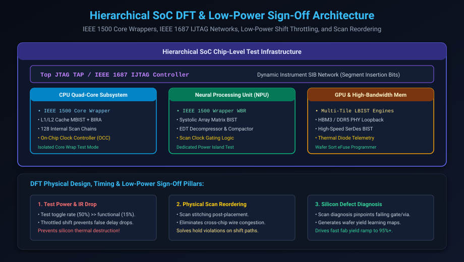

# SoC DFT Integration, Low-Power Test & Physical Sign-Off

## Introduction: The System-Level Integration Challenge

Throughout Chapters 1 through 7, we mastered the individual building blocks of modern Design for Testability: scan chains, ATPG compression engines, MBIST controllers, LBIST engines, boundary scan, and SerDes transceivers.

In a commercial 50-billion-transistor SoC, the supreme engineering challenge is **Hierarchical System-Level Integration**:
- How do dozens of IP core wrappers, memory test collars, and analog PHYs connect to a unified chip-level test network?
- How do we prevent the chip from **physically melting on the ATE tester** due to excessive power dissipation during scan shift?
- How do we close timing on millions of scan shift paths without causing routing congestion in physical design?
- And how do we convert factory failure data into rapid **silicon yield learning**?

This capstone chapter covers:
1. **Hierarchical SoC DFT Architecture & IEEE 1500 / 1687 Integration**.
2. **The Test Power Crisis: Shift Power vs. Capture Power & IR Drop**.
3. **Low-Power ATPG & Scan Clock Gating Architectures**.
4. **Physical Scan Reordering & Scan Timing Closure**.
5. **Silicon Failure Diagnosis & Yield Learning**.
6. **The Complete DFT Tape-Out Sign-Off Checklist**.
7. **Hands-On Exercises & Review Questions**.

---

## Hierarchical SoC DFT Architecture

Modern SoCs are too large for flat test generation. Instead, chips are architected as a tiled hierarchy of modular IP subsystems:



### 1. Hierarchical Core Isolation via IEEE 1500
Every major subsystem (CPU cluster, GPU, NPU, Memory Controller) is encased in an **IEEE 1500 Core Wrapper**:
- **Wrapper Boundary Register (WBR)**: Boundary scan cells isolating the core's input and output ports.
- **Top-Level Independence**: The core can be completely tested at the block level before chip-level integration. Patterns generated for the CPU core are wrapped and retargeted directly to top-level chip pins without re-running full-chip ATPG.

### 2. On-Chip Clock Controller (OCC)
In modern chips, clock frequencies reach 3.0+ GHz, generated by on-chip Phase-Locked Loops (PLLs). 
- An external ATE tester cannot provide a clean 3 GHz clock through package pins.
- The **On-Chip Clock Controller (OCC)** receives a slow reference clock (e.g. 25 MHz) from the tester during shift mode, and dynamically gates the high-speed functional PLL output during capture mode to emit exactly **two at-speed clock pulses** for Launch-on-Capture (LOC) testing.

---

## The Test Power Crisis: Shift & Capture Power

During normal functional operation, software and hardware algorithms are designed to be energy-efficient: clock gating shuts off inactive blocks, caches remain idle until accessed, and only **10% to 15% of circuit flip-flops toggle simultaneously** in any given clock cycle.

In unconstrained DFT scan testing, the exact opposite occurs:
- As pseudo-random patterns are shifted through scan chains, **50% to 70% of all flip-flops on the chip toggle on every single clock cycle**!
- Test power dissipation can reach **300% to 500% of the chip's maximum rated functional power envelope**.

```text
================================================================================
                    THE CATASTROPHIC RISKS OF TEST OVERPOWER
================================================================================
  1. Excessive IR Drop:
     --> Massive current draw (I) through power grid resistance (R) causes
         local supply voltage VDD to sag (e.g. 0.9V drops to 0.72V).
     --> Transistors slow down drastically!
     --> Perfectly good, defect-free chips fail at-speed timing tests on the
         tester and are discarded, destroying silicon yield!

  2. Thermal Runaway:
     --> Prolonged high shift power causes package temperature to exceed 125°C.
     --> Can melt solder micro-bumps, crack silicon dies, and destroy ATE sockets.
================================================================================
```

### Low-Power Test Solutions:

#### 1. Low-Power ATPG (Adjacent Fill / Repeat Fill)
Recall that in compressed ATPG, 95%+ of bits are Don't Care ($X$) bits. 
- **Standard ATPG**: Fills $X$-bits with random 0s and 1s, maximizing switching activity.
- **Low-Power ATPG**: Fills $X$-bits with the **same value as the preceding care bit** (e.g. `000000` or `111111`). This eliminates unnecessary $0 \rightarrow 1$ transitions, reducing scan shift switching power by **over 70%**!

#### 2. Scan Clock Gating
Divide the internal scan chains into partitions (e.g. 4 sub-groups). The decompressor only clocks one sub-group at a time, keeping the remaining 75% of scan chains completely static.

#### 3. Partitioned Core-by-Core Test Scheduling
Never test the CPU, GPU, and NPU simultaneously. The top-level test controller schedules IP blocks sequentially across independent power domains, keeping peak chip power strictly within thermal packaging limits.

---

## DFT Physical Design & Scan Timing Closure

When RTL synthesis inserts scan chains, it has no knowledge of physical floorplanning:
- It might chain Flip-Flop 1 (in the bottom-left corner of the die) to Flip-Flop 2 (in the top-right corner 10 millimeters away).
- This creates massive routing congestion, wire crossovers, and timing failures.

### Physical Scan Reordering (Scan Stitching)
After physical placement (Place & Route), EDA tools execute **Physical Scan Reordering**:
- The tool rips up the logical scan chain connections.
- It re-stitches flip-flops based on their **actual physical geometric proximity** on the silicon floorplan.
- This reduces scan routing wirelength by over 80%, eliminating routing congestion and setup violations.

### Resolving Scan Shift Hold Violations
During scan shift mode, data moves directly from $Q$ of Flip-Flop $A$ to $SI$ of Flip-Flop $B$ through a single wire with zero combinational gate delay.
- If clock skew between $A$ and $B$ exceeds the flip-flop clock-to-Q delay ($t_{skew} > t_{cq}$), a **Hold Time Violation** occurs, corrupting the scan chain.
- Physical design tools automatically insert **Hold Buffers** (delay cells) along scan shift nets to guarantee positive hold slack across all operating process corners (PVT).

---

## Silicon Bring-Up & Defect Diagnosis

When a newly fabricated semiconductor chip returns from the foundry, initial wafer yields are often low (30% to 50%). Finding and fixing physical defects is called **Yield Learning**.

```text
[ATE Factory Tester]
        |
        v (Logs failing pattern # and failing scan out pin)
[Scan Diagnosis EDA Tool]
        |
        v (Backtraces failing logic cones through gate netlist)
[Pinpoints Physical Layout (X, Y, Z Coordinate)]
        |
        v
[Scanning Electron Microscope (SEM) Physical Inspection]
        |
        v
[Foundry Fixes Etch Recipe / Lithography Mask] -> Yield Ramps to 95%+!
```

Modern **Scan Diagnosis software** takes the failure bitstreams from the ATE tester and mathematically backtraces through the circuit netlist to pinpoint the single defective transistor, open via, or metal bridge to within **sub-micron physical coordinates**, enabling rapid yield ramps to high-volume profitability!

---

## The Complete DFT Tape-Out Sign-Off Checklist

Before signing off an ASIC design for physical photomask fabrication, the DFT architecture must satisfy the following strict criteria:

```text
================================================================================
                       DFT TAPE-OUT SIGN-OFF CRITERIA
================================================================================
 [✓] Stuck-At Fault Coverage > 99.5% (across all digital logic).
 [✓] Transition Delay (At-Speed) Fault Coverage > 90.0% (LOC timing paths).
 [✓] 100% Embedded Memories covered by At-Speed MBIST (March C-).
 [✓] Memory BIRA redundancy analysis verified with 100% repair simulation.
 [✓] Zero Scan DRC Violations (Clocks, Resets, and Bus Contention verified).
 [✓] Shift & Capture Power Analysis verified under peak IR-drop limit (< 8% VDD sag).
 [✓] Scan chain hold timing closed across all worst-case PVT corners.
 [✓] IEEE 1149.1 Boundary Scan compliant (BSDL file validated against packaging).
================================================================================
```

---

## Hands-On Exercise

### The Problem
An SoC contains 4 symmetrical core tiles (Core 0, Core 1, Core 2, Core 3).
- Each core consumes $P_{func} = 8\text{ Watts}$ during normal operation ($P_{chip\_total} = 32\text{ Watts}$).
- Packaging thermal limit: The package can safely dissipate a maximum of **$P_{max} = 45\text{ Watts}$**.
- During unconstrained scan testing, high switching activity increases power to $P_{test\_core} = 22\text{ Watts}$ per core!

1. What happens if all 4 cores are tested simultaneously?
2. Design a partitioned test schedule that keeps total power within safe packaging limits while minimizing total test time.

### The Solution

#### 1. Simultaneous Test Analysis:
If all 4 cores run scan test simultaneously:
$$P_{total\_test} = 4 \times 22\text{ W} = \mathbf{88\text{ Watts!}}$$
- $88\text{ W}$ severely exceeds the $45\text{ W}$ package limit.
- **Outcome**: Catastrophic thermal failure, severe supply IR drop causing false test failures, and potential destruction of the chip on the ATE socket!

#### 2. Low-Power Partitioned Test Schedule:
- The package limit is $45\text{ W}$.
- Since each core consumes $22\text{ W}$, we can safely test:
  $$\lfloor 45\text{ W} / 22\text{ W} \rfloor = \mathbf{2\text{ cores simultaneously}} \quad (2 \times 22\text{ W} = 44\text{ W} < 45\text{ W})$$
- **Optimal Test Schedule**:
  - **Phase 1**: Test Core 0 and Core 1 concurrently (Power = $44\text{ W}$).
  - **Phase 2**: Test Core 2 and Core 3 concurrently (Power = $44\text{ W}$).
- **Result**: Keeps total peak power strictly below the 45W limit, prevents false IR drop yield loss, and requires only 2 sequential test phases!

---

## Review Questions & Self-Assessment

1. **Why is test power significantly higher than functional power in CMOS chips?**
   *Answer:* CMOS power is primarily dynamic switching power ($P = \alpha C V^2 f$). In functional operation, hardware clock gating and data correlation keep the toggle rate low (10–15%). In scan shift mode, pseudo-random vectors force 50–70% of flip-flops to toggle on every clock cycle, causing 3x to 5x higher power dissipation.
2. **What is the purpose of Physical Scan Reordering (Scan Stitching)?**
   *Answer:* Scan insertion during RTL synthesis chains flip-flops in arbitrary logical order, creating cross-chip wiring tangles. Physical scan reordering re-stitches scan chains based on the physical $(X, Y)$ layout coordinates of flip-flops after placement, dramatically reducing routing congestion and wirelength.
3. **How does an On-Chip Clock Controller (OCC) facilitate at-speed testing?**
   *Answer:* External ATE testers cannot drive gigahertz clocks through physical tester pins. The OCC takes a high-frequency internal PLL clock and cleanly gates it, emitting exactly two at-speed functional clock pulses (Launch and Capture) during the capture phase of transition delay testing.
4. **How does Scan Diagnosis assist foundry yield learning?**
   *Answer:* Scan diagnosis software analyzes failing ATE test vector patterns and backtraces through the logic netlist and physical layout to pinpoint the exact sub-micron $(X,Y,Z)$ location of defects (e.g. a shorted metal wire or open via), enabling process engineers to identify and correct fabrication issues.

---

##### Copyright (c) 2026 squared-studio
