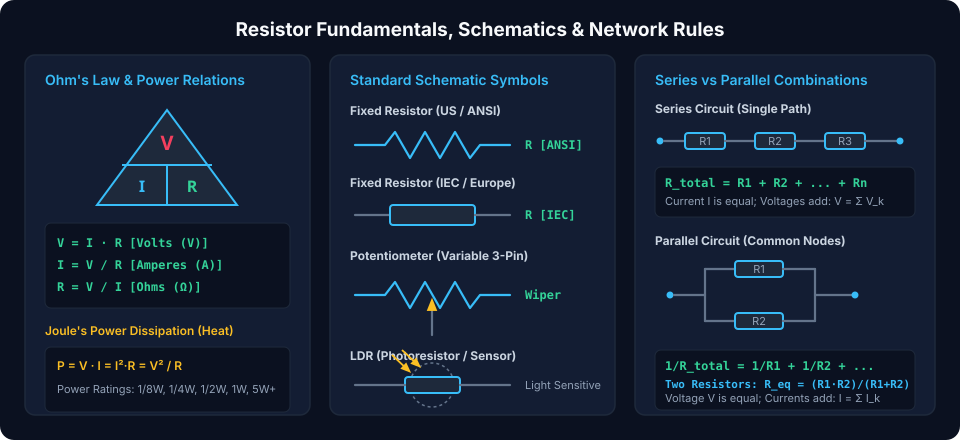
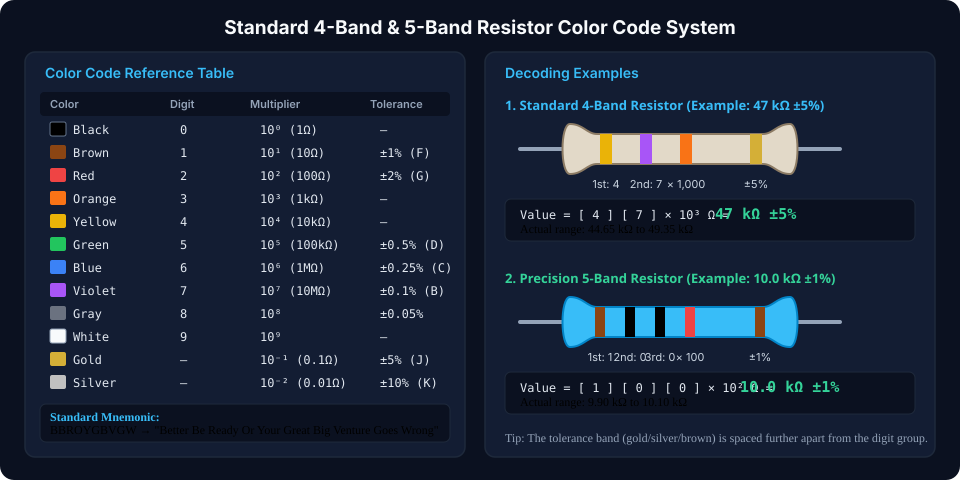
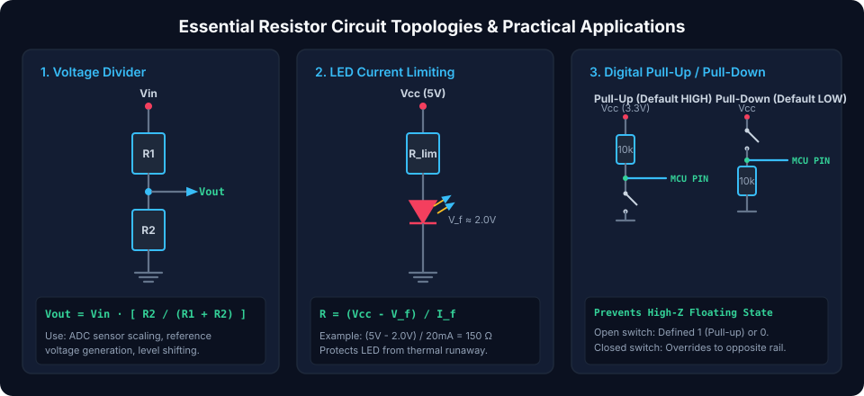

# Resistors: A Comprehensive Guide

Resistors are **passive two-terminal electrical components** that are fundamental to the world of electronics. Their primary function is to **impede the flow of electric current**, acting as a controlled bottleneck in electronic circuits. Resistors are indispensable in virtually all electronic circuits for current control, voltage division, signal level adjustment, biasing active devices, and power dissipation.

---

## Basic Electrical Concepts

Understanding resistors requires grasping three fundamental electrical quantities governed by electromagnetic physics:

- **Resistance ($R$):** The inherent physical property of a material that **quantifies its opposition to the flow of electric charge**. Resistance arises from collisions between charge carriers (electrons) and the vibrating atomic lattice of the conductor. Resistance is measured in **Ohms ($\Omega$)**, named after Georg Simon Ohm.
- **Current ($I$):** The **rate of flow of electric charge** past a given cross-section of a conductor:
  $$I = \frac{dQ}{dt}$$
  Measured in **Amperes ($A$)**, where $1\text{ A} = 1\text{ Coulomb/second}$.
- **Voltage ($V$):** The **electrical potential difference** or electromotive force driving charge through a circuit. It represents the potential energy difference per unit charge between two points:
  $$V = \frac{dW}{dQ}$$
  Measured in **Volts ($V$)**, where $1\text{ V} = 1\text{ Joule/Coulomb}$.

---

## Ohm's Law: The Cornerstone of Circuit Analysis

Ohm's Law expresses the fundamental linear relationship between voltage, current, and resistance across an ideal ohmic conductor:

$$V = I \cdot R$$

From this fundamental law, we derive expressions for current and resistance:

$$I = \frac{V}{R} \qquad\text{and}\qquad R = \frac{V}{I}$$



---

## Power Dissipation: Resistors as Energy Converters

As current passes through a resistive material, electrical energy is converted irreversibly into thermal energy via Joule heating. The instantaneous power dissipated is:

$$P = V \cdot I$$

Substituting Ohm's Law ($V = I \cdot R$) yields alternative formulations depending on which parameters are known:

$$P = I^2 \cdot R = \frac{V^2}{R}$$

Where:

- $P$ = Power in **Watts ($W$)** ($1\text{ W} = 1\text{ J/s}$)
- $V$ = Potential difference across the resistor in **Volts ($V$)**
- $I$ = Current flowing through the resistor in **Amperes ($A$)**
- $R$ = Resistance in **Ohms ($\Omega$)**

> [!IMPORTANT]
> **Power Rating & Engineering Derating Rule:**  
> Resistors are manufactured with standardized continuous power ratings (e.g., $1/8\text{ W}$, $1/4\text{ W}$, $1/2\text{ W}$, $1\text{ W}$, $5\text{ W}+$). Operating a resistor at its exact nominal rating significantly increases operating temperatures, shifts resistance value (TCR drift), and shortens operational lifespan. As a sound engineering rule-of-thumb, **derate power dissipation by at least 50%** (i.e., choose a resistor rated for at least $2\times$ the calculated steady-state dissipation).

---

## Series and Parallel Resistor Configurations

Circuits combine multiple resistors into network topologies to achieve target resistances and divide voltages or currents.

### Resistors in Series (Current-Conserving Chain)

In a series connection, components are connected end-to-end along a single continuous path:

- **Current is Identical:** $I_{total} = I_1 = I_2 = \dots = I_n$
- **Voltages Add (KVL):** $V_{total} = V_1 + V_2 + \dots + V_n$

The equivalent total resistance is the algebraic sum of individual values:

$$R_{total} = \sum_{k=1}^{n} R_k = R_1 + R_2 + R_3 + \dots + R_n$$

### Resistors in Parallel (Voltage-Conserving Nodes)

In a parallel connection, all resistors share two common electrical nodes:

- **Voltage is Identical:** $V_{total} = V_1 = V_2 = \dots = V_n$
- **Currents Add (KCL):** $I_{total} = I_1 + I_2 + \dots + I_n$

The reciprocal of the equivalent resistance equals the sum of reciprocals (conductances):

$$\frac{1}{R_{total}} = \sum_{k=1}^{n} \frac{1}{R_k} = \frac{1}{R_1} + \frac{1}{R_2} + \dots + \frac{1}{R_n}$$

For the special case of **two parallel resistors**:

$$R_{eq} = \frac{R_1 \cdot R_2}{R_1 + R_2}$$

For $n$ identical resistors of value $R$ connected in parallel:

$$R_{eq} = \frac{R}{n}$$

---

## Decoding Resistor Color Codes: 4-Band & 5-Band Systems

Through-hole cylindrical resistors indicate nominal resistance and manufacturing tolerance using standardized EIA color bands.



### Color Code Lookup Matrix

| Color      | Significant Digit |     Multiplier ($10^n$)     | Tolerance ($\pm\%$) | TCR ($\text{ppm/}^\circ\text{C}$) |
| :--------- | :---------------: | :-------------------------: | :-----------------: | :-------------------------------: |
| **Black**  |         0         |     $10^0 = 1\,\Omega$      |          —          |                 —                 |
| **Brown**  |         1         |     $10^1 = 10\,\Omega$     |    $\pm 1\%$ (F)    |              100 ppm              |
| **Red**    |         2         |    $10^2 = 100\,\Omega$     |    $\pm 2\%$ (G)    |              50 ppm               |
| **Orange** |         3         |  $10^3 = 1\text{ k}\Omega$  |          —          |              15 ppm               |
| **Yellow** |         4         | $10^4 = 10\text{ k}\Omega$  |          —          |              25 ppm               |
| **Green**  |         5         | $10^5 = 100\text{ k}\Omega$ |   $\pm 0.5\%$ (D)   |                 —                 |
| **Blue**   |         6         |  $10^6 = 1\text{ M}\Omega$  |  $\pm 0.25\%$ (C)   |              10 ppm               |
| **Violet** |         7         | $10^7 = 10\text{ M}\Omega$  |   $\pm 0.1\%$ (B)   |               5 ppm               |
| **Gray**   |         8         |           $10^8$            |    $\pm 0.05\%$     |                 —                 |
| **White**  |         9         |           $10^9$            |          —          |               1 ppm               |
| **Gold**   |         —         |   $10^{-1} = 0.1\,\Omega$   |    $\pm 5\%$ (J)    |                 —                 |
| **Silver** |         —         |  $10^{-2} = 0.01\,\Omega$   |   $\pm 10\%$ (K)    |                 —                 |

#### 4-Band Resistor Reading Method

1. **Band 1:** First significant digit.
2. **Band 2:** Second significant digit.
3. **Band 3:** Decimal multiplier ($10^n$).
4. **Band 4:** Tolerance band (separated by a wider mechanical gap).

$$\text{Value} = (D_1 \cdot 10 + D_2) \times 10^{\text{multiplier}} \pm \text{Tolerance}$$

_Example:_ Yellow (4) - Violet (7) - Orange ($10^3$) - Gold ($\pm 5\%$) = **$47\text{ k}\Omega \pm 5\%$** (Actual span: $44.65\text{ k}\Omega$ to $49.35\text{ k}\Omega$).

#### 5-Band Precision Resistor Reading Method

Used for high-precision metal film resistors ($\pm 1\%$ or tighter):

1. **Bands 1, 2, 3:** Three significant digits ($D_1, D_2, D_3$).
2. **Band 4:** Multiplier.
3. **Band 5:** Tolerance band (Brown for $\pm 1\%$, Red for $\pm 2\%$).

$$\text{Value} = (D_1 \cdot 100 + D_2 \cdot 10 + D_3) \times 10^{\text{multiplier}} \pm \text{Tolerance}$$

_Example:_ Brown (1) - Black (0) - Black (0) - Red ($10^2$) - Brown ($\pm 1\%$) = **$10.0\text{ k}\Omega \pm 1\%$**.

---

## The Diverse Family of Resistors

```
                          ┌────────────────────────┐
                          │    Resistor Family     │
                          └───────────┬────────────┘
                                      │
              ┌───────────────────────┴───────────────────────┐
              ▼                                               ▼
     ┌─────────────────┐                             ┌─────────────────┐
     │ Fixed Resistors │                             │Variable/Sensors │
     └────────┬────────┘                             └────────┬────────┘
              │                                               │
   ├──────────┼──────────┤                       ├────────────┼────────────┤
   ▼          ▼          ▼                       ▼            ▼            ▼
Carbon      Metal    Wirewound             Potentiometers  Thermistors    LDRs
Film        Film     (High Power)            & Rheostats    (NTC/PTC)    (Optical)
```

1. **Carbon Film Resistors:** General-purpose, low-cost through-hole components ($5\%$ tolerance). Moderate noise and temperature drift.
2. **Metal Film Resistors:** High precision ($1\%$, $0.1\%$), low thermal drift ($\text{TCR} < 50\text{ ppm/}^\circ\text{C}$), and low noise. Preferred for precision instrumentation and audio.
3. **Wirewound Resistors:** Nichrome wire wound around a ceramic insulating core. Handles extreme pulse power and sustained heat ($5\text{ W}$ to $100\text{ W}+$); exhibits parasitic series inductance at high RF frequencies.
4. **Surface-Mount Device (SMD) Resistors:** Thick-film and thin-film chip resistors packaged in standardized imperial/metric footprints (0402, 0603, 0805, 1206). Ultra-low parasitic inductance, ideal for high-density modern PCBs.
5. **Potentiometers & Trimmers:** Three-terminal mechanical variable voltage dividers. Used for volume controls, sensory feedback, and calibration.
6. **Thermistors:** Temperature-sensitive resistors:
   - **NTC (Negative Temperature Coefficient):** Resistance drops exponentially as temperature rises; used for inrush current limiting and temperature measurement.
   - **PTC (Positive Temperature Coefficient):** Resistance climbs sharply past a Curie threshold; acts as resettable fuses (Polyswitch).
7. **Photoresistors (LDR):** Cadmium-sulfide (CdS) photocells whose resistance decreases with increasing incident photon flux.

---

## Essential Resistor Applications in Circuit Design



### 1. The Voltage Divider Network

Attenuates a high DC or AC voltage down to a proportional lower level:

$$V_{out} = V_{in} \cdot \left(\frac{R_2}{R_1 + R_2}\right)$$

_Design Rule:_ To prevent load resistance $R_L$ from pulling down $V_{out}$ (loading effect), ensure the divider's output impedance $R_1 \parallel R_2 \le 0.1 \cdot R_L$.

### 2. LED Current Limiting

Semiconductor diodes have an exponential forward I-V characteristic. Without a series ballast resistor, minor increases in rail voltage cause destructive thermal runaway:

$$R_{limit} = \frac{V_{CC} - V_F}{I_F}$$

_Example:_ For $V_{CC} = 5.0\text{ V}$, a red LED with $V_F = 2.0\text{ V}$, and target current $I_F = 20\text{ mA}$:
$$R_{limit} = \frac{5.0 - 2.0}{0.020} = 150\,\Omega$$

### 3. Digital Pull-Up and Pull-Down Resistors

High-impedance CMOS/TTL microcontroller inputs float when a mechanical button or bus line is unasserted, picking up stray electromagnetic interference and triggering spurious logic toggles.

- **Pull-Up:** Connects input pin to $V_{CC}$ via a $10\text{ k}\Omega$ resistor (default logic HIGH = 1).
- **Pull-Down:** Connects input pin to GND via a $10\text{ k}\Omega$ resistor (default logic LOW = 0).

##### Copyright (c) 2026 squared-studio
