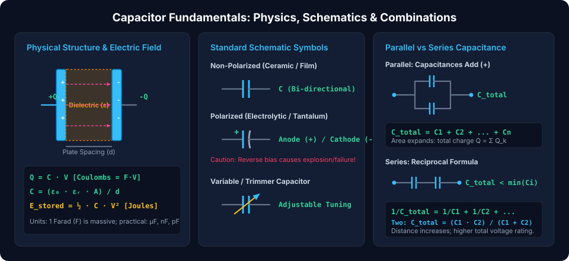
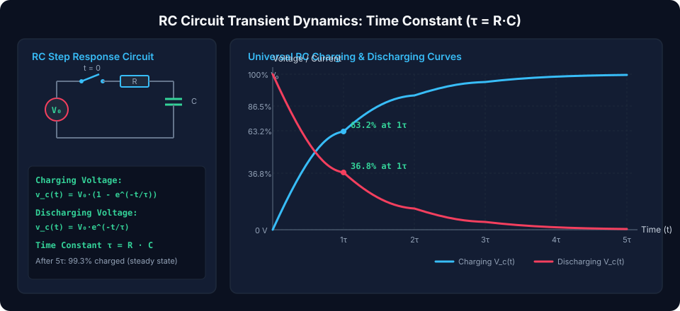
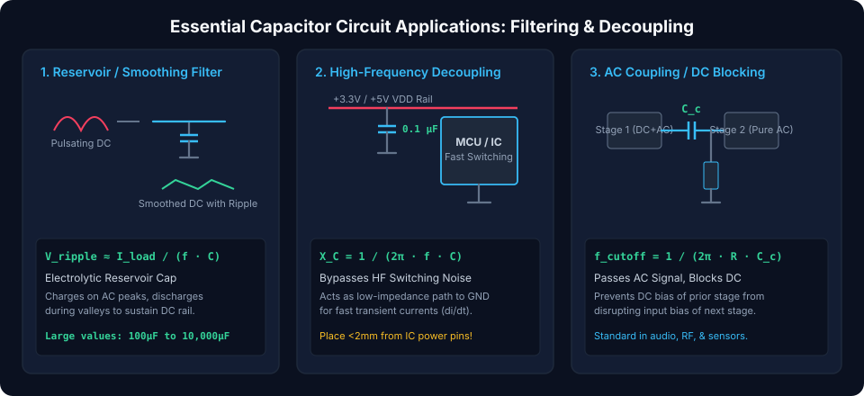

# Capacitors: Electrical Energy Storage and AC Filtering

Capacitors are **passive two-terminal electrical components** that store energy in an **electrostatic field** created between conductive plates separated by a dielectric insulator. Unlike batteries that convert chemical energy through slow electrochemical reactions, capacitors store electrostatic potential energy directly, allowing near-instantaneous charging and discharging. Capacitors are fundamental building blocks for power supply smoothing, high-frequency noise decoupling, signal coupling, and precision timing.

---

## Fundamental Capacitor Physics & Equations

A capacitor consists of two conducting electrodes of area $A$ separated by a distance $d$ containing an insulating dielectric material with relative permittivity $\varepsilon_r$.

### 1. The Fundamental Charge Equation

The electric charge $Q$ accumulated on the plates is directly proportional to the applied potential difference $V$:

$$Q = C \cdot V$$

Where:

- $Q$ = Electric charge in **Coulombs ($C$)**
- $C$ = Capacitance in **Farads ($F$)**
- $V$ = Voltage across plates in **Volts ($V$)**

### 2. Physical Capacitance Equation

Capacitance is governed entirely by geometry and the dielectric medium:

$$C = \frac{\varepsilon_0 \cdot \varepsilon_r \cdot A}{d}$$

Where:

- $\varepsilon_0 \approx 8.854 \times 10^{-12}\text{ F/m}$ (Permittivity of free space / vacuum)
- $\varepsilon_r$ (or $\kappa$) = Relative permittivity / dielectric constant (Air $\approx 1$, Mylar $\approx 3$, $\text{Al}_2\text{O}_3 \approx 9$, High-K Ceramics $\approx 1,000\text{--}10,000$)
- $A$ = Overlapping plate surface area in square meters ($\text{m}^2$)
- $d$ = Separation distance between plates in meters ($m$)

### 3. Electrostatic Stored Energy

The work required to transfer charge against the electric field accumulates as electrostatic potential energy:

$$E = \int_0^V C \cdot v \, dv = \frac{1}{2} C \cdot V^2 = \frac{Q^2}{2C}$$

### 4. Dynamic Current-Voltage Relationship

Differentiating $Q = C \cdot V$ with respect to time yields the instantaneous displacement current:

$$i(t) = C \cdot \frac{dv(t)}{dt}$$

> [!NOTE]
> **Voltage Continuity Rule:**  
> Because $i(t) = C \frac{dv}{dt}$, an instantaneous jump in voltage ($\frac{dv}{dt} \to \infty$) would demand infinite current. Therefore, **the voltage across an ideal capacitor cannot change instantaneously**.

---

## Combining Capacitors in Circuits

### Parallel Capacitors (Expanded Plate Area)

Connecting capacitors in parallel provides multiple paths for charge, effectively combining the plate areas:

- **Voltage is Identical:** $V_1 = V_2 = \dots = V_n = V_{total}$
- **Charges Add:** $Q_{total} = Q_1 + Q_2 + \dots + Q_n$

$$C_{total} = \sum_{k=1}^n C_k = C_1 + C_2 + C_3 + \dots + C_n$$

### Series Capacitors (Increased Separation Distance)

In series, the same displacement current passes through each capacitor:

- **Voltages Add:** $V_{total} = V_1 + V_2 + \dots + V_n$
- **Charge is Equal:** $Q_1 = Q_2 = \dots = Q_n = Q_{total}$

$$\frac{1}{C_{total}} = \sum_{k=1}^n \frac{1}{C_k} = \frac{1}{C_1} + \frac{1}{C_2} + \dots + \frac{1}{C_n}$$

For **two capacitors in series**:

$$C_{total} = \frac{C_1 \cdot C_2}{C_1 + C_2}$$

---

## Transient Response in Resistor-Capacitor (RC) Circuits

When an uncharged capacitor connects to a DC voltage source $V_0$ via resistor $R$, the rate of charging is governed by a first-order differential equation:

$$V_0 = R \cdot i(t) + v_C(t) = R \cdot C \frac{dv_C(t)}{dt} + v_C(t)$$

### The RC Time Constant ($\tau$)

The characteristic response time of the circuit is defined as:

$$\tau = R \cdot C \quad [\Omega \cdot \text{F} = \text{seconds}]$$

### 1. Capacitor Charging Profile

Starting from zero initial voltage ($v_C(0) = 0$):

$$v_C(t) = V_0 \cdot \left(1 - e^{-t / \tau}\right)$$

$$i(t) = \frac{V_0}{R} \cdot e^{-t / \tau}$$

### 2. Capacitor Discharging Profile

Discharging through resistor $R$ from initial voltage $V_0$:

$$v_C(t) = V_0 \cdot e^{-t / \tau}$$

$$i(t) = -\frac{V_0}{R} \cdot e^{-t / \tau}$$

### Standard Time Constant Benchmarks

|  Elapsed Time   |   Charging $v_C(t)$   | Discharging $v_C(t)$  | Physical State                                         |
| :-------------: | :-------------------: | :-------------------: | :----------------------------------------------------- |
| **$t = 1\tau$** | **$63.2\%$** of $V_0$ | **$36.8\%$** of $V_0$ | Rapid initial charge/discharge                         |
| **$t = 2\tau$** |   $86.5\%$ of $V_0$   |   $13.5\%$ of $V_0$   | Curvature slows                                        |
| **$t = 3\tau$** |   $95.0\%$ of $V_0$   |   $5.0\%$ of $V_0$    | Near-complete transfer                                 |
| **$t = 4\tau$** |   $98.2\%$ of $V_0$   |   $1.8\%$ of $V_0$    | Residual tail                                          |
| **$t = 5\tau$** | **$99.3\%$** of $V_0$ | **$0.7\%$** of $V_0$  | **Engineered Steady-State (Fully charged/discharged)** |

---

## AC Circuit Behavior & Capacitive Reactance

Under continuous sinusoidal AC excitation ($v(t) = V_m \sin(\omega t)$), the capacitor presents a frequency-dependent opposition to current flow known as **capacitive reactance ($X_C$)**:

$$X_C = \frac{1}{\omega \cdot C} = \frac{1}{2\pi \cdot f \cdot C} \quad [\Omega]$$

In complex impedance form:

$$Z_C = \frac{1}{j \omega C} = -j X_C = \frac{1}{j 2\pi f C}$$

- **At DC ($f = 0\text{ Hz}$):** $X_C \to \infty$, capacitor acts as an **open circuit**.
- **At Ultra-High Frequencies ($f \to \infty$):** $X_C \to 0$, capacitor behaves as an **AC short circuit**.
- **Phase Shift:** Current **leads** voltage by exactly $90^\circ$ ($\pi/2$ radians) ("ICE" in the mnemonic _ELI the ICE man_).

---

## Essential Capacitor Applications in Electronic Design

### 1. Power Supply Smoothing (Reservoir Filter)

Placed directly at the output of a full-wave bridge rectifier to absorb AC pulsation and supply continuous load current during the waveform dips:

$$V_{ripple(p\text{-}p)} \approx \frac{I_{load}}{2 \cdot f_{line} \cdot C_{filter}}$$

_Design Tip:_ For a $50\text{ Hz}$ mains rectifier ($100\text{ Hz}$ ripple) drawing $1\text{ A}$ with a max allowed ripple of $1\text{ V}$, choose $C \ge \frac{1}{2 \cdot 100 \cdot 1} = 5,000\,\mu\text{F}$.

### 2. High-Frequency IC Decoupling (Bypass)

Microcontrollers, FPGAs, and high-speed CMOS gates draw instantaneous supply currents ($di/dt$) during clock edges. Parasitic board trace inductances ($L_{trace}$) cause ground bounce and rail sag ($V = L \frac{di}{dt}$).

- **Solution:** Place a low-ESR ceramic capacitor ($0.1\,\mu\text{F}$ 0402/0603 MLCC) **within 2 mm of each IC $V_{DD}/V_{SS}$ pin pair** to provide a localized, low-impedance high-frequency charge reservoir.

### 3. AC Coupling / DC Blocking

Used to daisy-chain amplifier stages (e.g., audio preamps or RF receivers). The series capacitor passes alternating audio signals while blocking different DC bias operating points between stages:

$$f_{-3\text{dB}} = \frac{1}{2\pi \cdot R_{in} \cdot C_{coupling}}$$

---

## Comparison of Capacitor Dielectric Technologies

| Dielectric Family          | Capacitance Range                 | Voltage Ratings               | ESR & Parasitics                     | Dominant Applications                           |
| :------------------------- | :-------------------------------- | :---------------------------- | :----------------------------------- | :---------------------------------------------- |
| **Ceramic (C0G/NP0)**      | $1\text{ pF} - 47\text{ nF}$      | $25\text{ V} - 1\text{ kV}$   | Ultra-low ESR, 0 voltage coefficient | RF oscillators, precision filters, timing       |
| **Ceramic (X7R/X5R)**      | $10\text{ nF} - 100\,\mu\text{F}$ | $6.3\text{ V} - 100\text{ V}$ | Low ESR, moderate DC bias derating   | Digital IC decoupling, DC-DC converters         |
| **Aluminum Electrolytic**  | $1\,\mu\text{F} - 100\text{ mF}$  | $6.3\text{ V} - 500\text{ V}$ | High ESR, polarized                  | AC-DC mains smoothing, bulk energy storage      |
| **Tantalum / Polymer**     | $0.47\,\mu\text{F} - 1\text{ mF}$ | $2.5\text{ V} - 50\text{ V}$  | Low ESR, compact, polarized          | Avionics, telecom, high-density power rails     |
| **Film (Polypropylene)**   | $1\text{ nF} - 50\,\mu\text{F}$   | $50\text{ V} - 2\text{ kV}$   | Ultra-low dielectric absorption      | Audiophile crossovers, pulsed laser discharge   |
| **Supercapacitors (EDLC)** | $0.1\text{ F} - 3,000\text{ F}$   | $2.7\text{ V} - 3.0\text{ V}$ | Moderate ESR, extreme Farad density  | Battery backup, regenerative braking, IoT burst |

##### Copyright (c) 2026 squared-studio
