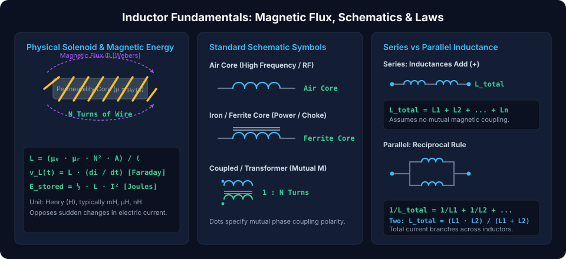
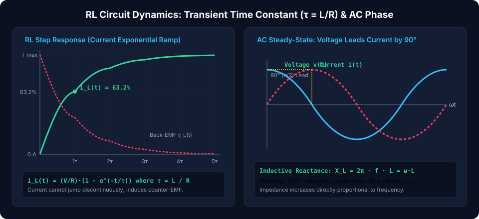
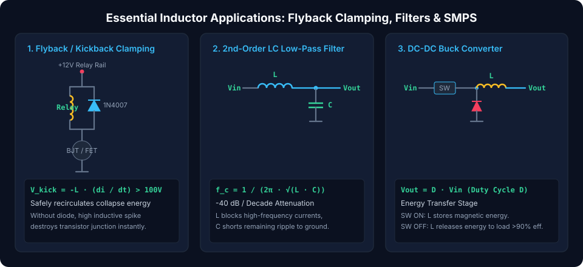

# Inductors: Magnetic Energy Storage, Reactance, and Filter Design

Inductors are **passive two-terminal electrical components** that store energy in a **concentrated magnetic field** when an electric current passes through them. Governed by the principles of electromagnetism discovered by Michael Faraday and Heinrich Lenz, an inductor fundamentally **opposes any change in the electric current** flowing through it. Inductors are indispensable in modern electronics for DC-DC switch-mode power converters, electromagnetic interference (EMI) suppression chokes, resonant LC filters, and transformers.

---

## Fundamental Inductor Physics & Governing Laws

When electric current flows through a helical coil of wire, it creates a magnetic field proportional to the current. If the current changes, the changing magnetic flux induces a counter-electromotive force (back-EMF) across the coil.

### 1. Faraday's Law & Lenz's Law (The Back-EMF Equation)

The instantaneous voltage $v_L(t)$ across an inductor is directly proportional to the time rate-of-change of current:

$$v_L(t) = L \cdot \frac{di(t)}{dt}$$

Where:

- $v_L(t)$ = Induced back-EMF in **Volts ($V$)**
- $L$ = Inductance in **Henrys ($H$)** ($1\text{ H} = 1\text{ Volt}\cdot\text{second / Ampere}$)
- $\frac{di(t)}{dt}$ = Time derivative of current in **Amperes/second ($A/s$)**

> [!NOTE]
> **Current Continuity Rule:**  
> Because $v(t) = L \frac{di}{dt}$, an instantaneous jump in current ($\frac{di}{dt} \to \infty$) would generate infinite voltage. Therefore, **the current flowing through an inductor cannot change instantaneously**. Attempting to abruptly disconnect an energized inductor produces massive inductive kickback voltage spikes.

### 2. Physical Solenoid Inductance Equation

For a cylindrical coil (solenoid) wound with $N$ turns of wire around a magnetic core:

$$L = \frac{\mu_0 \cdot \mu_r \cdot N^2 \cdot A}{\ell}$$

Where:

- $\mu_0 = 4\pi \times 10^{-7}\text{ H/m}$ (Magnetic permeability of free space / vacuum)
- $\mu_r$ = Relative magnetic permeability of core material (Air $\approx 1$, Iron $\approx 5,000$, Manganese-Zinc Ferrite $\approx 2,000\text{--}15,000$)
- $N$ = Total number of wire turns (note the squared dependence: doubling turns quadruples inductance!)
- $A$ = Cross-sectional area of the core in square meters ($\text{m}^2$)
- $\ell$ = Effective magnetic path length in meters ($m$)

### 3. Energy Stored in the Magnetic Field

The total work required to establish current $I$ against the opposing back-EMF is stored in the magnetic field:

$$E_L = \int_0^I L \cdot i \, di = \frac{1}{2} L \cdot I^2 \quad [\text{Joules}]$$

---

## Series and Parallel Inductor Combinations

_(Assuming zero mutual magnetic coupling between coils)_

### Series Inductors (Flux Addition)

In series, the same current flows through all coils, and induced back-EMFs add algebraically:

$$L_{total} = \sum_{k=1}^n L_k = L_1 + L_2 + L_3 + \dots + L_n$$

### Parallel Inductors (Current Branching)

In parallel, each inductor shares the same potential difference:

$$\frac{1}{L_{total}} = \sum_{k=1}^n \frac{1}{L_k} = \frac{1}{L_1} + \frac{1}{L_2} + \dots + \frac{1}{L_n}$$

For **two inductors in parallel**:

$$L_{total} = \frac{L_1 \cdot L_2}{L_1 + L_2}$$

---

## RL Transient Response & AC Sinusoidal Phase Dynamics

### 1. RL Step Response (Current Exponential Ramp)

When a DC step voltage $V_0$ is connected across a series resistor-inductor ($RL$) circuit, the inductor produces a maximum back-EMF at $t=0^+$ equal to $V_0$, causing initial current to be zero. The current ramps exponentially toward its Ohm's law limit ($I_{max} = V_0 / R$):

$$i_L(t) = \frac{V_0}{R} \cdot \left(1 - e^{-t / \tau}\right)$$

$$v_L(t) = V_0 \cdot e^{-t / \tau}$$

Where the **RL time constant** is defined as:

$$\tau = \frac{L}{R} \quad [\text{Henrys / }\Omega = \text{seconds}]$$

- At $t = 1\tau$: Current reaches **$63.2\%$** of $I_{max}$.
- At $t = 5\tau$: Current reaches **$99.3\%$** of $I_{max}$ (steady-state DC conductor behavior).

### 2. AC Sinusoidal Phase & Inductive Reactance ($X_L$)

Under continuous AC excitation ($i(t) = I_m \sin(\omega t)$), differentiating current yields voltage:

$$v_L(t) = L \frac{di}{dt} = \omega L \cdot I_m \cos(\omega t) = \omega L \cdot I_m \sin\left(\omega t + 90^\circ\right)$$

- **Voltage Leads Current by $90^\circ$ ($\pi/2$ radians)** (Mnemonic: **"ELI"** — Electromotive force $E$ leads Current $I$ in Inductor $L$).
- **Inductive Reactance ($X_L$):** The frequency-dependent opposition to AC current:
  $$X_L = \omega \cdot L = 2\pi \cdot f \cdot L \quad [\Omega]$$
- In complex impedance notation:
  $$Z_L = j \omega L = j 2\pi f L$$

- **At DC ($f = 0\text{ Hz}$):** $X_L = 0\,\Omega$, inductor behaves as an **ideal short circuit**.
- **At High Frequency ($f \to \infty$):** $X_L \to \infty$, inductor acts as an **open circuit**, naturally blocking high-frequency AC noise.

---

## Inductor Core Technologies & Magnetic Saturation

| Core Material      | Permeability ($\mu_r$) | Saturation Flux Density ($B_{sat}$) |         Frequency Range         | Typical Engineering Applications                     |
| :----------------- | :--------------------: | :---------------------------------: | :-----------------------------: | :--------------------------------------------------- |
| **Air Core**       |          $1$           |         No saturation limit         | $10\text{ MHz} - 1\text{ GHz}+$ | High-frequency RF tuning, transmitter tanks          |
| **Iron Powder**    |       $20 - 150$       |   High ($1.0 - 1.5\text{ Tesla}$)   | $50\text{ kHz} - 5\text{ MHz}$  | High-current SMPS buck/boost inductors               |
| **Ferrite (MnZn)** |    $1,000 - 15,000$    | Moderate ($0.3 - 0.5\text{ Tesla}$) | $10\text{ kHz} - 1\text{ MHz}$  | Switched-mode power transformers, common-mode chokes |
| **Ferrite (NiZn)** |      $50 - 1,500$      | Moderate ($0.2 - 0.4\text{ Tesla}$) | $1\text{ MHz} - 100\text{ MHz}$ | RF broad-band chokes, EMI bead suppression           |

> [!CAUTION]
> **Core Magnetic Saturation ($I_{sat}$):**  
> Ferromagnetic cores have a maximum magnetic flux density ($B_{sat}$). When current exceeds the saturation rating ($I_{sat}$), the magnetic domains fully align, dropping differential permeability ($\mu_r \to 1$). Inductance collapses abruptly by $90\%+$, transforming the inductor into a near-dead short that can burn out switching MOSFETs in power supplies!

---

## Essential Inductor Circuit Applications

### 1. Flyback / Freewheeling Diode (Inductive Kick Clamping)

When driving an electromechanical relay, solenoid, or DC motor with a switching transistor, turning the transistor OFF abruptly cuts coil current. The inductor responds with a massive negative back-EMF ($v = -L \frac{di}{dt}$) that can easily spike past $+100\text{ V}$, destroying the transistor junction.

- **Solution:** Place an antiparallel **flyback diode** (e.g., 1N4007 or Schottky) across the inductive coil. When the switch opens, the diode conducts, safely recirculating and dissipating the stored magnetic energy through coil resistance.

### 2. Second-Order LC Low-Pass Filter

Combining a series inductor ($L$) with a shunt capacitor ($C$) forms a resonant second-order low-pass filter with an aggressive **$-40\text{ dB/decade}$** ($-12\text{ dB/octave}$) rolloff:

$$f_0 = \frac{1}{2\pi \cdot \sqrt{L \cdot C}}$$

- The series inductor blocks high-frequency harmonic spikes.
- The shunt capacitor shunts residual ripple to ground.
- Widely used on output rails of switch-mode supplies and audio Class-D amplifiers.

### 3. Switch-Mode DC-DC Buck Converter

Modern efficient power supplies ($>90\%$ efficiency) avoid dissipative linear regulators by using an inductor as an intermittent energy storage reservoir:

1.  **Switch ON Phase:** Input voltage energizes the inductor; current ramps up linearly, storing magnetic energy ($\frac{1}{2} L I^2$).
2.  **Switch OFF Phase:** The switch opens; the inductor's magnetic field collapses, forcing current through the catch diode to continuously power the load.
3.  **DC Transfer Function:**
    $$V_{out} = D \cdot V_{in} \quad (0 \le D \le 1)$$

##### Copyright (c) 2026 squared-studio
