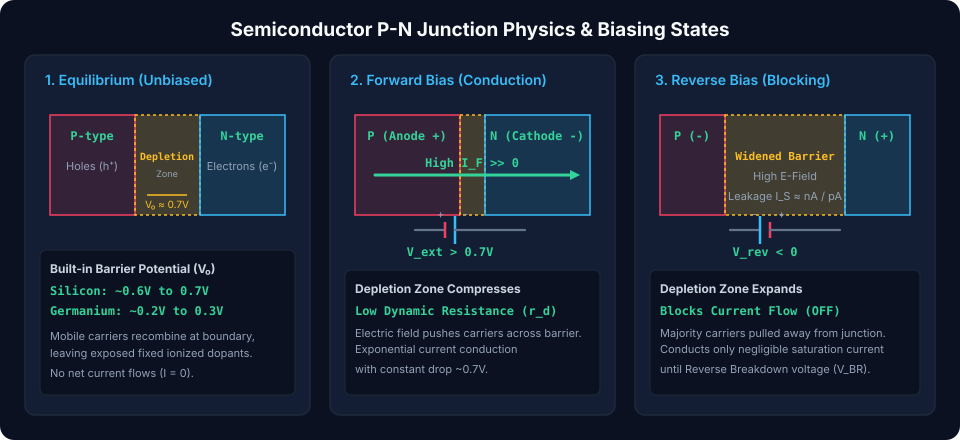
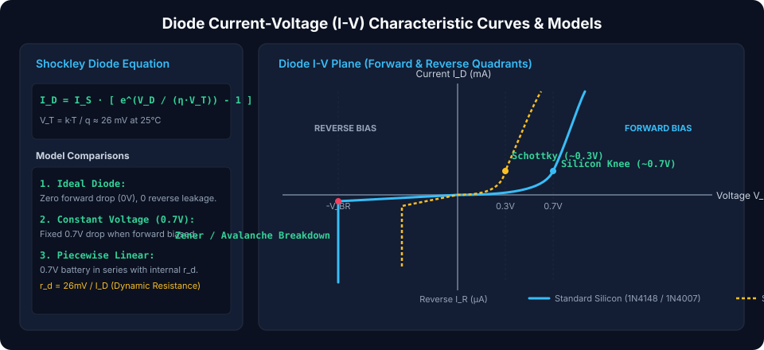
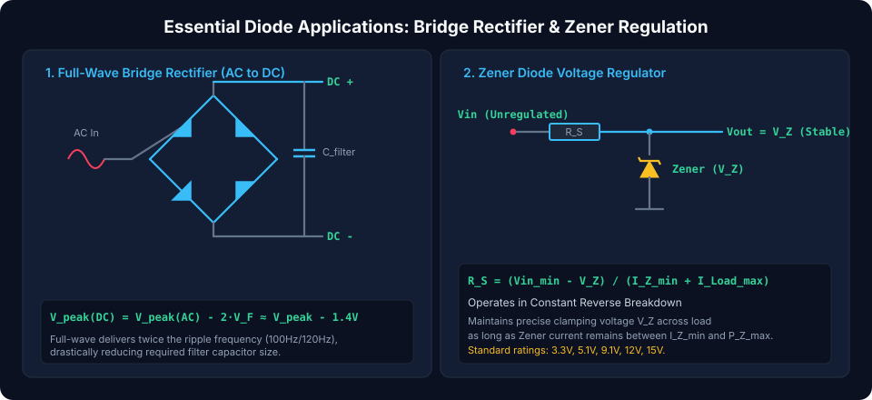

# Diodes: P-N Junction Physics, Rectification, and Voltage Clamping

Diodes are **fundamental two-terminal semiconductor devices** that act as unidirectional current switches. Characterized by their ability to conduct electric current readily in one direction (**forward bias**) while effectively blocking current in the opposite direction (**reverse bias**), diodes underpin modern AC-to-DC power conversion, voltage clamping, RF demodulation, and electrostatic discharge (ESD) protection.

---

## Semiconductor P-N Junction Physics & Biasing States

A semiconductor diode is created by metallurgically joining **P-type** (doped with trivalent acceptors, majority carriers are holes $h^+$) and **N-type** (doped with pentavalent donors, majority carriers are electrons $e^-$) silicon crystals.

### 1. Thermal Equilibrium (Unbiased State, $V = 0$)

At the metallurgical boundary, free electrons from the N-region diffuse across into the P-region and recombine with holes. This leaves unneutralized positively charged donor ions ($N_D^+$) on the N-side and negatively charged acceptor ions ($N_A^-$) on the P-side:

- This region devoid of free mobile charge carriers is the **depletion region** (or space-charge layer).
- The uncovered ions create an internal electric field pointing from N to P, establishing a **built-in barrier potential ($V_0$)**:
  $$V_0 = \frac{k \cdot T}{q} \ln\left(\frac{N_A \cdot N_D}{n_i^2}\right)$$
  - **Silicon:** $V_0 \approx 0.65\text{ V} - 0.70\text{ V}$
  - **Germanium:** $V_0 \approx 0.25\text{ V} - 0.30\text{ V}$

### 2. Forward Bias ($V_{ext} > V_0$, Anode Positive, Cathode Negative)

Connecting the external positive battery terminal to the P-region and negative to the N-region pushes majority carriers toward the junction:

- The external field opposes the built-in barrier, **compressing the depletion width**.
- When $V_{ext}$ overcomes the threshold knee ($\sim 0.7\text{ V}$ for Si), the barrier collapses, enabling massive exponential diffusion current across the junction.

### 3. Reverse Bias ($V_{ext} < 0$, Anode Negative, Cathode Positive)

Connecting the positive battery terminal to the N-region and negative to the P-region pulls majority carriers away from the junction:

- The depletion layer **widens dramatically**, reinforcing the internal electric field.
- Only a microscopic **reverse saturation current ($I_S$)** flows (typically picoamps to nanoamps in silicon), carried by thermally generated minority carriers.
- If reverse voltage exceeds the **breakdown voltage ($V_{BR}$)**, avalanche multiplication or quantum Zener tunneling initiates rapid reverse conduction.

---

## Diode Current-Voltage (I-V) Characteristics & Modeling

### The Shockley Diode Equation

The non-linear conduction profile across all operating regions is described by the Shockley equation:

$$I_D = I_S \cdot \left(e^{\frac{V_D}{\eta \cdot V_T}} - 1\right)$$

Where:

- $I_D$ = Diode current in Amperes ($A$)
- $I_S$ = Reverse saturation leakage current (typically $10^{-12}\text{ A}$ for Si)
- $V_D$ = Voltage across diode terminals in Volts ($V$)
- $\eta$ (eta) = Ideality factor ($1.0 \le \eta \le 2.0$, typically $\approx 1$ for modern discrete diodes)
- $V_T$ = **Thermal Voltage**:
  $$V_T = \frac{k \cdot T}{q} \approx 25.86\text{ mV at room temperature } (300\text{ K})$$

### Diode Circuit Models

1.  **Ideal Diode Model:**
    - Forward Bias ($V_D \ge 0$): Perfect short circuit ($0\text{ V}$ drop, $R = 0$).
    - Reverse Bias ($V_D < 0$): Perfect open circuit ($I_D = 0$, $R \to \infty$).
2.  **Constant Voltage Drop (CVD) Model (Most Common):**
    - When forward-biased and conducting, the diode is modeled as a fixed voltage drop: $V_D = 0.7\text{ V}$ (Silicon) or $0.3\text{ V}$ (Schottky).
3.  **Piecewise Linear Model (With Internal Dynamic Resistance $r_d$):**
    - Models the finite steep slope of forward conduction above $0.7\text{ V}$:
      $$v_D = V_{knee} + i_D \cdot r_d$$
      $$r_d = \frac{d V_D}{d I_D} = \frac{\eta \cdot V_T}{I_D} \approx \frac{26\text{ mV}}{I_D}$$
      _Example:_ At $I_D = 10\text{ mA}$, dynamic resistance is merely $r_d = 26\text{ mV} / 10\text{ mA} = 2.6\,\Omega$.

---

## Essential Diode Circuit Topologies

### 1. Full-Wave Bridge Rectifier (AC to DC Power)

Utilizes four diodes ($D_1 - D_4$) arranged in a diamond bridge topology to invert the negative half-cycles of an AC input:

- **Positive Half-Cycle:** Current conducts through $D_1 \to \text{Load} \to D_2$.
- **Negative Half-Cycle:** Current conducts through $D_3 \to \text{Load} \to D_4$.
- **Output Voltage Peak:**
  $$V_{peak(DC)} = V_{peak(AC)} - 2 \cdot V_F \approx V_{peak(AC)} - 1.4\text{ V}$$
- **Average DC Voltage:**
  $$V_{DC} = \frac{2 \cdot V_{peak(DC)}}{\pi} \approx 0.636 \cdot V_{peak(DC)}$$

### 2. Zener Diode Voltage Regulator

Unlike standard diodes that are damaged by reverse breakdown, **Zener diodes** are heavily doped to safely sustain continuous operation in reverse breakdown at a tightly controlled breakdown voltage ($V_Z$):

- **Operating Rule:** The series resistor $R_S$ must drop the excess unregulated input voltage while ensuring Zener current remains within bounds ($I_{Z(min)} \le I_Z \le I_{Z(max)}$):
  $$R_S = \frac{V_{in(min)} - V_Z}{I_{Z(min)} + I_{Load(max)}}$$
- **Maximum Zener Power Dissipation:**
  $$P_Z = V_Z \cdot I_{Z(max)} \le P_{Z(rated)}$$

---

## Comparison of Diode Semiconductor Technologies

| Diode Family                    |       Forward Drop ($V_F$)        |    Reverse Recovery ($t_{rr}$)    |            Breakdown ($V_{BR}$)            | Key Strengths & Use Cases                                     |
| :------------------------------ | :-------------------------------: | :-------------------------------: | :----------------------------------------: | :------------------------------------------------------------ |
| **Standard Silicon (1N400x)**   |   $0.7\text{ V} - 1.0\text{ V}$   | Slow ($2\text{--}5\,\mu\text{s}$) |       $50\text{ V} - 1,000\text{ V}$       | Low-frequency ($50/60\text{ Hz}$) mains AC rectification      |
| **Schottky Barrier (1N5819)**   | **$0.2\text{ V} - 0.4\text{ V}$** | **Ultra-fast ($< 10\text{ ns}$)** |     Low ($20\text{ V} - 100\text{ V}$)     | SMPS catch diodes, low-loss solar bypass, logic clamping      |
| **Fast Recovery (UF4007)**      |   $1.0\text{ V} - 1.3\text{ V}$   | Fast ($50\text{--}75\text{ ns}$)  |      $600\text{ V} - 1,000\text{ V}$       | High-voltage SMPS secondary rectifiers, flyback snubbers      |
| **Zener Diode (BZX55 / BZX84)** |     $0.7\text{ V}$ (Forward)      |                N/A                | **Precise ($2.4\text{ V} - 75\text{ V}$)** | Shunt voltage references, overvoltage surge clamps            |
| **Transient Suppressor (TVS)**  |     $0.7\text{ V}$ (Forward)      |          Sub-nanosecond           |           Specific trip voltage            | Clamping ESD/lightning strikes on USB/CAN communication lines |

##### Copyright (c) 2026 squared-studio
