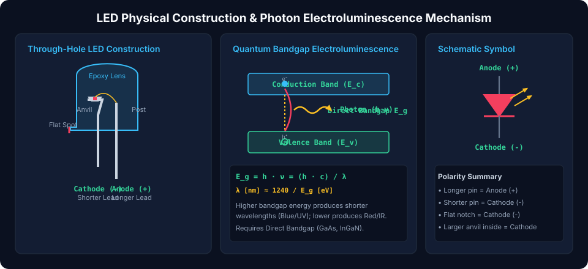
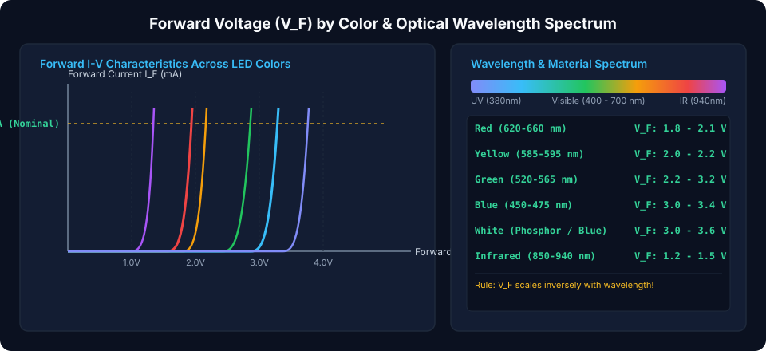
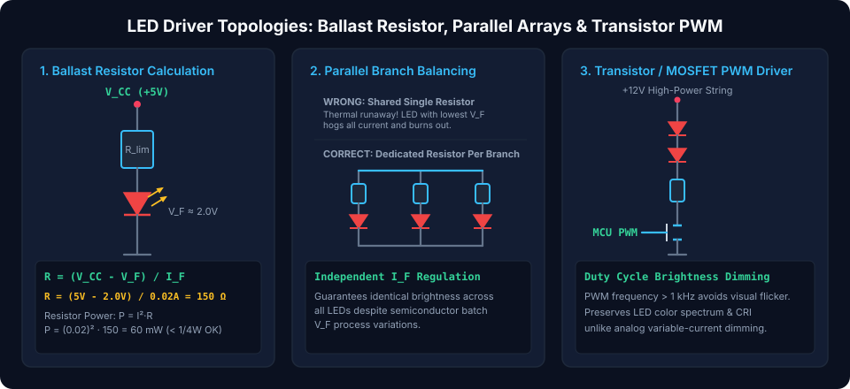

# Light Emitting Diodes (LEDs): Solid-State Lighting, Physics, and Driver Design

Light Emitting Diodes (LEDs) are **specialized semiconductor P-N junction diodes** that emit incoherent or coherent light through **electroluminescence** when forward-biased. Characterized by exceptional energy conversion efficiency, microsecond switching response, and operating lifespans exceeding $50,000$ hours, LEDs have superseded incandescent and fluorescent lighting across indicators, high-CRI general illumination, optical fiber communications, and display backlights.

---

## Direct Bandgap Physics & Physical Construction

Unlike standard silicon diodes where electron-hole recombination dissipates energy invisibly as crystal lattice vibrations (heat/phonons), LEDs are fabricated from **direct bandgap compound semiconductors** (Group III-V alloys).

### 1. Quantum Electroluminescence Mechanism

When a forward bias voltage exceeds the junction barrier, electrons are injected into the conduction band and holes into the valence band. As electrons drop across the energy gap ($E_g$) to recombine with holes, the released energy is conserved as a emitted **photon of light**:

$$E_g = h \cdot \nu = \frac{h \cdot c}{\lambda}$$

Solving for the emitted wavelength $\lambda$:

$$\lambda = \frac{h \cdot c}{E_g} \approx \frac{1240\text{ eV}\cdot\text{nm}}{E_g\text{ [eV]}}$$

Where:

- $h \approx 6.626 \times 10^{-34}\text{ J}\cdot\text{s}$ (Planck's constant)
- $c \approx 3.0 \times 10^8\text{ m/s}$ (Speed of light in vacuum)
- $E_g$ = Semiconductor bandgap energy in **electron-volts ($eV$)**
- $\lambda$ = Optical peak emission wavelength in **nanometers ($nm$)**

> [!NOTE]
> **Bandgap-Wavelength Inverse Law:**  
> A wider semiconductor bandgap ($E_g$) requires a higher forward voltage to conduct, and emits higher-energy, shorter-wavelength photons (e.g., Blue, UV). Conversely, narrower bandgaps emit lower-energy, longer-wavelength photons (e.g., Red, Infrared).

### 2. Through-Hole Physical Anatomy & Polarity Identification

Through-hole $3\text{ mm}$ and $5\text{ mm}$ LED packages provide multiple geometric cues for terminal identification:

- **Anode (+):** Connected to the smaller interior **post**; has the **longer external lead**.
- **Cathode (-):** Formed by the larger interior **reflective anvil cup** (which cradles the semiconductor die); has the **shorter lead** and aligns with a **flat notch** along the rim of the epoxy lens.

---

## LED Forward Voltage ($V_F$) Across the Optical Spectrum

Because bandgap energy dictates both emission wavelength and forward threshold voltage, different colors exhibit distinctly different electrical characteristics.

### Semiconductor Materials & Color Benchmark Matrix

| Color                | Optical Wavelength ($\lambda$) |       Forward Drop ($V_F$)        | Semiconductor Compound Alloy                                 | Typical Applications                                      |
| :------------------- | :----------------------------: | :-------------------------------: | :----------------------------------------------------------- | :-------------------------------------------------------- |
| **Infrared (IR)**    |     $850 - 940\text{ nm}$      | **$1.2\text{ V} - 1.5\text{ V}$** | Gallium Arsenide ($\text{GaAs}$)                             | TV remote controls, night vision IR illuminators          |
| **Red**              |     $620 - 660\text{ nm}$      | **$1.8\text{ V} - 2.1\text{ V}$** | Aluminum Gallium Arsenide ($\text{AlGaAs}$) / $\text{GaAsP}$ | Power status indicators, digital 7-segment displays       |
| **Orange / Amber**   |     $590 - 610\text{ nm}$      | **$2.0\text{ V} - 2.2\text{ V}$** | Gallium Arsenide Phosphide ($\text{GaAsP}$)                  | Automotive indicators, warning instrumentation            |
| **Yellow**           |     $585 - 595\text{ nm}$      | **$2.0\text{ V} - 2.3\text{ V}$** | Gallium Phosphide ($\text{GaP}$) / $\text{AlInGaP}$          | Status panels, signal boards                              |
| **Pure Green**       |     $515 - 530\text{ nm}$      | **$2.8\text{ V} - 3.2\text{ V}$** | Indium Gallium Nitride ($\text{InGaN}$)                      | Traffic signals, full-color LED video walls               |
| **Blue**             |     $450 - 475\text{ nm}$      | **$3.0\text{ V} - 3.4\text{ V}$** | Indium Gallium Nitride ($\text{InGaN}$)                      | Architectural lighting, blue lasers                       |
| **White**            |         Broad spectrum         | **$3.0\text{ V} - 3.6\text{ V}$** | $\text{InGaN}$ Blue Die + Yellow YAG Phosphor                | Domestic lighting, flashlight torches, display backlights |
| **Ultraviolet (UV)** |     $365 - 400\text{ nm}$      | **$3.4\text{ V} - 4.0\text{ V}$** | Aluminum Gallium Nitride ($\text{AlGaN}$)                    | Currency validation, resin UV-curing, forensics           |

---

## Circuit Topologies & LED Driver Design

### 1. Single LED Ballast Resistor Design

Because the LED I-V characteristic is exponential, connecting an LED directly to a fixed voltage source causes excessive current, leading to immediate thermal failure. A series ballast resistor sets the forward operating current ($I_F$):

$$R_{ballast} = \frac{V_{CC} - V_F}{I_F}$$

**Step-by-Step Worked Example:**

- **Supply Voltage ($V_{CC}$):** $+5.0\text{ V}$ (from USB or microcontroller)
- **LED:** High-efficiency Red ($V_F = 2.0\text{ V}$, target nominal current $I_F = 20\text{ mA} = 0.020\text{ A}$)
- **Resistor Value:**
  $$R = \frac{5.0\text{ V} - 2.0\text{ V}}{0.020\text{ A}} = \frac{3.0\text{ V}}{0.020\text{ A}} = 150\,\Omega$$
- **Resistor Power Dissipation:**
  $$P_R = I_F^2 \cdot R = (0.020)^2 \cdot 150 = 0.060\text{ W} = 60\text{ mW}$$
  _(A standard $1/8\text{ W}$ ($125\text{ mW}$) or $1/4\text{ W}$ ($250\text{ mW}$) resistor provides ample margin)._

### 2. The Golden Rule of Parallel LED Strings

> [!CAUTION]
> **Never Connect Parallel LEDs to a Single Shared Resistor!**  
> Due to semiconductor manufacturing batch tolerances, no two LEDs have the exact same forward knee voltage. If placed in parallel across one shared resistor, the diode with the lowest $V_F$ turns on first, conducts almost all the current, overheats (which drops its $V_F$ further due to negative thermal coefficient), enters **thermal runaway**, and burns out. The remaining diodes then absorb the surge and burn out sequentially!
>
> **Correct Design:** Always place an **independent current-limiting resistor in series with each parallel branch**.

### 3. Transistor / MOSFET Pulse-Width Modulation (PWM) Dimming

To control LED brightness without shifting optical color temperature:

- **Analog Current Reduction:** Altering forward DC current shifts the emitted spectral peak slightly.
- **Digital PWM Dimming:** Drive a low-side N-channel MOSFET at a fixed forward current ($20\text{ mA}$) pulsed at high frequency ($1\text{ kHz} - 20\text{ kHz}$). Modulating the duty cycle ($0\%$ to $100\%$) varies perceived luminous flux linearly while completely avoiding visual flicker and color tint shifts.

##### Copyright (c) 2026 squared-studio
