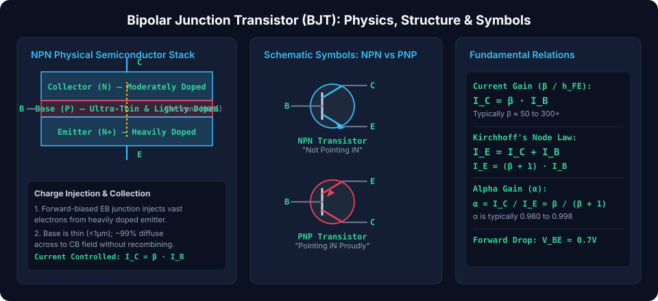
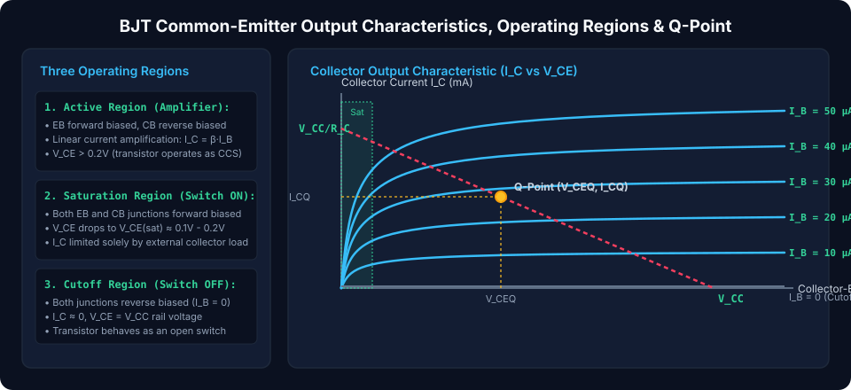
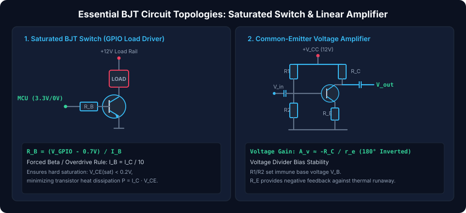

# Bipolar Junction Transistors (BJTs): Physics, Biasing, and Linear Amplification

Bipolar Junction Transistors (BJTs) are **three-terminal semiconductor devices** that form the foundation of analog amplification and digital switching. Unlike unipolar Field-Effect Transistors (FETs) which rely exclusively on majority charge carriers, BJTs are **bipolar** because their operation relies fundamentally on the coordinated transport of **both electrons and holes**. Operating as **current-controlled current sources (CCCS)**, a small current flowing into the base terminal regulates a significantly larger current between collector and emitter.

---

## Semiconductor Architecture & Governing Physics

A BJT is constructed as a three-layer sandwich of alternating P-type and N-type semiconductor regions, creating two adjacent P-N junctions: the **Emitter-Base Junction (EBJ)** and the **Collector-Base Junction (CBJ)**.

### 1. Physical Layer Geometry & Carrier Transport (NPN Transistor)

1.  **Emitter ($E$):** **Heavily doped ($N^+$)** to maximize the concentration of majority electrons injected into the base.
2.  **Base ($B$):** **Extremely narrow (sub-micron, $< 1\,\mu\text{m}$)** and **very lightly doped ($P$)**. This critical physical geometry ensures that over $98\% - 99.5\%$ of injected electrons diffuse across the base without recombining with base holes.
3.  **Collector ($C$):** **Moderately doped ($N$)** with a large physical surface area designed to sweep in incoming electrons and dissipate thermal heat ($P = I_C \cdot V_{CE}$).

### 2. Standard Schematic Symbols & Terminal Identification

- **NPN Transistor:** Emitter arrow points **outward** (_"Not Pointing iN"_). Conventional current flows **into** Base ($I_B$) and Collector ($I_C$), exiting via Emitter ($I_E$).
- **PNP Transistor:** Emitter arrow points **inward** (_"Pointing iN Proudly"_). Current enters the Emitter ($I_E$) and exits via Base ($I_B$) and Collector ($I_C$).

### 3. Fundamental Current & Voltage Equations

In the forward-active region:

- **Collector Current (Beta Gain):**
  $$I_C = \beta \cdot I_B = h_{FE} \cdot I_B$$
  _(Typical values of $\beta$ range from $50$ to $300+$ for general-purpose small-signal transistors like 2N3904 / BC547)._
- **Emitter Current (Kirchhoff's Current Law):**
  $$I_E = I_C + I_B = (\beta + 1) \cdot I_B$$
- **Alpha Gain ($\alpha$):**
  $$\alpha = \frac{I_C}{I_E} = \frac{\beta}{\beta + 1} \qquad (0.980 \le \alpha \le 0.998)$$
  $$\beta = \frac{\alpha}{1 - \alpha}$$
- **Base-Emitter Forward Voltage Drop:**
  $$V_{BE} \approx 0.65\text{ V} - 0.70\text{ V at } 25^\circ\text{C}$$

---

## BJT Operating Regions & Characteristic Curves

The operational state of a BJT is governed by the bias voltages applied across its two internal junctions:

| Operating Region    | Emitter-Base Junction (EBJ) | Collector-Base Junction (CBJ) |     Collector Current ($I_C$)     |                Terminal Voltage                | Primary Application            |
| :------------------ | :-------------------------: | :---------------------------: | :-------------------------------: | :--------------------------------------------: | :----------------------------- |
| **Cutoff**          |       Reverse Biased        |        Reverse Biased         |  $I_C \approx 0$ (Leakage only)   |            $V_{CE} \approx V_{CC}$             | Digital Switch **OFF** (Open)  |
| **Active / Linear** |     **Forward Biased**      |      **Reverse Biased**       |      $I_C = \beta \cdot I_B$      |            $V_{CE} > 0.2\text{ V}$             | Linear Analog Signal Amplifier |
| **Saturation**      |     **Forward Biased**      |      **Forward Biased**       |     Limited by external load      | $V_{CE(sat)} \approx 0.1\text{--}0.2\text{ V}$ | Digital Switch **ON** (Closed) |
| **Reverse-Active**  |       Reverse Biased        |        Forward Biased         | Inefficient ($I_C = \beta_R I_B$) |               Inverted polarity                | Specialized analog switching   |

### DC Load Line & Quiescent Operating Point (Q-Point)

Applying Kirchhoff's Voltage Law to the collector circuit:

$$V_{CC} = I_C \cdot R_C + V_{CE} \implies I_C = -\frac{1}{R_C} \cdot V_{CE} + \frac{V_{CC}}{R_C}$$

- **X-intercept (Cutoff):** $V_{CE} = V_{CC}$ (when $I_C = 0$).
- **Y-intercept (Saturation limit):** $I_{C(sat)} = V_{CC} / R_C$ (when $V_{CE} = 0$).
- **Quiescent Point (Q-Point):** The intersection of the DC load line with the selected base current curve ($I_{BQ}$). For maximum symmetric, undistorted AC output swing in audio/RF amplifiers, the Q-point is biased near the center of the active load line:
  $$V_{CEQ} \approx \frac{V_{CC}}{2}$$

---

## Essential BJT Circuit Topologies

### 1. The Saturated Transistor Switch (GPIO Load Driver)

Microcontroller GPIO pins (3.3V / 5V) can only source or sink $10\text{--}25\text{ mA}$. A saturated BJT switch allows a low-power digital pin to switch high-current solenoids, relays, or power LEDs ($100\text{ mA} - 5\text{ A}$):

- **Forced Beta / Overdrive Rule:** In saturation, the transistor's effective $\beta$ drops. To guarantee deep saturation ($V_{CE(sat)} \le 0.2\text{ V}$):
  $$I_{B(sat)} \ge \frac{I_{C(load)}}{10}$$
- **Base Resistor Sizing:**
  $$R_B = \frac{V_{GPIO} - V_{BE}}{I_{B(sat)}} = \frac{V_{GPIO} - 0.7\text{ V}}{I_{C(load)} / 10}$$

### 2. Common-Emitter Voltage Amplifier (Universal Biasing)

The Common-Emitter (CE) configuration provides both substantial voltage gain and current gain, with a characteristic $180^\circ$ phase inversion:

- **Voltage Divider Biasing ($R_1, R_2$):** Establishes a stiff base voltage $V_B$ independent of temperature and transistor $\beta$ variations:
  $$V_B \approx V_{CC} \cdot \left(\frac{R_2}{R_1 + R_2}\right)$$
  $$V_E = V_B - V_{BE} = V_B - 0.7\text{ V}$$
  $$I_E \approx I_C = \frac{V_E}{R_E}$$
- **Thermal Negative Feedback ($R_E$):** If temperature rises, increasing $I_C$, the voltage drop across $R_E$ increases, reducing $V_{BE} = V_B - V_E$, which automatically throttles $I_C$ back to its stable setpoint.
- **AC Small-Signal Voltage Gain:**
  $$A_v = -\frac{R_C}{r_e} = -\frac{R_C \cdot I_C}{26\text{ mV}} \qquad (\text{with emitter bypass capacitor } C_E)$$

---

## Comparison of BJT Amplifier Configurations

| Configuration                                  | Common Terminal |    Voltage Gain ($A_v$)     |    Current Gain ($A_i$)     |         Input Impedance ($Z_{in}$)          |        Output Impedance ($Z_{out}$)         |   Phase Shift   | Primary Use Case                                |
| :--------------------------------------------- | :-------------: | :-------------------------: | :-------------------------: | :-----------------------------------------: | :-----------------------------------------: | :-------------: | :---------------------------------------------- |
| **Common Emitter (CE)**                        |     Emitter     |   **High ($\sim -100$)**    |   **High ($\sim \beta$)**   | Medium ($\sim 1\text{--}5\text{ k}\Omega$)  |          Medium-High ($\sim R_C$)           | **$180^\circ$** | General-purpose audio/voltage gain stages       |
| **Common Collector (CC)** _(Emitter Follower)_ |    Collector    | Low ($\sim 0.99 \approx 1$) |  **High ($\sim \beta+1$)**  | **Very High ($\sim 100\text{ k}\Omega+$)**  | **Very Low ($\sim 10\text{--}50\,\Omega$)** |    $0^\circ$    | High-to-low impedance buffer stages             |
| **Common Base (CB)**                           |      Base       |   **High ($\sim +100$)**    | Low ($\alpha \approx 0.99$) | **Very Low ($\sim 10\text{--}50\,\Omega$)** |   **Very High ($\sim 1\text{ M}\Omega$)**   |    $0^\circ$    | High-frequency RF amplifiers (no Miller effect) |

##### Copyright (c) 2026 squared-studio
