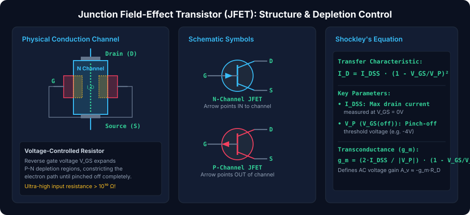
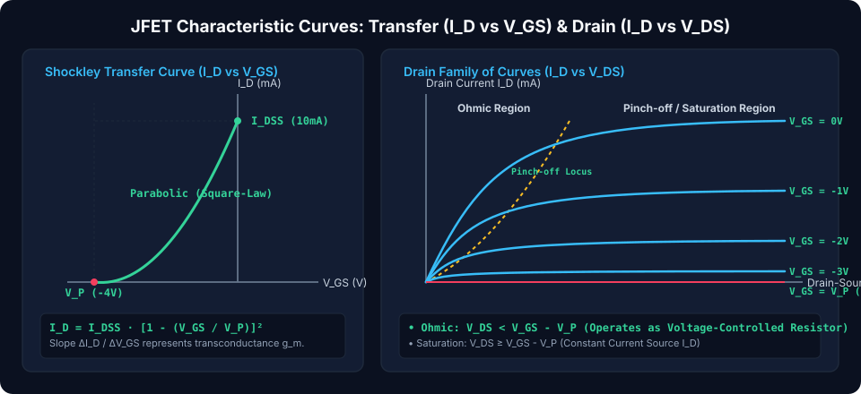
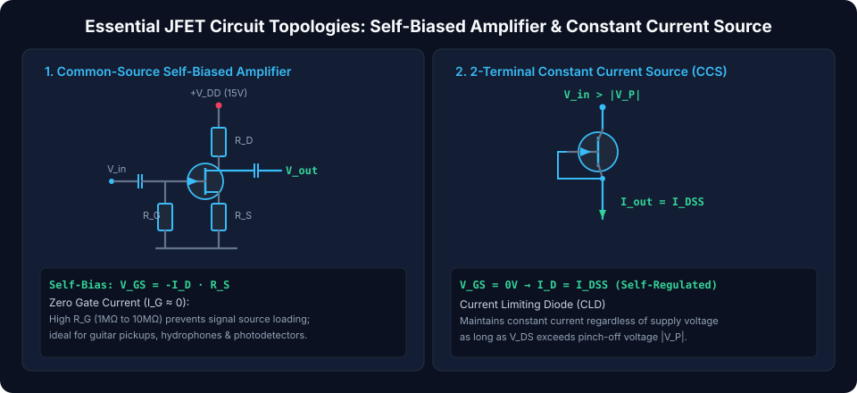

# Junction Field-Effect Transistors (JFETs): Physics, Biasing, and Low-Noise Amplification

Junction Field-Effect Transistors (JFETs) are **three-terminal unipolar semiconductor devices** prized for their exceptionally **high input impedance, ultra-low acoustic noise, and pure voltage-controlled operation**. Unlike Bipolar Junction Transistors (BJTs) which require continuous base input current to conduct, the JFET's gate is formed by a reverse-biased P-N junction. Consequently, the gate draws virtually zero DC current ($I_G < 1\text{ nA}$), presenting an input resistance exceeding $10^{10}\,\Omega$. JFETs are the components of choice for sensitive preamplifiers, high-impedance instrument probes, electret microphones, and precision analog switches.

---

## Semiconductor Architecture & Electrostatic Depletion Physics

A JFET consists of a continuous bar of doped semiconductor material forming a conduction **channel** between the **Drain ($D$)** and **Source ($S$)** terminals. Two heavily doped opposite-polarity regions embedded along the sides form the **Gate ($G$)**.

### 1. N-Channel vs P-Channel Physical Operation

- **N-Channel JFET:** The channel is composed of N-type silicon (majority carriers are electrons, providing higher electron mobility $\mu_n \approx 1350\text{ cm}^2/\text{V}\cdot\text{s}$). The gate is formed of heavily doped $P^+$ regions.
- **P-Channel JFET:** The channel is P-type silicon (majority carriers are holes, $\mu_p \approx 480\text{ cm}^2/\text{V}\cdot\text{s}$).
- **Depletion Modulation:** Applying a **negative voltage to the gate relative to the source ($V_{GS} \le 0$)** reverse-biases the gate-channel P-N junctions. This widens the non-conductive depletion regions inward into the channel, physically narrowing the conductive cross-sectional path available for electron flow.
- **Pinch-Off Voltage ($V_P$ or $V_{GS(off)}$):** The negative gate-source voltage at which the depletion layers touch, completely cutting off the conduction channel ($I_D \to 0$).

### 2. Standard Schematic Symbols

- **N-Channel JFET:** The gate arrow points **inward** toward the channel (representing a P-to-N diode forward direction).
- **P-Channel JFET:** The gate arrow points **outward** away from the channel.

---

## Operating Regions & Characteristic Curves

A JFET operates across three distinct electrical regions governed by the terminal voltages $V_{GS}$ and $V_{DS}$:

### 1. Ohmic / Linear Region ($V_{DS} < V_{GS} - V_P$)

At small drain-to-source voltages, the channel behaves as a linear, voltage-variable resistor. The drain-source channel resistance ($r_{ds}$) is precisely modulated by the gate voltage:

$$r_{ds} \approx \frac{r_0}{\left(1 - \frac{V_{GS}}{V_P}\right)^2}$$

_(Widely exploited as a **Voltage-Controlled Resistor (VCR)** for automatic gain control and audio compressors)._

### 2. Saturation / Pinch-Off Region ($V_{DS} \ge V_{GS} - V_P$)

As $V_{DS}$ increases, the voltage drop along the channel causes the gate-channel junction to be most heavily reverse-biased near the drain end. The channel "pinches off" to a constant geometry:

- Electrons are swept across the pinch-off boundary by the high drain electric field.
- The drain current becomes independent of $V_{DS}$, plateauing into a **pure voltage-controlled current source**.

### 3. Shockley's JFET Transfer Equation

In the saturation region, the relationship between drain current $I_D$ and gate bias $V_{GS}$ follows Shockley's parabolic square law:

$$I_D = I_{DSS} \cdot \left(1 - \frac{V_{GS}}{V_P}\right)^2 \qquad (V_P \le V_{GS} \le 0)$$

Where:

- $I_D$ = Drain current in Amperes ($A$)
- $I_{DSS}$ = **Zero-Bias Drain Saturation Current** (the maximum current when $V_{GS} = 0\text{ V}$)
- $V_P$ = **Pinch-Off Cutoff Voltage** (negative for N-channel, typically $-2\text{ V}$ to $-6\text{ V}$)
- $V_{GS}$ = Applied gate-to-source reverse bias

### 4. Transconductance ($g_m$)

The small-signal gain of the JFET is the derivative of the transfer characteristic:

$$g_m = \frac{d I_D}{d V_{GS}} = \frac{2 \cdot I_{DSS}}{|V_P|} \cdot \left(1 - \frac{V_{GS}}{V_P}\right) = g_{m0} \cdot \left(1 - \frac{V_{GS}}{V_P}\right) \quad [\text{Siemens (S) or } \mu\text{S}]$$

Where $g_{m0} = \frac{2 I_{DSS}}{|V_P|}$ is the maximum transconductance at $V_{GS} = 0\text{ V}$.

---

## Essential JFET Circuit Topologies

### 1. Self-Biased Common-Source Amplifier

Because $V_{GS}$ must be negative relative to the source for an N-channel JFET, a single positive supply rail ($+V_{DD}$) can bias the device using a source resistor ($R_S$):

- Current $I_D$ flowing through $R_S$ elevates the source terminal to $+V_S = I_D \cdot R_S$.
- A large gate resistor $R_G$ ($1\text{ M}\Omega - 10\text{ M}\Omega$) ties the gate to ground ($V_G = 0\text{ V}$).
- The resulting gate-source bias is automatically negative:
  $$V_{GS} = V_G - V_S = -I_D \cdot R_S$$
- **Voltage Gain:**
  $$A_v = -g_m \cdot (R_D \parallel R_L) \qquad (\text{with source bypass capacitor } C_S)$$
- **Input Impedance:** $Z_{in} \approx R_G \ge 10\text{ M}\Omega$, eliminating loading effects on high-impedance sensors (e.g. piezoelectric acoustic transducers, electric guitar pickups).

### 2. Two-Terminal Constant Current Source (CLD)

By simply connecting the Gate directly to the Source ($V_{GS} = 0\text{ V}$):

- The JFET operates at its natural saturation current:
  $$I_{out} = I_{DSS}$$
- Behaves as a robust, two-terminal current regulator diode (CRD) across any applied voltage exceeding the pinch-off threshold ($V_{in} > |V_P|$), immune to input supply ripple.

---

## Comparison: JFET vs Bipolar Junction Transistor (BJT)

| Parameter / Feature      | Junction Field-Effect Transistor (JFET)                 | Bipolar Junction Transistor (BJT)                         |
| :----------------------- | :------------------------------------------------------ | :-------------------------------------------------------- |
| **Control Mechanism**    | **Voltage-controlled** ($V_{GS}$ modulates $I_D$)       | **Current-controlled** ($I_B$ modulates $I_C$)            |
| **Charge Carrier Type**  | **Unipolar** (Majority carriers only)                   | **Bipolar** (Both electrons and holes)                    |
| **DC Input Resistance**  | **Astronomical ($10^{10} - 10^{12}\,\Omega$)**          | Moderate ($1\text{ k}\Omega - 10\text{ k}\Omega$)         |
| **Gate/Base Current**    | Negligible reverse leakage ($< 1\text{ nA}$)            | Continuous base drive current ($I_B = I_C / \beta$)       |
| **Intrinsic Noise**      | **Ultra-low noise** (No minority carrier recombination) | Moderate thermal and shot noise                           |
| **Voltage Gain ($A_v$)** | Moderate ($g_m$ typically $2 - 10\text{ mS}$)           | High ($g_m = I_C / 26\text{ mV} \sim 40 - 200\text{ mS}$) |
| **Thermal Stability**    | Negative thermal coefficient at high currents           | Positive thermal coefficient (susceptible to runaway)     |

##### Copyright (c) 2026 squared-studio
