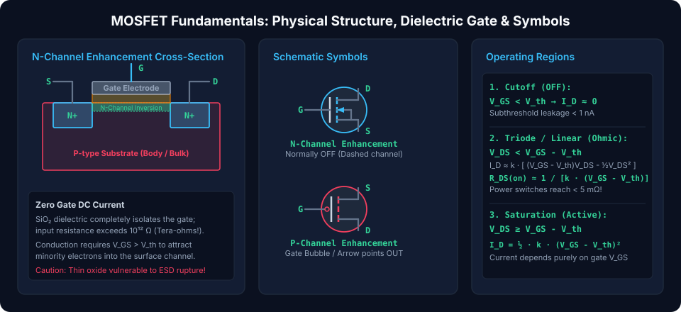
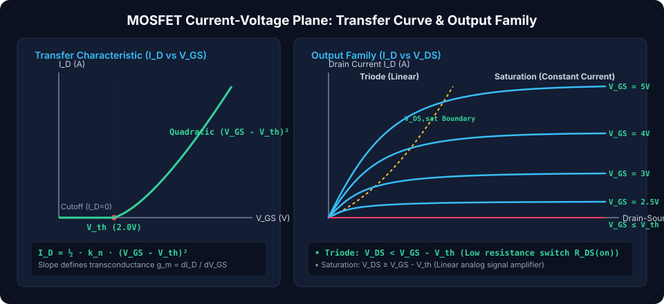
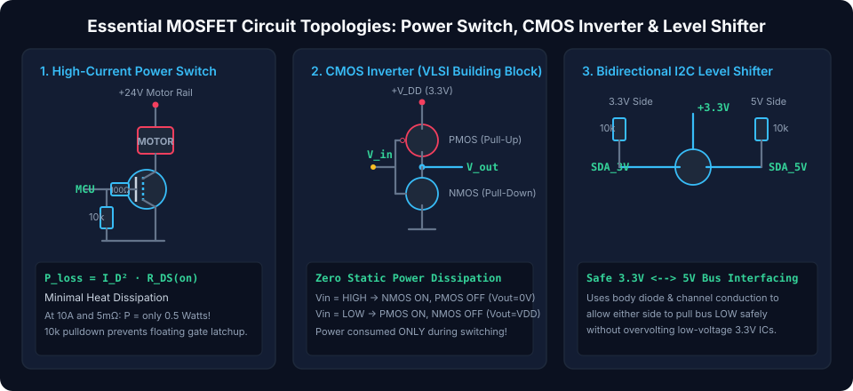

# Metal-Oxide-Semiconductor Field-Effect Transistors (MOSFETs): The Engine of Modern Computing

Metal-Oxide-Semiconductor Field-Effect Transistors (MOSFETs) are the most widely manufactured artificial devices in human history, with trillions fabricated annually. Operating as **voltage-controlled switches and amplifiers**, MOSFETs feature an insulating silicon dioxide ($\text{SiO}_2$) or high-$\kappa$ dielectric layer that completely isolates the gate electrode from the conduction channel. This dielectric isolation provides **near-infinite DC input resistance ($> 10^{12}\,\Omega$)**, near-zero static gate power consumption, and remarkable geometric scalability down to nanometer dimensions.

---

## Semiconductor Architecture & Physics of Inversion

A standard planar MOSFET consists of a semiconductor substrate (body/bulk), two heavily doped source and drain wells, and an insulated conductive gate electrode.

### 1. The MOS Capacitor & Inversion Layer Physics (N-Channel Enhancement)

In an N-Channel Enhancement MOSFET, the source and drain are heavily doped $N^+$ wells embedded within a $P$-type silicon substrate:

1.  **Zero Gate Bias ($V_{GS} = 0\text{ V}$):** Two back-to-back P-N junctions exist between source and drain ($N^+\text{-}P\text{-}N^+$). No current can flow; the device is **normally OFF**.
2.  **Positive Gate Bias ($0 < V_{GS} < V_{th}$):** The positive gate potential repels mobile holes from the substrate surface, creating a carrier-depleted region beneath the gate oxide.
3.  **Inversion Threshold ($V_{GS} \ge V_{th}$):** When gate voltage exceeds the **threshold voltage ($V_{th}$)**, the strong vertical electric field attracts minority electrons to the surface in such high concentration that they invert the P-type surface into an **N-type conductive channel (the inversion layer)**. A continuous resistive path now directly connects the $N^+$ Source to the $N^+$ Drain.

### 2. Enhancement vs Depletion Mode & Polarities

- **Enhancement Mode (Normally OFF):** The channel does not exist at zero bias ($V_{GS} = 0$). Conduction requires active gate biasing ($V_{GS} > V_{th}$). Indicated in schematics by a **dashed/interrupted channel line**.
- **Depletion Mode (Normally ON):** A physical doped channel is diffused during fabrication. Conduction occurs at $V_{GS} = 0$; applying a reverse gate bias is required to deplete the channel and pinch off conduction. Indicated by a **solid channel line**.
- **NMOS vs PMOS:**
  - **NMOS:** $N$-channel on $P$-substrate; majority carriers are high-mobility electrons ($\mu_n \approx 3\times \mu_p$). Turned ON by positive gate voltage ($V_{GS} > V_{th} > 0$).
  - **PMOS:** $P$-channel on $N$-substrate; majority carriers are holes. Turned ON by negative gate voltage relative to source ($V_{GS} < V_{th} < 0$).

### 3. The Parasitic Intrinsic Body Diode

During fabrication, the P-substrate is internally connected to the Source terminal to eliminate floating-body latchup. This internal connection creates an **unavoidable parasitic P-N junction diode between Source and Drain** (anode at Source, cathode at Drain for NMOS).

- The body diode conducts whenever the drain voltage falls below the source voltage by more than $\sim 0.7\text{ V}$.
- In inductive H-bridge motor drivers, the body diode inherently acts as a freewheeling clamp.

---

## Operating Regions & Governing Analytical Equations

### 1. Cutoff Region ($V_{GS} < V_{th}$)

The gate voltage is insufficient to establish an inversion layer. The channel remains open:

$$I_D \approx 0 \quad (\text{Subthreshold leakage } < 1\text{ nA})$$

### 2. Triode / Linear / Ohmic Region ($V_{GS} \ge V_{th}$ and $V_{DS} < V_{GS} - V_{th}$)

At low drain voltages, the inversion channel extends continuously from source to drain. The MOSFET acts as a voltage-variable resistor:

$$I_D = \mu_n \cdot C_{ox} \cdot \left(\frac{W}{L}\right) \cdot \left[ (V_{GS} - V_{th}) \cdot V_{DS} - \frac{1}{2} V_{DS}^2 \right]$$

For very small drain voltages ($V_{DS} \ll V_{GS} - V_{th}$), the quadratic term drops out, giving the **On-Resistance ($R_{DS(on)}$)**:

$$R_{DS(on)} = \frac{V_{DS}}{I_D} \approx \frac{1}{\mu_n \cdot C_{ox} \cdot \left(\frac{W}{L}\right) \cdot (V_{GS} - V_{th})}$$

Where:

- $\mu_n$ = Electron mobility in silicon ($\sim 500 - 800\text{ cm}^2/\text{V}\cdot\text{s}$ at interface)
- $C_{ox} = \frac{\varepsilon_{ox}}{t_{ox}}$ = Gate oxide capacitance per unit area
- $W, L$ = Channel width and channel length
- $k_n' = \mu_n C_{ox}$ = Process transconductance parameter

_Modern discrete power MOSFETs achieve on-resistances below $2\text{ m}\Omega$ by packing millions of micro-cells in parallel (TrenchFET architectures)._

### 3. Saturation / Active Region ($V_{GS} \ge V_{th}$ and $V_{DS} \ge V_{GS} - V_{th}$)

When $V_{DS}$ exceeds the overdrive voltage ($V_{GS} - V_{th}$), the channel pinches off at the drain end:

- Drain current reaches a plateau that is virtually independent of $V_{DS}$:
  $$I_D = \frac{1}{2} \cdot \mu_n \cdot C_{ox} \cdot \left(\frac{W}{L}\right) \cdot (V_{GS} - V_{th})^2 \cdot (1 + \lambda \cdot V_{DS})$$
- Where $\lambda$ represents the **Channel-Length Modulation factor** (analogous to the Early effect in BJTs).

---

## Essential MOSFET Circuit Topologies

### 1. High-Current Power NMOS Low-Side Switch

Used to switch high-power loads (motors, heaters, high-brightness LED arrays) from low-voltage microcontrollers:

- **Gate Pull-Down Resistor ($10\text{ k}\Omega$):** Because the gate is a tiny MOS capacitor ($C_{iss} \approx 500\text{ pF} - 5\text{ nF}$), an undriven/floating gate will pick up ambient static charge and latch the MOSFET into a resistive, heat-generating half-ON state. A $10\text{ k}\Omega$ resistor from Gate to Source ensures a default, safe OFF state during microcontroller power-up.
- **Series Gate Damping Resistor ($10\text{--}100\,\Omega$):** Damps parasitic high-frequency ringing formed between PCB trace inductance and gate capacitance ($L_{trace} C_{iss}$ tank).
- **Extremely Low Conduction Losses:**
  $$P_{loss} = I_D^2 \cdot R_{DS(on)}$$
  _(At $10\text{ A}$ through a $5\text{ m}\Omega$ MOSFET, heat loss is merely $P = 10^2 \times 0.005 = 0.5\text{ W}$, requiring no heatsink!)_

### 2. Complementary MOS (CMOS) Inverter Gate

The universal foundation of digital microprocessors, memories, and VLSI chips:

- Combines a pull-up **PMOS** transistor and a pull-down **NMOS** transistor with shared gates (Input) and shared drains (Output):
  - **Input = Logic HIGH ($V_{DD}$):** NMOS turns ON ($R \approx 0$), PMOS turns OFF ($R \to \infty$). Output pulls cleanly to **GND ($0\text{ V}$)**.
  - **Input = Logic LOW ($0\text{ V}$):** PMOS turns ON ($R \approx 0$), NMOS turns OFF ($R \to \infty$). Output pulls cleanly to **$V_{DD}$**.
- **Zero Static Power:** In both stable states, one of the two series transistors is completely non-conductive. Current flows **only during switching transitions** as parasitic node capacitances are charged and discharged:
  $$P_{dynamic} = C_{load} \cdot V_{DD}^2 \cdot f_{clock}$$

### 3. Bidirectional I2C Logic Level Shifter

Enables $3.3\text{ V}$ microcontrollers to communicate safely across a shared bidirectional bus with legacy $5.0\text{ V}$ sensors:

- A discrete N-channel MOSFET (such as BSS138) has its Gate tied permanently to $+3.3\text{ V}$.
- When both sides are idle, pull-up resistors float the lines to $3.3\text{ V}$ and $5\text{ V}$ respectively ($V_{GS} = 0\text{ V}$, MOSFET is OFF).
- When the $3.3\text{ V}$ device pulls the bus LOW ($0\text{ V}$), $V_{GS} = 3.3\text{ V}$, turning the MOSFET ON and pulling the $5\text{ V}$ side LOW.
- When the $5\text{ V}$ device pulls the bus LOW ($0\text{ V}$), the internal body diode conducts initially, pulling the Source to $0.7\text{ V}$, which forces $V_{GS} = 3.3 - 0.7 = 2.6\text{ V} > V_{th}$, fully turning the channel ON to pull the $3.3\text{ V}$ side cleanly to $0\text{ V}$.

##### Copyright (c) 2026 squared-studio
