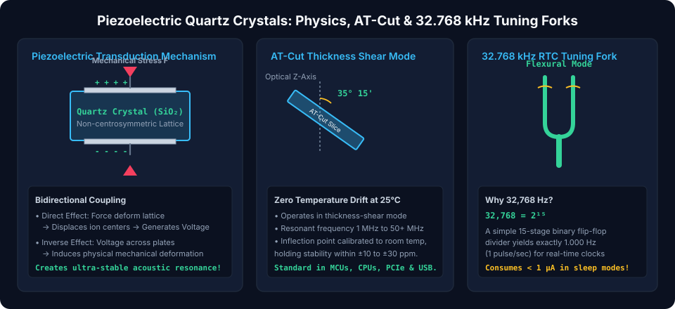
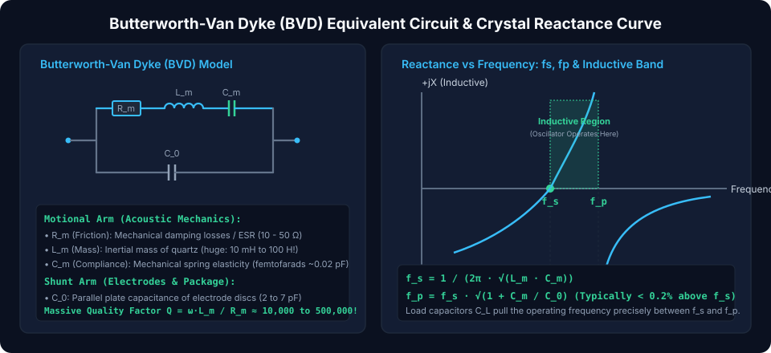
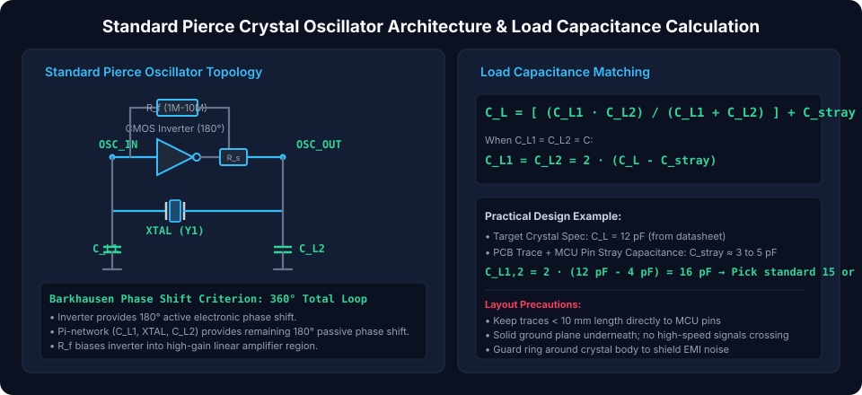

# Quartz Crystals: Piezoelectric Resonators and Precision Clock Oscillators

Quartz crystal resonators are **passive electromechanical components** that establish the fundamental heartbeat and clock reference for digital microprocessors, wireless transceivers, Ethernet controllers, and real-time clocks (RTCs). While conventional electrical LC tank circuits suffer from low quality factors ($Q \approx 50 - 200$) and significant thermal drift, quartz crystals exploit the **piezoelectric effect** to achieve unprecedented frequency stability with quality factors ($Q$) ranging from **$10,000$ to over $500,000$**, holding clock tolerances within parts-per-million ($\pm 10\text{ ppm}$).

---

## The Piezoelectric Effect & Crystal Cuts

Quartz is a crystalline form of silicon dioxide ($\text{SiO}_2$) whose trigonal crystal lattice lacks a center of inversion symmetry.

### 1. Bidirectional Piezoelectric Transduction

1.  **Direct Piezoelectric Effect:** Applying mechanical stress (compression, tension, or shear) displaces the electrical dipoles within the crystal lattice, generating an electrical polarization charge and proportional voltage difference across opposite faces:
    $$Q_{piezo} = d \cdot F$$
2.  **Inverse (Converse) Piezoelectric Effect:** Applying an external electrical voltage across metal electrodes plated onto the crystal induces proportional mechanical strain, deforming the crystal lattice:
    $$x_{strain} = d \cdot V$$

Applying an alternating AC voltage forces the quartz wafer to vibrate mechanically. When the excitation frequency matches the physical acoustic resonant frequency of the quartz slice, the amplitude of mechanical vibration reaches an extraordinary peak, exhibiting extremely sharp electrical resonance.

### 2. Quartz Wafer Cuts & Vibration Modes

The physical orientation at which a quartz wafer is sliced relative to the natural crystallographic axes ($X, Y, Z$) determines its resonant frequency range and temperature stability:

- **The AT-Cut (Thickness-Shear Mode, $1\text{ MHz} - 50+\text{ MHz}$):**
  - Sliced at an angle of **$35^\circ 15'$** relative to the optical Z-axis.
  - Vibrates in **thickness-shear mode**, where the top and bottom surfaces slide back and forth in opposite directions.
  - **Zero Temperature Drift at $25^\circ\text{C}$:** The frequency-vs-temperature characteristic follows a cubic S-curve with an inflection point precisely at room temperature ($25^\circ\text{C}$), providing an exceptional stability of $\pm 10\text{ to } \pm 30\text{ ppm}$ over industrial operating ranges ($-40^\circ\text{C}$ to $+85^\circ\text{C}$).
  - The primary clock reference for USB, Ethernet, CAN, and microcontrollers.
- **The 32.768 kHz Tuning Fork (Flexural Mode):**
  - Miniature quartz tuning fork vibrating in flexural (bending) mode.
  - **The Mathematical Magic of 32,768 Hz:**
    $$32,768 = 2^{15}$$
    Passing this frequency through a 15-stage binary flip-flop counter ($/2^{15}$) produces an exact **$1.000\text{ Hz}$ (1 pulse per second)** signal for digital watches and microcontroller Real-Time Clocks (RTC), consuming less than $1\,\mu\text{A}$ of standby power.

---

## The Butterworth-Van Dyke (BVD) Equivalent Electrical Model

Because a vibrating quartz crystal interacts electromechanically with electrical circuits, its impedance is represented precisely by the **Butterworth-Van Dyke (BVD) equivalent circuit**:

### 1. BVD Circuit Parameters

The model consists of two parallel branches:

1.  **The Motional Arm (Series RLC Branch):** Represents the pure acoustic mechanical vibration of the crystal:
    - **$R_m$ (Motional Resistance / ESR):** Represents internal mechanical acoustic friction and mounting losses ($10\,\Omega - 50\,\Omega$).
    - **$L_m$ (Motional Inductance):** Represents the effective vibrating mechanical inertial mass of the quartz. Because quartz is extremely dense and stiff, $L_m$ is **astronomically large—typically tens of millihenries to over $100\text{ Henrys}$!**
    - **$C_m$ (Motional Capacitance):** Represents mechanical compliance (elasticity). Extremely small—typically **femtofarads ($0.001\text{ pF} - 0.05\text{ pF}$)**.
2.  **The Shunt Arm ($C_0$):**
    - **$C_0$ (Shunt Static Capacitance):** The purely electrical electrostatic capacitance formed by the two metal electrode discs separated by the quartz dielectric, plus package lead capacitance (typically $2\text{ pF} - 7\text{ pF}$).

### 2. Series Resonance ($f_s$) vs Parallel Anti-Resonance ($f_p$)

Due to the presence of both $C_m$ and $C_0$, the crystal possesses two closely spaced resonant frequencies:

- **Series Resonant Frequency ($f_s$):** Occurs when the motional arm reactances cancel ($X_{Lm} = -X_{Cm}$):
  $$f_s = \frac{1}{2\pi \cdot \sqrt{L_m \cdot C_m}}$$
  - At $f_s$, crystal impedance collapses to its pure minimum resistive value: $Z \approx R_m$ ($10\text{--}30\,\Omega$).
- **Parallel Anti-Resonant Frequency ($f_p$):** Occurs when the inductive motional arm resonates with shunt capacitance $C_0$:
  $$f_p = \frac{1}{2\pi \cdot \sqrt{L_m \cdot \left(\frac{C_m \cdot C_0}{C_m + C_0}\right)}} = f_s \cdot \sqrt{1 + \frac{C_m}{C_0}}$$
  - Because $C_m \ll C_0$ (ratio $\sim 1:500$), $f_p$ is typically **only $0.1\% - 0.3\%$ above $f_s$**.
  - At $f_p$, crystal impedance reaches a massive peak ($> 1\text{ M}\Omega$).
- **The Inductive Operating Band:** Between $f_s$ and $f_p$, the crystal's net reactance is **purely inductive**. Almost all standard microcontroller oscillator circuits (Pierce oscillators) operate within this narrow inductive window!

### 3. The Quality Factor ($Q$)

The ratio of stored energy to energy dissipated per cycle:

$$Q = \frac{\omega_s \cdot L_m}{R_m} = \frac{1}{R_m} \cdot \sqrt{\frac{L_m}{C_m}} \approx 10,000 \text{ to } 500,000$$

_(Compare this to an electrical inductor-capacitor tank, which struggles to exceed $Q \approx 150$. A high $Q$ guarantees sharp frequency selectivity and negligible phase jitter)._

---

## Pierce Oscillator Architecture & Load Capacitance Matching

The **Pierce oscillator** is the universal circuit architecture integrated inside microcontrollers, microprocessors, and SoCs.

### 1. Circuit Component Functions

1.  **CMOS Inverter Gate:** Acts as the active inverting amplifier, providing an initial $180^\circ$ electronic phase shift.
2.  **Feedback Resistor ($R_f$, $1\text{ M}\Omega - 10\text{ M}\Omega$):** Biases the digital inverter into its high-gain linear region so that $V_{in} \approx V_{out} \approx V_{DD} / 2$.
3.  **Series Damping Resistor ($R_s$, $100\,\Omega - 1\text{ k}\Omega$):** Limits the drive power delivered to the crystal, preventing mechanical fracture or overdrive aging.
4.  **$\pi$-Network (Crystal + $C_{L1}$ + $C_{L2}$):** The crystal operates as an inductor, forming a third-order $\pi$-filter with the two load capacitors that introduces the remaining $180^\circ$ phase shift. Total loop phase shift equals **$360^\circ$ (or $0^\circ$)**, satisfying Barkhausen's criterion for sustained oscillation.

### 2. Load Capacitance ($C_L$) Equation & Sizing

Every parallel-resonant crystal is calibrated by the manufacturer to oscillate at its stamped nominal frequency only when loaded with a specific **load capacitance ($C_L$)** (commonly $8\text{ pF}, 12\text{ pF}, 18\text{ pF}$, or $20\text{ pF}$):

$$C_L = \frac{C_{L1} \cdot C_{L2}}{C_{L1} + C_{L2}} + C_{stray}$$

Where $C_{stray}$ represents the parasitic stray capacitance of the microcontroller pins and PCB copper traces (typically $3\text{ pF} - 5\text{ pF}$).

When symmetrical capacitors are selected ($C_{L1} = C_{L2} = C$):

$$C_L = \frac{C}{2} + C_{stray} \implies C = 2 \cdot (C_L - C_{stray})$$

**Practical Sizing Example:**

- Target Crystal Datasheet Rating: $C_L = 12\text{ pF}$
- Estimated PCB Stray Capacitance: $C_{stray} = 4\text{ pF}$
- External Capacitor Calculation:
  $$C_{L1} = C_{L2} = 2 \cdot (12\text{ pF} - 4\text{ pF}) = 16\text{ pF}$$
  _(Select standard E24 surface-mount C0G/NP0 ceramic capacitors: **$15\text{ pF}$ or $18\text{ pF}$**)._

> [!WARNING]
> **Load Mismatch Frequency Pulling:**  
> If external capacitors are too small, the crystal oscillates slightly **above** its rated frequency. If capacitors are too large, the frequency pulls **downward**, startup time increases, or the oscillator may fail to start entirely under cold temperatures.

---

## Comparison of Oscillator Clock Technologies

| Technology                         |     Typical Frequency Range     |           Frequency Tolerance            | Quality Factor ($Q$) |          Power Consumption           | Primary Application                            |
| :--------------------------------- | :-----------------------------: | :--------------------------------------: | :------------------: | :----------------------------------: | :--------------------------------------------- |
| **Tuning Fork Crystal**            |       $32.768\text{ kHz}$       |           $\pm 20\text{ ppm}$            |    $\sim 50,000$     |  **Ultra-low ($< 1\,\mu\text{A}$)**  | Real-time clocks, low-power sleep timers       |
| **AT-Cut Quartz (XTAL)**           | $1\text{ MHz} - 50\text{ MHz}$  |       $\pm 10 - \pm 30\text{ ppm}$       |    $\sim 100,000$    |      Low ($0.5 - 2\text{ mA}$)       | Microcontroller main clock, USB, CAN, PCIe     |
| **TCXO (Temperature-Compensated)** | $10\text{ MHz} - 52\text{ MHz}$ |    **$\pm 0.5 - \pm 2.5\text{ ppm}$**    |    $\sim 100,000$    |    Moderate ($2 - 10\text{ mA}$)     | GPS/GNSS receivers, cellular 5G basebands      |
| **OCXO (Oven-Controlled)**         | $5\text{ MHz} - 100\text{ MHz}$ |  **$\pm 0.001 - \pm 0.05\text{ ppm}$**   |  **$> 1,000,000$**   | High ($1 - 5\text{ W}$, heated oven) | Telecom base stations, atomic clock references |
| **Silicon MEMS Resonator**         | $1\text{ MHz} - 150\text{ MHz}$ |       $\pm 20 - \pm 50\text{ ppm}$       |    $\sim 30,000$     |       Low ($1 - 5\text{ mA}$)        | High-vibration, harsh aerospace environments   |
| **Internal RC Oscillator**         | $16\text{ MHz} - 64\text{ MHz}$ | Poor ($\pm 1\% = \pm 10,000\text{ ppm}$) |       $\sim 1$       |               Minimal                | General non-timing-critical firmware execution |

##### Copyright (c) 2026 squared-studio
