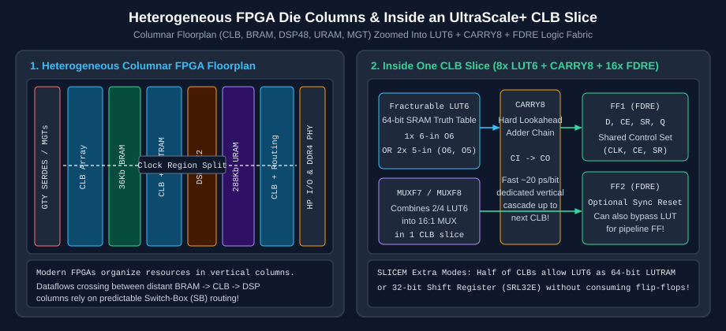
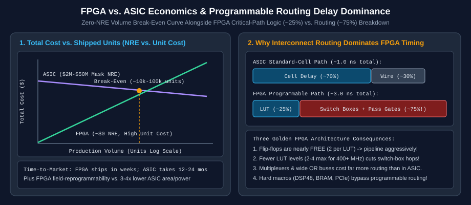

# FPGA Architecture Foundations, Fabric Anatomy, and ASIC Comparison

A Field-Programmable Gate Array (FPGA) is a reconfigurable semiconductor device composed of millions of programmable logic cells, dedicated math blocks, on-die SRAMs, multi-gigabit transceivers, and switch-box routing tracks configured by SRAM bitstreams. Writing high-performance FPGA RTL differs fundamentally from ASIC design: whereas an ASIC designer pays area per gate and optimizes cell chains, an FPGA designer exploits pre-manufactured **6-input Lookup Tables (`LUT6`)**, abundant **flip-flops (`FDRE`)**, **Block/UltraRAMs**, **DSP48 math slices**, and navigates **programmable routing interconnect** that dominates 65%–75% of critical path delay.

---

## Learning Goals

- Map a modern **columnar FPGA floorplan** (CLB, BRAM, DSP48, URAM, Clock Regions, HP I/O, and GTY transceivers).
- Trace signals inside a **Configurable Logic Block (CLB)** slice across fracturable `LUT6` truth tables, `CARRY8` chains, `MUXF7`/`MUXF8` wide multiplexers, and `FDRE` flip-flops.
- Quantify economic and physical **FPGA vs. ASIC trade-offs** (NRE cost break-even, `Fmax`, logic-vs-routing delay ratio, static/dynamic power, and time-to-market).
- Choose intelligently between mapping datapaths onto **soft LUT fabric** vs. **hardened silicon macros** (`BRAM`, `DSP48`, `PCIe`/`DDR4` hard IP).

---

## Heterogeneous FPGA Die Columns and Switch-Box Routing Fabric

Early FPGAs contained uniform grids of tiny 4-input LUTs. Modern FPGAs (AMD UltraScale+/Versal, Intel Agilex/Stratix, Lattice Avant) arrange resources into heterogeneous **vertical silicon columns** separated by programmable Switch Boxes (`SB`) and global horizontal clock spines:

### Die Anatomy Across Modern Families

- **CLB / ALM Columns**: General-purpose logic fabric holding Lookup Tables, fast carry chains, wide multiplexers, and registers.
- **BRAM &amp; URAM Columns**: Hardened `18Kb`/`36Kb` Block RAM and `288Kb` UltraRAM memory columns interspersed regularly across the die so datapaths can access multi-terabyte/s SRAM bandwidth locally without routing across the whole chip.
- **DSP48 / Variable-Precision DSP Columns**: Hardened multiplier-accumulator columns sitting physically adjacent to BRAM columns (`bram_clk -> dsp48`) to support high-speed `400–800 MHz` FIR filters, FFTs, and AI systolic arrays.
- **Clock Regions &amp; SLRs (Super Logic Regions)**: Large flagship FPGAs stack 2–4 silicon **chiplets (`SLRs`)** side-by-side atop a passive silicon interposer (**SSI / 2.5D stacking**), connected across the boundary by dedicated **Super Long Lines (`SLL`)** that cost ~`0.5–1.0 ns` extra delay if crossed without pipeline registers!

---

## Inside a Configurable Logic Block Slice LUT6, CARRY8, MUXF, and FDRE

Every Xilinx UltraScale+ CLB holds **one Slice** composed of **8 LUT6 primitives**, **16 Flip-Flops (`FDRE`)**, **1 `CARRY8` chain**, and **`MUXF7`/`MUXF8` tree multiplexers** (while Intel FPGAs pair adaptive `ALMs` with 8-input fracturable LUTs and 4 registers per ALM):

### 1. Fracturable 6-Input Lookup Table (`LUT6`)

Instead of AND/OR/XOR gates, a `LUT6` is simply a **64-bit SRAM truth table** indexed by 6 inputs (`I0..I5`):
- Can implement **ANY boolean function of 6 variables** in one uniform `~100–150 ps` delay—whether a simple inverter or a complex `a^b^c^d^e^f` parity gate!
- **Dual 5-Input Fracturable Mode (`LUT6_2`)**: Splits the 64-bit SRAM into two independent 32-bit tables sharing up to 5 inputs (`O6` and `O5`), packing two small logic functions into 1 LUT!
- **`SLICEM` Memory &amp; Shift Mode**: Roughly half of all CLBs (`SLICEM`, vs pure logic `SLICEL`) allow writing dynamically into the 64-bit LUT SRAM, functioning either as **Distributed RAM (`RAM64X1S`)** or a **32-bit Shift Register (`SRL32E`)**!

### 2. Fast Dedicated Carry Chain (`CARRY8`) &amp; Wide MUXes (`MUXF`)

- **`CARRY8`**: Dedicated hard lookahead carry chain linking vertically directly between slices (`CI -> CO`) at ~`20 ps/bit`, enabling 64-bit adders/counters above `500 MHz` without hopping through slow general switch boxes!
- **`MUXF7` / `MUXF8` / `MUXF9`**: Combines 2, 4, or 8 LUT outputs inside *one* CLB slice (`zero switch-box hops!`) to build single-slice `16:1` or `32:1` multiplexers cleanly.

### 3. Shared Control Sets on Flip-Flops (`FDRE`)

Each CLB slice provides 2 flip-flops per LUT (16 FFs total!). Crucial hardware constraint: **flip-flops in the same slice (group of 4 or 8) must share identical `{Clock, Clock Enable (CE), Sync/Async Reset (SR)}` nets** ("Control Set")! Using 100 tiny arbitrary reset/enable combinations prevents Vivado/Quartus from packing FFs together, leaving CLBs half-empty!

---

## FPGA vs ASIC Trade-Offs and Routing Delay Dominance

Knowing *why* FPGAs run slower and burn more dynamic power per MHz than ASICs makes the rationale behind every FPGA coding rule obvious:

| Dimension | ASIC Standard-Cell | Modern FPGA Fabric | Architectural Implication |
| :--- | :--- | :--- | :--- |
| **NRE Mask + Tool Cost** | `$2M – $50M+` | `~$0` (Buy COTS parts) | FPGA dominates under `~10k–100k` units, prototypes &amp; evolving standards |
| **Time to Market** | `12 – 24 months` | `Weeks – Months` | Bitstream bug fixes ship over the air (`field updates`)! |
| **Routing vs Cell Delay** | `~30% Wire` / `~70% Cell` | **`~70%–75% Switch Box`** / `~25% LUT` | **Pipeline aggressively!** Routing hops dominate timing, not gate fan-in |
| **Clock Gating (`ICG`)** | Tiny 2-gate cell saves power | Breaks clock tree if synthesized naively! | Never manually gate clocks in LUTs—use `CE` or `BUFGCE` |
| **Flip-Flop Cost** | Expensive (~6–10x NAND2 area) | **Nearly Free** (pre-built behind every LUT!) | Deeply pipelining at `2–3` LUT levels/stage boosts `Fmax` with zero LUT penalty! |
| **Core Area &amp; Power** | `1x` Baseline | `~15x–30x` Area, `~5x–12x` Power | Map heavy arithmetic/storage onto hard macros (`DSP48`, `BRAM`, `HBM`) |

> [!IMPORTANT]
> **Think in Logic Levels, Not Gate Count!** Because every `LUT6` implements any 6-variable Boolean equation in constant ~120 ps while every hop *between* LUTs burns ~250–600 ps in programmable switch-box pass transistors, reducing a critical path from **10 LUT levels down to 4 LUT levels** easily doubles maximum operating frequency (`Fmax`)!

---

## Hardened Fabric Macros vs Programmable Logic

Modern FPGAs embed large hardened ASIC islands inside the programmable fabric (`Hard IP`). Using hardened silicon rather than burning LUTs yields 10x better performance and power:
- **Hard Memory Controllers (`DDR4/DDR5/HBM2E`)**: Soft fabric DDR controllers stall around ~300–400 MT/s due to I/O deskew limits; hardened PHY + controllers hit **3200–6400 MT/s**.
- **Hard Protocol Engines (`PCIe Gen4/Gen5`, `100G CMAC Ethernet`, `MRMAC`)**: Building a `PCIe Gen5 x16` transaction/data-link layer out of LUTs would consume an entire mid-size FPGA; hard blocks use zero CLB resources and close timing effortlessly!
- **SoC Processing Systems (`ARM Cortex-A53/A72/R5`)**: Hybrid SoC FPGAs boot Linux natively in hard silicon alongside custom hardware accelerators in programmable logic.

---

## Best Practices and Common Pitfalls

1. **Exploit Abundant Slice Registers ("Pipeline First, Trim Later")**: Do not fear adding pipeline flip-flops between arithmetic operations; in FPGAs, registers sit already silicon-fabricated behind every LUT output and often sit idle if unused!
2. **Avoid Giant 64-to-1 Combinational Crossbars**: Wide combinational `N:1` multiplexers blow up routing switch-box congestion exponentially (`routing > 80%`)! Pipeline wide MUXes as registered `4:1 -> 4:1 -> 4:1` trees or use **AXI-Stream / Ring Buses**.
3. **Never Cross Die SLRs Combinationally**: On multi-SLR stacked FPGAs (like `VU9P`/`VU19P`), place explicit back-to-back pipeline registers cleanly on both sides of every SLR crossing so inter-SLR `SLL` routes never share delay budget with combinational LUT logic!
4. **Understand Speed Grades (`-1`, `-2`, `-3`) &amp; Temperature**: Jumping from `-1` (slowest/cheapest) to `-3` speed grade raises `Fmax` by `~15–25%`, yet carries steep silicon unit cost—always target timing closure on `-1` or `-2` parts through clean pipelining first.

---

## Practical Exercises with Solutions

### Exercise 1 ASIC vs. FPGA Total Cost Break-Even Calculation

A networking startup designs a custom packet engine:
- **ASIC Path**: `$6,000,000` total NRE (masks, EDA licenses, DFT, packaging), **`$35`** recurring unit silicon cost.
- **FPGA Path**: **`$150,000`** board/RTL engineering NRE, **`$320`** per-unit FPGA silicon price.

1. Compute the exact unit **break-even volume $Q^*$** where ASIC becomes cheaper than FPGA.
2. What total cost savings does the FPGA path deliver if total lifetime product sales reach `4,500` units?

#### Solution

1. **Break-Even Volume**:
   $$6{,}000{,}000 + 35\,Q^* = 150{,}000 + 320\,Q^*$$
   $$5{,}850{,}000 = 285\,Q^* \implies Q^* = \frac{5{,}850{,}000}{285} \approx \mathbf{20{,}526\text{ units}}$$
2. **Cost at `4,500` Units**:
   - **FPGA Total**: $\$150{,}000 + 4{,}500 \times \$320 = \$1{,}590{,}000$.
   - **ASIC Total**: $\$6{,}000{,}000 + 4{,}500 \times \$35 = \$6{,}157{,}500$.
   - **Savings via FPGA**: **$\$4{,}567{,}500$** saved (plus shipping 12+ months earlier!).

---

### Exercise 2 Counting `LUT6` Resources Using Fracturable &amp; Wide-MUX Fabric

A designer implements two functions inside an UltraScale+ CLB (`LUT6` + `MUXF7`/`MUXF8`):
- **Function A**: Two completely independent 4-input parity/control signals sharing the *same* 4 input wires (`in[3:0]`).
- **Function B**: A combinational **`16:1` 1-bit Multiplexer** (`sel[3:0]`, `d[15:0]`).

Determine the minimum number of **`LUT6` cells** consumed by Function A and Function B inside modern Xilinx CLBs!

#### Solution

1. **Function A (Dual 4-input functions on shared inputs)**:
   - Each uses $\le 5$ total shared inputs, fitting cleanly into **one single fracturable `LUT6_2` (`O6` and `O5`)** = **`1 LUT6`**!
2. **Function B (`16:1` 1-bit MUX)**:
   - Each `LUT6` implements a **`4:1` MUX** (`4 data + 2 select = 6 inputs`).
   - Four `LUT6` cells handle 16 data bits indexed by `sel[1:0]`, and hard slice **`MUXF7` + `MUXF8`** (`0 extra LUTs!`) combine those 4 outputs using `sel[3:2]`!
   - Total consumed: **`4 LUT6` + hard `MUXF7`/`MUXF8`** inside a single CLB slice! (Even a `32:1` MUX needs just `8 LUT6`!)

---

### Exercise 3 Analyzing Logic-Level Speed Limits (`Fmax`)

A critical combinational path inside an `-2` speed-grade FPGA runs through **8 LUT6 levels** with average cell delay `t_lut = 120 ps` and average switch-box interconnect delay `t_net = 330 ps` per hop (plus `t_CO = 150 ps`, `t_setup = 80 ps`, `t_uncert = 70 ps`).

1. Calculate total critical path delay and achievable maximum clock frequency $F_{\max}$.
2. If you insert **one balanced pipeline register stage** right in the middle (splitting into `4` LUT levels per cycle), compute the new $F_{\max}$!

#### Solution

1. **8-Level Unpipelined Path**:
   - 8 LUTs have 9 interconnect segments (roughly `8 * t_lut + 8 * t_net` assuming local input/output hops):
   - $T_{\text{min}} = 150 + 8(120) + 8(330) + 80 + 70 = 150 + 960 + 2640 + 150 = \mathbf{3.90\text{ ns}}$.
   - $F_{\max} = \frac{1}{3.90\text{ ns}} \approx \mathbf{256.4\text{ MHz}}$.
2. **Split to 4-Level Pipelined Path**:
   - $T_{\text{min}} = 150 + 4(120) + 4(330) + 80 + 70 = 150 + 480 + 1320 + 150 = \mathbf{2.10\text{ ns}}$.
   - $F_{\max} = \frac{1}{2.10\text{ ns}} \approx \mathbf{476.2\text{ MHz}}$ (**+85.7% frequency speedup** using existing flip-flops at near-zero LUT increase!).

---

##### Copyright (c) 2026 squared-studio
