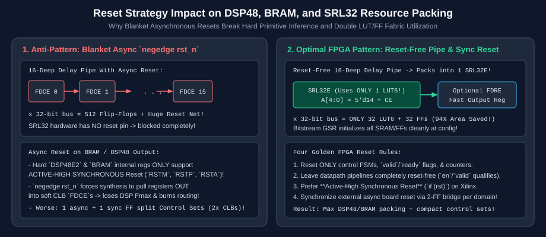
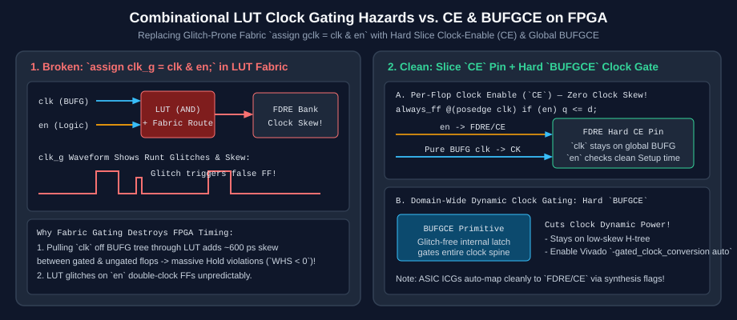

# Writing FPGA-Friendly RTL, Reset Rules, and Inference Patterns

Synthesizable SystemVerilog works across both ASIC and FPGA targets, yet RTL habits optimized for ASIC standard cells frequently inflate FPGA area by `3x` and slash `Fmax` in half. Mastering **FPGA-friendly RTL coding** means aligning your SystemVerilog constructs directly with hard FPGA slice primitives: minimizing **control sets**, preferring **active-high synchronous resets**, keeping datapath pipelines **reset-free (`SRL32E` packing)**, never gating clocks in combinational LUTs, and writing deterministic templates for BRAM, DSP48, and carry-chain inference.

---

## Learning Goals

- Contrast **ASIC reset conventions** (`always_ff @(posedge clk or negedge rst_n)`) against **FPGA best practices** (selective **active-high synchronous reset** + reset-free datapaths) and explain how resets break `SRL32E`, `BRAM`, and `DSP48` packing.
- Eliminate **combinational clock gating (`assign gclk = clk & en`)** and replace it with clean **`CE` Clock-Enable** logic or hard **`BUFGCE`** primitives.
- Control **Control Set** proliferation (`{CLK, CE, SR}`) across slice packs to maximize CLB density and routing freedom.
- Infer **`SRL32E` shift registers**, **`CARRY8` arithmetic**, and compact **parallel multiplexers** reliably in SystemVerilog without instantiating vendor black-box primitives unnecessarily.

---

## Synchronous vs Asynchronous Resets and Primitive Packing

At first glance, resetting every single flip-flop in a module with `always_ff @(posedge clk or negedge rst_n)` feels disciplined. On an FPGA, however, **blanket asynchronous resets severely damage Quality of Results (QoR)**:



### Why FPGA Hard Silicon Dislikes `negedge rst_n`

1. **Global Configuration Init (`GSR`) Already Cleared Every Bit**: Every FPGA bitstream automatically asserts an internal **Global Set/Reset (`GSR`)** during configuration (`DONE`), initializing every FF (`FDRE`), LUTRAM, and BRAM to exact `INIT = 0` (or custom initial value) before clock `0` arrives!
2. **Hard `BRAM` &amp; `DSP48` Registers Have ONLY Active-High Synchronous Resets (`RST`)**: Putting `if (!rst_n)` with an asynchronous sensitivity list (`or negedge rst_n`) forces synthesis to **rip output/pipeline registers out of `DSP48` and `BRAM` hard blocks** into external fabric `FDCE` flip-flops—cutting math/memory `Fmax` sharply!
3. **`SRL32E` Shift Registers Have NO Reset Pin**: A 32-cycle delay pipeline written without a reset maps **32 registers into 1 single `LUT6` (`SRL32E`)**! Adding *any* reset (sync or async) blocks `SRL32E` inference completely, exploding resource usage by **32x flip-flops**!
4. **Reset Polarity Matters (`rst` vs `rst_n`)**: Xilinx `FDRE` reset inputs (`R`) are **active-high**. Writing active-low `if (!rst_n)` forces the tool either to invert `rst_n` through a LUT (extra routing congestion!) or pack multiple control sets separately!

> [!IMPORTANT]
> **Golden FPGA Reset Strategy**:
> 1. Use **Active-High Synchronous Reset** (`always_ff @(posedge clk) if (rst)`) exclusively on **control FSMs, `valid`/`ready` handshakes, and counters**.
> 2. Leave **datapaths, pipeline stages, and shift-register FIFOs completely reset-free**—control validity via `valid_q`!
> 3. Only use an asynchronous reset on rare safety-critical pins when a domain's **clock may be dead** while output pins must force a safe `0` (such as PWM motor shutoff!).

---

## Clock Enables (CE) vs Fabric Clock Gating and Control Sets

In ASIC flows, designers gate clocks constantly (`always @(posedge gclk)` via `ICG` cells) to drop dynamic power. On FPGAs, **manually gating clocks in RTL (`assign gclk = clk & en;`) breaks timing cleanly**:



### Why Fabric Gating Fails vs. `CE` and `BUFGCE`

- **Clock Tree Deviation**: Driving a clock signal out of global H-tree routing (`BUFG`) through a fabric `LUT` (`AND`) and back into `CK` pins injects `500–1200 ps` of uncalibrated insertion skew between `clk` and `gclk`—triggering catastrophic **Hold Violations (`WHS < 0`)**!
- **Runt Glitches**: Whenever `en` changes while `clk == 1`, combinational LUT hazard pulses inject narrow runt glitches straight onto flip-flop clock pins!
- **Clean Alternative 1 (`CE` Pin)**: Write `always_ff @(posedge clk) if (en) q <= d;`! Synthesis routes `clk` straight on the zero-skew global tree and connects `en` directly onto the slice flip-flop's dedicated **`CE` input** (`FDRE`) cleanly!
- **Clean Alternative 2 (`BUFGCE` Global Clock Gating)**: To shut off clock power across an entire 50,000-flop subsystem for milliseconds, instantiate a hard **`BUFGCE`** (or enable `-gated_clock_conversion auto` for ported ASIC RTL).

### Managing Control Sets (`{CLK, CE, SR}`)

Remember from Chapter 1: 8 flip-flops inside one slice share common `CE` and `SR` lines (1 control set per slice group). If you sprinkle tiny single-bit `if (en_a)`, `if (en_b)`, `if (rst_c)` combinations across 8 unrelated bytes, Vivado must place each byte in its **own sparse slice**, leaving 87% of FFs unuseable!
- Audit `report_control_sets` regularly in Vivado: keep unique control sets low (`< 5–7%` of slices), and fold tiny `CE` expressions (`if (en) q <= d; else q <= q;`) into the LUT D-input (`MAX_FANOUT` / `-control_set_opt_threshold`) on low-fanout FFs!

---

## Inferring Shift Registers (SRL32E), Carry Chains, and Wide Multiplexers

Writing clean behavioral SystemVerilog unlocks powerful hard primitives portably without scattering vendor-locked unisim instantiations (`SRLC32E u_srl (...)`) throughout business logic:

```systemverilog
// FPGA-Friendly Reset-Free Delay Pipe + Sync Control Wrapper
// Automatically packs delay_pipe into SRL32E (1 LUT6 per bit!) + FDRE output reg!
module fpga_pipeline_stage #(
    parameter int WIDTH = 32,
    parameter int DEPTH = 16  // Must be >= 2; DEPTH-1 taps SRL, last cycle in FDRE!
) (
    input  logic             clk,
    input  logic             rst,       // Active-high SYNC reset (ONLY on control valid!)
    input  logic             ce,
    input  logic             in_valid,
    input  logic [WIDTH-1:0] in_data,
    output logic             out_valid,
    output logic [WIDTH-1:0] out_data
);
    // 1. Datapath Shift Pipe: ZERO reset -> 100% SRL32E + FDRE inference!
    logic [WIDTH-1:0] pipe_mem [0:DEPTH-1];

    always_ff @(posedge clk) begin
        if (ce) begin
            pipe_mem[0] <= in_data;
            for (int i = 1; i < DEPTH; i++) begin
                pipe_mem[i] <= pipe_mem[i-1];
            end
        end
    end
    // Last stage pipe_mem[DEPTH-1] stays free to pack into a fast slice FDRE!
    assign out_data = pipe_mem[DEPTH-1];

    // 2. Control Valid Pipe: Sync Reset clears valid flags cleanly to 0!
    logic [DEPTH-1:0] valid_sr;
    always_ff @(posedge clk) begin
        if (rst) begin
            valid_sr <= '0;
        end else if (ce) begin
            valid_sr <= {valid_sr[DEPTH-2:0], in_valid};
        end
    end
    assign out_valid = valid_sr[DEPTH-1];
endmodule
```

> [!TIP]
> **Always Keep the Last Tap Out of `SRL32E`!** An `SRL32E` has slower clock-to-out (`t_CKO ~ 0.6–0.9 ns`) than a dedicated slice `FDRE` (`~0.15 ns`). Leaving the final stage `pipe_mem[DEPTH-1]` free of dynamic variable indexing lets synthesis place `(DEPTH-1)` taps inside one `SRL32E` and put the last tap into the fast adjacent `FDRE`!

### Clean Carry-Chain (`CARRY8`) &amp; MUX Coding

- **Let `+` / `-` / `<` Inference Work Naturally**: Write clean `sum <= a + b + cin;` or wide equality `hit = (addr == target);`. Synthesis packs adders automatically onto fast `CARRY8` chains (`~20 ps/bit`!).
- **Avoid Priority `if/else if` Chains on Wide Selectors**: Deep `if (sel[0]) ... else if (sel[1]) ...` compiles into unbalanced chained `LUT` cascades (`N` levels deep!). Whenever selectors are mutually exclusive (`one-hot` or binary ID), code clean `unique case (sel)` or flat `assign out = bus[idx];` so tools build compact parallel `LUT6 + MUXF7/MUXF8` trees!

---

## Eliminating Latches, Tri-States, and Non-Deterministic Loops

Three coding flaws create chronic FPGA debugging nightmares:

1. **Inferred Latches (`LDCE`)**: Incomplete combinational `always_comb` assignments infer transparent level-sensitive **latches**. Unlike ASICs, FPGA slices lack dedicated latch optimizations, causing glitch propagation and brutal static timing failures (half-cycle transparent paths). Fix cleanly by initializing all outputs at the top of `always_comb`.
2. **Internal Tri-States (`inout` / `1'bz` Inside Fabric)**: Modern FPGAs have **ZERO internal tri-state buffers**! Any `assign bus = oe ? data : 1'bz;` written inside sub-modules must be rewritten by synthesis into giant distributed MUXes—use **external `IOBUF` pads strictly at top-level FPGA pins** and clean unidirectional `MUX`/AXI-Lite buses internally!
3. **Un-reset Initial Values vs Synthesis Equivalence (`X`-Masking)**: In ASICs, Verilog initial blocks (`reg cnt = 0;`) are ignored by synthesis! In FPGAs, `logic [7:0] cnt = 8'd0;` actually sets the bitstream `INIT` attribute for power-on (`GSR`), yet relying *only* on `INIT` means soft resets without bitstream reload won't re-clear `cnt`—use explicit synchronous resets on state registers!

---

## Best Practices and Common Pitfalls

1. **Use `always_comb` and `always_ff` Strictly**: SystemVerilog `always_comb` forces sensitivity completeness and triggers compiler errors if you accidentally infer a latch or write multiple drivers (`u_ctrl` vs `u_fsm`).
2. **Keep Fanout Control Real Instead of Blind `MAX_FANOUT`**: Leaving a 1-bit `rst` driving 40,000 flops creates a giant net delay (`4 ns`); pipeline resets locally per module (`always_ff @(posedge clk) local_rst <= global_rst;`) so Vivado/Quartus places regional copies cleanly inside every Clock Region!
3. **Avoid Multi-Bit Resetting Giant Register Files**: Zeroing a `256 x 32-bit` register array (`8192 FFs`) synchronously under `if (rst) for(...) mem[i] <= 0;` consumes 8,192 slice FFs AND prevents LUTRAM (`SLICEM`) inference! Convert cleared arrays to LUTRAM/BRAM and invalidate via a single `256-bit` valid bitmap or counter sweep!
4. **Separate Reset-Free Pipelines From Control FSMs**: Always visually inspect Vivado utilization (`LUT as Memory` vs `Flip Flops`) after synthesis to confirm intended `SRL32E` and `DSP48` pipelines packed cleanly!

---

## Practical Exercises with Solutions

### Exercise 1 Calculating CLB Savings from Reset-Free `SRL32E` Packing

An image-processing line delay buffers a `64-bit` RGB+Metadata stream by **20 clock cycles** (`DEPTH = 20`) inside a Xilinx UltraScale+ FPGA (where 1 CLB slice contains `8 LUT6` and `16 FDRE` flip-flops).

Compare exact **Flip-Flop** and **LUT6** slice consumption between:
- **Design A**: Coding `always_ff @(posedge clk or negedge rst_n)` on all 20 stages of the 64-bit bus.
- **Design B**: Coding reset-free `SRL` datapath + 1 trailing `FDRE` per bit (using `SRL16E`/`SRLC32E` in `SLICEM`, assuming 50% `SLICEM` ratio—compute raw `LUT6` and `FF` primitives needed!).

#### Solution

1. **Design A (Async Reset on All 20 Stages)**:
   - Every single bit-stage requires 1 dedicated `FDCE` flip-flop: $64 \times 20 = \mathbf{1{,}280\text{ Flip-Flops}}$ (~80 full CLB slices of FFs + 1280-load async reset net!). `0 SRLs` inferred.
2. **Design B (Reset-Free 19-Tap `SRLC32E` + 1 Fast `FDRE`)**:
   - Stages `0..18` pack into **1 single `SRLC32E` (`LUT6`) per bit** -> **`64 LUT6`** primitives (`8 SLICEM` CLBs)!
   - Stage `19` packs into the adjacent `FDRE` in the *exact same slices* -> **`64 Flip-Flops`**!
   - Savings: **1,216 Flip-Flops eliminated (`95%` FF reduction)** while keeping clean fast `FDRE` timing at the output!

---

### Exercise 2 Fixing Broken Clock Gating & Control-Set Explosion

Review the RTL snippet below written by an ASIC engineer targeting an FPGA:

```systemverilog
assign pixel_clk = sys_clk & frame_active;

always_ff @(posedge pixel_clk or negedge sys_rst_n) begin
    if (!sys_rst_n) begin
        px_sum  <= 32'd0;
        px_pipe <= 32'd0;
    end else if (row_en) begin
        px_sum  <= px_sum + din;
        px_pipe <= px_sum;
    end
end
```

Identify **four FPGA anti-patterns** in those 10 lines and rewrite the module cleanly in FPGA-native SystemVerilog!

#### Solution

1. **Four Anti-Patterns**:
   - **Combinational LUT Clock Gating (`assign pixel_clk = sys_clk & frame_active;`)**: Pulls clock off global `BUFG` onto LUT fabric, adding large skew and glitch hazards.
   - **Blanket Async Active-Low Reset (`negedge sys_rst_n`, `!sys_rst_n`)**: Inserts inverter LUT on reset net and blocks `DSP48` accumulator packing on `px_sum <= px_sum + din`.
   - **Resetting Pipeline Register `px_pipe`**: Adds unneeded reset net load onto pure datapath stage.
   - **Combined Control Logic**: Gate enable cleanly via `CE` (`frame_active && row_en`) instead of splitting clock + enable!
2. **Clean FPGA-Native Rewrite**:
```systemverilog
always_ff @(posedge sys_clk) begin
    if (sys_rst) begin
        px_sum <= 32'd0; // Active-high sync reset packs cleanly in DSP48/FDRE!
    end else if (frame_active && row_en) begin
        px_sum <= px_sum + din;
    end
end

// Leave datapath pipeline stage reset-free (qualified downstream by valid bit)
always_ff @(posedge sys_clk) begin
    if (frame_active && row_en) begin
        px_pipe <= px_sum;
    end
end
```

---

### Exercise 3 Why Writing a Synchronous Clear on a 4K-Entry Array Fails BRAM Inference

An engineer codes a `4096 x 32-bit` lookup table with an explicit single-cycle `clear_all` reset input:

```systemverilog
logic [31:0] table_mem [0:4095];
always_ff @(posedge clk) begin
    if (rst) begin
        for (int i = 0; i < 4096; i++) table_mem[i] <= 32'd0;
    end else if (we) begin
        table_mem[waddr] <= wdata;
    end
    rdata <= table_mem[raddr];
end
```

Why does Vivado refuse to infer `BRAM`, consuming **`131,072` Flip-Flops** and timing out synthesis? Propose the clean architectural fix!

#### Solution

1. **Why Inference Fails**: Hardware **Block RAM (`BRAM`) can ONLY write ONE address per port per clock cycle**! Writing `for (int i = 0; i < 4096; i++) table_mem[i] <= 0;` demands resetting all **4,096 memory rows simultaneously in 1 clock edge**, which physically requires **`4096 * 32 = 131,072` individual slice Flip-Flops**!
2. **Architectural Fixes**:
   - **Option A (Valid Bitmap + Lazy Reset)**: Remove the `for` reset loop on `table_mem` cleanly (so `table_mem` infers `4x 36Kb BRAMs`!). Keep a small `valid_bits[4095:0]` reset state or a `12-bit clear_counter` FSM that sequentially writes `0` across `0..4095` over 4096 cycles after reset!
   - **Option B (`INIT` Power-On Clear Only)**: If only initial power-on zeroing is needed (not runtime warm clear), initialize via `$readmemh` / `initial` (`0`) cleanly in FPGA—BRAM loads initial values directly from the configuration bitstream!

---

##### Copyright (c) 2026 squared-studio
