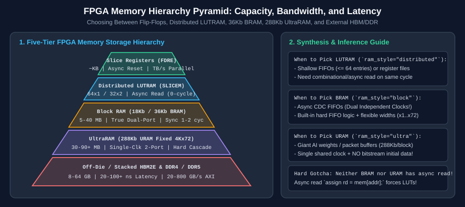
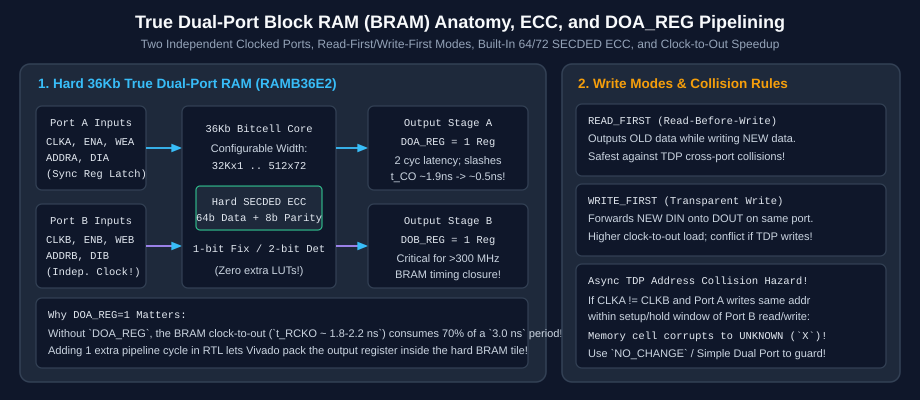

# FPGA Memory Architecture Distributed RAM, BRAM, URAM, and FIFOs

On-die SRAM capacity and bandwidth often decide whether an FPGA design hits `400+ MHz` effortlessly or stalls waiting on off-chip DDR. Modern FPGAs offer four distinct on-die memory tiers—**Slice Registers**, **Distributed LUTRAM**, **Block RAM (`18Kb/36Kb BRAM`)**, and **UltraRAM (`288Kb URAM`)**—each governed by strict clock, port, latency, and reset rules. Understanding how to infer each tier reliably, avoid dual-port collision corruption, close timing with `DOA_REG`, and construct rock-solid synchronous and asynchronous FIFOs is essential FPGA engineering craft.

---

## Learning Goals

- Compare **Registers**, **Distributed LUTRAM (`SLICEM`)**, **36Kb BRAM**, **288Kb URAM**, and external **HBM/DDR4** across capacity, access latency, ports, and initialization capability.
- Infer clean **Simple Dual-Port (SDP)** and **True Dual-Port (TDP)** BRAMs in SystemVerilog, selecting **`READ_FIRST`**, **`WRITE_FIRST`**, or **`NO_CHANGE`** modes safely.
- Enable hard **`DOA_REG`/`DOB_REG` output pipeline registers** and built-in **64/72-bit SECDED ECC** to close `400–600 MHz` memory paths cleanly.
- Build reliable **Synchronous** and **Asynchronous CDC FIFOs** (`BRAM_FIFO` vs Gray-pointer RTL), and understand multi-port (`4R2W`) **Live-Value Table (`LVT`) / XOR-bank** memory emulation.

---

## FPGA On-Die Memory Hierarchy Registers, LUTRAM, BRAM, and URAM

Choosing the wrong memory primitive wastes either millions of LUTs or scarce 36Kb BRAM tiles:



| Memory Tier | Unit Capacity | Read Latency | Ports &amp; Clocking | Bitstream Init? | Ideal Use Case |
| :--- | :--- | :--- | :--- | :--- | :--- |
| **Flip-Flops (`FDRE`)** | `1 bit/FF` | `0 cycles` (direct `Q`) | Unlimited parallel reads | Yes (`INIT`) | Small pipeline regs, scoreboards, valid bitmaps |
| **Distributed LUTRAM (`SLICEM`)** | `64 bits` (`64x1` / `32x2`) | **`0 cycles` (Async Read!)** or `1 cyc` | `SP`, `SDP`, `Quad-Port (3R+1W)` | Yes (`INIT`) | Shallow FIFOs (`<=64` deep), CPU register files (`32x64`) |
| **Block RAM (`BRAM 36Kb`)** | `36 Kb` (`2x 18Kb` split!) | `1 cyc` (unreg) / **`2 cyc` (`DOA_REG`)** | **True Dual Port**, `CLKA != CLKB` | Yes (`$readmemh`) | Async CDC FIFOs, packet buffers, soft CPU cache, LUT tables |
| **UltraRAM (`URAM 288Kb`)** | `288 Kb` (`4096 x 72` fixed!) | `1–4+ cyc` (cascadable) | **2 Ports, SINGLE Clock Only!** | **NO (`0` at GSR!)** | Huge AI weights, 4K frame buffers, deep networking tables |

> [!WARNING]
> **Two Costly URAM Limitations**:
> 1. **Single Clock Only**: Both Port A and Port B of a `288Kb URAM` *must* run on the exact same synchronous clock—you **cannot** build a cross-clock CDC FIFO directly in URAM!
> 2. **Zero Initialization**: URAM always boots cleared to `0` (ignores `$readmemh` ROM contents unless pre-loaded at runtime via fabric logic!).

---

## True Dual-Port BRAM Modes, Collision Rules, and ECC

A physical `36Kb BRAM` (`RAMB36E2`) can operate either as **two independent `18Kb` blocks** (`RAMB18E2`) or one deep/wide `36Kb` block with **True Dual-Port (`TDP`)** access:



### Operating Modes (`WRITE_MODE`)

When a port asserts write enable (`WE = 1`), what appears on its *own* read data output `DO`?
- **`WRITE_FIRST` (Transparent)**: The newly written `DI` passes straight onto `DO`. Warning: highest internal path delay (`lower Fmax`) and dangerous in TDP cross-port collisions!
- **`READ_FIRST` (Read-Before-Write)**: Outputs the *previous* contents of `mem[ADDR]` on `DO` while overwriting with `DI`. Best choice for safe TDP usage and FIFO/delay buffers!
- **`NO_CHANGE`**: Holds the previous `DO` value untouched during write cycles—**lowest dynamic power**!

### Asynchronous Clock TDP Collision Hazard

When `CLKA` and `CLKB` are asynchronous (`CLKA != CLKB`), if Port A **writes** to `ADDR = X` inside the narrow setup/hold collision window of Port B **reading or writing** the *exact same address `X`*, sense-amplifier contention corrupts the memory bitcell! Even in `READ_FIRST` mode, **never allow simultaneous asynchronous TDP writes to the same address** (`ADDR_A == ADDR_B`); use **Simple Dual-Port (`1W + 1R`)** or ensure address pointers differ cleanly (as in Gray-coded FIFOs!).

### Built-In Hard `64/72` SECDED ECC

Every `RAMB36E2` (in `512 x 72` Simple Dual-Port mode) and `URAM` includes **hard Single-Error-Correct, Double-Error-Detect (SECDED) Hamming ECC encoders/decoders** built right inside the hard block—protecting soft errors cleanly with **0 extra LUTs**!

---

## High-Frequency Pipelining with DOA_REG and URAM Cascade

Look at any unpipelined BRAM timing report (`DOA_REG = 0`) at `400 MHz` (`T_clk = 2.50 ns`):
- Hard BRAM clock-to-out (`t_RCKO_RAM`) alone eats **`~1.85 ns – 2.20 ns`**, leaving `< 0.30 ns` for *all* downstream LUT logic and routing—causing severe setup failures (`WNS < 0`)!

**Solution (`DOA_REG = 1` Output Pipeline Register)**: Simply write **one extra trailing pipeline register** right after the synchronous BRAM read in SystemVerilog! Synthesis automatically absorbs that external FF right into the BRAM tile's built-in `DOA_REG` output flip-flop, cutting effective clock-to-out from `~2.0 ns` down to **`~0.45 ns`**!

```systemverilog
// Synthesis-Guaranteed Simple Dual-Port BRAM With Internal DOA_REG/DOB_REG Pipeline!
// Set `ram_style = "block"` (or `"ultra"` for massive single-clock tables!)
module sdp_bram_pipelined #(
    parameter int DATA_W = 64,
    parameter int DEPTH  = 1024,
    parameter int ADDR_W = $clog2(DEPTH)
) (
    input  logic              clk,
    input  logic              wr_en,
    input  logic [ADDR_W-1:0] wr_addr,
    input  logic [DATA_W-1:0] wr_data,
    input  logic              rd_en,
    input  logic [ADDR_W-1:0] rd_addr,
    output logic [DATA_W-1:0] rd_data    // 2-cycle read latency -> Packs DOB_REG cleanly!
);
    (* ram_style = "block" *)
    logic [DATA_W-1:0] mem [0:DEPTH-1];

    logic [DATA_W-1:0] rd_stage1;        // Internal BRAM sense-amp output latch

    always_ff @(posedge clk) begin
        if (wr_en) begin
            mem[wr_addr] <= wr_data;
        end
        if (rd_en) begin
            rd_stage1 <= mem[rd_addr];   // Cycle 1: BRAM Core Read
            rd_data   <= rd_stage1;      // Cycle 2: Packs into BRAM hard output register!
        end
    end
endmodule
```

> [!CAUTION]
> **Do NOT Add a Reset on `rd_data` Unless You Use `DOA_REG`'s Exact Sync Active-High Reset!** Notice `rd_stage1` above has NO reset, and `rd_data` has NO reset (`or` active-high sync reset only, matching `DOB_REG`). Also make sure BOTH `rd_stage1` and `rd_data` use the *same* clock enable (`if (rd_en)`), otherwise synthesis cannot absorb `rd_data` inside the BRAM tile!

### Deep Memory Cascading Without External MUX Trees

To map a giant `32K x 72` table into `8` UltraRAMs (`4K x 72` each), enabling `CASCADE_ORDER` allows URAM blocks to pass address decoding and output MUX chains vertically through dedicated internal silicon cascade buses at `500+ MHz` without building huge 8:1 fabric MUX trees! (Notice: enable explicit `OREG_CASCADE` pipeline stages across deep cascades.)

---

## Synchronous vs Asynchronous CDC FIFOs and Multi-Port Emulation

### Built-In Hard BRAM FIFOs (`FIFO36E2`) vs Soft RTL FIFOs

- **Synchronous FIFO**: Keep read/write pointers binary, infer Simple Dual-Port BRAM/LUTRAM, and register **`almost_full` / `almost_empty`** cleanly for backpressure without combinational critical paths!
- **First-Word Fall-Through (FWFT)**: Presents valid read data at `dout` *before* `rd_en` pulses (using a 1–2 word skid register pre-fetching ahead of BRAM's 1–2 cycle read latency), matching AXI-Stream `TVALID`/`TREADY` zero-bubble interfaces seamlessly!
- **Asynchronous CDC FIFO**: Must run on `BRAM` or `LUTRAM` (NEVER `URAM`), synchronize Gray-coded pointers via `(* ASYNC_REG = "TRUE" *)` 2-FF/3-FF chains, and apply `set_max_delay -datapath_only` + `set_bus_skew` XDC bounds! Alternatively, AMD `XPM_FIFO_ASYNC` encapsulates all BRAM packing, Gray sync, reset synchronization, and scoped XDC constraints automatically!

### Multi-Port Register Files (`4R + 2W`) on Dual-Port Memories

What if a superscalar RISC-V core needs `4 Read Ports + 2 Write Ports` simultaneously, while hardware BRAMs only provide 2 ports total?
- **`4R + 1W` (Replication)**: Duplicate `4` identical copies of the BRAM writing the same `wr_data` to all `4` copies concurrently—each copy serves `1` independent read port cleanly!
- **`4R + 2W` (Live Value Table `LVT` or `XOR` Banking)**: Track which write bank (`Bank 0` vs `Bank 1`) last updated each address using a tiny distributed LUTRAM **Live Value Table (`LVT`)**, routing read results dynamically from the winning bank!

---

## Best Practices and Common Pitfalls

1. **Always Check `report_utilization` + `synth` Logs for Unintended LUT Memory**: One accidental asynchronous read (`assign dout = mem[raddr];`) or wrong `reset` inside an array causes Vivado to turn a intended `36Kb BRAM` into **`36,864` LUTs**, exploding runtime and collapsing placement! Check synthesis INFO lines (`Synthesizing RAM ... onto block RAM`)!
2. **Watch Depth/Width Aspect Ratios to Avoid Wasted BRAMs**: An array sized `1025 x 18` overflows `1024 x 36` (`1 BRAM`) by **1 word**, snapping up to **`2` BRAMs** (wasting 50% capacity!). Power-of-2 depths (`512`, `1024`, `2048`, `4096`) match BRAM/URAM hardware efficiency cleanly.
3. **Prefer `XPM_MEMORY` / `XPM_FIFO` Over GUI Block Memory Generator `.xci` Files When Scripting**: Parameterized SystemVerilog macros (`xpm_memory_sdpram`, `xpm_fifo_async`) require zero binary `.xci` bloat in Git and include automatic synthesis-time XDC constraints!
4. **Never Leave Unread Floating BRAM Enable `EN = 1` Permanently**: Tying `ENA = 1'b1` continuously even during idle cycles toggles internal sense-amps on every clock edge—gating `EN` with `rd_en | wr_en` cuts BRAM dynamic power dramatically!

---

## Practical Exercises with Solutions

### Exercise 1 Calculating Exact `BRAM36E2` Tile Usage Across Shapes

Each `RAMB36E2` tile holds `36,864` bits (`32Kb` data + `4Kb` parity/ECC bits) and configures up to `512 x 72` (SDP), `1024 x 36`, `2048 x 18`, `4096 x 9`, `8192 x 4`, `16384 x 2`, or `32768 x 1`. Calculate the minimum number of **`RAMB36E2`** tiles required for:
1. A **`2048 x 64-bit`** packet buffer (using SDP without ECC).
2. A **`16384 x 8-bit`** byte lookup table.
3. A **`512 x 128-bit`** wide descriptor cache.

#### Solution

1. **`2048 x 64-bit` Buffer**:
   - Each tile configures cleanly as `2048 x 18` (`18 >= 16` data bits). Stacking `4` tiles in width gives `2048 x 72 >= 2048 x 64` -> **`4` `RAMB36E2` tiles**!
2. **`16384 x 8-bit` Table**:
   - `16384 x 2` uses 1 tile per 2 data bits -> `8 / 2 =` **`4` `RAMB36E2` tiles** (total `131,072` bits = `4 * 32,768`). Wait: can `8` half-tiles (`RAMB18E2`) do `8192 x 2`? Same `4` full `36Kb` tiles!
3. **`512 x 128-bit` Wide Cache**:
   - In SDP mode, max width per `36Kb` tile is `512 x 72` (using parity bits too). Two tiles side-by-side yield `512 x 144 >= 512 x 128` -> **`2` `RAMB36E2` tiles**! (If ECC is needed, width per tile drops to `64` data bits + `8` ECC -> STILL `2` tiles!)

---

### Exercise 2 Fixing a Silent LUTRAM-Instead-of-BRAM Synthesis Bug

An engineer writes the `1024 x 32` buffer below expecting 1 `BRAM36E2`, yet Vivado synthesis reports `32,768` distributed `RAM64M` LUTRAM cells! Spot the exact bug and fix it:

```systemverilog
module mystery_ram (
    input  logic        clk,
    input  logic        we,
    input  logic [9:0]  waddr,
    input  logic [31:0] wdata,
    input  logic [9:0]  raddr1,
    input  logic [9:0]  raddr2,
    output logic [31:0] rdata1,
    output logic [31:0] rdata2
);
    logic [31:0] mem [0:1023];
    always_ff @(posedge clk) begin
        if (we) mem[waddr] <= wdata;
        rdata1 <= mem[raddr1];
        rdata2 <= mem[raddr2];
    end
endmodule
```

#### Solution

1. **Exact Bug**: Look at the number of concurrent ports accessed every clock edge: **`1 Write Port` (`waddr`) + `2 Independent Read Ports` (`raddr1`, `raddr2`) = `3 Total Ports`** (`2R1W`)! Hardware Block RAM (`BRAM`) physically has **only 2 address decoders/ports** (`A` and `B`), so it CANNOT perform 1 write + 2 reads simultaneously in 1 tile! Vivado fell back onto multi-port Distributed LUTRAM (`RAM64M` uses 4-port slices)!
2. **Fix**: Either **replicate into `2` SDP BRAMs** (`mem_copy1` handles `waddr + raddr1`, `mem_copy2` handles `waddr + raddr2` -> uses only **`2` `BRAM36E2`** tiles!), OR double-pump 1 TDP BRAM at `2x clk` if area is scarce!

---

### Exercise 3 Auditing Clock-to-Out Timing with `DOA_REG`

A design targets `450 MHz` (`T_clk = 2.22 ns`). An unpipelined BRAM (`DOA_REG = 0`) has `t_CKO = 1.95 ns`, feeding `2 LUT6` levels (`2 * 120 ps = 0.24 ns`) + routing (`0.55 ns`) into a slice FDRE (`t_setup = 0.08 ns`, `uncert = 0.08 ns`).

1. Compute the Setup Slack (`WNS`) with `DOA_REG = 0`.
2. Compute the new `WNS` after adding 1 pipeline register stage enabling `DOA_REG = 1` (`t_CKO` drops to `0.50 ns`, plus local slice net `0.15 ns`).

#### Solution

1. **Unpipelined (`DOA_REG = 0`)**:
   - Arrival = $1.95 + 0.24 + 0.55 = 2.74\text{ ns}$.
   - Required = $2.22 - 0.08 - 0.08 = 2.06\text{ ns}$.
   - **Slack = $2.06 - 2.74 = \mathbf{-0.68\text{ ns}}$ (FAILS `450 MHz` badly!)**.
2. **Pipelined (`DOA_REG = 1`)**:
   - Cycle 1 (Internal BRAM core -> `DOA_REG` latch) meets `> 550 MHz` internally inside hard silicon.
   - Cycle 2 (`DOA_REG` -> 2 LUTs -> FDRE): Arrival = $0.50 + 0.24 + 0.55 = 1.29\text{ ns}$.
   - **Slack = $2.06 - 1.29 = \mathbf{+0.77\text{ ns}}$ (PASSES `450 MHz` cleanly with huge margin!)**.

---

##### Copyright (c) 2026 squared-studio
