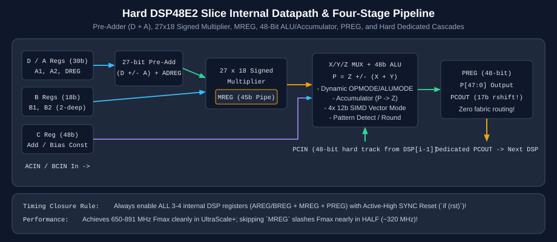
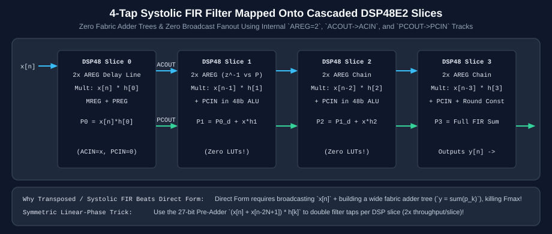

# Hard DSP Slices, Pipelined Arithmetic, and Fixed-Point Architecture

High-throughput wireless baseband (`5G NR`), radar beamforming, video codecs, and neural-network inference execute trillions of multiply-accumulate (`MAC`) operations per second. Building wide multipliers out of general-purpose `LUT6` fabric burns thousands of LUTs and crawls below `150 MHz`. Modern FPGAs solve this using columns of hardened **DSP Slices** (AMD `DSP48E2` / `DSP58`, Intel Variable-Precision DSP Blocks) engineered to run at **`650–891 MHz`** when paired cleanly with **internal pipeline registers (`AREG`, `MREG`, `PREG`)**, **hard vertical `ACIN`/`PCIN` cascades**, and disciplined **Fixed-Point (`Qm.n`) arithmetic**.

---

## Learning Goals

- Trace the complete internal datapath of a **DSP48E2 slice** (`27-bit Pre-Adder`, `27x18` signed multiplier, `MREG`, `48-bit ALU`, `PREG`, `Pattern Detect`, and `4x 12-bit` SIMD modes).
- Write behavioral SystemVerilog RTL that reliably infers **all 3–4 internal pipeline stages** (`A/B` + `MREG` + `PREG`) without wasting external fabric FFs or losing Fmax.
- Design **Systolic FIR Filters** and wide `54x54` multipliers using hard dedicated **`ACOUT->ACIN` and `PCOUT->PCIN` vertical cascades** (bypassing programmable fabric routing!).
- Execute error-free **Fixed-Point (`Qm.n`) arithmetic** covering bit-growth rules, symmetric **convergent rounding**, **saturation clamping**, and **CORDIC** trig/magnitude engines.

---

## DSP48 Slice Internals Pre-Adder, Multiplier, MREG, and 48-Bit ALU

Every Xilinx UltraScale+ `DSP48E2` block packs an entire arithmetic pipeline into a small hardened column:



### Five Key Architectural Features

1. **`27-Bit` Pre-Adder (`D +/- A`)**: Computes `(x[n] + x[n-k])` *before* the multiplier! Exploiting even/odd coefficient symmetry cuts the number of DSP slices needed for symmetric linear-phase FIR filters strictly in **half** (`2x` effective tap efficiency)!
2. **Asymmetric `27 x 18` Two's-Complement Multiplier**: Multiplies a 27-bit signed `A/D` signal by an 18-bit signed `B` filter coefficient (yielding a 45-bit signed product). Always order operands so your wider signal sits on `A` (`27b` signed / `26b` unsigned!) and your narrower weight/coefficient sits on `B` (`18b` signed / `17b` unsigned)!
3. **Critical Multiplier Register (`MREG`)**: Latches the 45-bit product cleanly *inside* the DSP slice before entering the 48-bit ALU! **Skipping `MREG` forces both multiplier + 48-bit adder into 1 single cycle, cutting max `Fmax` nearly in half!**
4. **`48-Bit` 3-Input ALU / Accumulator (`Z +/- (X + Y)`)**:
   - Performs accumulation (`P <= P + M`), wide constant rounding (`P <= C + M`), or cascaded accumulation (`P <= PCIN + M`), plus **17-bit right-shift (`PCIN >> 17`)** directly inside hard silicon to chain partial products of giant `35x35` or `54x54` wide multipliers!
   - Also splits dynamically (`USE_SIMD = FOUR12`) into **four independent 12-bit adders** for compact vector math.
5. **Hard Pattern Detector &amp; Overflow Flag**: Detects exact rounding halfway cases (`0.500...`) or saturation thresholds inside the DSP tile for free (`0` fabric LUTs!).

---

## Writing RTL That Infers Full 3-Stage and 4-Stage DSP Pipelines

Synthesizing `assign p = a * b;` cleanly maps onto 1 DSP, *yet leaves `AREG`, `BREG`, `MREG`, and `PREG` turned OFF*, capping timing at `~250 MHz`! Writing **explicit pipelined RTL with active-high synchronous reset (or reset-free)** lets Vivado pack all internal registers inside the DSP silicon cleanly:

```systemverilog
// Synthesis-Guaranteed 4-Stage Pipelined Pre-Adder + MAC in 1 Single DSP48E2 (~700 MHz!)
// Computes: P = (D + A) * B + P_prev   [Signed fixed-point]
module dsp48_sym_mac #(
    parameter int AW = 25,
    parameter int BW = 18,
    parameter int PW = 48
) (
    input  logic                 clk,
    input  logic                 rst,      // Active-High SYNC reset ONLY! (Never negedge!)
    input  logic                 ce,
    input  logic                 accum_clr,// Clears feedback accumulation cleanly on new burst
    input  logic signed [AW-1:0] d_in,
    input  logic signed [AW-1:0] a_in,
    input  logic signed [BW-1:0] b_in,
    output logic signed [PW-1:0] p_out
);
    // Stage 1: Input & Pre-Adder pipeline regs (pack into DREG/AREG + BREG + ADREG)
    logic signed [AW:0]     preadd_q;
    logic signed [BW-1:0]   b_reg1_q, b_reg2_q;
    // Stage 2: Multiplier pipeline reg (packs into MREG!)
    logic signed [AW+BW:0]  mult_q;

    always_ff @(posedge clk) begin
        if (rst) begin
            preadd_q <= '0;
            b_reg1_q <= '0;
            b_reg2_q <= '0;
            mult_q   <= '0;
            p_out    <= '0;
        end else if (ce) begin
            // Stage 1: Pre-adder + B balancing reg (2 cycles before MREG so B aligns!)
            preadd_q <= d_in + a_in;
            b_reg1_q <= b_in;
            b_reg2_q <= b_reg1_q;

            // Stage 2: Multiply -> MREG
            mult_q   <= preadd_q * b_reg2_q;

            // Stage 3: Accumulate / Clear -> PREG!
            p_out    <= accum_clr ? mult_q : (p_out + mult_q);
        end
    end
endmodule
```

> [!WARNING]
> Notice two subtle details above that preserve 100% hard DSP packing:
> 1. **`rst` is Active-High Synchronous** (`always_ff @(posedge clk) if (rst)`), matching `DSP48E2` silicon (`RSTA`/`RSTM`/`RSTP`).
> 2. **Pipeline Balance on `b_in` (`b_reg1_q` + `b_reg2_q`)**: Because `preadd_q` adds 1 cycle before multiplication (`A1 -> ADREG`), delaying `b_in` by 2 stages (`B1 -> B2`) balances both inputs right inside the DSP tile without consuming fabric FFs! (And check `report_utilization` + schematic view to verify 0 fabric LUT/FF leakage!)

---

## Systolic FIR Filters and Hard ACIN/PCIN Cascades

When implementing a `64-tap` FIR filter (`y[n] = sum(h[k]*x[n-k])`):
- **Direct-Form FIR** fails badly at high speed: summing 64 products requires a 6-level fabric adder tree + broadcasting `x[n]` across 64 slices (`high fanout`)!
- **Systolic / Transposed FIR** cascades directly up a vertical **DSP48 column** using dedicated `ACOUT -> ACIN` (`AREG=2` creates the $z^{-1}$ sample shift!) and `PCOUT -> PCIN` (`48-bit` partial-sum wires)—delivering **`600+ MHz` throughput with ZERO fabric LUTs**:



Wait: notice **column height limits**! One physical DSP column inside a Clock Region holds `~24–48` DSP slices. Cascading a giant `128-tap` chain blindly in 1 continuous `PCIN` wire forces jumps across Clock Regions or SLR chiplets (`SLR` boundaries break hard `PCIN` cascade tracks!)—always break long chains cleanly at Clock Region / SLR boundaries using 1 regular fabric pipeline register (`reg` on `P_out -> C_in`)!

---

## Fixed-Point Q-Format Arithmetic, Rounding, Saturation, and CORDIC

IEEE-754 32-bit `float` hardware burns ~5–8 DSPs + hundreds of LUTs per add/multiply! Unless dynamic range exceeds `90–120 dB` (like scientific matrix solvers), production FPGA DSP cores compute in compact **`Qm.n` Two's-Complement Fixed-Point** (1 `sign+m` integer bits, `n` fractional bits; e.g., `Q1.15` spans `[-1.0, +0.99997]` cleanly inside an 18-bit DSP input!):

### 1. Exact Bit Growth Rules

- **Addition (`Qm.n + Qm.n`)**: Align fractional points identically; result needs **`(m+1)` integer bits** -> `1 + m + n + 1` total width to guarantee zero overflow.
- **Multiplication (`Qm1.n1 * Qm2.n2`)**: Product has exact integer width `m1 + m2 + 1` and fractional width **`n1 + n2`** (e.g., `Q1.15 * Q1.15 -> Q2.30`, needing shift right by 15 bits back to `Q1.15`!). Notice multiplying `-1.0 * -1.0` (`-2^15 * -2^15`) creates `+1.0`, overflowing `Q1.15` max `+0.99997` by 1 LSB unless saturated!

### 2. Rounding Without DC Bias (`Truncate` vs `Convergent Round`)

- **Simple Bit Truncation (`p[30:15]`)**: Drops fractional LSBs, introducing a systematic **negative `-0.5 LSB` DC bias** that accumulates inside IIR/CIC filters and shifts FFT noise floors!
- **Symmetric Round-Half-to-Even (Convergent Rounding)**: Adds `0.5 LSB` (`{1'b0, 14'h3FFF}` or `15'h4000` with sticky bit check on exact tie) inside the *same* DSP48 `C` port via **`C + M` + Pattern Detect**, yielding **0 DC bias** for free!

### 3. Saturation Clamping (Never Wrap Around!)

Wrapping from `+32767` to `-32768` on overflow creates massive full-scale spikes (screaming distortion in audio/motor control!). Always check discarded upper sign/overflow bits (`overflow = ~&top_bits && |top_bits` or `msb != all_sign_bits`) and clamp strictly to `+MAX` (`32'h7FFF...`) or `-MIN` (`32'h8000...`).

### 4. Multiplier-Free Math with CORDIC

Need `sin(theta)`, `cos(theta)`, `atan2(y, x)`, or `sqrt(I^2 + Q^2)` on FPGA? **CORDIC** executes iterative micro-rotations ($\theta_i = \arctan(2^{-i})$) using *only* **bit-shifts and add/subtracts (`CARRY8` LUTs, zero DSPs!)**, converging `1 bit` of accuracy per pipeline stage at `400+ MHz`!

---

## Best Practices and Common Pitfalls

1. **Swap Operands to Fit `27 x 18` Single-DSP Bounds Before Synthesis Splits Across `2` DSPs**: Writing a `20 x 20` unsigned multiply overflows the `18-bit` `B` port by 2 bits, forcing synthesis to instantiate **two DSPs + fabric adders**! Whenever one side is `<= 18 bits` signed (`<= 17b` unsigned) and the other `<= 27 bits` signed (`<= 26b` unsigned), one single `DSP48E2` completes it cleanly!
2. **Account for Accumulator Bit Growth (`Guard Bits`)**: When accumulating `1024` 45-bit products (`log2(1024) = 10`), guard bits keep intermediate sums safely inside the `48-bit` accumulator if products sit under `38` bits; otherwise widen accumulator externally!
3. **Never Neglect DC Gain Normalization in CIC / Fixed-Point Filters**: Document exact `Qm.n` formats directly in signal names (e.g., `sig_q2_16`) and cross-check fixed-point bit-accurate Python/MATLAB golden models vector-for-vector against SystemVerilog simulation!
4. **Always Register `CE` and `OPMODE` Control Inputs Too**: Dynamic `OPMODE` toggling inside a DSP48 must match `INMODE`/`ALUMODE` registers (`OPMODEREG = 1`) cleanly to stay synchronized with pipelined `A`/`B` data!

---

## Practical Exercises with Solutions

### Exercise 1 Sizing Signed &amp; Unsigned Operands Inside `DSP48E2` (`27 x 18`)

You are implementing two pipelined multipliers on an UltraScale+ FPGA (`DSP48E2` accepts **signed 27-bit `A`** and **signed 18-bit `B`**):
1. An **unsigned `24-bit x 16-bit`** pixel scaler (`px[23:0] * gain[15:0]`). Does it fit in **1 DSP48E2**?
2. A **signed `20-bit x 20-bit`** FFT twiddle multiplier. How many `DSP48E2` slices does it consume?

#### Solution

1. **Unsigned `24-bit x 16-bit`**:
   - Convert unsigned operands into signed two's-complement slots by zero-extending 1 MSB (`0`):
     - `24-bit` unsigned needs **`25 bits` signed** $\le 27$ (`Fits A port!`).
     - `16-bit` unsigned needs **`17 bits` signed** $\le 18$ (`Fits B port!`).
   - Result: Fits cleanly inside **1 single `DSP48E2`**!
2. **Signed `20-bit x 20-bit`**:
   - One operand (`20b`) fits `A` (`<= 27b`), yet the second (`20b`) exceeds `B` (`18b`) by 2 bits!
   - Synthesis splits the `20b` `B` operand into a `17b` lower unsigned slice + `3b` upper signed slice, computing 2 partial products using **`2` `DSP48E2` slices** (chained via `PCIN >> 17`)!

---

### Exercise 2 Detecting Fixed-Point Overflow vs. Saturation Arithmetic

Consider multiplying two `Q1.15` signed 16-bit numbers (`val_a = 16'h8000` representing `-1.0`, and `val_b = 16'h8000` representing `-1.0`) yielding a full 32-bit intermediate product `prod_raw` (`Q2.30`), which must round/scale back down to **`Q1.15`** (`16-bit signed`).

1. Compute the exact hexadecimal value of `prod_raw` (`signed 32-bit`).
2. Explain what catastrophic audio/control bug occurs if you naively slice `prod_raw[30:15]` without saturation!
3. Write the exact SystemVerilog saturation + rounding expression returning clean `Q1.15` (`16'h7FFF = +0.99997`)!

#### Solution

1. **Exact Product**:
   - `16'sh8000 = -32768`. Multiplying $(-32768) \times (-32768) = +1{,}073{,}741{,}824 = \mathbf{32'sh4000\_0000}$ (`+1.0` in `Q2.30`).
2. **Naive Slicing Bug (`prod_raw[30:15]`)**:
   - Bit `30` of `32'h4000_0000` is `1`, and bits `[29:15]` are all `0` -> `16'h8000` = **`-1.0`**! Multiplying `-1.0 * -1.0` flipped signs to **`-1.0`** (full-scale sign-inversion glitch)!
3. **Clean Rounding + Saturation Check**:
   - Notice bits `[31:30]` (`2'b01`) do NOT match (`prod[31] != prod[30]` -> positive overflow!).
```systemverilog
logic signed [31:0] prod_raw, prod_rnd;
assign prod_raw = val_a * val_b;
assign prod_rnd = prod_raw + 32'sh0000_4000; // Add 0.5 LSB rounding before slice

always_comb begin
    // Check overflow between sign bit [31] and integer bit [30]
    if (~prod_rnd[31] && prod_rnd[30]) begin
        q15_out = 16'sh7FFF; // Positive Saturate (+0.99997)
    end else if (prod_rnd[31] && ~prod_rnd[30]) begin
        q15_out = 16'sh8000; // Negative Saturate (-1.0)
    end else begin
        q15_out = prod_rnd[30:15];
    end
end
```

---

### Exercise 3 Sizing Systolic FIR Pipeline Throughput

You need a **48-tap FIR filter** processing a complex (`I/Q`) RF signal at **`500 MSPS`** on an FPGA clocked at **`500 MHz`**. Assume coefficients are symmetric (`h[k] = h[47-k]`) and fit in 18-bit signed (`<= 16-bit` data).

1. Exploiting `DSP48E2` pre-adders (`D + A`) and two parallel channels (`I` and `Q`), how many `DSP48E2` slices total are needed?
2. Can all `24` DSPs per channel (`I` and `Q`) chain inside one single Clock Region column if the FPGA Clock Region height is `24` DSPs high? What happens if a `64-tap` (`32` DSPs) filter crosses a Clock Region / SLR boundary?

#### Solution

1. **DSP Slice Count**:
   - Because coefficients are symmetric (`48` taps -> `24` symmetric pairs using the hard `D + A` pre-adder!), each real filter channel requires only **`24` `DSP48E2`** slices!
   - For Complex (`I` + `Q` channels) with real coefficients: `24 * 2 =` **`48` `DSP48E2`** slices total! (Or `4 * 24 = 96` if complex coefficients!)
2. **Column Height &amp; SLR Crossing**:
   - At height `24` DSPs, each `24-DSP` systolic chain (`I` and `Q`) fits comfortably inside one single Clock Region column via pure vertical `PCOUT->PCIN` tracks (`500+ MHz`!).
   - For `32` DSPs crossing into an adjacent Clock Region (or `SLR`), **Clock Region boundaries often allow vertical `PCIN` continuity within the same SLR**, whereas **SLR interposer gaps cut hard `PCIN` routing completely**! Crossing an SLR requires breaking the chain cleanly into fabric flip-flops (`SLL` bridge) between DSP #23 (`PREG`) and DSP #24 (`CIN`).

---

##### Copyright (c) 2026 squared-studio
