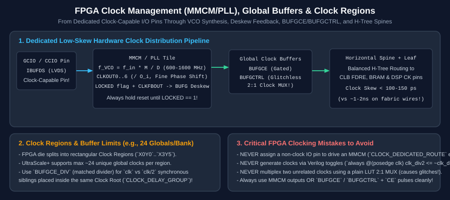
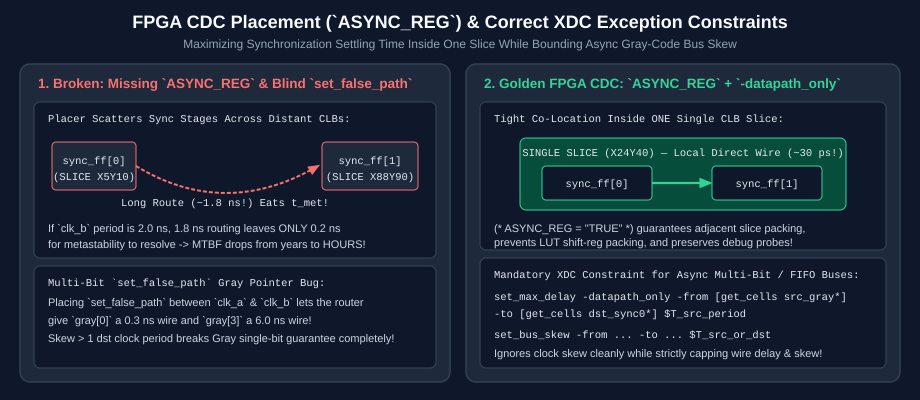

# FPGA Clocking Networks, MMCM/PLL, Clock Regions, and CDC Rules

In a high-performance FPGA, clocks are distributed through specialized low-skew metal H-trees and dedicated clock buffers (`BUFG`) completely separate from general LUT switch boxes. Violating FPGA clocking rules—such as bringing an external clock onto an ordinary GPIO pin, dividing clocks inside flip-flops, multiplexing clocks through LUTs, or scattering CDC synchronizers across distant slices—causes severe timing violations, random clock glitches, and catastrophic metastability failures.

---

## Learning Goals

- Trace the hardware clock path from **Clock-Capable I/O (`GCIO`/`CCIO`) pins** through **MMCM/PLL** synthesis tiles, **`BUFGCE` / `BUFGCTRL`** buffers, and **Clock Regions**.
- Contrast **Mixed-Mode Clock Managers (`MMCM`)** vs **PLLs** and understand deskew feedback loops (`CLKFBOUT -> BUFG -> CLKFBIN`).
- Implement glitchless runtime clock switching (**`BUFGCTRL`**) and phase-aligned derived clock dividers (**`BUFGCE_DIV`** + `CLOCK_DELAY_GROUP`).
- Enforce FPGA-specific **Clock Domain Crossing (`CDC`)** rules: **`(* ASYNC_REG = "TRUE" *)` placement** combined with **`set_max_delay -datapath_only`** and **`set_bus_skew`**.

---

## FPGA Clock Distribution MMCM, PLL, BUFGCE, and Clock Regions

Modern FPGAs split the silicon die into a grid of rectangular **Clock Regions** (each serving a fixed column height of CLBs, BRAMs, and DSPs, and typically supporting a hard ceiling of ~24 independent global clock tracks per region):



### Pin &amp; Buffer Selection Rules

1. **Always Enter Clocks on Dedicated `GCIO` / `CCIO` Pins**: Dedicated clock-capable pads wire straight via short metal tracks directly into regional `MMCM`/`PLL` tiles (`0.3 ns` low jitter). Routing a board oscillator into a standard data pin triggers Vivado `Place 30-574` (`CLOCK_DEDICATED_ROUTE`) errors and injects fabric jitter.
2. **MMCM vs. PLL**:
   - **PLL**: Compact frequency synthesis (`f_VCO = f_in * M / D`), integer divide outputs, clean jitter attenuation.
   - **MMCM**: Full-featured superset adding **fractional divide on `CLKOUT0`** (`0.125` increments!), **fine dynamic phase shift** (steps of $T_{\text{VCO}}/56$!), and complementary inverted outputs (`CLKOUT0B`).
3. **Lock Gating (`LOCKED` Flag)**: An MMCM takes tens of microseconds to stabilize VCO frequency after power-up or reset. **Always hold downstream fabric resets active until `mmcm_locked == 1'b1`**, preventing metastable partial-frequency clock pulses from corrupting FSM startup!

---

## Zero-Skew Clock Muxing, Derived Clocks, and Clock Delay Groups

Never write clock dividers or clock multiplexers in behavioral LUT logic:

- **Wrong**: `always_ff @(posedge clk) clk_div2 <= ~clk_div2;` -> Drives `clk_div2` out of a slice `FDRE/Q` onto a secondary clock tree (`>1.2 ns` insertion delay lag relative to `clk`!). Crossing data between `clk` and `clk_div2` suffers brutal Hold (`WHS < 0`) and Setup penalties!
- **Right Option A (`BUFGCE_DIV`)**: Uses dedicated hard divider circuitry inside the global clock buffer itself, automatically balancing insertion delay!
- **Right Option B (`MMCM` Output + `CLOCK_DELAY_GROUP`)**: Derive `clk_100`, `clk_200`, and `clk_400` from the **same MMCM** and assign sibling global nets to the **same `CLOCK_DELAY_GROUP` property** (`set_property CLOCK_DELAY_GROUP grp1 [get_nets {clk_200 clk_400}]`) so the router forces identical clock root placement (`< 50 ps` inter-clock skew!).
- **Glitchless Clock Muxing (`BUFGCTRL`)**: Never switch `clk_out = sel ? clk_a : clk_b;` in a LUT! Use hard **`BUFGCTRL`** (or `BUFGMUX`), which uses dual synchronized edge-hold latches to guarantee zero runt pulses during live clock switching even when `clk_a` and `clk_b` are completely asynchronous!

---

## FPGA-Specific Clock Domain Crossing (CDC) and ASYNC_REG Placement

Synchronizing a single-bit control flag across asynchronous clocks (`clk_a -> clk_b`) via a 2-FF or 3-FF synchronizer works mathematically *only* if the metastability resolution time $t_{\text{met}}$ between `sync_ff[0]` and `sync_ff[1]` spans almost the entire destination clock period (`T_dst - t_wire - t_setup`)!



Look at what happens on an FPGA without **`ASYNC_REG`**:
- Without constraints, the placer might put `sync_ff[0]` near the left edge of the chip (`SLICE_X4Y10`) and `sync_ff[1]` near the right edge (`SLICE_X92Y88`)—adding `1.8 ns` of programmable interconnect delay between them! At `500 MHz` (`2.0 ns` period), almost **zero settling time remains**, slashing MTBF to hours!
- Applying **`(* ASYNC_REG = "TRUE" *)`** locks `sync_ff[0..N]` tightly together inside **one single CLB slice** (`~30 ps` dedicated inter-FF wire!), protects them from optimization removal, and blocks shift-register (`SRL`) merging cleanly!

```systemverilog
// Synthesis-Guaranteed FPGA 3-Stage CDC Synchronizer with ASYNC_REG Packing
module fpga_cdc_sync #(
    parameter int STAGES = 3  // 2-FF for <250 MHz; 3-FF recommended above 300 MHz
) (
    input  logic dst_clk,
    input  logic async_in,
    output logic sync_out
);
    // CRITICAL: ASYNC_REG keeps stages inside 1 CLB slice & blocks SRL/retiming!
    (* ASYNC_REG = "TRUE" *)
    logic [STAGES-1:0] sync_pipe = '0;

    always_ff @(posedge dst_clk) begin
        sync_pipe <= {sync_pipe[STAGES-2:0], async_in};
    end

    assign sync_out = sync_pipe[STAGES-1];
endmodule
```

> [!IMPORTANT]
> **Scoped XDC for Reusable IP Modules**: Notice `fpga_cdc_sync` cannot put hardcoded clock names inside the module if instantiated in multiple clock pairs! Put a **scoped XDC (`set_property SCOPED_TO_REF fpga_cdc_sync`)** constraining `set_false_path -to [get_pins sync_pipe_reg[0]/D]` ONLY on `sync_pipe_reg[0]/D`—leaving `sync_pipe_reg[0]/Q -> sync_pipe_reg[1]/D` fully timed as a strict 1-cycle synchronous path so the router enforces ultra-short `~30 ps` delay!

---

## Constraining Asynchronous Paths Without Blind set_false_path

Never blanket-apply `set_clock_groups -asynchronous` globally across your entire chip if you also run **multi-bit Gray-code async FIFOs** (`XPM_FIFO_ASYNC`) or **Handshake/DMUX CDC buses** (`req` + `data` bus)!
- **`set_clock_groups -asynchronous`** has the **highest XDC precedence** in Vivado/Quartus—quietly **overriding and silencing `set_max_delay -datapath_only` and `set_bus_skew`** constraints!
- Without `-datapath_only` and `set_bus_skew`, the router lets individual bits of a 10-bit Gray FIFO pointer take wildly mismatched `0.4 ns` vs `7.5 ns` detours across the die, allowing **2 or 3 bits to change during the same destination clock cycle** and corrupting FIFO full/empty flags!

**Proper Safe Rule**: Drop global `set_clock_groups -asynchronous` whenever async CDC buses exist; constrain single-bit sync inputs specifically (`-to sync_ff0/D`) and constrain Gray/Handshake buses strictly with **`set_max_delay -datapath_only`** (set to $\min(T_{\text{src}}, T_{\text{dst}})$) plus **`set_bus_skew`**!

---

## Best Practices and Common Pitfalls

1. **Run `report_clock_interaction` and `report_cdc` Before Writing Bitstreams**: Never trust that CDC paths are clean until `report_cdc` shows **Zero `Unsafe` or `Unknown` crossings** (`Unconstrained` or `Missing ASYNC_REG`) and `report_clock_interaction` highlights no accidental red `Timed (Unsafe)` phase crossings between unrelated MMCMs!
2. **Check Unused `BUFGs` &amp; Clock Region Capacity Early**: Exceeding 24 global clocks inside any single Clock Region causes `Place 30-675` routing failures late in implementation—consolidate derived slow clocks (`10 MHz`, `1 MHz`) onto `CE` tick pulses derived from a single `100 MHz` master clock!
3. **Never Bypass `MMCM` Deskew Feedback (`CLKFBOUT -> BUFG -> CLKFBIN`) When Aligning External Board Clocks**: If matching phase against external SRAM/ADC interfaces, loop feedback *through* a matching `BUFG` so the MMCM cancels internal global clock tree insertion delay automatically!
4. **Add Dedicated `BUFGCE` Before Switching Asymmetric Clocks Safely**: Only switch active clocks using `BUFGCTRL` cleanly (never force mux enables with combinational `LUT`s).

---

## Practical Exercises with Solutions

### Exercise 1 Calculating MTBF Improvement From `ASYNC_REG` Slice Packing

A `500 MHz` destination clock (`T_dst = 2.00 ns`, `t_setup = 0.08 ns`) captures a `50 MHz` asynchronous signal inside a 2-FF synchronizer with silicon parameter $\tau = 45\text{ ps}$ and $T_0 = 0.1\text{ ps}$ (`MTBF = exp(t_met / tau) / (T_0 * f_clk * f_data)`).

Compare **MTBF** between:
- **Case A (Unconstrained Scattered FFs)**: Inter-flop routing consumes `t_route = 1.60 ns` (`t_met = 2.00 - 1.60 - 0.08 = 0.32 ns`).
- **Case B (`ASYNC_REG = "TRUE"` Co-Located)**: Inter-flop local route consumes `t_route = 0.05 ns` (`t_met = 2.00 - 0.05 - 0.08 = 1.87 ns`).

#### Solution

Denominator: $T_0 \cdot f_{\text{clk}} \cdot f_{\text{data}} = (10^{-13}\text{ s})(5 \times 10^8)(5 \times 10^7) = 2.5 \times 10^3\text{ s}^{-1}$.

- **Case A (Scattered FFs, $t_{\text{met}} = 320\text{ ps}$)**:
  $$\frac{t_{\text{met}}}{\tau} = \frac{320}{45} = 7.111 \implies e^{7.111} = 1{,}225$$
  $$\text{MTBF}_A = \frac{1{,}225}{2500} \approx \mathbf{0.49\text{ seconds}}$$
  (**Fails twice every second!!**)
- **Case B (`ASYNC_REG`, $t_{\text{met}} = 1870\text{ ps}$)**:
  $$\frac{t_{\text{met}}}{\tau} = \frac{1870}{45} = 41.56 \implies e^{41.56} \approx 1.12 \times 10^{18}$$
  $$\text{MTBF}_B = \frac{1.12 \times 10^{18}}{2500} \approx 4.48 \times 10^{14}\text{ s} \approx \mathbf{14.2\text{ Million Years!}}$$
  A `1.55 ns` wire difference changed failure rate from twice per second to 14 million years!

---

### Exercise 2 Fixing a Silent `set_clock_groups` Override Bug on an Async FIFO

An engineer writes a clean `async_fifo` with Gray pointers constrained via:
```tcl
set_max_delay -datapath_only -from [get_cells u_fifo/wr_ptr_gray_reg*] -to [get_cells u_fifo/rd_sync_reg*] 4.0
set_bus_skew -from [get_cells u_fifo/wr_ptr_gray_reg*] -to [get_cells u_fifo/rd_sync_reg*] 2.0
```
Yet later adds one line at the bottom of `top.xdc`:
```tcl
set_clock_groups -asynchronous -group [get_clocks clk_wr] -group [get_clocks clk_rd]
```
Explain why lab hardware intermittently corrupts FIFO `empty` status after weeks of simulation passing cleanly!

#### Solution

1. **Precedence Override Bug**: In Vivado XDC/SDC precedence, **`set_clock_groups -asynchronous` overrides `set_max_delay -datapath_only` completely**! Once `set_clock_groups` was evaluated, Vivado dropped timing urgency on `wr_ptr_gray_reg* -> rd_sync_reg*` completely!
2. **Consequence on Hardware**: Under placement congestion, bit `3` of the Gray pointer routed a `9 ns` detour while bits `0..2` arrived in `0.8 ns`. That `>1` clock cycle skew broke the Gray-code 1-bit transition property at `rd_sync_reg`, causing invalid empty jumps!
3. **Fix**: Remove the global `set_clock_groups -asynchronous` rule between `clk_wr` and `clk_rd` (use targeted `set_false_path` ONLY on 1-bit `ASYNC_REG` inputs while keeping `-datapath_only` + `set_bus_skew` active on multi-bit Gray buses, or verify `report_exceptions` to prove `-datapath_only` wasn't overridden!).

---

### Exercise 3 Consolidating Clocks to Beat the 24-Clock-per-Region Limit

A sensor aggregator FPGA needs **30 slow peripheral clocks** (`10 MHz`, `5 MHz`, `2 MHz`, `1 MHz`, `400 kHz`, etc.) for SPI, I2C, UART, PWM, and timer engines inside one single Clock Region (`max 24 globals`). Should you instantiate 6 cascaded MMCMs with 30 `BUFG`s, or how should you architect the clocking cleanly?

#### Solution

1. Instantiating 30 global clock nets (`MMCM`s + `BUFG`s) exceeds hardware clock-region routing tracks (`24` globals) and causes immediate placement failure!
2. **Clean FPGA Architecture**: Generate **1 single `100 MHz` global clock (`clk_100m`)** on 1 `BUFG`, then drive tiny synchronous programmable modulo counters generating **1-cycle `CE` (Clock Enable) strobes** (`tick_10m`, `tick_5m`, `tick_400k`):
   - Every peripheral runs synchronously on **`@(posedge clk_100m)`** qualified by `if (tick_en)`.
   - Zero extra `BUFG`s consumed (**1 global clock instead of 30**!), zero cross-clock CDC synchronizers needed between CPU `100 MHz` CSRs and SPI/I2C/UART logic, and clean synchronous static timing!

---

##### Copyright (c) 2026 squared-studio
