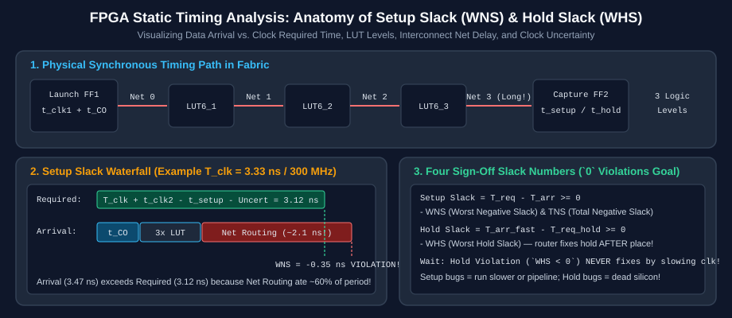
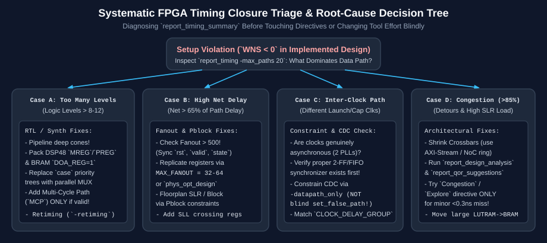

# Timing Constraints (XDC/SDC) and Systematic FPGA Timing Closure

An FPGA bitstream is NOT verified by simulation alone—**Static Timing Analysis (`STA`)** in Vivado/Quartus determines whether every flip-flop-to-flip-flop path across worst-case Process, Voltage, and Temperature corners meets Setup (**`WNS >= 0`**) and Hold (**`WHS >= 0`**). Unlike an ASIC where missing timing fails tape-out after months, an FPGA lets you inspect exact routed path delays in minutes and close timing systematically through **clean XDC constraints**, **RTL pipelining**, **fanout replication**, **floorplanned `Pblock` constraints**, and targeted physical optimization directives.

---

## Learning Goals

- Write complete, accurate **XDC/SDC timing constraints**: `create_clock`, `create_generated_clock`, `set_input_delay` / `set_output_delay`, `set_multicycle_path`, and `set_max_delay -datapath_only`.
- Audit **`report_timing_summary`**, **`report_clock_interaction`**, and **`check_timing`** to verify **100% constrained paths** before analyzing WNS/WHS slack.
- Diagnose Setup (`WNS < 0`) vs. Hold (`WHS < 0`) failures across logic depth, routing congestion, high-fanout nets, and SLR chiplet crossings.
- Execute a disciplined **5-step FPGA Timing Closure loop** targeting source RTL, control sets, physical placement (`Pblocks`), and `phys_opt_design` instead of blindly guessing tool effort flags!

---

## Primary Clocks, Generated Clocks, and Clock Groups in XDC

Uncorrected or missing XDC constraints lie silently (`unconstrained paths` never show up in `WNS`, causing random lab hardware glitches!). Always verify **`check_timing`** reports **zero `no_clock`, `unconstrained_internal_endpoints`, or `no_input_delay` warnings**!

### Essential Clock &amp; Exception XDC Commands

```tcl
# 1. Primary External Oscillator Clock on GCIO Pin (200 MHz -> 5.000 ns period, 50% duty)
create_clock -name sys_clk_200m -period 5.000 [get_ports sys_clk_p]

# 2. Input Jitter Specification (Board oscillator + power noise budget)
set_input_jitter [get_clocks sys_clk_200m] 0.050

# 3. Generated Clocks: Note MMCM / PLL outputs usually auto-derive from IP XDC!
# Define manually ONLY for forwarded ODDR clocks or custom fabric divide/mux dividers:
create_generated_clock -name spi_sclk_out \
    -source [get_pins u_spi/u_oddr_clk/C] \
    -divide_by 4 [get_ports spi_sclk]

# 4. Multicycle Path (MCP): Example when an FIR datapath runs cleanly every 2 clock cycles
# Always apply BOTH setup (-setup 2) AND hold (-hold 1) together on MCP!!
set_multicycle_path -setup 2 -from [get_cells u_slow_alu/in_q*] -to [get_cells u_slow_alu/out_q*]
set_multicycle_path -hold  1 -from [get_cells u_slow_alu/in_q*] -to [get_cells u_slow_alu/out_q*]
```

> [!CAUTION]
> **The Classic `set_multicycle_path` Hold Trap!** Writing `set_multicycle_path -setup 2` *alone* leaves the default hold launch-to-capture edge relationship shifted forward to edge `1` (`Hold = +1 cycle` requirement instead of `0`), forcing the router to insert giant `5 ns` hold delay buffers to stall fast paths! **Always pair `-setup N` with `-hold (N - 1)`** (e.g., `-setup 2` paired with `-hold 1`) whenever moving both capture edges together!

---

## Reading report_timing_summary and Slack Waterfalls

A timing path measures arrival time vs. required capture edge across launch FF, combinational LUT/DSP/BRAM stages, routing switch-boxes, and setup/hold windows:



### Setup vs. Hold Checks

- **Setup Slack (`WNS` Worst Negative Slack, `TNS` Total Negative Slack)**: Checks the **slowest** PVT corner (`Slow-Max`) ensuring data launched at $t = 0$ arrives at Capture FF before $T_{\text{clk}} - t_{\text{setup}}$:
  $$\text{Slack}_{\text{setup}} = (T_{\text{clk}} + T_{\text{clk,cap}} - t_{\text{setup}} - t_{\text{uncert}}) - (T_{\text{clk,launch}} + t_{\text{CO}} + t_{\text{logic}} + t_{\text{net}})$$
- **Hold Slack (`WHS` Worst Hold Slack, `THS` Total Hold Slack)**: Checks the **fastest** PVT corner (`Fast-Min`) ensuring data from the *next* edge doesn't race through tiny routes and overwrite the *current* capture edge (`>= t_hold`).
  - **Setup Failure (`WNS < 0`)** can temporarily pass if you lower board clock frequency; **Hold Failure (`WHS < 0`)** fails at **ANY clock frequency** (even 1 Hz!)—never load a bitstream with `WHS < 0`!

---

## Multicycle Paths, False Paths, and Boundary I/O Constraints

External chip interfaces need exact **board PCB trace + external IC setup/hold** constraints so Vivado guarantees valid timing right at FPGA pins:

$$\text{input\_delay}_{\max} = T_{\text{CO,ext\_max}} + T_{\text{PCB\_data\_max}} - T_{\text{PCB\_clk\_min}}$$
$$\text{input\_delay}_{\min} = T_{\text{CO,ext\_min}} + T_{\text{PCB\_data\_min}} - T_{\text{PCB\_clk\_max}}$$
$$\text{output\_delay}_{\max} = T_{\text{setup,ext}} + T_{\text{PCB\_data\_max}} - T_{\text{PCB\_clk\_min}}$$
$$\text{output\_delay}_{\min} = -T_{\text{hold,ext}} + T_{\text{PCB\_data\_min}} - T_{\text{PCB\_clk\_max}}$$

Notice **minus sign on `-T_hold,ext`** for `output_delay -min`! Pushing output transitions cleanly into `IOB = TRUE` flip-flops stabilizes I/O slack tightly across builds. Only slow async LEDs/switches with human/millisecond timings should carry `set_false_path -from/to [get_ports led*]`.

---

## Systematic Timing Closure Loops Logic Depth, Fanout, Floorplanning, and Directives

Never waste days randomly rerunning `place_design -directive Explore` hoping luck clears a `-1.5 ns` violation! Read the worst 20 violating paths in `report_timing` and follow a targeted **root-cause decision tree**:



### Inspecting Before Editing

1. **Case A (`Logic Delay > 45%` or `Levels > 8` @ `300+ MHz`)**: Too much combinational work per cycle! Add an RTL pipeline stage, turn ON DSP48 `MREG`/`PREG` or BRAM `DOA_REG`, or check whether Vivado turned a wide `case` into a priority tree.
2. **Case B (`Net Delay > 65%` with Low Logic Levels)**: Either:
   - **High Fanout (`Fanout > 200–1000`)**: A single reset or `valid` register feeding 4,000 slices stretches across half the die! Manually duplicate the source register per subsystem or set `(* max_fanout = 32 *)` + run `phys_opt_design` replication!
   - **Bad Cross-Die Pull**: Block A talks directly to Block B across opposite ends of the chip or across an **SLR boundary**. Apply **coarse `Pblock` floorplanning** cleanly keeping tightly coupled engines together, and insert dedicated pipeline registers across SLR edges!
3. **Case C (`Different Clocks` / `Inter-Clock`)**: Check `report_clock_interaction`: if unrelated asynchronous clocks appear as `Timed`, verify hardware CDC synchronizers (`2-FF` / `XPM_FIFO_ASYNC`) exist, then constrain cleanly with `-datapath_only` + `set_bus_skew`!
4. **Case D (`Congestion Level >= 5` in `report_design_analysis`)**: Dense crossbars or over-utilized BRAM slices (`>85%`) force massive routing detours! Flatten wide crossbars into registered AXI-Stream stages, push `LUTRAM -> BRAM`, or enable `AlternateCLBPacking` / `Congestion_SpreadLogic_high` directives.

> [!TIP]
> **Run `report_qor_suggestions` (`RQS`)**: Modern Vivado/Quartus engines provide automated QoR advisors (`report_qor_suggestions` in Vivado) that automatically diagnose high-fanout nets, missing DSP/BRAM output registers, clock skew groups, and congestion hot-spots, emitting ready-to-apply Tcl/XDC patches!

---

## Best Practices and Common Pitfalls

1. **Always Fix `check_timing` Unconstrained Warnings First**: Closing timing on a `.bit` file with `WNS = +0.5 ns` means nothing if 2,000 external I/O pins or derived clocks sat unconstrained!
2. **Avoid Over-Floorplanning Tiny `Pblock` Boxes**: Constraining every small module into rigid `Pblock` rectangles prevents the placer from optimizing global wirelengths and causes worse congestion! Only use coarse `Pblock` boundaries around major **SLR partitions** (`SLR0`/`SLR1`/`SLR2`) or **DFX Reconfigurable Partitions**.
3. **Never Leave Unwanted `DONT_TOUCH` / `MARK_DEBUG` on High-Speed Cores in Production**: Unused `MARK_DEBUG` wires prevent retiming and register replication cleanly—strip debug probes or keep ILA strictly scoped before final `Fmax` sign-off!
4. **Check Both Post-Placement AND Post-Route Timing**: Remember `place_design` only *estimates* wire routes; severe `WNS` drops (`-0.2 -> -1.4 ns`) between `place` and `route` point directly to **routing congestion or missing pipeline registers near BRAM/DSP/SLR ports**!

---

## Practical Exercises with Solutions

### Exercise 1 Debugging a `-2.8 ns` Hold Failure (`WHS`) on a Multicycle Path

A designer constrains an `ALU` (`3`-cycle calculation enabled cleanly by an `alu_start` pulse every `3` clocks of `clk_250m`, `T = 4.00 ns`) with ONLY this single XDC line:
```tcl
set_multicycle_path -setup 3 -from [get_cells u_alu/op_*] -to [get_cells u_alu/res_*]
```
Implementation passes Setup easily (`WNS = +1.1 ns`), yet **Hold fails catastrophically with `WHS = -2.85 ns`**! Explain exactly why `-2.85 ns` hold error appeared and fix the XDC constraint!

#### Solution

1. **Why Hold Failed by `~2.85 ns`**:
   - By default, `Setup = 1` checks capture at edge `1` (`4.0 ns`) and `Hold = 0` checks edge `0` (`0.0 ns`).
   - Adding `-setup 3` shifts the setup capture edge out to edge **`3` (`12.0 ns`)**, **AND automatically shifts the implied default hold check forward to edge `2` (`8.0 ns`)**!
   - Thus STA demands that a brand-new input toggled at `t = 0` MUST NOT reach `u_alu/res_*` before `8.0 ns` (violated cleanly by a fast `1.15 ns` path -> `1.15 - 4.00 = -2.85 ns` relative to wrong edge `2`, actually `-8.0 + ...`)!
2. **Fix (Always Pair `-setup N` With `-hold N-1`)**:
```tcl
set_multicycle_path -setup 3 -from [get_cells u_alu/op_*] -to [get_cells u_alu/res_*]
set_multicycle_path -hold  2 -from [get_cells u_alu/op_*] -to [get_cells u_alu/res_*]
```
Adding `-hold 2` pulls the hold check back to edge **`0` (`0.0 ns`)**, matching real synchronous hardware operation cleanly!

---

### Exercise 2 Computing External Board `set_input_delay` Constraints

An external `125 MHz` (`T_clk = 8.00 ns`) Ethernet RGMII PHY drives SDR data into your FPGA:
- External PHY clock-to-out spec: $T_{\text{CO,min}} = 1.20\text{ ns}$, $T_{\text{CO,max}} = 3.10\text{ ns}$.
- PCB Data trace flight time: $T_{\text{data,min}} = 0.45\text{ ns}$, $T_{\text{data,max}} = 0.65\text{ ns}$.
- PCB Clock trace flight time: $T_{\text{clk,min}} = 0.35\text{ ns}$, $T_{\text{clk,max}} = 0.50\text{ ns}$.

Calculate exact `-max` and `-min` values for `set_input_delay -clock eth_rx_clk`.

#### Solution

1. **Worst-Case Late Data (`-max`)** (Slowest PHY + Longest Data trace - Shortest Clock trace):
   $$\text{delay}_{\max} = T_{\text{CO,max}} + T_{\text{data,max}} - T_{\text{clk,min}} = 3.10 + 0.65 - 0.35 = \mathbf{3.40\text{ ns}}$$
2. **Worst-Case Early Data (`-min`)** (Fastest PHY + Shortest Data trace - Longest Clock trace):
   $$\text{delay}_{\min} = T_{\text{CO,min}} + T_{\text{data,min}} - T_{\text{clk,max}} = 1.20 + 0.45 - 0.50 = \mathbf{1.15\text{ ns}}$$
3. **Exact XDC Constraints**:
```tcl
set_input_delay -clock eth_rx_clk -max 3.40 [get_ports {eth_rxd[*] eth_rx_ctl}]
set_input_delay -clock eth_rx_clk -min 1.15 [get_ports {eth_rxd[*] eth_rx_ctl}]
```

---

### Exercise 3 Triaging a `-0.95 ns` Setup Failure With 2 LUT Levels

In a `400 MHz` (`2.50 ns`) design, `report_timing` shows the worst failing path (`Slack = -0.95 ns`):
- `Source`: `u_ctrl/global_stall_reg/Q`
- `Destination`: `u_dma_lane3/fifo_wr_reg[12]/CE`
- `Logic Levels`: **`1` LUT2**, `Logic Delay`: **`0.18 ns` (`6%`)**, `Net Delay`: **`3.12 ns` (`94%`)**, `Fanout(global_stall_reg/Q)`: **`4,820`**.

Why did changing `synth_design -retiming` fail to fix this path, and what exact RTL/physical change solves it cleanly?

#### Solution

1. **Root Cause**: This is a classic **High-Fanout Net (`Fanout = 4,820` -> `94%` Net Delay)**! Notice only 1 logic level sits on the path (`0.18 ns`), so logic retiming cannot shrink logic levels! One single flip-flop `global_stall_reg` is forced to route all across 4,820 `CE` pins spanning multiple Clock Regions!
2. **Exact Fixes**:
   - **RTL Replication (`max_fanout` + Pipeline)**: Register local stalled copies per major subsystem (`lane0_stall_q <= global_stall; ... lane3_stall_q <= global_stall;`) using `(* DONT_TOUCH = "TRUE" *)` or `(* max_fanout = 64 *)`, reducing fanout from `4,820` down below `64` per register!
   - **Physical Opt**: Ensure `phys_opt_design -directive AggressiveFanoutOpt` runs post-place so cloned registers sit physically adjacent to each DMA lane (`net delay` drops from `3.12 ns` down to `~0.45 ns`, turning `-0.95 ns` slack cleanly into **`+1.72 ns`**)!

---

##### Copyright (c) 2026 squared-studio
