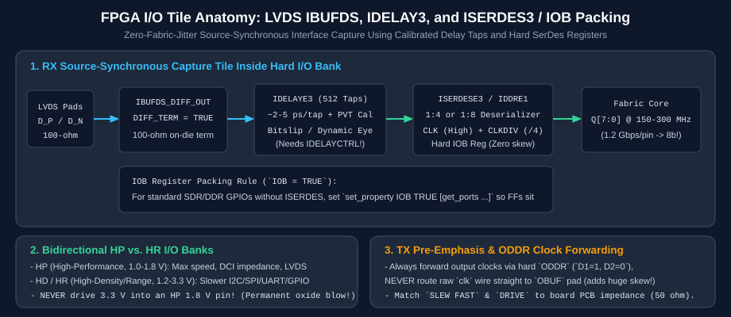
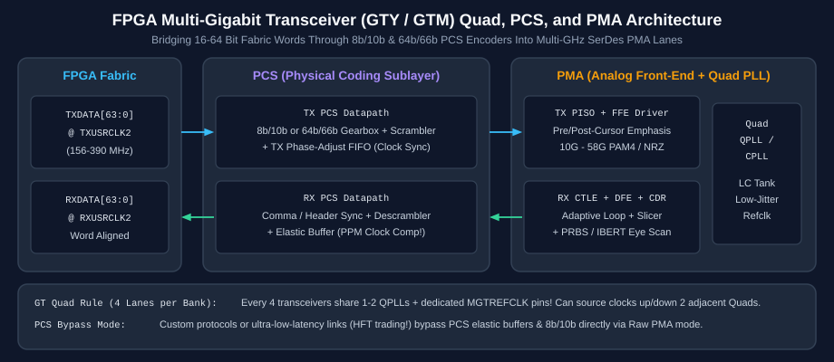

# High-Speed I/O Standards, Source-Synchronous Interfaces, and Transceivers

Bridging an FPGA to the outside board requires handling two completely different physical interface domains: **Parallel / Source-Synchronous SelectIO** running from `10 MHz` GPIOs up to `1.6+ Gbps/pin` LVDS camera/ADC/DDR buses via dedicated I/O tile primitives (`IDELAY3`, `ISERDES3`, `IDDR`), and **Multi-Gigabit Serial Transceivers (`GTY` / `GTM` / `GTH`)** pushing `10G–112G` PCIe, 100G/400G Ethernet, and JESD204B/C links through analog PMA equalizers (`TX FFE`, `RX CTLE + DFE`, `CDR`) and PCS gearboxes. Getting I/O bank voltages, termination, calibration, and clock-forwarding right prevents dead boards and fried silicon!

---

## Learning Goals

- Select safe **I/O Bank Voltage &amp; Logic Standards** (`HP` `1.0–1.8 V` vs `HR/HD` `1.2–3.3 V`, `LVCMOS`, `LVDS`, `SSTL`, `POD`, `DCI`) respecting bank `VCCO` compatibility rules.
- Build deskewed high-speed source-synchronous interfaces using **`IBUFDS`**, **`IDELAY3` + `IDELAYCTRL`**, **`ISERDES3`**, and **`ODDR`** clock-forwarding primitives.
- Understand FPGA **Transceiver Quad Architecture**: **`QPLL` / `CPLL`** clock sharing, **PCS** encoding/elastic buffers (`8b/10b`, `64b/66b`), and **PMA** analog equalization (`CTLE`, `DFE`, `CDR`).
- Calibrate high-speed links on hardware using dynamic tap eye-centering (`bitslip`) and built-in **PRBS / IBERT** eye scans.

---

## FPGA I/O Bank Voltages, Terminations, and Standards (HP vs HR)

Every FPGA pin belongs to an **I/O Bank** powered by a shared **`VCCO`** rail. Two primary bank types exist on modern FinFET FPGAs:



| Bank Family | Voltage Range (`VCCO`) | Supported Standards | Target Applications |
| :--- | :--- | :--- | :--- |
| **HP (High-Performance)** | `1.0 V – 1.8 V` **MAX!** | `LVDS` (1.8 V), `POD12` (DDR4), `SSTL15`, `HSTL`, `DCI` controlled impedance | **DDR4/DDR5**, 1.6 Gbps LVDS ADCs, high-speed camera MIPI/SLVS |
| **HR / HD (High-Range / High-Density)** | `1.2 V – 3.3 V` | `LVCMOS33`, `LVCMOS25`, `LVDS_25`, slow `I2C`/`SPI`/`UART`/`GPIO` | Legacy `3.3 V` board sensors, PMIC I2C, status LEDs, JTAG headers |

### Four Golden I/O Pin-Planning Rules

1. **NEVER Expose `1.8 V` HP Banks to `3.3 V` Board Signals!** Driving `3.3 V` into a thin-oxide HP bank exceeds breakdown immediately and permanently damages silicon—check board schematics and bank assignments twice!
2. **One Common `VCCO` per Bank**: All single-ended outputs and standard inputs inside the same I/O Bank must share compatible `VCCO`! (`LVDS` inputs can sometimes operate across compatible voltage banks if `DIFF_TERM` is disabled or externally terminated, though `VCCO` match is cleanest).
3. **Internal vs. External Termination**: Use **`DIFF_TERM = TRUE`** on `1.8 V` LVDS inputs (or internal **`DCI` Digitally Controlled Impedance** using an external precision `240 ohm` `VRP` resistor per bank) to match `50-ohm`/`100-ohm` PCB traces cleanly without cluttering tight BGA breakouts with hundreds of external resistors!
4. **Always Set `IOB = TRUE` on Critical SDR/DDR Pins**: Forces capture/launch flip-flops inside the hard **I/O Buffer (`IOB`)** tile right behind the bondpad instead of wandering into deep CLB fabric (`< 100 ps` pin skew!).

---

## Source-Synchronous Interfaces with IDDR, ODDR, IDELAY3, and ISERDES3

Above `~150–200 MHz`, system-synchronous I/O fails because PCB flight time + FPGA clock insertion skew exceeds 1 bit period! **Source-Synchronous** interfaces send a **forwarded clock alongside the data bus** (`CLK` travels identical PCB length next to `DATA[N:0]`), allowing capture even above `1.2–1.6 Gbps` per LVDS pair:

### 1. Input Calibration Pipeline (`IBUFDS` -> `IDELAY3` -> `ISERDES3`)

- **`IDELAYE3`**: Inserts programmable `~2–5 ps/tap` precision delay (`512` taps spanning `~1.1 ns`) calibrated automatically across PVT variations by a companion **`IDELAYCTRL`** tile driven by a fixed `200–400 MHz` reference clock!
- **Per-Bit Deskew &amp; Dynamic Eye Training**: During boot training, RX logic sweeps `IDELAYE3` taps while reading known training patterns (`0xA5` / PRBS) to map the left and right edges of each lane's data eye, then sets every lane's tap right into the **exact eye center**, followed by **`BITSLIP`** (or barrel shifting in fabric) to align multi-bit word boundaries (`FRAME_CLK` alignment)!
- **`ISERDESE3` (`1:4` or `1:8`)**: Converts `1.2 Gbps` serial DDR inputs directly into parallel `8-bit` bytes inside hard IOB silicon so core CLB fabric runs comfortably at `150 MHz`!

### 2. Output Clock Forwarding (`ODDR`)

Never wire an internal fabric/MMCM clock straight to an `OBUF` output pad (`assign out_clk = internal_clk;`)! Doing so forces the clock off global routing onto messy local switch-box nets with terrible duty-cycle distortion and PVT drift! Instead, always forward clocks via a dedicated **`ODDRE1`** (`ODDR`) sitting cleanly inside the output IOB (`D1 = 1'b1, D2 = 1'b0`) so clock-to-data output skew matches within tens of picoseconds!

```systemverilog
// Clean Source-Synchronous DDR Clock + Data Forwarding via Hard ODDR Primitives (Xilinx)
module src_sync_tx_ddr #(
    parameter int DATA_W = 8
) (
    input  logic              clk_tx,      // Fast global BUFG clock (e.g., 400 MHz -> 800 Mbps DDR)
    input  logic [DATA_W-1:0] data_rise,
    input  logic [DATA_W-1:0] data_fall,
    output logic              tx_clk_p,
    output logic              tx_clk_n,
    output logic [DATA_W-1:0] tx_d_p,
    output logic [DATA_W-1:0] tx_d_n
);
    logic tx_clk_se;
    logic [DATA_W-1:0] tx_d_se;

    // 1. Forwarded Clock Using Hard ODDRE1 (Guaranteed matched pad timing & clean 50% duty!)
    ODDRE1 #(.SIM_DEVICE("ULTRASCALE_PLUS")) u_oddr_clk (
        .Q  (tx_clk_se),
        .C  (clk_tx),
        .D1 (1'b1),
        .D2 (1'b0),
        .SR (1'b0)
    );
    OBUFDS u_obuf_clk (.I(tx_clk_se), .O(tx_clk_p), .OB(tx_clk_n));

    // 2. Matched DDR Data Outputs Packed Cleanly into Adjacent IOB ODDRE1 Tiles
    for (genvar i = 0; i < DATA_W; i++) begin : g_tx_lane
        ODDRE1 #(.SIM_DEVICE("ULTRASCALE_PLUS")) u_oddr_d (
            .Q  (tx_d_se[i]),
            .C  (clk_tx),
            .D1 (data_rise[i]),
            .D2 (data_fall[i]),
            .SR (1'b0)
        );
        OBUFDS u_obuf_d (.I(tx_d_se[i]), .O(tx_d_p[i]), .OB(tx_d_n[i]));
    end
endmodule
```

---

## Multi-Gigabit Transceivers (GTY/GTH) PMA, PCS, and Shared Quad PLLs

Beyond `~1.6 Gbps/pin`, shared source-synchronous clocks break down from PCB trace skew and crosstalk. Multi-gigabit protocols (`10G/25G/100G Ethernet`, `PCIe Gen4/Gen5`, `SATA`, `Aurora`, `JESD204C`) embed clocks inside data transitions across **High-Speed Serial Transceivers (`GTH/GTY/GTM` Quads)**:



### Quad Topology &amp; PMA vs. PCS Split

- **Shared GT Quad (`4` Lanes per Bank)**: Four serial lanes sit grouped inside one physical Quad sharing **`1–2` `QPLL` LC-tank PLLs** (`low phase noise, 8–28+ GHz`), plus dedicated per-lane `CPLL` ring/LC options and ultra-clean **`MGTREFCLK`** differential reference clock pins (`AC-coupled LVDS/HCSL`).
- **PMA (Physical Medium Attachment — Hard Analog)**:
  - **TX**: High-speed serializer (`PISO`) + **3-tap TX FFE** (`pre-cursor`, `main`, `post-cursor` swing boost).
  - **RX**: **CTLE + adaptive DFE + Bang-Bang CDR** recovering bit clock &amp; data straight out of lossy 25+ dB backplanes without external clock pins!
- **PCS (Physical Coding Sublayer — Hard Digital)**:
  - **`8b/10b` (20% overhead)** or **`64b/66b` (3% overhead + scrambler)**: Ensures frequent edge transitions for CDR locking and DC-balance across AC-coupling `100 nF` board capacitors.
  - **RX Elastic Buffer (`Clock Correction`)**: Absorb $\pm 200\text{ ppm}$ clock frequency drift between remote TX crystal and local RX crystal by cleanly inserting/dropping idle `IDLE`/`SKIP` ordered sets!

---

## Equalizers, Elastic Buffers, and Transceiver Bring-Up

Verifying transceiver links smoothly takes both pre-silicon simulation and on-board validation:

1. **Use Vendor GT Wizard IP (`GTY_QUAD` / Transceiver Wizard)**: Never hand-code hundreds of undocumented DRP analog equalizer registers manually—configure line rate, protocol encoding, refclk, and reset FSMs inside the Wizard (which handles exact **TX/RX reset state-machine sequencing**: `QPLL lock -> TXRESET -> RXCDR lock -> RX_BUF_RESET`).
2. **Select `LPM` vs `DFE` RX Equalization Properly**:
   - Short low-loss cables (`< 10 dB` @ Nyquist): Use **`LPM` (Low-Power Mode CTLE-only)**—lower power and zero DFE error propagation!
   - Long lossy backplanes (`> 12–25 dB` @ Nyquist): Enable **`DFE`** adaptive taps cleanly to kill post-cursor reflections!
3. **Run On-Chip `IBERT` Eye Scans Early**: Generate an `IBERT` test bitstream during board bring-up to verify hardware `MGTREFCLK` jitter, tune `TXPRECURSOR`/`TXPOSTCURSOR`, and measure **2D BER Eyemaps** at real board temperatures!

---

## Best Practices and Common Pitfalls

1. **Always Include `100 nF` AC-Coupling Caps &amp; Correct Polarity Checks**: High-speed serial lanes (`GTY`/`PCIe`/`Ethernet`) expect `0.1 uF` AC-coupling caps on TX lines (`check schematic!`); if board PCB designers accidentally swap `RX_P` and `RX_N` differential traces to clean routing (`polarity inversion`), simply toggle the GT **`RXPOLARITY = 1'b1`** attribute in RTL—zero PCB respin needed!
2. **Drive `IDELAYCTRL` With Exact Reference Frequency &amp; `IODELAY_GROUP`**: Missing `IDELAYCTRL` instantiation or placing wrong `REFCLK` frequency causes synthesis/implementation failures or uncalibrated tap drift across temperature!
3. **Provide Free-Running System Clock (`drpclk` / `freerun_clk`) to GT Reset FSMs**: Never drive the Transceiver Wizard's reset/DRP controller using `TXOUTCLK` or `RXOUTCLK`—when the transceiver resets, `TXOUTCLK` stops, permanently locking up its own reset state machine! Always use a separate always-on crystal/MMCM clock (`50–125 MHz`) for `drpclk`!
4. **Speed Up Transceiver RTL Simulation Cleanly**: Full PMA serial bit-by-bit simulation takes forever in XSim/VCS unless **`SIM_RESET_SPEEDUP = "TRUE"`** is kept active in GT wrappers (skipping multi-millisecond analog PLL lock delays cleanly in RTL tests!).

---

## Practical Exercises with Solutions

### Exercise 1 Calculating Source-Synchronous Bit Budget &amp; `IDELAY3` Margin

A camera sensor transmits **8 parallel LVDS lanes + 1 forwarded DDR clock** into an `HP` I/O bank (`1.8 V`) at **`500 MHz` (`1.0 Gbps` DDR per lane)**.
- `1 UI (Half-Clock Period)` = `1.000 ns` (`1000 ps`).
- Sensor launch skew + PCB trace mismatch + crosstalk jitter shrinks valid data window (`Data Valid Window` at FPGA pins) to **`650 ps`** centered cleanly (or edge-aligned) relative to `clk`.
- `IDELAYE3` tap step equals `4.0 ps/tap` (512 taps -> `2.048 ns` max), while hard `ISERDESE3` setup + hold capture window takes `220 ps` combined.

1. Calculate remaining **timing margin** inside the `1 UI` eye after `ISERDESE3` capture requirements.
2. Assuming edge-aligned transmission (`clk` edge coincides with data transitions at the pad), roughly how many `IDELAYE3` taps should shift `DATA` vs `CLK` to sample straight at the center of the `1000 ps` UI eye?

#### Solution

1. **Remaining Window Margin**:
   - Available Eye = `650 ps`, Capture Requirement (`t_SU + t_H`) = `220 ps`.
   - **Capture Margin** = $650 - 220 = \mathbf{430\text{ ps}}$ (plenty of room if centered accurately!).
2. **Centering via `IDELAYE3`**:
   - Target delay shift between clock and data = $0.5\text{ UI} = 500\text{ ps}$.
   - Number of taps on `CLK` (or delayed `DATA` by `500 ps` relative to `CLK`):
     $$\text{Taps} = \frac{500\text{ ps}}{4.0\text{ ps/tap}} = \mathbf{125\text{ taps}}$$
   - Even better: train dynamically per lane at boot (`sweep 0..250 taps` while checking sync pattern `0xA5`) so PCB per-lane trace length mismatches vanish automatically!

---

### Exercise 2 Fixing a Transceiver Link Stuck Dead in Reset

During board bring-up of a `10.3125 Gbps` Ethernet `GTY` lane (`64b/66b` PCS), `qpll0_lock` stays LOW (`0`) forever and `tx_reset_done` never goes HIGH. You check the RTL clock wiring and see:
- `u_gty_wiz/gtwiz_reset_clk_freerun_in` connects to `tx_usrclk2` (derived from GTY `TXOUTCLK`!).
- Board `MGTREFCLK0` external crystal (`156.25 MHz`) sits soldered onto bank `226`, yet the GTY Wizard accidentally routed `QPLL0` from bank `224`'s `MGTREFCLK0`.

Identify **two independent fatal bugs** stopping bring-up cleanly!

#### Solution

1. **Deadlock Bug #1 (Circular Reset Clock)**: `gtwiz_reset_clk_freerun_in` drives the Wizard reset FSM and DRP calibration logic, yet it was wired to `tx_usrclk2` (which originates *from* the GTY's own `TXOUTCLK`!). While held in reset waiting for QPLL lock, `TXOUTCLK` does NOT toggle—so the reset FSM never gets a single clock edge to deassert `QPLLRESET`! **Fix**: Wire `freerun_clk` exclusively to an external independent oscillator or fabric MMCM clock (`50–100 MHz`) that runs continuously from power-on!
2. **Refclk Span Bug #2**: Bank `226` sits **two banks away** from `224` (or check GT routing rules: `MGTREFCLK` can route at most `+/- 2` Quads up/down on UltraScale+ ONLY if enabled cleanly, and mixing wrong bank pins breaks `QPLL` lock if `226` isn't constrained to `224` or isn't adjacent!). **Fix**: Lock `.xdc` `LOC` constraints cleanly so `MGTREFCLK0` comes directly from the Quad's own `Bank 226` clock pins (or within valid +/-2 Quad span!).

---

### Exercise 3 Computing Effective Bandwidth of `8b/10b` vs `64b/66b` Transceiver Encoding

Four `GTY` transceiver lanes run at a raw serial line rate of **`12.5 Gbps/lane` (`50.0 Gbps` raw aggregate)** using:
1. **`8b/10b`** encoding.
2. **`64b/66b`** encoding.

Compute the **net usable payload throughput (`Gbps`)** and required **`TXUSRCLK2` frequency** for a `64-bit` fabric data interface in both cases!

#### Solution

1. **`8b/10b` Encoding (`8/10 = 80%` efficiency)**:
   - Net payload = $50.0 \times 0.80 = \mathbf{40.0\text{ Gbps}}$ (`10.0 Gbps/lane`).
   - Notice `8b/10b` interfaces pack cleanly in multiples of `8` payload bits (`10` serial bits/byte): a `64-bit` (8-byte) TXDATA interface transmits `80` serial bits per clock -> `TXUSRCLK2` = $\frac{12.5\text{ Gbps}}{80\text{ bits}} = \mathbf{156.25\text{ MHz}}$ per lane!
2. **`64b/66b` Encoding (`64/66 = 96.97%` efficiency)**:
   - Net payload = $50.0 \times \frac{64}{66} \approx \mathbf{48.48\text{ Gbps}}$ (`+8.48 Gbps` free extra bandwidth over `8b/10b`!).
   - With `64` payload bits carried per `66` serial bits (`TXDATA = 64b`): `TXUSRCLK2` = $\frac{12.5\text{ Gbps}}{66\text{ bits}} \approx \mathbf{189.39\text{ MHz}}$ (with gearbox pause cycles when using width conversion!).

---

##### Copyright (c) 2026 squared-studio
