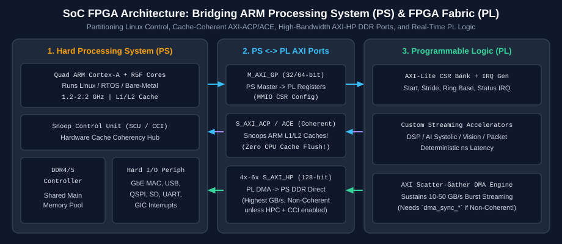
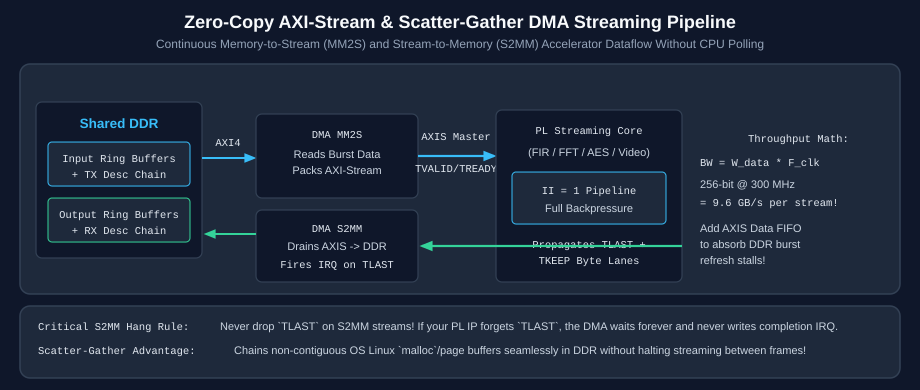

# SoC FPGAs, Embedded Processors, AXI Interconnects, and DMA

Modern FPGA architectures go far beyond standalone programmable logic—**SoC FPGAs** (AMD Zynq UltraScale+ MPSoC / Versal ACAP, Intel Agilex SoC) fuse hardened multi-core ARM Cortex-A/R application processors, DDR4/5 controllers, and high-speed peripherals (**Processing System, `PS`**) tightly alongside custom programmable fabric accelerators (**Programmable Logic, `PL`**) on one monolithic die. Mastering how software running on embedded Linux interacts with hardware accelerators across **`AXI-GP`**, **`AXI-HP`**, **`AXI-ACP`/`ACE`** coherent ports, and **zero-copy Scatter-Gather `AXI-Stream` DMA** unlocks deterministic microsecond real-time compute paired with full software flexibility.

---

## Learning Goals

- Architect clean hardware/software partitions across **PS (ARM Linux + RTOS)** and **PL (Custom FPGA Hardware)** on SoC FPGAs.
- Select the optimal PS-to-PL AXI bridge for every workload: **`M_AXI_GP`** (control CSRs), **`S_AXI_HP`** (bulk high-bandwidth DDR DMA), and **`S_AXI_ACP`/`ACE`** (hardware cache-coherent transactions).
- Design zero-copy **`AXI4-Stream` + Scatter-Gather AXI DMA (`MM2S` / `S2MM`)** pipelines that sustain multi-GB/s throughput without CPU polling bottlenecks.
- Prevent **cache-coherency bugs**, **missing `TLAST` DMA hangs**, **4KB AXI boundary burst violations**, and **PS-PL clock/reset race traps**.

---

## Heterogeneous SoC Architecture PS Processing System and PL Fabric

Splitting an application cleanly across PS and PL maximizes each engine's strengths:



- **Keep in PS (ARM Software)**: Networking stacks (`TCP/IP`, `gRPC`), filesystem/NVMe management, REST/control APIs, Python/C++ host orchestration, boot loaders, and complex rare control branches.
- **Accelerate in PL (FPGA Logic)**: High-rate sensor ingestion, deterministic nanosecond-latency loops, wide parallel DSP/convolution engines, inline compression/crypto, and packet classification.

### Important PS-First Boot Trap

Notice on SoC FPGAs like Zynq/Versal, the **PS is the boot master** (`BootROM -> FSBL -> U-Boot -> Linux`)! Unlike classic pure FPGAs that power directly into PL fabric logic, **PS must power up cleanly, initialize DDR4 training &amp; clocks (`FCLK_CLK0..3`), load the PL bitstream (`PCAP`), and release `pl_resetn`** before PL logic runs! (And watch out: resetting PL while Linux holds an active AXI transaction across PS-PL bridges will **hang the entire ARM processor AXI interconnect bus** until power cycle unless bridges are cleanly isolated/quiesced first!)

---

## Choosing Between AXI-GP, AXI-HP, and Cache-Coherent AXI-ACP/ACE

PS and PL communicate over standardized AMBA AXI4 ports—choosing the wrong port destroys performance or breaks data integrity:

| PS–PL Port | Master / Slave Direction | Typical Width | Cache Coherent? | Target Use Case |
| :--- | :--- | :--- | :--- | :--- |
| **`M_AXI_HPM_FPD` (`GP`)** | **PS Masters PL** | `32` / `64 / 128-bit` | N/A (Un-cached Device I/O) | Register MMIO configuration (`AXI-Lite` CSRs, start, base addr, IRQ clear) |
| **`S_AXI_HP` (High-Perf)** | **PL Masters PS DDR** | `4–6x 128-bit` | **No** (Requires software cache flush/invalidate!) | Maximum multi-GB/s video/AI/network streaming straight into DRAM |
| **`S_AXI_HPC` / `CCI`** | **PL Masters PS** | `128-bit` | **I/O Coherent** (One-way snoops CPU L1/L2 reads/writes via CCI) | Simplifies Linux DMA drivers (`dma-coherent` in Device Tree!) |
| **`S_AXI_ACP` / `ACE`** | **PL Masters PS Cache** | `128-bit` | **Yes (Full Hardware Snoop via SCU!)** | Small, ultra-low-latency CPU–FPGA descriptor/metadata sharing without flush overhead! |

> [!WARNING]
> **The Stale Cache Corruption Bug on `S_AXI_HP`**: Non-coherent `S_AXI_HP` bypasses ARM CPU L1/L2 caches straight into physical DDR! If software writes input image data into a buffer (`remains dirty in CPU L1 cache`) and triggers PL DMA immediately without calling `dma_sync_single_for_device()` (cache clean/flush), the **FPGA reads stale garbage from DDR**! Conversely, after PL finishes writing output results, CPU must **invalidate cache** before reading—OR move the buffer onto a coherent `HPC`/`ACP` port!

---

## Zero-Copy AXI-Stream and Scatter-Gather DMA Engines

Passing 4K video frames word-by-word from CPU `memcpy` over `M_AXI_GP` stalls around ~`100 MB/s` and pins 100% CPU load. Achieving `10–50+ GB/s` requires **Zero-Copy AXI-Stream + Scatter-Gather DMA (`MM2S` + `S2MM`)**:



### How Scatter-Gather Streaming Operates

1. **OS Allocation &amp; Descriptor Ring**: Software allocates non-contiguous 4KB OS physical pages in DDR and writes a linked-list **Buffer Descriptor (BD) ring** (`addr, len, next_desc, flags`) in shared memory.
2. **MM2S (Memory-to-Stream)**: DMA reads BDs independently, bursts contiguous `AXI4` cacheline reads (`INCR`, up to `256` beats, never crossing a **4KB AXI address boundary**!), and pushes clean byte streams out on **`AXI4-Stream` (`TDATA, TVALID, TREADY, TKEEP, TLAST`)**.
3. **PL Accelerator Pipeline (`II = 1`)**: Processes data on the fly (`TVALID && TREADY` handshakes, zero local full-frame buffering needed unless sliding-window!), preserving **`TLAST`** strictly on the final beat of every packet/frame!
4. **S2MM (Stream-to-Memory)**: Captures processed output stream back into DDR destination buffers until `TLAST` arrives, writes completion status (`Bytes Written`), and triggers an edge/level **Interrupt (`IRQ -> GIC`)** waking Linux!

```systemverilog
// Minimal AXI4-Stream Pass-Through Pipeline Stage With Full Backpressure & TLAST Hygiene
// Rules: Never assert TVALID combinationally on TREADY; never drop TLAST or stall with bubbles!
module axis_skid_pipe #(
    parameter int DATA_W = 64
) (
    input  logic                clk,
    input  logic                rst,       // Active-high synchronous reset
    // Slave Input Stream
    input  logic                s_tvalid,
    output logic                s_tready,
    input  logic [DATA_W-1:0]   s_tdata,
    input  logic [DATA_W/8-1:0] s_tkeep,
    input  logic                s_tlast,
    // Master Output Stream
    output logic                m_tvalid,
    input  logic                m_tready,
    output logic [DATA_W-1:0]   m_tdata,
    output logic [DATA_W/8-1:0] m_tkeep,
    output logic                m_tlast
);
    // Downstream ready OR our output register is currently empty -> accept new beat cleanly!
    assign s_tready = !m_tvalid || m_tready;

    always_ff @(posedge clk) begin
        if (rst) begin
            m_tvalid <= 1'b0;
            m_tdata  <= '0;
            m_tkeep  <= '0;
            m_tlast  <= 1'b0;
        end else if (s_tready) begin
            m_tvalid <= s_tvalid;
            if (s_tvalid) begin
                // Registered compute/transform goes right here cleanly!
                m_tdata <= s_tdata;
                m_tkeep <= s_tkeep;
                m_tlast <= s_tlast;
            end
        end
    end
endmodule
```

> [!CAUTION]
> **Two Deadly AXI4 / AXI-Stream Hardware Deadlocks**:
> 1. **Combinational `TVALID` Depending on `TREADY`**: Violates AMBA AXI4 spec directly (`deadlock loop` if slave waits on master `TVALID` while master waits on slave `TREADY`!). Master `TVALID` MUST come purely from a register or upstream valid!
> 2. **4KB Boundary Split Violation on Custom AXI4 Masters**: AXI4 protocol strictly forbids a single burst (`ARLEN`/`AWLEN`) from crossing any `4096-byte` address boundary (`addr[11:0]` rollover)! Always split DMA bursts cleanly at 4KB boundaries inside custom PL masters!

---

## Cache Coherency Pitfalls, Linux UIO/DMA Drivers, and Address Mapping

To expose PL accelerators smoothly to Linux (`PetaLinux` / Yocto):
- **Device Tree (`.dtsi`) Generation**: Matches exact `Address Editor` base offsets (`0xA000_0000` CSR map, IRQ numbers `pl_ps_irq0[7:0]`), plus flags `dma-coherent;` ONLY when connected to hardware-coherent `HPC`/`ACE` ports!
- **UIO (`Userspace I/O`) + `udmabuf` vs. Kernel Driver**: Quick prototypes map small AXI-Lite CSRs cleanly via `/dev/uio0` + `mmap()` (`< 20 lines of C`), while high-rate production streams use Linux kernel DMA Engine APIs (`dma_alloc_coherent`, `scatterlist`) isolating virtual user pointers safely from physical DRAM DMA addresses (`SMMU` / `IOMMU`)!
- **Address Width Mismatch &amp; Decode Error Watchdog**: Make sure `AXI Interconnect / SmartConnect` routes an explicit error responder (`DECERR` / timeout) if buggy software reads an unmapped PL offset, otherwise missing `RVALID`/`BVALID` hangs the ARM CPU core permanently (**Bus Hang!**)!

---

## Best Practices and Common Pitfalls

1. **Always Add AXI SmartConnect / AXI Protocol Checker (`ILA` + SVA) During Bring-Up**: AXI handshakes have subtle protocol rules (`WLAST` must match `AWLEN + 1`; `ARVALID` cannot drop before `ARREADY`). Drop an **AXI Protocol Checker IP** in simulation and early hardware builds to catch protocol hang bugs on cycle #1!
2. **Never Reset PL While ARM PS Holds Outstanding AXI Transactions**: Before reloading a partial bitstream (`DFX`) or asserting `pl_reset`, always quiesce DMAs, disable bridges via PS isolation registers, or place an **`AXI Shutdown Manager`** / firewall on PS–PL ports!
3. **Separate Real-Time Bare-Metal Control (`Cortex-R5F` / Soft `MicroBlaze`) from Linux (`Cortex-A`)**: Linux scheduling jitter (`milliseconds`) ruins microsecond PID loops; assign deterministic microsecond hardware housekeeping to an `R5F` lockstep core or PL FSM while ARM Linux focuses on high-level workloads!
4. **Match `AXI4` Burst Length &amp; Width to DDR Controller Row Size**: Issuing 1-beat (`ARLEN = 0`, 32-bit) single reads across `AXI-HP` gets <5% DDR efficiency; issue **`128-bit` / `256-bit` wide aligned `16–64` beat bursts (`INCR`)**!

---

## Practical Exercises with Solutions

### Exercise 1 Calculating AXI-Stream Burst Bandwidth vs. DDR4 Saturation

A PL video accelerator streams **`1920 x 1080` RGB888 (`3 bytes/pixel`, or padded `32-bit = 4 bytes/pixel`) at `120 FPS`**, reading raw frames via `MM2S` (`S_AXI_HP0`) and writing filtered frames simultaneously back via `S2MM` (`S_AXI_HP1`). The PL domain runs cleanly at `250 MHz`.

1. Calculate total combined **read + write bandwidth (`GB/s`)** required at `120 FPS` (`32-bit` aligned pixels).
2. What minimum `AXI-Stream` `TDATA` width (`32`, `64`, `128` bits) is needed per port at `250 MHz` (`80%` effective bus efficiency margin)?

#### Solution

1. **Required Bandwidth**:
   - Pixels per second: $1920 \times 1080 \times 120 = 248.832\text{ MPixels/s}$.
   - Single-stream (`4 bytes/pixel`): $248.832 \times 4 \approx \mathbf{0.995\text{ GB/s}}$ (`~1.0 GB/s` each way).
   - Combined Read + Write DDR traffic: **`~1.99 GB/s`** (~`2.0 GB/s`).
2. **Minimum Stream Width**:
   - At `250 MHz` and `80%` efficiency (`200 MHz` effective beat rate), a **`32-bit` (`4-byte`)** bus yields $200\text{ M} \times 4\text{ B} = 0.80\text{ GB/s}$ (too tight!).
   - Choosing **`64-bit` (`8-byte`)** `TDATA` yields $200\text{ M} \times 8\text{ B} = \mathbf{1.60\text{ GB/s}}$ per port cleanly (`62%` utilization, plenty of margin against DDR refresh pauses!). Pairing `S_AXI_HP0` + `HP1` on a `128-bit` AXI bus handles `2.0 GB/s` effortlessly (<15% of a single `DDR4-3200` `25.6 GB/s` peak channel!).

---

### Exercise 2 Fixing a Silent `S_AXI_HP` Stale Cache Corruption Bug

On a Zynq MPSoC running Linux, a C++ app allocates a `1 MB` input array `in_buf` with standard `malloc()`, fills it with a test ramp (`0, 1, 2...`), sends `virt_to_phys(in_buf)` to a PL DMA engine attached to **`S_AXI_HP0`**, triggers the accelerator, and reads `out_buf`. However, 30% of bytes read by the FPGA look like zeros or old data from the previous run! Notice switching the PL port to **`S_AXI_ACP`** (or `HPC` with `dma-coherent`) fixes the problem instantly!

Explain **two bugs** in the `malloc() + S_AXI_HP0` setup and describe the exact clean Linux software fix!

#### Solution

1. **Bug 1 (Virtual vs Non-Contiguous Physical `malloc()`)**: Standard Linux `malloc()` allocates **virtual pages** that are NOT physically contiguous beyond 4KB OS page boundaries! Passing `virt_to_phys` of page `0` causes `AXI DMA` reading linearly (`+1 MB`) to overshoot into completely random kernel memory after the first `4 KB`!
2. **Bug 2 (CPU Cache Dirty Data vs Non-Coherent `S_AXI_HP0`)**: Even after filling `in_buf`, those freshly written values sit **dirty inside the ARM L1/L2 cache** and haven't flushed out to DRAM yet—while non-coherent `S_AXI_HP0` reads directly from DRAM!
3. **Clean Fix**: Allocate physical DMA-safe buffers using Linux **`dma_alloc_coherent()` / `CMA` (`udmabuf`)** (yielding physically contiguous memory OR scatter-gather `sg_table` page lists!), and explicitly call **`dma_sync_single_for_device()`** before starting PL DMA (`S_AXI_HP0`) and **`dma_sync_single_for_cpu()`** before reading `out_buf`!

---

### Exercise 3 Catching a `4 KB` AXI4 Boundary Violation in a Custom PL Master

A custom PL AXI4 DMA engine issues a `16-beat` (`AWLEN = 15`), `16-byte` (`AWSIZE = 4`, `128-bit`) burst write (`total 256 bytes`) starting at physical address **`0x4000_0F80`**.

1. At what byte address does the burst attempt to finish?
2. Explain why the AXI4 SmartConnect / PS DDR port raises a protocol error (`SLVERR` or deadlocks in simulation) and write the exact Verilog logic to clamp burst length cleanly before `0x1000` boundaries!

#### Solution

1. **Ending Address Calculation**:
   - Start offset inside `4 KB` page = `0xF80` (`3968`).
   - Adding `256` bytes reaches `0xF80 + 0x100 = 0x1080` -> **`0x4000_107F`**, crossing right over the **`0x4000_1000` (`4 KB`)** page boundary! (Only `0x1000 - 0xF80 = 128 bytes` = **`8 beats`** remain inside page `0`!)
2. **Boundary Clamp Rule**: AXI4 guarantees every 4KB block maps cleanly to one single slave endpoint without wrapping slaves mid-burst. Split `0x4000_0F80` into two bursts: Burst 1 (`AWADDR = 0x4000_0F80`, **`8 beats` = `AWLEN = 7`**) followed cleanly by Burst 2 (`AWADDR = 0x4000_1000`, **`8 beats` = `AWLEN = 7`**):
```systemverilog
// Beats remaining to next 4KB boundary (assuming 16-byte / 128-bit bus width, addr[11:4]):
logic [8:0] beats_to_4k;
assign beats_to_4k = 9'd256 - {1'b0, curr_addr[11:4]};
assign next_burst_beats = (req_beats_rem < beats_to_4k) ? req_beats_rem : beats_to_4k;
```

---

##### Copyright (c) 2026 squared-studio
