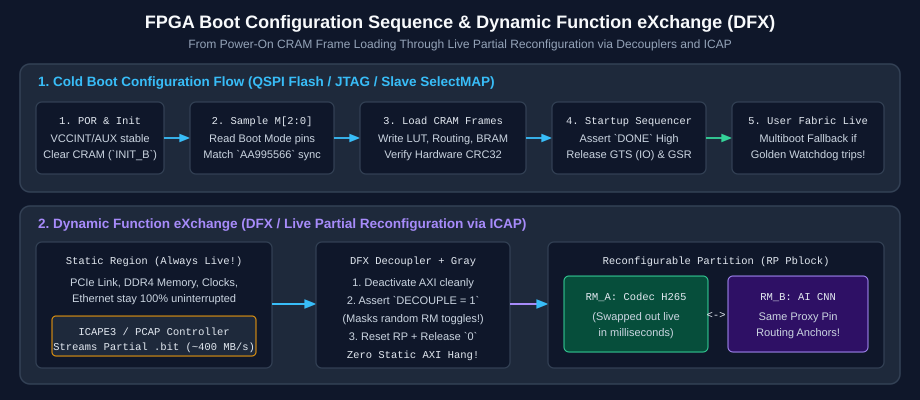
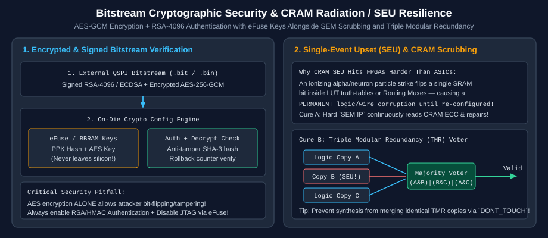

# Configuration, Bitstreams, Dynamic Partial Reconfiguration, and Security

Unlike masked ASIC silicon that executes immediately upon power-on, SRAM-based FPGAs wake up completely blank—holding zero logic gates until a multi-megabyte **Bitstream (`.bit` / `.bin`)** configures every LUT truth table, routing MUX, BRAM initial value, and I/O standard. Beyond cold booting reliably with fail-safe **Multiboot fallback**, modern field-deployed FPGAs rely on **Dynamic Function eXchange (DFX / Partial Reconfiguration)** to hot-swap accelerator kernels live in milliseconds, **AES-GCM + RSA-4096 cryptographic protection** to safeguard IP against cloning/tampering, and **CRAM scrubbing / Triple Modular Redundancy (TMR)** to survive cosmic neutron **Single-Event Upsets (SEUs)**.

---

## Learning Goals

- Trace every step of the **FPGA Cold-Boot Configuration Sequence** (`POR`, `INIT_B`, `M[2:0]`, CRAM Frame Load, CRC32 check, `GTS`, `GSR`, `DONE`) and configure **Watchdog Multiboot Fallback** safely.
- Architect **Dynamic Function eXchange (DFX / Partial Reconfiguration)** partitions combining `Pblocks`, **Proxy LUT pins**, **AXI/DFX Decouplers**, and **`ICAPE3`** DMA streaming without crashing live static PCIe/DDR links.
- Protect bitstreams against reverse-engineering and fault injection using **AES-256-GCM encryption + RSA-4096 authentication + eFuse locking**.
- Quantify SRAM **CRAM Single-Event Upsets (SEU)** and mitigate silent logic/routing flips using **Soft Error Mitigation (`SEM IP`) Scrubbers** and **`TMR` Majority Voters**.

---

## FPGA Boot Configuration Sequence and Multiboot Fallback

Every time power ramps up cleanly, the FPGA's hardened Configuration State Machine drives a deterministic bring-up sequence:



1. **Power-On Reset (`POR`) &amp; Houseclean**: Holds configuration inactive until `VCCINT`, `VCCAUX`, and `VCCIO` pass valid brownout thresholds, then sweeps configuration SRAM cleanly to zero (`INIT_B` pulses LOW).
2. **Sample Mode Pins (`M[2:0]`)**: Chooses **Master QSPI Flash (`x4`)**, **JTAG**, **Slave SelectMAP (`x8/x16`)**, or **PS PCAP** (on Zynq/Versal SoCs).
3. **Sync Word &amp; CRAM Frame Write**: Detects magic header `32'hAA995566`, decodes configuration register packets (`IDCODE` device check!), streams CRAM frames sequentially, and validates running **Hardware CRC32** continuously!
4. **Startup Sequencer &amp; `DONE`**:
   - Waits for configured `MMCM`s to assert `LOCKED` (`Optional Startup Cycle`),
   - Releases **`GTS`** (I/O tri-state release) &amp; **`GSR`** (Global Set/Reset releasing every flip-flop &amp; BRAM cleanly into user operation!),
   - Raises external **`DONE`** pin HIGH (`open-drain pull-up!`) and opens `EOS` (End of Startup) pulse.

### Fail-Safe Remote Updates via Multiboot &amp; Golden Image Fallback

What happens if power dies halfway through updating an FPGA's QSPI Flash over Ethernet ("bricking" a remote satellite or base-station FPGA)?
- **Partition QSPI Flash Into Two Regions**:
  1. **Golden Image (Address `0x0000_0000`, Write-Protected!)**: Tested minimal boot image starting with an **IPROG Jump Header** pointing cleanly to the Update offset (`0x0100_0000`).
  2. **Update / Field Image (`0x0100_0000`)**: Holds active application logic.
- If the Update image is corrupted (`CRC error`), missing, or hangs before kicking a configuration **Watchdog Timer (`TIMER_CFG`)**, the FPGA hardware config engine automatically **re-triggers `IPROG` fallback straight back to Address `0x0000_0000` (Golden Image)**, keeping remote hardware permanently recoverable!

---

## Dynamic Function eXchange (DFX) and Live Partial Reconfiguration

Instead of shutting down an entire PCIe server card for 500 ms to reload a new workload (which drops the PCIe link and crashes the host OS!), **Dynamic Function eXchange (`DFX`)** reloads **one isolated Reconfigurable Partition (`RP`)** in `< 20 ms` while the surrounding **Static Region** (PCIe EP, DDR4, DMA, Clocks) keeps running 100% live!

### Four Mandatory DFX Engineering Rules

1. **Coarse Floorplanned `Pblock` + Reset Isolation (`RESET_AFTER_RECONFIG`)**: Draw an explicit physical `Pblock` enclosing all CLBs, BRAMs, and DSPs of the Reconfigurable Module (`RM`), and enable **`SNAPPING_MODE = ON`** so Vivado aligns `Pblock` edges strictly along vertical CRAM frame boundaries!
2. **Place DFX Decouplers on Every Static–RP Wire**: While partial CRAM frames stream into the `RP` over `ICAPE3` / `MCAP`, internal routing MUXes flip unpredictably (`0 <-> 1` random toggles!). If an `RP` drives raw AXI `ARVALID`/`WVALID` wires directly into the live Static SmartConnect, those random glitches permanently wedge the Static AXI bus! Always insert a **DFX Decoupler** pinning static-facing outputs to safe quiescent constants (`TVALID=0, TREADY=0`) before reconfiguration begins!
3. **Never Cross Asynchronous Clocks Without Static-Side Synchronizers**: Keep clock generation (`MMCM/BUFG`) strictly in the Static Region, and feed clean clocks across fixed **Partition Pins (Proxy LUT1s)** locked at exact physical sites across all RM variants (`RM_A`, `RM_B`, `Greybox`).
4. **Reset the Newly Loaded RM Cleanly After Config (`DECOUPLE -> LOAD -> RESET_RM -> UNDECOUPLE`)**: Partial config does NOT fire global `GSR` across the chip; pulse a local synchronous reset inside the newly loaded `RM` *before* lowering `DECOUPLE`!

---

## Bitstream Encryption, RSA Authentication, and Anti-Tamper Design

Unencrypted `.bit` files sitting in external QSPI Flash can be read off the PCB in 5 seconds with a `$20` SPI programmer—exposing proprietary algorithms cleanly to competitors or attackers!



### Production Cryptographic Defense Stack

1. **AES-256-GCM Confidentiality**: Encrypts CRAM frames with a secret 256-bit key programmed permanently into **on-die write-once eFuses** (or battery-backed `BBRAM`). Add rolling per-frame **Key Rolling** inside Bitgen so DPA (Differential Power Analysis) side-channel attacks cannot recover keys!
2. **RSA-4096 / ECDSA Signature Authentication**: Encryption *alone* stops eavesdropping, NOT malicious bitstream injection! Hardware **RSA Authentication** verifies a cryptographic hash (`SHA-384`) of the entire bitstream against the **Primary Public Key (PPK) hash burned in eFuse** before releasing `DONE`, blocking Trojan bitstreams and **Roll-Back Downgrade Attacks** cleanly via monotonic eFuse version counters!
3. **Lock Down JTAG Readback (`JTAG_DISABLE` / `DIS_AES_KEY_READ`)**: Burn eFuse security bits disabling external CRAM readback and boundary JTAG snooping in production units! (Keep a Golden Test Board with unlocked eFuses in the lab—burning `JTAG_DISABLE` is strictly **one-way irreversible**!)

---

## Single-Event Upsets (SEU), CRAM Scrubbing, and Triple Modular Redundancy

Atmospheric neutrons at aircraft/space altitudes—or trace alpha particles in terrestrial datacenters—occasionally strike an SRAM cell inside the FPGA. Unlike a regular flip-flop transient upset (`1 clock error` flushed next cycle), a **CRAM SEU alters the actual hardware LUT truth table or routing switch-box**, breaking circuit topology permanently until reconfigured!

### Dual-Layer Mitigation

- **Layer 1 (`SEM IP` Continuous CRAM Scrubbing)**: Hardened CRC/ECC hardware continuously sweeps every CRAM frame in the background (`every 10–30 ms`), automatically correcting single-bit CRAM errors invisibly (`no fabric interruption!`) and flagging multi-bit uncorrectable errors so external supervisors can trigger a clean reset/reload.
- **Layer 2 (`TMR` Triple Modular Redundancy + Voting)**: For aerospace/automotive safety-critical FSMs (`ISO 26262 ASIL-D` / avionics), replicate logic cleanly `3x` with distinct placement and combine outputs through majority voters `(A & B) | (B & C) | (A & C)` guarded by `(* DONT_TOUCH = "TRUE" *)` so synthesis doesn't optimize away redundant copies!

---

## Best Practices and Common Pitfalls

1. **Always Test Multiboot Fallback in Real Hardware With Intentionally Corrupted Flash**: Never assume `BITSTREAM.CONFIG.NEXT_CONFIG_ADDR` works just because Bitgen succeeded—deliberately erase sector 0 of your Update Flash image on a bench board and verify `WBSTAR` / `BOOTSTS` recovers straight back to Golden Image!
2. **Check `DONE` Pin External Pull-Up &amp; `STARTUP` Timing**: A missing `330 ohm / 4.7 kohm` pull-up resistor on open-drain `DONE` leaves `DONE` stuck LOW even after valid config (`DriveDone` vs external resistor!).
3. **Never Burn Production Security eFuses Without Lab Key Verification &amp; Recovery Plan**: Test your exact AES `.nky` key + RSA `.pem` workflow inside `BBRAM` volatile RAM *first* across power cycles before irreversibly fusing silicon!
4. **Verify Static Timing Across ALL Reconfigurable Module Permutations (`RM_A` &amp; `RM_B`)**: In DFX, verify **every single configuration build (`Config_A = Static + RM_A` AND `Config_B = Static + RM_B`)** closes Static Timing cleanly sharing the exact same locked Static `.dcp`!

---

## Practical Exercises with Solutions

### Exercise 1 Calculating DFX Partial Bitstream Swap Time Across `ICAPE3`

An AI inference FPGA dynamically swaps Reconfigurable Module `RM_ResNet` whose partial compressed bitstream size is **`4.8 MB`** (`4,800,000 bytes`) stored in local PS DDR4.
- Internal Configuration Access Port (**`ICAPE3`**) runs at a **`32-bit` (`4 bytes/cycle`)** word width clocked cleanly at **`100 MHz`** (actually spec limit up to `100–200 MHz`, `400 MB/s` peak at `100 MHz`).
- Suppose AXI DMA fetches from DDR4 into `ICAPE3` at `90%` effective throughput efficiency, and DFX decouple + RM reset handshake adds `150 us` overhead.

Calculate the total live **swap downtime (`ms`)** experienced by that accelerator slot!

#### Solution

1. **Raw `ICAPE3` Peak Bandwidth (`32-bit @ 100 MHz`)**:
   $$\text{BW}_{\text{peak}} = 4\text{ bytes/cycle} \times 100 \times 10^6\text{ Hz} = 400\text{ MB/s}$$
   With `90%` DMA efficiency: $\text{BW}_{\text{eff}} = 0.90 \times 400 = \mathbf{360\text{ MB/s}}$.
2. **Transfer Time for `4.8 MB` Partial Bitstream**:
   $$t_{\text{load}} = \frac{4.8\text{ MB}}{360\text{ MB/s}} = 0.01333\text{ s} = \mathbf{13.33\text{ ms}}$$
3. **Total Live Reconfiguration Downtime**:
   $$t_{\text{total}} = 13.33\text{ ms} + 0.15\text{ ms} = \mathbf{13.48\text{ ms}}$$
   Notice the surrounding Static PCIe Link &amp; adjacent channels remain **100% live with zero frame drop** throughout those `13.48 ms`!

---

### Exercise 2 Auditing a DFX Decoupler Omission Bug

An engineer adds a live DFX Reconfigurable Partition (`RP_FILTER`) talking over `AXI-Lite` to a Static `ARM/MicroBlaze` processor. Testing `Config_A` works fine, AND testing `Config_B` standalone works fine. Yet **during the exact `10 ms` moment `ICAPE3` loads `RM_B` over `RM_A`**, the Static `AXI SmartConnect` locks up completely (`RVALID` never returns, freezing the processor)!

Explain why `Config_A` and `Config_B` both passed individually yet crashed mid-swap, and write the exact hardware + firmware sequence fixing it!

#### Solution

1. **Why Mid-Swap Crash Happened**: During `ICAPE3` partial frame loading, CRAM configuration latches inside `RP_FILTER` transition asynchronously through partially written invalid LUT/routing states—causing `RP_FILTER` outputs (`AWVALID`, `WVALID`, `BREADY`, `ARREADY`, `RVALID`) to toggle chaotically (`pseudo-random glitches`) directly into the live Static `AXI SmartConnect`, corrupting AXI handshake state machines!
2. **Exact Fix (`DFX Decoupler IP` + Clean Software Sequence)**:
   - Insert a **`DFX Decoupler` IP** in Static logic cleanly wrapping **every interface pin (`AXI`, `IRQ`, `GPIO`) crossing between Static &amp; `RP_FILTER`**.
   - Execute strict 4-step sequence cleanly from Static controller:
     1. Quiesce all outstanding AXI transactions to `RP_FILTER` (wait until `pending == 0`).
     2. Assert **`DECOUPLE = 1`** (clamps `RP` inputs/outputs safely so `SmartConnect` sees cleanly tied quiescent `0`s).
     3. Stream `RM_B.bit` partial frames through `ICAPE3` and poll `EOS`/`DONE`.
     4. Pulse `RP_FILTER` local synchronous reset (`>= 16 cycles`), release `DECOUPLE = 0`!

---

### Exercise 3 Why Synthesis Silently Destroys Unprotected TMR (`Triple Modular Redundancy`)

To survive cosmic neutron upsets, an avionics engineer codes a TMR counter register (`cnt_a`, `cnt_b`, `cnt_c`) with majority voter `out = (cnt_a & cnt_b) | (cnt_b & cnt_c) | (cnt_a & cnt_c)`. Yet after running Vivado synthesis, `report_utilization` shows **only ONE set of flip-flops** instead of three!

1. Why did Vivado collapse `3` copies down into `1`?
2. Write the exact SystemVerilog synthesis attribute required cleanly on `cnt_a`, `cnt_b`, `cnt_c` AND the voter outputs to preserve physical TMR redundancy!

#### Solution

1. **Root Cause**: Because `cnt_a`, `cnt_b`, and `cnt_c` share identical input expressions and reset logic, standard RTL Boolean optimization detects structural equivalence (**Common Subexpression / Duplicate Register Merging**) and collapses `cnt_b` and `cnt_c` onto `cnt_a`, then reduces `(A & A) | (A & A) | (A & A) -> A` (`0 redundancy left`!)!
2. **Fix (`DONT_TOUCH` / `KEEP`)**: Mark all three redundant register banks and the voted output explicitly with **`(* DONT_TOUCH = "TRUE" *)`** (plus physically separate them across distinct Pblocks/slices when strict physical fault-isolation against multi-bit upsets is required!):
```systemverilog
(* DONT_TOUCH = "TRUE" *) logic [15:0] cnt_a, cnt_b, cnt_c;
(* DONT_TOUCH = "TRUE" *) logic [15:0] cnt_voted;

always_ff @(posedge clk) begin
    if (rst) begin
        cnt_a <= '0; cnt_b <= '0; cnt_c <= '0;
    end else begin
        cnt_a <= cnt_a + 16'd1;
        cnt_b <= cnt_b + 16'd1;
        cnt_c <= cnt_c + 16'd1;
    end
end

assign cnt_voted = (cnt_a & cnt_b) | (cnt_b & cnt_c) | (cnt_a & cnt_c);
```

---

##### Copyright (c) 2026 squared-studio
