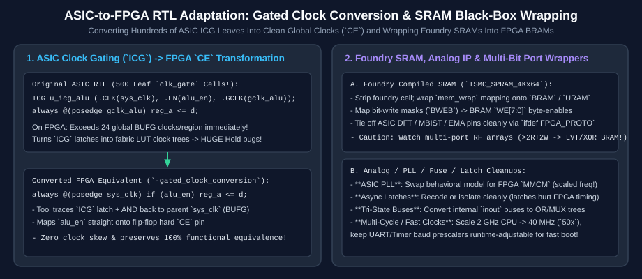
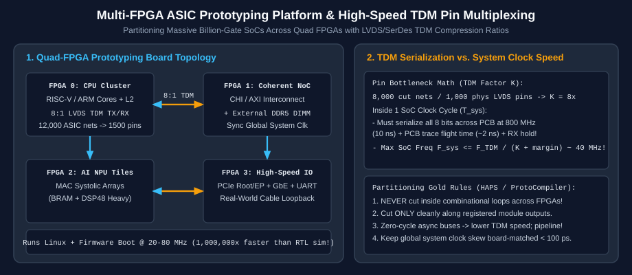

# Multi-FPGA ASIC Prototyping, Emulation, and Hardware Acceleration

Before spending `$20M+` taping out a billion-gate SoC ASIC, engineering teams run real Linux, Android, GPU drivers, and PCIe firmware on **FPGA Prototyping Systems** (like Synopsys HAPS / AMD VU19P clusters) at **10–80 MHz**—delivering **1,000,000x faster execution** than software RTL simulation (`100 Hz`)! Converting huge multi-clock ASIC RTL onto a multi-FPGA board requires solving three tough engineering problems: transforming **ASIC gated clocks (`ICG`) and foundry SRAMs** cleanly, **partitioning logic across 2–16 FPGAs** using **Time-Division Multiplexing (`TDM`)**, and preloading DDR/SRAMs with cycle-accurate waveform visibility.

---

## Learning Goals

- Contrast **Software RTL Simulators**, **Hardware Emulators (`Palladium` / `ZeBu`)**, and **Multi-FPGA Prototyping Platforms (`HAPS` / custom `VU19P` boards)** across compile time, debug depth, and execution speed (`Hz -> MHz`).
- Perform automated and manual **ASIC-to-FPGA RTL conversions**: converting leaf **ICG clock gates** to `BUFG + CE`, mapping compiled **Foundry SRAM macros** onto `BRAM`/`URAM`, and resolving tri-states/latches.
- Partition billion-gate SoCs across multiple FPGAs cleanly without cutting combinational loops, and compute **TDM pin-multiplexing ratios ($K$)** vs. resulting system clock `Fmax`.
- Deploy **Memory Backdoor Preloading**, **Virtual Wires**, and **Multi-FPGA Cross-Triggered Debug (`HAPS ProtoCompiler` / `ILA`)** for firmware bring-up.

---

## FPGA Prototyping vs Simulation and Hardware Emulators

No single pre-silicon platform handles every bug; SoC teams deploy a three-tier verification pyramid:

| Pre-Silicon Engine | Typical Speed | Compile Turnaround | Waveform / Bug Visibility | Primary Workload |
| :--- | :--- | :--- | :--- | :--- |
| **Software RTL Sim (`VCS`/`Xcelium`)** | `10 Hz – 1 kHz` | Seconds–Minutes | **100% Full Visibility** (every net, UVM, SVA) | Block unit tests, UVM constrained-random, formal |
| **Enterprise Emulator (`Palladium`/`ZeBu`)** | `500 kHz – 5 MHz` | Hours | **High** (Fast full-chip trace &amp; dynamic probes) | Complex SoC HW/SW regression, power/perf profiling |
| **FPGA Prototype (`HAPS`/`VU19P`)** | **`10 MHz – 100 MHz`** | Multi-Hour P&amp;R | **Limited** (Scoped ILA capture + UART/JTAG) | **Full OS Boot (`Linux/RTOS`), Firmware drivers, Real PCIe/USB/Ethernet IO!** |

---

## ASIC-to-FPGA RTL Transformations ICG Conversion and SRAM Mapping

Feed raw tape-out ASIC RTL directly into Vivado without adaptation, and synthesis instantly fails on three fundamental incompatibilities:



### 1. Gated Clock (`ICG`) Conversion

A standard ASIC CPU embeds **500–5,000 leaf Clock-Gating Cells (`ICG` latches)** (`assign gclk = clk & latched_en;`). Attempting to synthesize 2,000 separate clocks into an FPGA breaks the 24-clock-per-region limit immediately and creates massive routing hold errors!
- **Solution**: Run **`-gated_clock_conversion auto`** in Vivado (or `Synplify Pro` / `ProtoCompiler` `fix_gated_clocks`). The compiler traces each `ICG` latch + AND gate back to its master `sys_clk`, swaps `sys_clk` cleanly onto the global `BUFG` H-tree, and pushes `alu_en` onto the flip-flop **`CE` Enable pins**!
- *(Guard Tip: Wrap ASIC PDK `CKLNQD` clock-gate modules in cleanly recognizable behavioral RTL under `` `ifdef FPGA_PROTO `` so Vivado always recognizes the latch+AND pattern reliably!)*

### 2. Wrapping Compiled Foundry SRAM Macros

ASIC SRAMs (`TSMC_1RW_4096x64`) include foundry BIST pins, retention pins (`RET`/`SLP`), bit-write masks (`BWEB`), and timing shells (`specify`) that cannot synthesize onto FPGA!
- **Solution**: Maintain a clean **`ifdef FPGA_PROTO`** wrapper module (`sram_wrapper.sv`) mapping `MEM` reads/writes cleanly onto **`BRAM`/`URAM`** with byte/bit write enables (`WE`), tying off `BIST`/`EMA`/`VDD` pins cleanly while matching exact read pipeline latency (`1` vs `2` cycles!).
- Watch **3+ Port Register Files**: ASICs use custom `4R2W` compiled multi-port register files; map onto replicated or `LVT` multi-bank BRAM wrappers!

### 3. Replacing ASIC PLLs, Reset Glitches &amp; High-Speed Timers

- Swap analog SPICE/behavioral **ASIC PLLs** for clean parameterized **FPGA `MMCM`s** scaled proportionally to target prototype speeds (e.g., if a `2.0 GHz` CPU scales `50x` down to `40 MHz`, scale `100 MHz` peripheral buses proportionally to `2 MHz`, OR keep a software-configurable **baud/timer prescaler override** so UART consoles still talk cleanly at real `115200 bps` to host PCs!).

---

## Multi-FPGA Partitioning, TDM Pin Multiplexing, and Clock Distribution

When one flagship FPGA (e.g., `~9M` system logic gates / `~4M` LUTs on `VU19P`) still cannot hold a massive 100M-gate AI or Server SoC, teams split the RTL cleanly across **4 to 16 FPGAs** connected over custom high-speed PCB/Samtec cables:



### Solving the Inter-FPGA Pin Bottleneck via TDM

A single module interface inside an SoC (like a coherent CHI NoC + L2 cache bus) easily spans **`4,000–12,000` wires**—yet one FPGA only exposes `~800–1,200` usable differential I/O pins!

**Time-Division Multiplexing (`TDM`)**: Groups $K$ slower SoC logic signals (`8:1` or `16:1` or `32:1` over GTY/LVDS lines running at `1.0–12.5 Gbps`!) onto ONE physical wire inside every single prototype system clock cycle (`T_sys`):

$$F_{\text{sys},\max} \approx \frac{1}{K \cdot T_{\text{bit}} + T_{\text{flight\_PCB}} + T_{\text{ser/des}} + T_{\text{margin}}}$$

For example: multiplexing **`16:1` (`K = 16`)** across a **`1.0 Gbps`** (`1.0 ns/bit`) LVDS link adds $16\text{ ns}$ serialization + `~6 ns` PCB flight/deskew = `~22 ns` inter-chip latency -> limiting whole-SoC prototype frequency cleanly to **`~35–45 MHz`**!

### Golden Partitioning Rules

1. **NEVER Cut Inside Combinational Paths or Async Loops Across FPGAs**: Cutting an un-registered `ready`/`valid` combinational loop across two FPGAs forces TDM round-trip hops twice per clock, halving `Fmax` (`15 MHz`) and risking combinational oscillation! Always cut cleanly at **registered module boundaries**!
2. **Keep Tightly Coupled Subsystems Together on One Die**: Place `CPU + L1/L2` together on `FPGA 0`, and `DDR Controller + PHY` cleanly on `FPGA 1` directly wired to physical DIMM slots!
3. **Global Synchronous Clock Distribution**: Distribute the master SoC clock from **one central programmable clock board** across **length-matched coaxial/trace cables** into every FPGA simultaneously (`< 100 ps` inter-FPGA board skew)!

---

## Memory Preloading, Virtual Wires, and Prototype Debug Visibility

Booting Linux or bare-metal firmware from cold Flash on a `25 MHz` prototype can take minutes unless you preload DDR/SRAM directly:
- **JTAG / PCIe Backdoor Preload**: Stream ELF kernels, device trees, and initramfs straight into the prototype DDR4/BRAM in `< 2 seconds` over PCIe DMA or JTAG-to-AXI before releasing CPU `rst_n`!
- **Co-Debug Across Multiple FPGAs**: Link JTAG debug hubs (`BSCAN`) across all 4 FPGAs so an assertion failure or `ILA` trigger firing on `FPGA 2` (`NPU AXI Error`) instantly freezes clocks and triggers simultaneous waveform capture across `FPGA 0` (`CPU`) and `FPGA 1` (`NoC`)!

---

## Best Practices and Common Pitfalls

1. **Tag Prototype Adaptation Cleanly Under `` `ifdef FPGA_PROTO `` (Never Fork RTL!)**: Never let engineers create a separate "FPGA copy" of SoC RTL—when ASIC RTL diverges during tape-out bug fixes, forked FPGA code instantly turns stale and hides silicon bugs! Maintain **one unified RTL repo** with thin `` `ifdef FPGA_PROTO `` memory/PLL wrappers and CI synthesis gating!
2. **Audit `report_clock_interaction` Across Scaled Prototype Clocks**: Scaling a `2 GHz` CPU `50x` down to `40 MHz` while keeping a `100 MHz` PCIe hard IP real-time `100 MHz` (`not scaled`) reverses which clock is faster (`dst < src`)! Verify **async CDC FIFOs &amp; `-datapath_only` constraints hold cleanly under scaled prototype clock ratios**!
3. **Avoid Cutting Synchronous Control Signals Without Checking Hold Across Boards**: Always use matched synchronous launch-capture margins (`DDR / SERDES TDM` framing) across multi-board cables rather than raw single-ended GPIO hops!
4. **Watch Out for ASIC Latch Inference Inside Standard-Cell Wrappers**: Scan-test latches or reset-stretcher latches must stay cleanly isolated or wrapped cleanly under prototype defines so Vivado doesn't throw timing loops.

---

## Practical Exercises with Solutions

### Exercise 1 Calculating Multi-FPGA TDM Serialization Speed Ceiling

Two SoC subsystems split cleanly across `FPGA_A` and `FPGA_B` share **`3,600` directional cross-chip signals** (`1,800` A->B, `1,800` B->A). The board provides **`300` available differential LVDS pairs** between them (`150` pairs A->B, `150` pairs B->A), each running reliably at **`1.20 Gbps` (`0.833 ns/bit`)** with total PCB trace + IOB SerDes round-trip overhead `t_overhead = 8.0 ns` (per 1-way hop; assume registered outputs on FPGA_A launch cleanly and land at FPGA_B registers within 1 SoC clock `T_sys`).

1. Compute the minimum required **TDM multiplexing ratio $K$**.
2. Calculate the maximum theoretical prototype SoC clock frequency **$F_{\text{sys},\max}$**!

#### Solution

1. **TDM Factor $K$**:
   $$K = \frac{1{,}800\text{ signals}}{150\text{ physical LVDS pairs}} = \mathbf{12\text{:1}}$$
   (Wait: leave `~1` framing/sync overhead bit if using custom protocol, or exact `12` data bits per cycle at `1.20 Gbps` = `10.0 ns` burst!)
2. **Maximum Prototype SoC Clock (`T_sys` &amp; `F_sys`)**:
   - Data burst serialization time: $K \times T_{\text{bit}} = 12 \times 0.8333\text{ ns} = 10.0\text{ ns}$.
   - Minimum `T_sys` for 1-way registered transfer (including `t_overhead` + local FPGA setup/slack):
     $$T_{\text{sys},\min} = 10.0\text{ ns} + 8.0\text{ ns} = \mathbf{18.0\text{ ns}}$$
     $$F_{\text{sys},\max} = \frac{1}{18.0\text{ ns}} \approx \mathbf{55.5\text{ MHz}}$$
   - Note: Adding an internal pipeline beat (`virtual pipeline`) hides TDM latency as 2 cycles on valid/ready buses if latency tolerance permits!

---

### Exercise 2 Fixing a Prototype-Only Async FIFO Overflow Under Clock Scaling

On target ASIC silicon, `CPU_CLK` runs at `1.6 GHz` pushing data via an async CDC FIFO to a `200 MHz` `PCIE_CLK` (`8:1` faster producer!). On the `FPGA Prototype`, `CPU_CLK` scales `40x` down to **`40 MHz`**, while the real **`PCIe Gen3` Hard IP** requires real **`250 MHz`** `user_clk`! Suddenly, a prototype DMA test fails with **FIFO Underflow / Incorrect `set_max_delay` Slack**!

Why did scaling `CPU_CLK` break timing/behavior when `PCIE_CLK` stayed fixed at `250 MHz`?

#### Solution

1. **Two Distinct Root Causes**:
   - **Constraint Reversal (`set_max_delay -datapath_only`)**: In ASIC/normal mode, `200 MHz` (`5 ns`) was the slower clock; in the prototype, `40 MHz` (`25 ns`) is now **6.25x SLOWER** than `250 MHz` (`4.0 ns`)! If the async FIFO XDC hardcoded `set_max_delay 5.0` assuming `200 MHz`, or conversely used `25.0 ns` on the wrong direction (`40 MHz -> 250 MHz` Gray pointer), the destination `250 MHz` clock could see **multiple bits change across 6 cycles** (`25 ns > 4 ns`) and corrupt pointers! **Fix**: Always set `-datapath_only` cleanly to `min(T_src, T_dst) = 4.0 ns` dynamically using `[get_property PERIOD [get_clocks ...]]`!
   - **Protocol Underflow**: A `40 MHz` fabric producer feeding a `250 MHz` real PCIe endpoint may starve mid-packet unless PCIe DMA waits until a full **store-and-forward (`packet-threshold`)** packet sits buffered in the FIFO before starting TX!

---

### Exercise 3 Auditing an ASIC-to-FPGA `ICG` Conversion Failure

Porting an ASIC SPI controller (`125 MHz`) into an FPGA triggers a `-2.1 ns` Hold Violation (`WHS = -2.1 ns`) on `u_spi/shift_reg*`. Inspection finds the ASIC RTL used this behavioral clock-gater without `-gated_clock_conversion` matching it cleanly:

```systemverilog
// Buried inside vendor standard-cell wrapper without proper latch synthesis hint:
assign clk_gated = clk_sys & (en_dly | scan_en); // Combinational AND without latch!
```

Explain why Vivado refused to convert `clk_gated` onto `BUFG + CE` and show the clean fix!

#### Solution

1. **Why Vivado Failed to Convert**: Notice `assign clk_gated = clk_sys & (en_dly | scan_en);` is a raw un-latched combinational AND gate (**glitch-prone!**)—without an explicit active-low transparent enable latch (or clean `ifdef FPGA_PROTO` bypass), Vivado either refuses safe conversion or treats `clk_gated` as a **derived fabric clock** routed through LUTs (`+2.1 ns` clock skew vs `clk_sys` -> massive Hold violations)!
2. **Clean Fix**: Wrap the leaf ICG module with **`ifdef FPGA_PROTO`** (keeping ASIC netlist pure for ASIC tape-out!) that maps directly to a registered `BUFGCE` OR passes raw `clk_sys` cleanly so downstream flip-flops use `en` directly (or use standard negative-edge-latch ICG template recognized by `-gated_clock_conversion auto`):
```systemverilog
module asic_icg_cell (
    input  logic clk, en, scan_en,
    output logic gclk
);
`ifdef FPGA_PROTO
    // Hard glitch-free global clock enable OR let top-level synthesis convert cleanly:
    BUFGCE u_bufgce (.I(clk), .CE(en | scan_en), .O(gclk));
`else
    logic en_lat;
    always_latch if (!clk) en_lat = en | scan_en;
    assign gclk = clk & en_lat;
`endif
endmodule
```
(Note: if >24 `asic_icg_cell` instances exist inside one region, use `-gated_clock_conversion auto` with `en_lat` so Vivado folds them into slice `FDRE/CE` pins instead of burning 24 `BUFGCE` global buffers!)

---

##### Copyright (c) 2026 squared-studio
