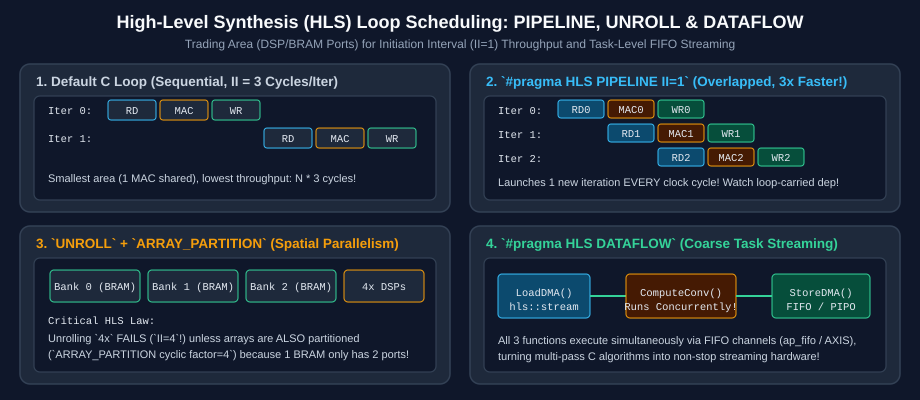
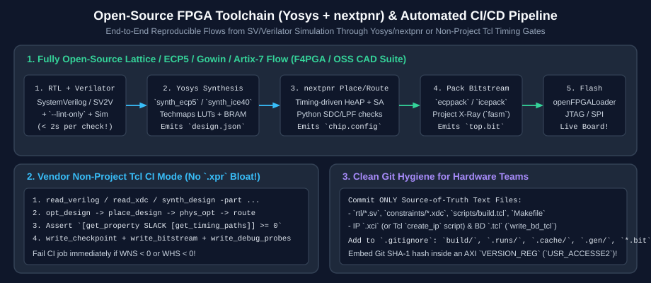

# High-Level Synthesis (HLS), Open-Source FPGA Toolchains, and CI

Writing every matrix accelerator, JPEG decoder, or neural-network layer by hand in RTL takes months of cycle-by-cycle state-machine debugging. **High-Level Synthesis (`Vitis HLS` / `Intel HLS`)** compiles annotated **C / C++ (`ap_fixed`, `hls::stream`)** algorithms straight into optimized pipelined SystemVerilog/VHDL (`II = 1`, `BRAM` banking, `DSP48` scheduling) in days. Simultaneously, open-source FPGA toolchains (**Verilator + Yosys + `nextpnr` + F4PGA**) and scriptable **Non-Project Tcl CI/CD pipelines** bring modern software testing speed and reproducibility to hardware engineering.

---

## Learning Goals

- Optimize HLS C++ kernels systematically using **`#pragma HLS PIPELINE II=1`**, **`UNROLL`**, **`ARRAY_PARTITION`**, and **`DATAFLOW`** task streaming.
- Diagnose **BRAM port-contention stalls (`II > 1`)**, **loop-carried dependencies**, and un-synthesizable dynamic C++ anti-patterns (`malloc`, recursion, unbounded `while`).
- Navigate the **Open-Source FPGA Ecosystem** (**Verilator**, **Yosys**, **`nextpnr`**, **`openFPGALoader`**) for Lattice `iCE40`/`ECP5`, Gowin, and documented 7-Series bitstreams.
- Build zero-bloat **Non-Project Tcl + Makefile CI/CD flows** that reject timing regressions (`WNS < 0` / `WHS < 0`) automatically on every Git commit.

---

## High-Level Synthesis (HLS) PIPELINE, UNROLL, ARRAY_PARTITION, and DATAFLOW

HLS translates sequential C++ loops into timed RTL schedules based on four orthogonal directives:



| Directive | Physical Hardware Transformation | Throughput Impact | Key Bottleneck to Watch |
| :--- | :--- | :--- | :--- |
| **Default (Sequential)** | 1 state per operation; shares single ALU/DSP cleanly | Slow (`Latency * N`) | Low area, minimal bandwidth |
| **`#pragma HLS PIPELINE II=1`** | Overlaps consecutive loop iterations (starts 1 new iter/clk) | **High (`~Latency + N`)** | **BRAM port conflicts** or **loop-carried dependencies** push `II = 2..8`! |
| **`#pragma HLS UNROLL factor=K`** | Duplicates $K$ physical DSP/ALU datapaths in parallel | **`Kx` Parallel** | **Fails to speed up** unless fed by partitioned arrays! |
| **`ARRAY_PARTITION cyclic/complete`** | Splits 1 BRAM (`max 2 ports`) into $K$ independent BRAM banks / FFs | **Multiplies Memory Ports** | Must match exact `UNROLL factor=K`! |
| **`#pragma HLS DATAFLOW`** | Connects producer/consumer functions via **`hls::stream` FIFOs** (`ap_fifo`/`AXIS`) | **Concurrent Pipeline** | Strict single-producer, single-consumer channel graph! |

### Sample Synthesis-Clean HLS C++ Streaming Kernel

```cpp
#include "ap_fixed.h"
#include "hls_stream.h"

typedef ap_fixed<16, 4> data_t;  // Exact 16-bit Q4.12 fixed-point!

void dot_product_accel(
    hls::stream<data_t> &in_a,
    hls::stream<data_t> &in_b,
    hls::stream<data_t> &out_y,
    int num_vectors
) {
#pragma HLS INTERFACE axis port=in_a
#pragma HLS INTERFACE axis port=in_b
#pragma HLS INTERFACE axis port=out_y
#pragma HLS INTERFACE s_axilite port=num_vectors bundle=CTRL
#pragma HLS INTERFACE s_axilite port=return      bundle=CTRL

    const data_t w_lut[4] = {0.25, 0.50, 0.50, 0.25};
#pragma HLS ARRAY_PARTITION variable=w_lut complete dim=1 // 4 parallel reads in 1 cycle!

LOOP_MAIN:
    for (int i = 0; i < num_vectors; i++) {
#pragma HLS PIPELINE II=1
        data_t a = in_a.read();
        data_t b = in_b.read();
        // Compact DSP-friendly MAC cleanly meeting II=1!
        data_t sum = a * w_lut[i & 3] + b * w_lut[(i + 1) & 3];
        out_y.write(sum);
    }
}
```

> [!IMPORTANT]
> **Always Run Co-Simulation (`C Sim -> Synthesis -> RTL Co-Sim`) in HLS!** Passing `C Sim` only proves C++ math works; passing `Synth` only proves gates build cleanly. **RTL Co-Simulation** wraps your compiled Verilog RTL against your C++ testbench to catch deadlocked `hls::stream` FIFO depths, bit-width overflows, and AXI master burst stalls!

---

## Writing Hardware-Synthesizable C++ vs Unsynthesizable Software Habits

Four C/C++ habits fail instantly inside HLS compilers:
1. **Dynamic Heap Allocation (`malloc`, `new`, `std::vector`)**: Hardware cannot grow SRAM on silicon at runtime! Allocate fixed compile-time capacities with static loop upper bounds (`#pragma HLS LOOP_TRIPCOUNT` helps latency reports).
2. **Recursion (`f(n-1)`)**: Unbounded call stacks cannot flatten statically into finite state machines—convert recursive trees/FFTs into iterative loops.
3. **Double-Precision Floating Point (`double` / `float`) Inside Fast Loops**: Floating-point addition takes `~5–8 cycles` and prevents **`II = 1`** accumulation (`sum += x; // float acc takes II = 5!`)! Convert accumulation loops cleanly to **`ap_fixed<W, I>`**.
4. **Pointer Aliasing &amp; Random Memory Access**: Prefer sequential **`hls::stream<T>`** (streaming FIFOs) over pointer arrays whenever possible—giving HLS clear dependency guarantees!

---

## Open-Source FPGA Flows Yosys, nextpnr, Verilator, and F4PGA

You do NOT need `50 GB` proprietary vendor installs to practice synthesis, place-and-route, static timing analysis, and board programming on FPGAs! A vibrant, industry-backed open-source ecosystem compiles real SystemVerilog straight down to hardware bitstreams cleanly in seconds:



### Open-Source Stack Highlights

- **Simulation &amp; Lint**: **Verilator** compiles synthesizable SystemVerilog into blazing multi-threaded C++ testbenches (`10–100x` faster than event simulators!), catching width/latch bugs via `--lint-only`. (**`sv2v`** converts full SystemVerilog structs/interfaces cleanly to Verilog-2005 before tools lacking native SV!).
- **Synthesis (`Yosys`)**: Reads Verilog/SystemVerilog (`read_verilog`), performs technology mapping (`synth_ecp5`, `synth_ice40`, `synth_xilinx`), infers LUTs/BRAMs/DSPs, and emits portable JSON netlists.
- **Place &amp; Route + STA (`nextpnr`)**: Timing-driven analytical + simulated-annealing router (`nextpnr-ecp5`, `nextpnr-ice40`) with Python API hooks and built-in Static Timing Analysis!
- **Bitstream Pack &amp; Flash**: `ecppack` / `icepack` generate flashable bitstreams, loaded directly to boards in `< 2 seconds` over USB-JTAG/FTDI via **`openFPGALoader`**.

```bash
# Complete Open-Source Lattice ECP5 FPGA Build Pipeline (Runs in ~5 Seconds!)
sv2v src/top.sv -w build/top.v && \
yosys -p "read_verilog build/top.v; synth_ecp5 -top top -json build/top.json" && \
nextpnr-ecp5 --85k --package CABGA381 --json build/top.json --lpf pins.lpf --textcfg build/top.config && \
ecppack --compress build/top.config build/top.bit && \
openFPGALoader -b ulx3s build/top.bit
```

---

## Automated Non-Project Tcl Builds, Git Hygiene, and Hardware CI/CD

In team production flows using vendor suites (Vivado/Quartus), **GUI `.xpr` binary project files ruin Git collaboration** (hundreds of unreadable XML lines change every time a user clicks a window!). Production FPGA repositories strictly enforce **Non-Project In-Memory Tcl Flows (`vivado -mode batch -source build.tcl`)**:

- Keep source code purely in clean text (`rtl/*.sv`, `constraints/*.xdc`, `scripts/build.tcl`, `Makefile`), ignoring `.runs/`, `.cache/`, `*.dcp`, and `*.bit` cleanly in `.gitignore`.
- Store Vivado IP Integrator block designs (`PS + AXI DMA`) cleanly via **`write_bd_tcl`** rather than committing massive binary `.bd` directories!
- **CI Timing Failure Gate**: End every CI Tcl build with a strict check failing the pipeline (`exit 1`) automatically if `WNS < 0` OR `WHS < 0` OR unconstrained paths exist (`check_timing`), and stamp the exact **Git Commit SHA (`32-bit USR_ACCESSE2` register)** directly into the bitstream header so lab engineers always know which commit is running on a board!

```tcl
# Production Non-Project Vivado CI Build Excerpt (build.tcl)
set part_id "xczu9eg-ffvb1156-2-e"
read_verilog -sv [glob ./rtl/*.sv]
read_xdc ./constraints/top.xdc
synth_design -top soc_top -part $part_id -gated_clock_conversion auto
opt_design
place_design
phys_opt_design -directive AggressiveFanoutOpt
route_design
phys_opt_design

set wns [get_property SLACK [get_timing_paths -max_paths 1 -setup]]
set whs [get_property SLACK [get_timing_paths -max_paths 1 -hold]]
if {$wns < 0.0 || $whs < 0.0} {
    puts "CI_ERROR: Timing closure failed! WNS=$wns ns, WHS=$whs ns"
    exit 1
}
write_bitstream -force ./build/soc_top.bit
```

---

## Best Practices and Common Pitfalls

1. **Always Fix `hls::stream` Blocking &amp; Depth Under-Sizing in `DATAFLOW` Graphs**: Two parallel tasks sharing split streams (`Stream A -> Fast Path` vs `Stream A -> Slow 3-cycle Bypass`) **deadlock permanently** if the bypass stream's FIFO depth (`#pragma HLS STREAM depth=N`) is smaller than the latency mismatch between branches! Run RTL Co-Sim across edge frames to verify zero FIFO deadlocks.
2. **Never Leave Un-Partitioned Array Reads Inside `II=1` Loops**: Every time HLS prints `Unable to schedule load operation on array 'buf' due to limited memory ports (II=2)`, inspect which loops access >2 indices simultaneously and apply `ARRAY_PARTITION` (or `ARRAY_RESHAPE` for wider BRAM words!).
3. **Track Bitstream Provenance via `USR_ACCESSE2` / Build Timestamp**: Never walk into a hardware lab wondering *"did I flash yesterday's bitstream?"* Reading `USR_ACCESSE2` (`BITSTREAM.CONFIG.USR_ACCESS TIMESTAMP`) via an AXI-Lite read confirms build timestamp + Git SHA down to the second!
4. **Run Fast `Verilator` + `Cocotb` / SV UVM Tests in CI Before Launching 2-Hour Vivado P&amp;R**: Catch 98% of RTL logic bugs in 3 seconds on every PR via open-source `Verilator`, reserving heavy Vivado P&amp;R CI runners for nightly builds and merge gates!

---

## Practical Exercises with Solutions

### Exercise 1 Resolving an HLS Initiation Interval Bottleneck (`II=4 -> II=1`)

You synthesize the `4`-tap vector kernel below in Vitis HLS (`1 BRAM` holds `coeff[4]`), expecting `II = 1`, yet the HLS synthesis report warns: `Scheduled with II = 2` (`Unable to enforce carried dependency / memory port limit on array 'coeff'`):

```cpp
void filter_step(const int16_t coeff[4], hls::stream<int16_t> &din, hls::stream<int32_t> &dout, int N) {
    for (int i = 0; i < N; i++) {
#pragma HLS PIPELINE II=1
        int16_t x = din.read();
        int32_t acc = 0;
        for (int k = 0; k < 4; k++) {
            acc += x * coeff[k]; // Needs 4 reads of coeff[] in 1 single cycle!
        }
        dout.write(acc);
    }
}
```

1. Explain cleanly why Vitis HLS forced `II = 2` instead of `II = 1`.
2. Show the single `#pragma` directive needed to unlock **`II = 1` (`4` MACs/cycle)** immediately!

#### Solution

1. **Why HLS Stalled at `II = 2`**: Applying `#pragma HLS PIPELINE II=1` to the outer `i` loop forces HLS to **completely unroll** the inner loop `k = 0..3`, demanding **4 simultaneous reads from `coeff[0..3]` in the same clock cycle**! Because `coeff[]` defaults to a Dual-Port BRAM (only **2 read ports**!), fetching 4 elements takes $\lceil 4 / 2 \rceil = \mathbf{2\text{ cycles}}$, capping throughput at **`II = 2`**!
2. **Exact Fix**: Partition `coeff` into 4 independent scalar registers (`FFs` / wires):
```cpp
#pragma HLS ARRAY_PARTITION variable=coeff complete dim=1
```
Once `coeff[0..3]` exposes `4` parallel ports, HLS reads all 4 taps simultaneously onto 4 parallel DSPs, scheduling cleanly at **`II = 1`**!

---

### Exercise 2 Fixing a Floating-Point Accumulation `II` Bottleneck

Consider summing an incoming stream of `double` floating-point pixels (`#pragma HLS PIPELINE II=1`):
```cpp
double sum = 0.0;
for (int i = 0; i < 1024; i++) {
#pragma HLS PIPELINE II=1
    sum += pix_stream.read();
}
```
Why does HLS fail `II = 1` with `Carried dependency on 'sum' (II = 8)`, and how can you refactor this into **`II = 1`** without breaking precision?

#### Solution

1. **Why `II = 8` Happened**: An IEEE-754 floating-point adder takes ~`5–8` clock cycles of pipelined exponent-alignment + mantissa normalization latency! Iteration `i+1` needs the updated value `sum` from iteration `i` **immediately 1 cycle later**, which isn't ready until cycle `i+8` -> **`II = 8`**!
2. **Two Clean Fixes**:
   - **Option A (`ap_fixed` Integer/Fixed Accumulator)**: Convert `sum` to exact 1-cycle integer/`ap_fixed<48, 24>` inside `DSP48E2` (`II = 1` cleanly at `500+ MHz`!).
   - **Option B (Partial Interleaved Lanes if `float`/`double` is Strictly Required)**: Split `sum` into `8` independent lane accumulators (`partial_sum[i & 7] += val;` -> each lane updates once every 8 cycles = `II = 1`!), then sum the `8` lanes once cleanly *after* the loop finishes!

---

### Exercise 3 Auditing Non-Project CI Timing Gates

In a GitHub Actions / GitLab CI pipeline running Vivado batch builds, a script currently ends cleanly with:
```tcl
route_design
report_timing_summary -file ./build/timing.rpt
write_bitstream -force ./build/top.bit
```
Why can a broken commit with **`WNS = -3.4 ns` and `WHS = -0.8 ns`** still turn the CI badge **GREEN (`exit code 0`)** and deploy corrupted bitstreams? Write the missing Tcl check!

#### Solution

1. **Silent Timing Bypass**: `write_bitstream` in Vivado generates `.bit` files **even when timing violations (`WNS < 0` or `WHS < 0`) exist**, exiting with code `0` unless explicit `check_timing` / `SLACK` checks halt the script!
2. **Mandatory CI Guard**: Query actual routed `setup` and `hold` slacks AND unconstrained endpoints cleanly, aborting `write_bitstream` with `exit 1` on any failure:
```tcl
set wns [get_property SLACK [get_timing_paths -max_paths 1 -nworst 1 -setup]]
set whs [get_property SLACK [get_timing_paths -max_paths 1 -nworst 1 -hold]]
if {$wns < 0.0 || $whs < 0.0} {
    puts "ERROR: Implementation failed timing! WNS=$wns ns, WHS=$whs ns"
    exit 1
}
write_bitstream -force ./build/top.bit
```

---

##### Copyright (c) 2026 squared-studio
