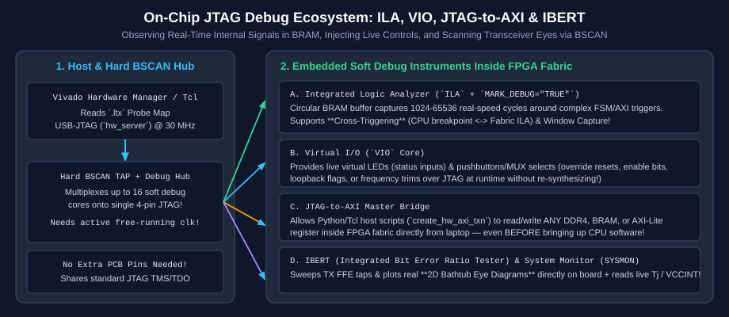
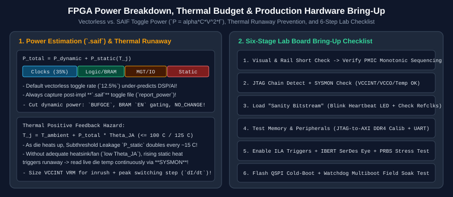

# On-Chip Debug (ILA, VIO), Power Estimation, and Production Bring-Up

Even with exhaustive simulation and clean Static Timing Closure (`WNS >= 0, WHS >= 0`), real FPGA hardware encounters external board noise, unmodeled sensor timing quirks, DDR calibration fails, and unexpected traffic deadlocks. Unlike sealed ASICs where internal signals stay hidden forever inside resin packages, FPGAs turn spare BRAMs and the JTAG port into built-in oscilloscopes and bus masters: **Integrated Logic Analyzers (`ILA`)**, **Virtual I/O (`VIO`)**, **JTAG-to-AXI Bridges**, **IBERT Eye Scanners**, and **System Monitors (`SYSMON`)**—paired cleanly with accurate **`.saif` Power Estimation** and systematic **Lab Bring-Up checklists**.

---

## Learning Goals

- Instrument live internal FPGA signals at full operating clock speed using **`ILA` (`MARK_DEBUG`)**, **`VIO`**, **`JTAG-to-AXI`**, and cross-triggering over shared `BSCAN` JTAG.
- Measure real transceiver channel signal integrity (`2D Bathtub Eye Scans`) directly on hardware using **IBERT**.
- Estimate dynamic and static FPGA power accurately via **post-implementation `.saif` switching activity** instead of deceptive default vectorless toggle guesses, and guard against **thermal runaway**.
- Execute a disciplined **6-Stage Lab Board Bring-Up Checklist** preventing fried regulators, bricked QSPI images, or ambiguous multi-domain failures.

---

## On-Chip Instrumentation with ILA, VIO, JTAG-to-AXI, and IBERT

On-chip debug cores communicate through the FPGA's hardened **`BSCAN` JTAG TAP Hub**, allowing simultaneous real-time probing over one 4-pin USB-JTAG cable without stealing precious external PCB GPIO pins:



### Selecting the Right On-Chip Debug Core

| Debug Core | Primary Purpose | Hardware Resources Used | Killer Feature |
| :--- | :--- | :--- | :--- |
| **`ILA` (Integrated Logic Analyzer)** | Captures real-time waveforms at full fabric `Fmax` (`100–500 MHz`) into circular BRAM | `BRAM` + tiny compare LUTs | **Advanced Trigger FSMs** (`AXI stall`, `count=N`, cross-trigger CPU halt!) |
| **`VIO` (Virtual Input/Output)** | Live JTAG interactive pushbuttons, reset overrides, MUX selectors, &amp; status LEDs | Tiny FFs + LUTs (`0 BRAM`) | Inject faults/resets or read registers runtime with zero rebuild! |
| **`JTAG-to-AXI Master`** | Issues real AXI4 / AXI-Lite reads &amp; writes from laptop Tcl straight into internal bus! | Compact AXI bridge | **Tests DDR4, BRAM, and CSRs even before bringing up Linux/CPU!** |
| **`IBERT`** | Configures `GTY`/`GTH` PRBS patterns, TX FFE swings, &amp; RX equalizer sweeps live | GT Quad DRP | Plots live **2D BER Eye Diagrams** across real backplanes/cables! |

### Inserting `ILA` Probes Without Breaking Timing (`MARK_DEBUG`)

Rather than rewriting module port lists to wire 20 internal buses up to the top level, simply tag signals right where they live using SystemVerilog attributes:

```systemverilog
// Preserve & expose internal AXI signals straight to Vivado Debug Flow cleanly!
(* mark_debug = "true" *) logic        axi_awvalid_dbg;
(* mark_debug = "true" *) logic        axi_awready_dbg;
(* mark_debug = "true" *) logic [31:0] axi_awaddr_dbg;

assign axi_awvalid_dbg = s_axi_awvalid;
assign axi_awready_dbg = s_axi_awready;
assign axi_awaddr_dbg  = s_axi_awaddr;
```

> [!CAUTION]
> **Two Classic `ILA` Trap Errors!**
> 1. **Dead Debug Hub Clock**: The `BSCAN` Debug Hub runs off whichever clock drives your first ILA! If that clock stops (gated off or un-locked `MMCM`), **Vivado Hardware Manager throws `"Debug Core Not Detected"` even though JTAG works!** Always ensure at least one `ILA` or Debug Hub connects to a free-running continuous crystal clock!
> 2. **Monitoring Asynchronous Signals Directly Without Sync**: Connecting signal `sig_200m` onto an `ILA` clocked at `clk_100m` shows fake setup/hold glitches on waveform display (`WNS < 0` warnings!). Always probe every signal inside its *own* synchronous clock domain (instantiate separate small ILAs per clock domain!).

---

## Accurate Power Estimation Vectorless vs Post-Implementation SAIF

Before signing off PCB Voltage Regulator Modules (`VRMs`, `VCCINT` `0.85 V @ 40–100 A`) and copper heatsinks, FPGA power must be bounded realistically across worst-case workloads:



### Why Default `report_power` Lies Under Vectorless Mode

If you simply run `report_power` in Vivado with no switching simulation trace, Vivado guesses a flat default **12.5% toggle rate** across flip-flops and clocks!
- On a **sparse control design** (`1%` activity), default `12.5%` massively *over-estimates* dynamic power (oversizing your VRM unnecessarily!).
- On a **heavy AI systolic array or `64-tap` DSP filter running at `500 MHz`** (`50%` bit toggling!), default `12.5%` severely *under-estimates* current—causing live `VCCINT` brownouts or thermal shutdown in the lab!

**Accurate Flow (`SAIF` Toggle Annotation)**: Run a post-synthesis/post-implementation timing/functional simulation executing a true **worst-case stress burst**, dump a **Switching Activity Interchange Format (`.saif`)** file (`log_saif`), read it via `read_saif ./sim/stress.saif`, and run `report_power`!

### High-Leverage FPGA Power Optimizations

- Enable **Clock Gating (`BUFGCE`)** cleanly on inactive subsystems (`saves 30%+ total dynamic power` by quieting giant H-tree clock spines!).
- Switch BRAM `WRITE_MODE` to **`NO_CHANGE`** and gate BRAM `EN` (`en = rd_en | wr_en`) when idle (`cuts idle BRAM sense-amp toggling completely!`).
- Run `power_opt_design` inside Vivado implementation to auto-gate unused clock enables cleanly across FFs and BRAMs!

---

## Thermal Management, Inrush Sequencing, and SYSMON Monitoring

Static subthreshold leakage power ($P_{\text{static}}$) grows **exponentially** with silicon junction temperature $T_j$:

$$T_j = T_{\text{ambient}} + P_{\text{total}}(T_j) \cdot \theta_{JA}$$

Notice the dangerous positive feedback loop: hotter silicon -> exponentially higher static leakage -> even higher $P_{\text{total}}$ -> **thermal runaway** past maximum rated $T_{j,\max}$ (`100 C` commercial / `125 C` industrial)!
- Always verify **Power-On Rail Monotonic Sequencing** (`VCCINT -> VCCBRAM -> VCCAUX -> VCCO` per datasheet spec) and size VRM bulk/ceramic decoupling capacitors cleanly for configuration **POR rush currents** and high `dI/dt` DSP steps (`10 A/us`).
- Poll the FPGA's built-in **System Monitor (`SYSMON` / `XADC`)** continuously over `AXI` or `I2C` (`PMBus`), triggering automatic clock-throttling (`BUFGCE` duty cycle reduction) or emergency `OT` thermal shutoff if $T_j$ crosses `90–95 C`!

---

## Six-Stage Hardware Bring-Up Checklist and Production Readiness

Never power up a brand-new `$5,000` prototype board and immediately flash your full complex SoC Linux + PCIe + AI image! Follow this proven incremental isolation checklist:

1. **Stage 1: Cold Continuity &amp; Supply Sequencing**: Before plugging in JTAG or FPGA configs, verify `0` rail-to-GND shorts with a multimeter, power up PMIC rails cleanly, and scope **monotonic rail sequencing** + `PG` flags.
2. **Stage 2: JTAG Chain &amp; `SYSMON` Health**: Connect USB-JTAG (`openFPGALoader` / Vivado Hardware Manager), confirm exact `IDCODE` detection, and verify `SYSMON` reports healthy core `VCCINT` (`0.85 V +/- 3%`) and cool ambient die temp (`~30–40 C`).
3. **Stage 3: Sanity Heartbeat Bitstream**: Load a tiny minimal bitstream containing ONLY an external oscillator `IBUFDS -> MMCM -> Counter -> LED` + `UART Hello World` (`confirms clock crystal solder joints, reset button polarity, and bank VCCO voltages!`).
4. **Stage 4: `JTAG-to-AXI` Memory &amp; CSR Sweep**: Load full base infrastructure, verify DDR4 **MIG PHY calibration passes (`init_calib_complete == 1`)** cleanly via `JTAG-to-AXI` memory read/write patterns (`0xAA55...`, walking-1s).
5. **Stage 5: `ILA` Live Logic &amp; `IBERT` High-Speed Eye Soak**: Enable `ILA` triggers around DMA/accelerator corner transitions and run `IBERT` PRBS31 eye scans across `GTY` SerDes lanes at elevated oven temperature (`50–60 C ambient`).
6. **Stage 6: QSPI Cold-Boot, Multiboot Watchdog &amp; Burn-In Soak**: Program non-volatile QSPI Flash, test 100 cold power cycles (`POR -> DONE -> App Alive`), confirm failsafe Golden fallback recovery, and log zero bit errors across a 24–72 hour soak!

---

## Best Practices and Common Pitfalls

1. **Always Include a Resettable LED Heartbeat Tied to Every Clock Domain (`clk_div[25]`)**: Watching a 1 Hz blinking LED immediately answers two critical lab questions in 1 second: *"Did the FPGA configure?"* AND *"Is `mmcm_locked` keeping `clk_200m` alive?"*
2. **Scope `ILA` Probe Bit-Widths Tightly to Spare BRAM**: Dumping 500 wide debug signals `16K` samples deep burns half an FPGA's BRAM and causes terrible routing congestion (`WNS drops -2 ns just from debug wires!`). Capture focused triggers (`64–128` key signals `1024–2048` deep), or route signals to **`ILA` via a selectable debug MUX**!
3. **Never Neglect `DONE` &amp; `INIT_B` Probe Test Points on PCB Schematic Reviews**: Ensure JTAG, `INIT_B`, `DONE`, `PROGRAM_B`, and `I2C PMBus` test points sit cleanly accessible with oscilloscope ground clips before PCB fab!
4. **Strip Unneeded Heavy `MARK_DEBUG` / `ILA` Before Production Qualification**: Or confirm production timing closure &amp; thermal `.saif` power with the *exact* shipped production debug configuration intact!

---

## Practical Exercises with Solutions

### Exercise 1 Calculating Thermal Margin &amp; Catching Runaway Risk

A Versal/UltraScale+ FPGA dissipates **`P_dynamic = 22.0 W`** at `500 MHz` (`from SAIF simulation`) alongside temperature-dependent static leakage approximated near operating point as **`P_static = 4.0 W` at `85 C`** (rising linearly around operating neighborhood by `+0.18 W/C` above `85 C`, bounded cleanly for linear stability check). The board sits in a `T_ambient = 45 C` chassis with an airflow heatsink achieving thermal resistance **`Theta_JA = 1.65 C/W`** (`Max T_j = 100 C`).

1. Compute approximate equilibrium junction temperature $T_j$ (first at fixed `P_static = 4.0 W`, then accounting for the `+0.18 W/C` thermal leakage feedback!).
2. Does this cooling solution safely stay below $T_{j,\max} = 100^\circ\text{C}$, or what improved heatsink $\theta_{JA}$ is required to hold $T_j \le 90^\circ\text{C}$?

#### Solution

1. **Equilibrium Junction Temperature**:
   - Baseline neglecting thermal rise on static power:
     $$P_{\text{tot}} = 22.0 + 4.0 = 26.0\text{ W} \implies T_j = 45 + 26.0 \times 1.65 = 45 + 42.9 = \mathbf{87.9^\circ\text{C}}$$
   - Including static feedback $P_{\text{static}}(T_j) \approx 4.0 + 0.18\,(T_j - 85)$:
     $$T_j = 45 + 1.65 \times \left[22.0 + 4.0 + 0.18\,(T_j - 85)\right] = 45 + 42.9 + 0.297\,(T_j - 85)$$
     $$0.703\,T_j = 87.9 - 25.245 = 62.655 \implies T_j \approx \mathbf{89.1^\circ\text{C}}$$
   - Safely below $100^\circ\text{C}$ max (`~10.9 C` margin), though right on the edge of `90 C`!
2. **Design Margin for Worst-Case `55 C` Ambient Chassis (`+10 C`)**: If ambient rises to `55 C`, `T_j` climbs past **`103.3 C` (> 100 C spec!)**. Dropping heatsink resistance via higher airflow to **`Theta_JA <= 1.20 C/W`** pins $T_j$ safely down near `85–88 C` even in hot rooms!

---

### Exercise 2 Fixing a `"Debug Hub Clock Stopped"` `ILA` Bring-Up Failure

On a lab board, an engineer programs a bitstream cleanly (`DONE` LED lights UP!), opens Vivado Hardware Manager, and sees the FPGA `IDCODE` cleanly—yet receives warning **`WARNING: Labtools 27-3361: The debug hub core was not detected`** and zero `ILA` waveforms appear! Inspecting the design shows the single `ILA` instance was attached to `pcie_user_clk` (which stays held in reset because no PCIe cable is plugged in yet!).

Explain why `ILA` disappeared completely and propose two immediate fixes!

#### Solution

1. **Root Cause**: Vivado's `dbg_hub` (JTAG-to-ILA bridge inside FPGA fabric) automatically connects its internal state-machine clock to an active `ILA` clock (`pcie_user_clk`). Because the PCIe endpoint stays un-linked/reset without a host cable, `pcie_user_clk` is **0 Hz frozen**, stalling `dbg_hub` so JTAG cannot even detect or communicate with any debug core!
2. **Two Fixes**:
   - **Rule Fix (Persistent Build Fix)**: Connect at least one heartbeat `VIO`/`ILA` (or set `C_CLK_INPUT_FREQ_HZ` / `connect_debug_port dbg_hub/clk`) explicitly onto an **always-running free-running crystal board clock** (`sys_clk_100m`), keeping `dbg_hub` alive even when PCIe/DDR resets!
   - **Temporary Lab Unblock**: Plug the board into a live PCIe slot (or toggle `PERST_N` / internal PCIe refclk bypass) so `pcie_user_clk` starts toggling cleanly.

---

### Exercise 3 Sizing `ILA` Circular Capture Depth in Spare `BRAM36E2` Tiles

An engineer probes **256 bits** (`8x 32-bit` buses) at **`300 MHz`** and selects a capture depth of **`16,384` samples** (`16K`) inside an FPGA with **32 spare `RAMB36E2` tiles** remaining.

1. How many total `BRAM36E2` tiles does a `256-bit x 16,384` `ILA` buffer require (`36Kb` effective data capacity `32,768` bits per tile in `x36`/`x32` power-of-2 alignment)?
2. Does it fit inside the `32` spare tiles? If not, propose a smart `ILA` compression/trigger adjustment!

#### Solution

1. **Required BRAM36E2 Capacity**:
   - Total bits captured = $256\text{ bits} \times 16{,}384\text{ samples} = 4{,}194{,}304\text{ bits}$ (`4.0 Mbits`).
   - Effective binary-aligned storage per `RAMB36E2` (`1024 x 32` or `512 x 64`) = **`32,768` data bits** (ignoring 4 parity bits unless `x36`/`x72` packed cleanly: `36Kb` max -> $256 / 72 \approx 4$ wide $\times$ $16384/512 = 32$ deep = $128$ tiles, or exact $\lceil 4{,}194{,}304 / 36{,}864 \rceil \approx \mathbf{114\text{ to }128\text{ BRAM36E2 tiles}}$!).
2. **Fit Check**: **NO! (`114–128` tiles needed vs ONLY `32` spare tiles available -> `Place/Map` fails immediately with `Over-utilized RAMB36E2`!)**.
3. **Smart Fix**:
   - Reduce `ILA` capture depth from `16K` down to **`2048` or `4096` samples** (`32` tiles fits `4096 x 256` cleanly using `4x 72` wide $\times$ `8` deep = **32 BRAMs**!), AND enable **`Storage Qualification` (`Capture Control`)** in ILA so samples ONLY write into BRAM on cycles where `axi_tvalid && axi_tready` actually transfer useful packets (ignoring millions of idle cycles cleanly)!

---

##### Copyright (c) 2026 squared-studio
