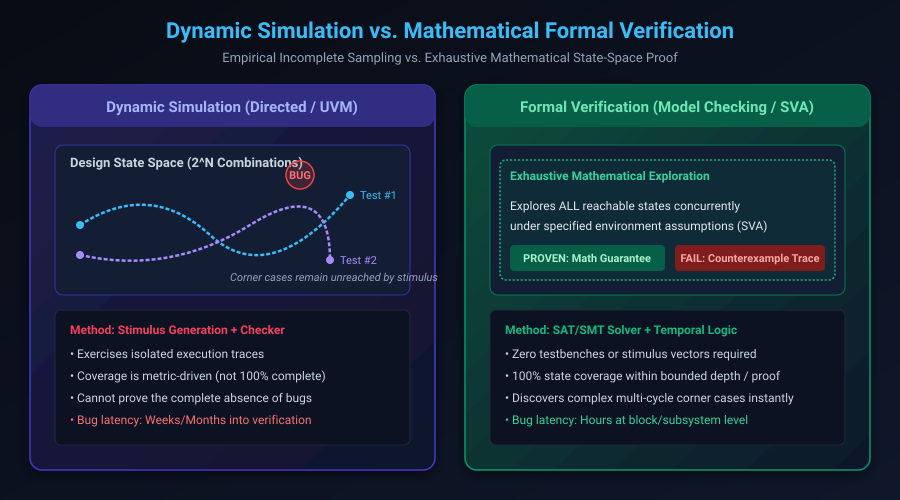

# Foundations of Formal Verification & Mathematical Modeling

## Introduction: The State-Space Explosion Crisis

As modern Application-Specific Integrated Circuits (ASICs) and Systems-on-Chip (SoCs) scale to billions of transistors, digital verification has become the single greatest bottleneck in hardware engineering—consuming upwards of 70% of total project development cycles.

In traditional digital design, engineers rely heavily on **Dynamic Simulation** (directed tests, pseudo-random UVM environments, and hardware emulation). However, a circuit with only 100 flip-flops contains $2^{100} \approx 1.26 \times 10^{30}$ possible states. Even executing one billion test vectors per second across a thousand-node computing cluster, a simulator would require over $4 \times 10^{13}$ years to exhaustively sample this state space. 

When subtle bugs lurk in multi-cycle corner cases—such as rare pipeline hazards, cache coherency deadlocks, or clock-domain crossing glitches—simulation cannot guarantee their absence.

**Hardware Formal Verification (FV)** shifts the verification paradigm from empirical sampling to **rigorous mathematical proof**. Using automated reasoning algorithms (SAT/SMT solvers and model checking), formal tools mathematically prove that an implementation satisfies its specification across *every conceivable input sequence for all time*, or produce an exact counterexample trace showing where the logic fails.

This chapter covers:
1. **Dynamic Simulation vs. Formal Verification**.
2. **Transition Systems & Kripke Structures**.
3. **Reachability Analysis & Invariant Formulation**.
4. **Boolean Engines: BDDs to Modern CDCL SAT & SMT Solvers**.
5. **A Concrete State Machine Formalization**.
6. **Hands-On Exercises & Review Questions**.

---

## Dynamic Simulation vs. Formal Verification

Understanding the fundamental trade-offs between dynamic simulation and formal model checking is essential for deploying both methodologies effectively:



### Structural Comparison

| Attribute | Dynamic Simulation (UVM) | Formal Model Checking (FV) |
| :--- | :--- | :--- |
| **Approach** | Empirical stimulus generation & checking | Mathematical exhaustive state-space search |
| **Completeness** | Incomplete: samples paths through state space | Complete: proves properties over $100\%$ of reachable states |
| **Testbench** | Requires drivers, monitors, scoreboards, sequencers | Zero stimulus testbench needed (solvers synthesize inputs) |
| **Input Constraints** | Procedural randomized constraints (`std::randomize`) | Formal temporal assumptions (`assume property`) |
| **Bug Detection** | Highly effective on deep, long data paths | Unbeatable on control logic, arbiters, FIFOs, and protocols |
| **Result** | Pass (for tested vectors) or Fail | **Proven**, **Falsified** (with trace), or **Timeout/Undetermined** |

---

## Transition Systems & Kripke Structures

Every synchronous digital circuit described in Verilog or SystemVerilog can be formally modeled as a **Transition System** or **Kripke Structure**.

Mathematically, a Kripke Structure $M$ over a set of atomic propositions $AP$ is a 4-tuple:

$$M = (S, S_0, R, L)$$

Where:
- **$S$**: The finite set of all possible states. In a synchronous circuit with $N$ state registers (flip-flops), $|S| \le 2^N$.
- **$S_0 \subseteq S$**: The set of initial states (the reset state of the circuit).
- **$R \subseteq S \times S$**: The transition relation, where $(s, s') \in R$ means the circuit can transition from state $s$ to state $s'$ in one clock cycle.
- **$L: S \rightarrow 2^{AP}$**: The labeling function, which associates each state $s \in S$ with the set of atomic propositions that evaluate to true in that state (e.g. `L(s) = {req, !ack, state == IDLE}`).

### Execution Traces & Paths

An infinite sequence of states $\pi = s_0, s_1, s_2, \dots$ is a **path** (or execution trace) in $M$ if:
1. $s_0 \in S_0$ (the path begins at an initial reset state).
2. For all $i \ge 0$, $(s_i, s_{i+1}) \in R$ (every transition conforms to the design's clock-edge logic).

The goal of formal verification is to prove that **every valid path** $\pi$ through the transition system satisfies the design requirements.

---

## Reachability Analysis & Invariant Checking

A state $s \in S$ is **reachable** if there exists a valid finite path $s_0, s_1, \dots, s_k$ such that $s_0 \in S_0$ and $s_k = s$. The set of all reachable states is denoted as $Reach(M)$.

An **Invariant Property** $P$ is an assertion that must evaluate to true in *every* reachable state:

$$\forall s \in Reach(M), \quad s \models P$$

If there exists even one reachable state $s_{bad} \in Reach(M)$ where $s_{bad} \not\models P$:
1. The property is **falsified**.
2. The sequence of states from $s_0$ to $s_{bad}$ constitutes a **Counterexample Trace**.
3. This trace is exported as a waveform file (`.vcd` or `.fsdb`) showing the exact input stimulus that triggers the bug.

---

## Boolean Engines: From BDDs to Modern SAT/SMT Solvers

The underlying algorithms powering formal tools have undergone profound revolutions:

### 1. Binary Decision Diagrams (BDDs)
In the 1980s and 1990s, symbolic model checkers (such as SMV) represented transition relations and reachable state sets using **Reduced Ordered Binary Decision Diagrams (ROBDDs)**.
- **Advantage**: Canonical representation; checking equivalence between two functions is $O(1)$.
- **Fatal Bottleneck**: Memory explosion. The size of a BDD depends critically on variable ordering. For circuits like integer multipliers, BDD representations grow exponentially regardless of variable ordering, limiting BDD-based tools to small blocks (~100 flip-flops).

### 2. CDCL SAT Solvers (Conflict-Driven Clause Learning)
Around 2000, formal tools transitioned to **SAT Solvers** (Boolean Satisfiability in Conjunctive Normal Form, CNF). Modern CDCL engines (such as CaDiCaL, Kissat, and CryptoMiniSat) leverage:
- **Two-watched-literal data structures** for lightning-fast unit propagation.
- **Conflict analysis & non-chronological backjumping** to prune massive regions of search space.
- **VSIDS (Variable State Independent Decaying Sum)** heuristics for dynamic variable selection.
- **Clause deletion & random restarts** to escape local search minima.

Modern SAT solvers regularly handle Boolean formulas containing millions of variables and tens of millions of clauses, enabling formal verification of industrial multi-million-gate SoC blocks.

### 3. SMT Solvers (Satisfiability Modulo Theories)
SMT solvers (such as Z3, Bitwuzla, and CVC5) elevate reasoning above raw bit-blasted Booleans to higher-order mathematical theories:
- **Theory of Fixed-Size Bit-Vectors ($\mathcal{T}_{BV}$)**: Directly models 32-bit registers, arithmetic overflows, and shifts.
- **Theory of Arrays ($\mathcal{T}_A$ wash)**: Models large RAMs, caches, and register files without flattening them into individual latches.

---

## Concrete Example: Formalizing a Dual-Client Arbiter

Consider a dual-client mutual-exclusion arbiter in SystemVerilog:

```systemverilog
module arbiter (
    input  logic clk,
    input  logic rst_n,
    input  logic req0,
    input  logic req1,
    output logic gnt0,
    output logic gnt1
);

    typedef enum logic [1:0] {
        IDLE  = 2'b00,
        GNT0  = 2'b01,
        GNT1  = 2'b10
    } state_t;

    state_t state, next_state;

    // Sequential state register
    always_ff @(posedge clk or negedge rst_n) begin
        if (!rst_n)
            state <= IDLE;
        else
            state <= next_state;
    end

    // Combinational next-state logic
    always_comb begin
        next_state = state;
        case (state)
            IDLE: begin
                if (req0)
                    next_state = GNT0;
                else if (req1)
                    next_state = GNT1;
            end
            GNT0: begin
                if (!req0)
                    next_state = req1 ? GNT1 : IDLE;
            end
            GNT1: begin
                if (!req1)
                    next_state = req0 ? GNT0 : IDLE;
            end
            default: next_state = IDLE;
        endcase
    end

    assign gnt0 = (state == GNT0);
    assign gnt1 = (state == GNT1);

    // =========================================================================
    // Formal Invariant Properties
    // =========================================================================
    // Invariant: Both clients must NEVER be granted access simultaneously!
    assert_mutex: assert property (@(posedge clk) disable iff (!rst_n)
        !(gnt0 && gnt1)
    );

    // Invariant: Grant implies request was asserted
    assert_legitimate_gnt0: assert property (@(posedge clk) disable iff (!rst_n)
        gnt0 |-> req0 || $past(req0)
    );

endmodule
```

### Formal Mathematical Translation
1. **State Bits**: `state[1:0]` gives $|S| = 2^2 = 4$ states.
2. **Initial State**: $S_0 = \{\text{IDLE} \equiv 2'b00\}$.
3. **Mutual Exclusion Invariant**: $\neg (gnt0 \wedge gnt1)$. Since $gnt0 \implies state = 01$ and $gnt1 \implies state = 10$, and a 2-bit register cannot be both $01$ and $10$ simultaneously, the SAT solver proves mutual exclusion holds in **$0$ solver iterations** across all time.

---

## Hands-On Exercise

### The Problem
You are verifying a 3-bit saturating counter that increments when `up` is high and decrements when `down` is high. When both are asserted, the counter holds its value.
1. Define the formal transition relation $T(s, s')$ for the counter.
2. Formulate the boundary invariant: "The counter value never exceeds 7, and never wraps around from 7 to 0 on increment."
3. Write the corresponding SystemVerilog assertion.

### The Solution

```systemverilog
module saturating_counter (
    input  logic       clk,
    input  logic       rst_n,
    input  logic       up,
    input  logic       down,
    output logic [2:0] count
);

    always_ff @(posedge clk or negedge rst_n) begin
        if (!rst_n) begin
            count <= 3'd0;
        end else begin
            case ({up, down})
                2'b10: if (count < 3'd7) count <= count + 1'b1; // Saturate at 7
                2'b01: if (count > 3'd0) count <= count - 1'b1; // Saturate at 0
                default: count <= count; // Hold on 00 or 11
            endcase
        end
    end

    // Safety Invariant 1: Value never exceeds 3'd7 (Bit-width guarantee)
    assert_max_bound: assert property (@(posedge clk) disable iff (!rst_n)
        count <= 3'd7
    );

    // Safety Invariant 2: No rollover from 7 to 0 when counting up
    assert_no_rollover: assert property (@(posedge clk) disable iff (!rst_n)
        (count == 3'd7 && up && !down) |=> (count == 3'd7)
    );

endmodule
```

---

## Review Questions & Self-Assessment

1. **Why is simulation incapable of guaranteeing the complete absence of bugs in a 100-register sequential block?**
   *Answer:* The state space is $2^{100} \approx 10^{30}$. Simulating billions of vectors only samples an infinitesimally small fraction ($< 10^{-18}$) of the reachable states. Corner-case interactions requiring specific, multi-cycle sequences will inevitably escape detection.
2. **What are the four components of a Kripke Structure $M = (S, S_0, R, L)$?**
   *Answer:* $S$ is the finite set of states; $S_0$ is the set of initial reset states; $R$ is the transition relation defining valid state steps; $L$ is the labeling function assigning atomic truth values to states.
3. **What is the primary operational difference between a BDD and a CDCL SAT solver?**
   *Answer:* BDDs construct a canonical graph of the entire Boolean function, which provides fast equivalence checks but suffers from catastrophic exponential memory explosion. CDCL SAT solvers search for a satisfying assignment using clause learning and heuristics over CNF formulas without building the full state graph in memory.
4. **What is a Counterexample Trace in formal verification?**
   *Answer:* It is a concrete sequence of states starting from reset $s_0$ that reaches a state violating an assertion. The formal tool outputs this trace as a cycle-accurate waveform for debugging.

---

##### Copyright (c) 2026 squared-studio
