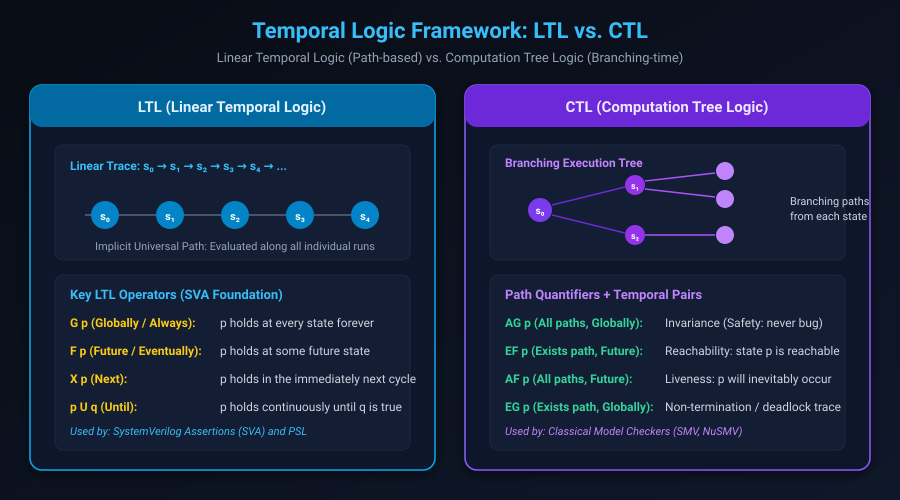

# Mathematical Logic & Temporal Logic: LTL vs. CTL

## Introduction: Why Classical Logic Is Insufficient

In classical propositional logic, a statement such as $A \wedge B$ has a fixed truth value evaluated in an instantaneous snapshot of time. 

However, synchronous digital circuits are fundamentally dynamic: signals change values at clock ticks, registers store history, and protocols require multi-cycle transactions (such as "if `req` is asserted, `ack` must be returned within 3 cycles, and `data` must remain stable until `ack`").

To mathematically specify and prove statements that span across sequential clock cycles, computer scientists developed **Temporal Logic**. Temporal logic extends Boolean algebra with modal operators that reason about the ordering and timing of events without requiring explicit, fragile clock-counter variables.

This chapter covers:
1. **Propositional Logic & First-Order Predicates in RTL**.
2. **Linear-Time vs. Branching-Time Semantics**.
3. **Linear Temporal Logic (LTL) & Formal Operator Semantics**.
4. **Computation Tree Logic (CTL) & Path Quantifiers**.
5. **Safety vs. Liveness (The Alpern-Schneider Theorem)**.
6. **Hands-On Exercises & Review Questions**.

---

## The Temporal Logic Framework: LTL vs. CTL

The two primary temporal logic formalisms used in hardware verification are **LTL (Linear Temporal Logic)** and **CTL (Computation Tree Logic)**:



### Structural Comparison

| Attribute | LTL (Linear Temporal Logic) | CTL (Computation Tree Logic) |
| :--- | :--- | :--- |
| **Model of Time** | Linear timeline: single infinite sequence of states $\pi$ | Branching tree: infinite tree of branching possible futures |
| **Path Quantifiers** | Implicitly universal: must hold along **all** execution paths | Explicit quantifiers: $A$ (all paths) and $E$ (exists path) |
| **Hardware Standard** | Direct mathematical foundation of **SystemVerilog Assertions (SVA)** and **PSL** | Used in classical symbolic model checkers (SMV, NuSMV) |
| **Complexity** | Model checking is PSPACE-complete; SAT-friendly | Model checking is $O(|M| \times |\phi|)$ polynomial in state size |
| **Expressiveness** | Expresses fairness: $GF\ req \rightarrow GF\ ack$ | Expresses reset reachability: $AG(EF\ rst)$ |

---

## Linear Temporal Logic (LTL) Deep Dive

In LTL, formulas are evaluated over an infinite sequence of states $\pi = s_0, s_1, s_2, \dots$ generated by the circuit.

### Core Temporal Operators

Let $\pi^i = s_i, s_{i+1}, s_{i+2}, \dots$ denote the suffix of path $\pi$ starting at cycle $i$.

#### 1. Next State: $\mathbf{X}\ \phi$ (Circle $\bigcirc \phi$)
Formula $\phi$ must hold in the immediately succeeding clock cycle:

$$\pi \models \mathbf{X}\ \phi \iff \pi^1 \models \phi$$

In SystemVerilog Assertions:
```systemverilog
// If req is high at cycle T0, ack must be high at cycle T1
req |=> ack; // Equivalent to: req |-> ##1 ack
```

#### 2. Globally / Always: $\mathbf{G}\ \phi$ (Square $\Box \phi$)
Formula $\phi$ must evaluate to true at *every single state* along the path from the current cycle to infinity:

$$\pi \models \mathbf{G}\ \phi \iff \forall i \ge 0, \quad \pi^i \models \phi$$

In SystemVerilog Assertions:
```systemverilog
// The FIFO empty and full flags are NEVER high simultaneously
assert property (@(posedge clk) !(fifo_empty && fifo_full));
```

#### 3. Future / Eventually: $\mathbf{F}\ \phi$ (Diamond $\Diamond \phi$)
Formula $\phi$ must become true at *some point* at or after the current cycle:

$$\pi \models \mathbf{F}\ \phi \iff \exists i \ge 0, \quad \pi^i \models \phi$$

In SVA (Strong Liveness):
```systemverilog
// A transaction request will eventually complete
req |-> s_eventually(done);
```

#### 4. Strong Until: $\phi\ \mathbf{U}\ \psi$
Formula $\phi$ must remain true continuously until $\psi$ becomes true, and $\psi$ **is guaranteed to occur** eventually:

$$\pi \models \phi\ \mathbf{U}\ \psi \iff \exists k \ge 0 \text{ s.t. } \pi^k \models \psi \text{ and } \forall 0 \le j < k, \pi^j \models \phi$$

#### 5. Weak Until: $\phi\ \mathbf{W}\ \psi$
Same as Strong Until, except $\psi$ is **not** required to occur. If $\psi$ never occurs, $\phi$ must hold forever ($\mathbf{G}\ \phi$):

$$\phi\ \mathbf{W}\ \psi \equiv (\phi\ \mathbf{U}\ \psi) \vee \mathbf{G}\ \phi$$

In SVA:
```systemverilog
// Data must stay stable until write_enable is asserted
$stable(data) until write_enable;
```

---

## Computation Tree Logic (CTL) Deep Dive

In CTL, time is an infinite tree generated by unwinding the circuit's state machine. Every temporal operator consists of a **Path Quantifier** paired with a **Temporal Operator**.

### 1. Path Quantifiers
- **$\mathbf{A}$ (All Paths)**: The property must hold along every execution path branching from the current state.
- **$\mathbf{E}$ (Exists Path)**: There exists *at least one* path branching from the current state where the property holds.

### The Canonical 4 Pairs

#### 1. $\mathbf{AG}\ \phi$ (Invariant / Safety)
"Along **A**ll paths, **G**lobally $\phi$." 
In every reachable state across the entire state tree, $\phi$ holds:

$$s_0 \models \mathbf{AG}\ \phi \iff \forall \pi \text{ starting at } s_0, \forall i \ge 0, \pi[i] \models \phi$$

*Hardware Application*: Proving no bus collision can ever occur: $AG(\neg(driveA \wedge driveB))$.

#### 2. $\mathbf{EF}\ \phi$ (Reachability / Witness Check)
"There **E**xists a path where **F**uture $\phi$ holds."
State $\phi$ is reachable from the current state:

$$s_0 \models \mathbf{EF}\ \phi \iff \exists \pi \text{ starting at } s_0, \exists i \ge 0, \pi[i] \models \phi$$

*Hardware Application*: Proving that the power-down state is reachable, or proving that a testbench cover point is non-vacuous.

#### 3. $\mathbf{AF}\ \phi$ (Inevitable Liveness)
"Along **A**ll paths, **F**uture $\phi$ holds."
No matter what path the system takes, it is guaranteed to reach a state satisfying $\phi$:

*Hardware Application*: Guaranteeing that an interrupt service routine will always return: $AG(irq \rightarrow AF\ irq\_ack)$.

#### 4. $\mathbf{EG}\ \phi$ (Potential Deadlock / Infinite Loop)
"There **E**xists a path where **G**lobally $\phi$."
There exists at least one execution trajectory where $\phi$ holds forever:

*Hardware Application*: Detecting if the system can get permanently stuck waiting for a response that never arrives: $EF(EG\ waiting\_for\_lock)$.

---

## Safety vs. Liveness Properties

In 1985, Bowen Alpern and Fred Schneider proved a landmark theorem in computer science: **Every formal property can be expressed as the conjunction of a Safety property and a Liveness property.**

Understanding the operational difference between Safety and Liveness is vital for hardware verification:

```text
Formal Properties
├── Safety ("Bad thing never happens")
│   ├── Invariants (AG p)
│   ├── Protocol ordering rules
│   └── Violations detectable in FINITE cycles
└── Liveness ("Good thing eventually happens")
    ├── Request-to-Grant eventual fulfillment
    ├── Deadlock / Starvation freedom
    └── Violations require INFINITE counterexample loops (lasso)
```

### Safety Properties
- **Definition**: Ensures that "bad things never happen."
- **Failure Characteristic**: If a safety property is violated, it can always be proven by a **finite counterexample trace** (e.g. at cycle 42, $gnt0$ and $gnt1$ were both 1).
- **Tool Performance**: Extremely fast; checked directly by Bounded Model Checking (BMC) and $k$-induction.

### Liveness Properties
- **Definition**: Ensures that "good things eventually happen."
- **Failure Characteristic**: Cannot be disproven in any finite number of cycles! (If `ack` hasn't arrived by cycle 1,000,000, you cannot be certain it wouldn't have arrived at cycle 1,000,001).
- A counterexample to a liveness property requires an **infinite periodic trace** (a "lasso": a finite path from reset to a loop of states where `ack` is never asserted).
- **Tool Performance**: Computationally expensive; requires fairness constraints to prevent environment stalls.

---

## Hands-On Exercise

### The Problem
You are verifying an arbitration block between a High-Priority (HP) client and a Low-Priority (LP) client.
1. Formulate the **Safety Invariant** in temporal logic: "The arbiter never grants access to both clients in the same cycle."
2. Formulate the **Fairness Liveness Property**: "If the Low-Priority client asserts `lp_req`, it is guaranteed to eventually receive `lp_gnt`, provided the High-Priority client does not starve it with continuous unreleased requests."
3. Translate both requirements into production SystemVerilog Assertions.

### The Solution

#### 1. Temporal Logic Formulas
- **Safety**: $G(\neg(hp\_gnt \wedge lp\_gnt))$
- **Liveness**: $G(lp\_req \rightarrow F(lp\_gnt))$ under fairness assumption $GF(\neg hp\_req)$.

#### 2. SystemVerilog Assertions (SVA) Implementation

```systemverilog
module arbiter_sva_checker (
    input logic clk,
    input logic rst_n,
    input logic hp_req,
    input logic lp_req,
    input logic hp_gnt,
    input logic lp_gnt
);

    // =========================================================================
    // Safety Invariant: Mutual Exclusion
    // Counterexample: Finite trace where both gnt signals are 1
    // =========================================================================
    property p_mutex;
        @(posedge clk) disable iff (!rst_n)
        !(hp_gnt && lp_gnt);
    endproperty
    assert_mutex: assert property (p_mutex)
        else $error("Violation: Simultaneous grant detected!");

    // =========================================================================
    // Liveness Property: Starvation Freedom
    // If LP requests, it MUST eventually receive grant (strong liveness)
    // =========================================================================
    property p_lp_starvation_free;
        @(posedge clk) disable iff (!rst_n)
        lp_req |-> s_eventually(lp_gnt);
    endproperty
    assert_lp_liveness: assert property (p_lp_starvation_free)
        else $error("Liveness Violation: LP client starved indefinitely!");

    // Environment Fairness Assumption:
    // HP client cannot hold request high infinitely without releasing
    assume_hp_fairness: assume property (@(posedge clk) disable iff (!rst_n)
        s_eventually(!hp_req)
    );

    // Functional Cover: Prove that LP grant is actually reachable
    cover_lp_granted: cover property (@(posedge clk) disable iff (!rst_n)
        lp_req && lp_gnt
    );

endmodule
```

---

## Review Questions & Self-Assessment

1. **Why is LTL preferred over CTL for hardware assertion standards such as SystemVerilog Assertions (SVA)?**
   *Answer:* LTL semantics align naturally with cycle-by-cycle execution paths in hardware simulation and hardware emulation. SVA assertions describe behaviors along individual simulation runs, which correspond directly to LTL path formulas without requiring branching tree quantifiers.
2. **What is the mathematical difference between Strong Until ($\mathbf{U}$) and Weak Until ($\mathbf{W}$)?**
   *Answer:* In Strong Until ($\phi\ \mathbf{U}\ \psi$), $\psi$ is strictly required to occur at some finite point in the future. In Weak Until ($\phi\ \mathbf{W}\ \psi$), $\psi$ is optional; if $\psi$ never occurs, $\phi$ is permitted to hold true forever ($G\phi$).
3. **Why can a Safety property be disproven by a finite waveform, while a Liveness property cannot?**
   *Answer:* Safety states that "something bad never happens." As soon as the bad state is reached at cycle $k$, a finite trace up to cycle $k$ proves the violation. Liveness states that "something good eventually happens"; no finite trace can prove a good event will *never* occur in the remaining infinite future. Disproving liveness requires an infinite periodic loop (lasso).
4. **What does the CTL formula $AG(EF\ reset)$ guarantee about a digital system?**
   *Answer:* It guarantees deadlock freedom regarding reset: from *every* reachable state ($AG$), there exists a valid sequence of state transitions ($EF$) that can successfully return the system to the reset state.

---

##### Copyright (c) 2026 squared-studio
