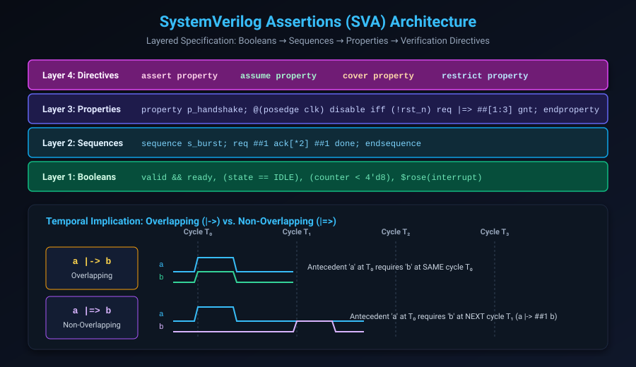

# Assertion-Based Verification (ABV) & SystemVerilog Assertions (SVA) Deep Dive

## Introduction: The Lingua Franca of Hardware Verification

In traditional RTL design, specifications are written in English or design documents, while verification environments are written in separate testbench code. Misinterpretations between designers and verification engineers are the single most prolific source of silicon bugs.

**Assertion-Based Verification (ABV)** solves this divide by embedding executable, unambiguous mathematical specifications directly into the hardware code using **SystemVerilog Assertions (SVA)** (IEEE 1800 Standard). 

In formal verification, SVA serves a dual role:
1. **Target of Proof**: `assert property` statements represent the formal requirements the solver must prove.
2. **Environment Boundary**: `assume property` statements restrict the formal solver to legal input stimulus.

This chapter covers:
1. **The Layered Architecture of SVA**.
2. **Immediate vs. Deferred vs. Concurrent Assertions**.
3. **Temporal Implication: Overlapping (`|->`) vs. Non-Overlapping (`|=>`)**.
4. **Sequence Construction, Delays (`##n`), and Repetition Operators (`[*]`, `[->]`, `[=]`)**.
5. **Formal Verification Directives: `assert`, `assume`, `cover`, and `restrict`**.
6. **Local Variables in SVA for End-to-End Data Tracking**.
7. **Hands-On Exercises & Review Questions**.

---

## SVA Layered Architecture

SystemVerilog Assertions are built upon a strict, four-layer hierarchical abstraction:



### The Four Layers:
1. **Layer 1: Boolean Expressions**: Pure combinatorial conditions evaluated at a specific clock tick (e.g. `valid && ready`, `state == IDLE`, `$rose(req)`).
2. **Layer 2: Sequences**: Temporal progressions of Boolean expressions over one or more clock cycles using cycle delays and repetitions (e.g. `req ##[1:3] ack`).
3. **Layer 3: Properties**: Complex temporal relationships combining sequences with implication operators (`|->`, `|=>`), clocking events, and disable conditions.
4. **Layer 4: Verification Directives**: The action applied to the property by the simulation or formal engine (`assert`, `assume`, `cover`, `restrict`).

---

## Immediate vs. Deferred vs. Concurrent Assertions

SystemVerilog provides three distinct assertion types that execute at different stages of the simulation scheduling event queue:

### 1. Simple Immediate Assertions (`assert (expr)`)
- Executed procedurally inside `always_comb` or `always_ff` blocks.
- **DANGER: Glitch Prone!** Because combinational logic can evaluate multiple times within a single simulation delta cycle before settling, simple immediate assertions often fire false violation glitches during delta-cycle settle times.

### 2. Deferred Assertions (`assert #0 (expr)` and `assert final (expr)`)
- Introduced in IEEE 1800-2009 to eliminate delta-cycle glitches.
- **`assert #0`**: Evaluated in the Observed Region after all active combinational delta cycles settle.
- **`assert final`**: Evaluated in the Postponed Region at the very end of the current simulation time step.

### 3. Concurrent Assertions (`assert property (...)`)
- **The Core Engine of Formal Verification**:
- Sampled exclusively in the **Preponed Region** (just before the clock edge), completely immune to delta-cycle races.
- Evaluated over multi-cycle temporal windows.
- Can be statically analyzed and proven by mathematical SAT/SMT engines.

---

## Temporal Implication: Overlapping (`|->`) vs. Non-Overlapping (`|=>`)

An implication statement consists of an **Antecedent** (the precondition) and a **Consequent** (the required response):

```systemverilog
antecedent |-> consequent; // Overlapping
antecedent |=> consequent; // Non-overlapping
```

### 1. Overlapping Implication: `|->`
If the antecedent sequence matches at cycle $T_0$, the consequent **must begin evaluation in the exact same cycle $T_0$**:

```systemverilog
// If write_enable is asserted at T0, data must NOT be unknown ('X) at T0
property p_write_valid;
    @(posedge clk) write_en |-> !$isunknown(write_data);
endproperty
```

### 2. Non-Overlapping Implication: `|=>`
If the antecedent matches at cycle $T_0$, the consequent **must begin evaluation in the next clock cycle $T_1$**:

```systemverilog
// If req is asserted at T0, ack must be asserted at T1
property p_req_ack;
    @(posedge clk) req |=> ack;
endproperty
// Exactly equivalent to: req |-> ##1 ack
```

> [!WARNING]
> **Vacuous Success**:
> If the antecedent is FALSE, the implication evaluates to TRUE **vacuously**!
> If your antecedent is never satisfied (e.g. `req` never occurs), the assertion will show as `PROVEN` in your formal report without having ever tested the consequent. Always pair assertions with `cover` properties to detect vacuity.

---

## Sequence Construction & Repetition Operators

SVA provides specialized operators to model complex hardware bus protocols:

| Operator | Syntax | Description | Example |
| :--- | :--- | :--- | :--- |
| **Cycle Delay** | `##n` | Exactly $n$ clock cycles later | `a ##2 b` ($b$ occurs 2 cycles after $a$) |
| **Range Delay** | `##[min:max]` | Occurs within bounded window | `req ##[1:4] ack` ($ack$ occurs 1 to 4 cycles later) |
| **Consecutive Repetition** | `expr [*n]` | $expr$ holds continuously for $n$ consecutive cycles | `busy [*3]` ($busy$ is 1 for 3 consecutive cycles) |
| **Consecutive Range** | `expr [*min:max]` | $expr$ holds continuously for $min$ to $max$ cycles | `valid [*2:5]` |
| **Goto Repetition** | `expr [->n]` | $expr$ occurs $n$ times non-consecutively; matches on exact cycle of $n$-th hit | `a ##1 b[->2] ##1 c` |
| **Non-Consecutive Repetition** | `expr [=n]` | $expr$ occurs $n$ times; match can continue for cycles where $expr$ is 0 | `b[=2] ##1 c` |

### Advanced Sequence Combination Operators
- **`s1 and s2`**: Both sequences must match; can start together but finish at different cycles.
- **`s1 intersect s2`**: Both sequences must match and **must end on the exact same cycle**.
- **`first_match(s)`**: Prunes multiple evaluation threads, keeping only the earliest completion of sequence $s$.
- **`expr throughout s`**: Boolean $expr$ must remain true during the entire duration of sequence $s$.

---

## Formal Verification Directives

| Directive | Role in Simulation | Role in Formal Verification |
| :--- | :--- | :--- |
| **`assert property`** | Monitors for functional violations during test execution. | **Proof Target**: Solvers attempt to prove that no state sequence can violate this property. |
| **`assume property`** | Checks that testbench drivers obey interface protocol rules. | **Environment Constraint**: Restricts the solver's input generator to legal stimulus. |
| **`cover property`** | Records functional coverage metric when sequence hits. | **Witness Generator**: Solvers generate a concrete waveform showing how the sequence can be reached. |
| **`restrict property`** | Ignored by simulators. | **Temporary Constraint**: Restricts solver search space without creating simulation overhead. |

---

## Local Variables for End-to-End Data Tracking

In pipelined or multi-threaded hardware (such as FIFOs, out-of-order processors, or network routers), verifying that data was not corrupted between ingress and egress requires tracking dynamic payload IDs.

SVA supports **Local Variables** inside properties:

```systemverilog
property p_fifo_data_integrity;
    logic [7:0] data_sample;
    int         entry_depth;

    @(posedge clk) disable iff (!rst_n)
    // When writing to FIFO, sample the input data and queue depth:
    (wr_en && !fifo_full, data_sample = wr_data, entry_depth = depth)
    |=>
    // Later, when reading out this specific entry, verify data matches:
    ##[1:$] (rd_en && !fifo_empty && (depth == entry_depth) && (rd_data == data_sample));
endproperty
```

Every time the antecedent succeeds, SVA spawns an independent, concurrent verification thread binding `data_sample` to that transaction's unique value, proving end-to-end data integrity.

---

## Hands-On Exercise

### The Problem
Design a complete SVA protocol checker module for a credit-based streaming interface:
1. **Clock & Reset**: Synchronized to `clk`, active-low `rst_n`.
2. **Handshake Rule**: When `tx_valid` is high and `credit_available` is 0, transmission must stall and `tx_data` must remain stable.
3. **Credit Decrement**: Every successful transfer (`tx_valid && credit_available`) decrements credits on the next cycle unless `credit_return` is asserted.
4. **Zero Overflow**: `credit_count` must never exceed `MAX_CREDITS = 8`.
5. **Cover**: Confirm that back-to-back 4-burst transfers with zero credit stalls are reachable.

### The Solution

```systemverilog
module credit_stream_sva #(
    parameter int MAX_CREDITS = 8
) (
    input logic       clk,
    input logic       rst_n,
    input logic       tx_valid,
    input logic [7:0] tx_data,
    input logic       credit_available,
    input logic       credit_return,
    input logic [3:0] credit_count
);

    default clocking @(posedge clk); endclocking
    default disable iff (!rst_n);

    // =========================================================================
    // 1. Safety Invariant: Credit count never exceeds capacity
    // =========================================================================
    assert_credit_max: assert property (
        credit_count <= MAX_CREDITS
    ) else $error("Credit count exceeded MAX_CREDITS!");

    // =========================================================================
    // 2. Protocol Rule: Data stability during backpressure
    // =========================================================================
    property p_data_stability;
        (tx_valid && !credit_available) |=> (tx_valid && $stable(tx_data));
    endproperty
    assert_data_stable: assert property (p_data_stability)
        else $error("Protocol Violation: tx_data changed while stalled!");

    // =========================================================================
    // 3. Environment Assumption: credit_return only when credits < MAX
    // =========================================================================
    assume_legal_credit_return: assume property (
        (credit_count == MAX_CREDITS) |-> !credit_return
    );

    // =========================================================================
    // 4. Functional Cover: Back-to-back 4-beat burst transfer
    // =========================================================================
    cover_4beat_burst: cover property (
        (tx_valid && credit_available) [*4]
    );

endmodule
```

---

## Review Questions & Self-Assessment

1. **Why do simple immediate assertions (`assert (a == b)`) cause false violation reports in combinational blocks during simulation?**
   *Answer:* Combinational logic undergoes multiple delta-cycle transitions before settling into a steady state. Simple immediate assertions execute during these intermediate delta cycles, reporting transient glitches as false bugs. Deferred assertions (`assert #0`) or concurrent assertions resolve this by waiting for delta cycles to settle.
2. **What is the difference between `req |-> ack` and `req |=> ack`?**
   *Answer:* `|->` is overlapping: `ack` must evaluate to true in the *same clock cycle* that `req` matched. `|=>` is non-overlapping: `ack` must evaluate to true in the *subsequent clock cycle* (`##1`).
3. **What is Vacuous Success in an assertion, and how do you safeguard against it?**
   *Answer:* Vacuous success occurs when an implication's antecedent is false, which causes the entire property to evaluate to true without the consequent ever being tested. To safeguard against it, write companion `cover property` directives for every antecedent to prove that the trigger condition is reachable.
4. **How does `assume property` differ when running in dynamic simulation vs. formal verification?**
   *Answer:* In dynamic simulation, `assume` acts identically to `assert` (it monitors testbench drivers and flags errors if violated). In formal verification, `assume` mathematically constrains the SAT/SMT solver, forcing the solver to generate only stimulus that satisfies the assumption.

---

##### Copyright (c) 2026 squared-studio
