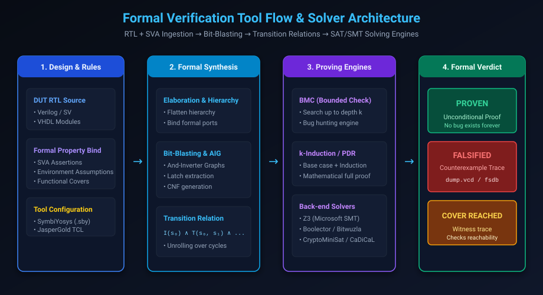

# Formal Verification Engines, Tools & Setups

## Introduction: From Equations to Industrial EDA Toolchains

In Chapters 1 through 3, we examined the mathematical foundations of transition systems, temporal logic, and SystemVerilog Assertions (SVA). In real-world engineering, transforming hundreds of thousands of lines of RTL and temporal logic formulas into solvable Boolean constraints requires sophisticated Electronic Design Automation (EDA) software.

A modern formal verification tool is a massively parallel, multi-engine software platform. It translates RTL into And-Inverter Graphs (AIGs) and word-level bit-vectors, extracts transition relations, and orchestrates dozens of SAT/SMT proving engines concurrently.

This chapter covers:
1. **The Formal Verification Tool Architecture & Compilation Pipeline**.
2. **Commercial Tool Suites: Cadence JasperGold, Synopsys VC Formal, Siemens Questa Formal**.
3. **The Open-Source Formal Ecosystem: Yosys, SymbiYosys (`sby`), and Modern SMT Solvers**.
4. **The Formal Testbench Architecture & The SystemVerilog `bind` Pattern**.
5. **Crafting SymbiYosys Project Configurations (`.sby`)**.
6. **Analyzing Counterexample Waveforms (`.vcd`)**.
7. **Hands-On Exercises & Review Questions**.

---

## Formal Verification Tool Pipeline

Understanding how a formal tool ingests RTL and dispatches solvers is crucial for debugging tool hangs and capacity limits:



### The 4 Pipeline Stages

1. **Ingestion & Binding**: The tool parses Verilog/SystemVerilog/VHDL, expands parameters, elaborates hierarchy, and binds formal assertion modules to target design blocks.
2. **Formal Synthesis & Bit-Blasting**: Unlike ASIC synthesis targeting standard cell libraries, formal synthesis converts the design into canonical Boolean representations:
   - **And-Inverter Graphs (AIG)**: Compact representation of combinational logic.
   - **Transition Relations**: $I(s_0)$ represents the initial state; $T(s, s')$ represents the transition relation between cycle $s$ and cycle $s'$.
   - **Cone of Influence (COI) Pruning**: The tool slices the circuit, removing all logic gates and registers that have no topological connection to the property being proven.
3. **Multi-Engine Proving**: The tool runs multiple engines in parallel (BMC, $k$-induction, PDR/IC3, interpolation, and BDDs). Whichever engine finishes first provides the verdict.
4. **Verdict Generation**:
   - **PROVEN**: Mathematically guaranteed across infinite time.
   - **FALSIFIED**: The solver synthesizes a cycle-accurate counterexample trace (`.vcd` or `.fsdb`).
   - **COVER REACHED**: The solver outputs a witness trace demonstrating state reachability.
   - **TIMEOUT / UNDETERMINED**: State space too deep or complex; requires abstraction or helper invariants.

---

## Industrial vs. Open-Source Tool Suites

### 1. Commercial Industry Standards
- **Cadence JasperGold**: The market-leading formal verification platform in semiconductor design. Includes specialized "Formal Apps" such as:
  - **FPV (Formal Property Verification)**: General property checking.
  - **SEC (Sequential Equivalence Checking)**: Verifies RTL vs. RTL or power-optimized transforms.
  - **CCX (Clock Domain Crossing)**: Formally proves CDC synchronization and metastability safety.
  - **Coverage**: Computes Proof Core and mutation metrics.
- **Synopsys VC Formal**: Highly integrated with Synopsys Verdi waveform debugging and VCS simulation engines. Utilizes the "Orchestrator" multi-engine technology.
- **Siemens Questa Formal**: Provides push-button automated checks (AutoCheck) for deadlocks, X-propagation, and bus contention without requiring user-written assertions.

### 2. The Open-Source Ecosystem
For students, researchers, and open-source silicon initiatives (such as OpenLane and RISC-V), open-source formal tools provide exceptional capability:
- **Yosys**: The extensible open-source synthesis framework developed by Claire Wolf. Synthesizes RTL into formal gate-level and word-level representations.
- **SymbiYosys (`sby`)**: The standardized front-end driver for Yosys formal verification flows.
- **Back-end Solvers**:
  - **Z3**: Microsoft Research's high-performance SMT solver.
  - **Bitwuzla**: State-of-the-art SMT solver specializing in bit-vectors and arrays.
  - **Boolector**: Award-winning bit-vector SMT solver.
  - **CaDiCaL / Kissat**: Ultra-fast propositional SAT engines for bit-blasted BMC.

---

## The Formal Testbench Architecture & The `bind` Pattern

A critical misconception among junior engineers is attempting to connect formal tools to standard UVM testbenches.

In formal verification:
- **No Testbench Drivers**: The SAT solver acts as an all-powerful, omniscient driver. It can drive *any* sequence of inputs on every clock cycle, discovering combinations human verification engineers would never conceive.
- **No Scoreboards**: SVA properties directly check outputs and internal state invariants.
- **Non-Intrusive Instrumentation via `bind`**: Never pollute production RTL files with verification assertions. Instead, keep formal checkers in separate files and attach them via the SystemVerilog `bind` directive.

### The SystemVerilog `bind` Syntax
```systemverilog
bind <target_module_name> <checker_module_name> <instance_name> (
    .* // Implicitly connect all matching port names
);
```

When the formal tool or simulator compiles the design, it automatically weaves the checker module inside the target module's scope, giving assertions direct access to internal registers without modifying RTL source code.

---

## Hands-On Setup: Complete SymbiYosys (`sby`) Flow

Let's build a production-grade formal verification setup for a **Priority Arbiter**.

### 1. The Design: `priority_arbiter.sv`

```systemverilog
module priority_arbiter (
    input  logic       clk,
    input  logic       rst_n,
    input  logic [3:0] req,
    output logic [3:0] gnt
);

    always_comb begin
        gnt = 4'b0000;
        if (!rst_n) begin
            gnt = 4'b0000;
        end else begin
            // Bit 0 has highest priority, Bit 3 has lowest priority
            if (req[0])
                gnt[0] = 1'b1;
            else if (req[1])
                gnt[1] = 1'b1;
            else if (req[2])
                gnt[2] = 1'b1;
            else if (req[3])
                gnt[3] = 1'b1;
        end
    end

endmodule
```

---

### 2. The Formal Checker Module: `priority_arbiter_formal.sv`

```systemverilog
module priority_arbiter_formal (
    input logic       clk,
    input logic       rst_n,
    input logic [3:0] req,
    input logic [3:0] gnt
);

    default clocking @(posedge clk); endclocking
    default disable iff (!rst_n);

    // =========================================================================
    // Safety Invariant 1: Mutual Exclusion (At most ONE grant active)
    // $onehot0 returns true if 0 or 1 bit is set
    // =========================================================================
    assert_onehot_grant: assert property (
        $onehot0(gnt)
    ) else $error("Mutual exclusion failure: Multiple grants asserted!");

    // =========================================================================
    // Safety Invariant 2: Grant Legitimacy (Grant only if requested)
    // =========================================================================
    assert_legitimate_grant: assert property (
        (gnt & ~req) == 4'b0000
    ) else $error("Grant asserted without corresponding request!");

    // =========================================================================
    // Safety Invariant 3: Priority Hierarchy Enforcement
    // If req[0] is active, lower bits (1, 2, 3) must NEVER be granted!
    // =========================================================================
    assert_priority_order: assert property (
        req[0] |-> !gnt[1] && !gnt[2] && !gnt[3]
    ) else $error("Priority inversion detected!");

    // =========================================================================
    // Functional Covers: Prove that all 4 priority lines are reachable
    // =========================================================================
    genvar i;
    generate
        for (i = 0; i < 4; i++) begin : gen_covers
            cover_gnt_reachable: cover property (gnt[i]);
        end
    endgenerate

endmodule

// Bind checker into DUT
bind priority_arbiter priority_arbiter_formal formal_inst (.*);
```

---

### 3. The SymbiYosys Configuration File: `arbiter.sby`

```ini
[options]
mode prove
depth 10

[engines]
smtbmc z3
smtbmc bitwuzla

[script]
read -formal priority_arbiter.sv
read -formal priority_arbiter_formal.sv
prep -top priority_arbiter

[files]
priority_arbiter.sv
priority_arbiter_formal.sv
```

### Running the Formal Verification

To execute the formal run on Linux/macOS:

```bash
sby -f arbiter.sby
```

The tool compiles the design, generates CNF bit-vectors, runs BMC up to depth 10, executes $k$-induction, and reports:

```text
SBY 14:02:15 [arbiter] engine_0.basecase: ##   0:00:00  Checking assertions in step 0..
SBY 14:02:15 [arbiter] engine_0.basecase: ##   0:00:00  Checking assertions in step 1..
SBY 14:02:15 [arbiter] engine_0.induction: ##  0:00:00  Trying induction in step 1..
SBY 14:02:15 [arbiter] engine_0.induction: ##  0:00:00  Temporal induction successful.
SBY 14:02:15 [arbiter] summary: engine_0 (smtbmc z3) returned pass
SBY 14:02:15 [arbiter] DONE (PASS, rc=0)
```

The property is **mathematically PROVEN** for all possible input combinations across all time!

---

## Review Questions & Self-Assessment

1. **Why do we NOT write stimulus generators (such as UVM sequences) in formal verification?**
   *Answer:* Formal solvers perform symbolic exploration where inputs are unconstrained variables. The solver mathematically analyzes all possible input combinations concurrently on every clock cycle. Writing explicit stimulus generators would restrict the solver, defeating the purpose of exhaustive proof.
2. **What is the purpose of the SystemVerilog `bind` construct?**
   *Answer:* `bind` allows formal assertion checkers to be instantiated non-intrusively inside a target module without altering or modifying the original RTL source code.
3. **What is Cone of Influence (COI) pruning, and why is it critical for formal solver performance?**
   *Answer:* COI pruning analyzes the circuit topology and removes all logic, gates, and registers that cannot mathematically affect the truth value of the target property. This reduces the size of the transition relation, dramatically speeding up solver execution.
4. **In the `.sby` configuration file, what does the `mode prove` command do?**
   *Answer:* `mode prove` instructs SymbiYosys to run both Bounded Model Checking (BMC, the base case) and temporal $k$-induction. If the induction step succeeds, the property is proven unconditionally for all time.

---

##### Copyright (c) 2026 squared-studio
