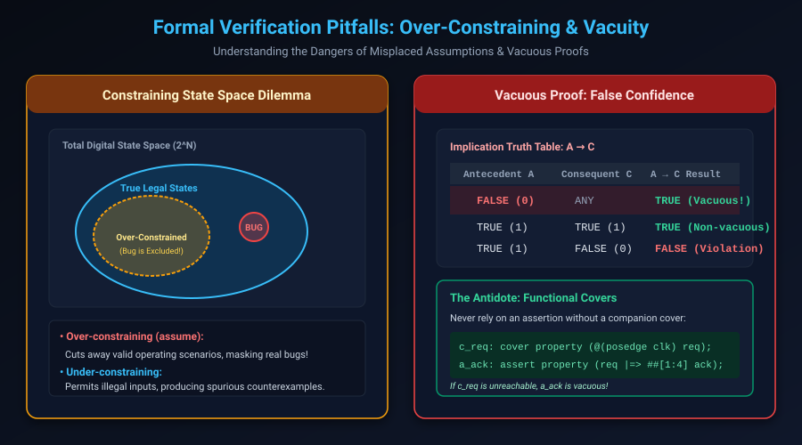

# Formal Verification of Control Logic, State Machines & Invariant Proving

## Introduction: Where Formal Delivers 100x ROI

While dynamic simulation excels at exercising continuous data paths (such as video decoders, DSP filters, and neural network accelerators), it struggles immensely with **complex control logic**:
- Multi-master arbiters with starvation edge cases.
- Pipelined control hazard units and credit-based flow managers.
- Finite State Machines (FSMs) with dozens of branching conditions.
- Asynchronous and synchronous FIFO pointer synchronization.

In these control-dominated domains, formal verification consistently achieves **100x ROI** over simulation—discovering critical bugs within hours of RTL coding without requiring months of testbench development.

However, formal verification introduces its own unique hazards: **Over-constraining**, **Under-constraining**, and **Vacuous Proofs**.

This chapter covers:
1. **The Over-Constraining vs. Under-Constraining State Space Dilemma**.
2. **Vacuous Proofs: How to Avoid False Confidence**.
3. **Formal Verification of Finite State Machines (FSMs)**.
4. **Inductive Strengthening with Auxiliary Invariants**.
5. **Comprehensive Case Study: Synchronous FIFO Formal Verification**.
6. **Hands-On Exercises & Review Questions**.

---

## Over-Constraining vs. Under-Constraining

In formal verification, your assumptions (`assume property`) define the legal operating envelope of the design's environment. Misconfiguring assumptions leads to two opposite failure modes:



### 1. Under-Constraining
- **Cause**: Missing or incomplete environment assumptions.
- **Symptom**: The solver drives illegal, physically impossible input sequences (such as asserting read and write simultaneously on a single-port memory, or driving data bursts exceeding bus protocol specifications).
- **Outcome**: **Spurious Counterexamples** (false failures). Verification engineers waste hours triaging bugs that cannot physically occur in real hardware.

### 2. Over-Constraining
- **Cause**: Assumptions that are too restrictive, or assumptions placed on design outputs instead of inputs.
- **Symptom**: The solver cuts away valid, legal execution paths.
- **Outcome**: **Masked Silicon Bugs** (the ultimate nightmare). The tool reports `PROVEN`, but a catastrophic bug slips into silicon because the solver was forbidden from testing the corner case!

> [!CAUTION]
> **Golden Rule of Assumptions**:
> **NEVER assume an internal register or a design output!**
> Only assume primary input ports driven by the external environment. If you assume a design output (e.g. `assume property (fifo_full == 0)`), you are legally commanding the solver to ignore any state where your FIFO fills up, masking all buffer overflow bugs!

---

## Vacuous Proofs: The Silent Killer

In Boolean logic, the implication $A \rightarrow C$ is evaluated as $\neg A \vee C$.

Consider this assertion:
```systemverilog
assert_packet_handled: assert property (@(posedge clk)
    packet_valid && (packet_type == ENCRYPTED_VIP) |=> ##[1:5] packet_processed
);
```

If a typo in your RTL or assumptions permanently forces `packet_type` to never equal `ENCRYPTED_VIP`:
1. The antecedent `packet_valid && (packet_type == ENCRYPTED_VIP)` is **never true** in any cycle.
2. The implication evaluates to true on **every cycle** ($\text{FALSE} \rightarrow \text{ANYTHING} \equiv \text{TRUE}$).
3. The formal tool green-lights the check: **PROVEN**.
4. The engineer falsely believes VIP packets are properly processed, when in reality that code path was never executed!

### The Antidote: Companion Cover Properties
Every conditional assertion MUST have a matching `cover property` testing its antecedent:

```systemverilog
// The Proof Target:
assert_packet_handled: assert property (@(posedge clk)
    packet_valid && (packet_type == ENCRYPTED_VIP) |=> ##[1:5] packet_processed
);

// The Vacuity Guard:
cover_antecedent_reachable: cover property (@(posedge clk)
    packet_valid && (packet_type == ENCRYPTED_VIP)
);
```

If `cover_antecedent_reachable` reports **UNREACHABLE**, you know immediately that your assertion proof is **vacuous**.

---

## Formal Verification of Finite State Machines (FSMs)

FSMs represent the nervous system of digital logic. A formal FSM specification must verify three universal properties:

### 1. State Encoding Safety (One-Hot Invariance)
In one-hot encoded state machines, exactly one flip-flop must be active at any time:

```systemverilog
assert_state_onehot: assert property (@(posedge clk) disable iff (!rst_n)
    $onehot(state)
) else $error("FSM reached illegal state encoding: %b", state);
```

### 2. Illegal State Recovery & Reset Freedom
Proving that the FSM cannot get stuck in an undefined or unmapped state:

```systemverilog
assert_known_state: assert property (@(posedge clk) disable iff (!rst_n)
    state inside {IDLE, READ_HDR, PAYLOAD, CHECKSUM, RESP}
);
```

### 3. Transition Determinism
If the FSM is in state `READ_HDR` and receives `abort`, it must transition directly to `IDLE` on the next cycle:

```systemverilog
assert_abort_transition: assert property (@(posedge clk) disable iff (!rst_n)
    (state == READ_HDR) && abort |=> (state == IDLE)
);
```

---

## Inductive Strengthening with Auxiliary Invariants

When using $k$-induction (discussed in detail in Chapter 7), the solver picks an **arbitrary state** to begin the induction step. 

Because the solver does not know which states are genuinely reachable from reset, it may pick an **unreachable "phantom" state** (e.g. `wr_ptr = 7` while `count = 0`), which immediately leads to an assertion violation. This is called an **Induction Failure due to Unreachable State**.

To resolve this, formal engineers write **Auxiliary Invariants** (or inductive strengthening lemmas) that teach the solver properties of reachable states:

```systemverilog
// Auxiliary Invariant: count must mathematically equal the pointer difference
assert_pointer_count_relationship: assert property (@(posedge clk) disable iff (!rst_n)
    count == ((wr_ptr >= rd_ptr) ? (wr_ptr - rd_ptr) : (FIFO_DEPTH + wr_ptr - rd_ptr))
);
```

Once this auxiliary invariant is proven, the solver prunes the phantom states, enabling the primary properties to prove inductively.

---

## Case Study: Synchronous FIFO Formal Verification

Let's examine a complete, industrial-grade formal testbench for a synchronous FIFO.

### The Formal Checker: `fifo_formal_checker.sv`

```systemverilog
module fifo_formal_checker #(
    parameter int DEPTH = 8,
    parameter int DATA_WIDTH = 16
) (
    input logic                  clk,
    input logic                  rst_n,
    input logic                  wr_en,
    input logic [DATA_WIDTH-1:0] wr_data,
    input logic                  rd_en,
    input logic [DATA_WIDTH-1:0] rd_data,
    input logic                  full,
    input logic                  empty,
    input logic [$clog2(DEPTH):0] count
);

    default clocking @(posedge clk); endclocking
    default disable iff (!rst_n);

    // =========================================================================
    // 1. Structural Invariants
    // =========================================================================
    // Full and empty can NEVER be asserted at the same time (assuming DEPTH > 0)
    assert_mutex_flags: assert property (
        !(full && empty)
    ) else $error("FIFO is simultaneously full and empty!");

    // Count cannot exceed capacity
    assert_count_bound: assert property (
        count <= DEPTH
    ) else $error("FIFO count overflowed DEPTH!");

    // Flag consistency with count
    assert_empty_flag: assert property (
        (count == 0) <-> empty
    );
    assert_full_flag: assert property (
        (count == DEPTH) <-> full
    );

    // =========================================================================
    // 2. Protocol & Overflow Protection
    // =========================================================================
    // Prevent writes when full
    assert_no_write_overflow: assert property (
        full && wr_en && !rd_en |=> (count == DEPTH)
    );

    // =========================================================================
    // 3. End-to-End Data Integrity Check (Local Variables)
    // =========================================================================
    // Verify that every word written is read out in exact FIFO order without corruption
    property p_data_order;
        logic [DATA_WIDTH-1:0] stored_data;
        int target_delay;

        // Sample data on valid push
        (wr_en && !full, stored_data = wr_data, target_delay = count)
        |=>
        // Must appear at read port when its turn arrives
        ##[0:$] (rd_en && !empty && target_delay == 0 && (rd_data == stored_data));
    endproperty
    // Note: In formal tools, bounded queues or scoreboard helpers are used for unbounded searches

    // =========================================================================
    // 4. Functional Covers (Sanity & Reachability)
    // =========================================================================
    // Prove that FIFO can become completely full
    cover_fifo_full: cover property (full);

    // Prove back-to-back simultaneous read & write at steady state
    cover_simultaneous_rw: cover property (
        wr_en && rd_en && !full && !empty
    );

endmodule
```

---

## Hands-On Exercise

### The Problem
You are verifying a 4-client **Round-Robin Arbiter**:
- When multiple clients request simultaneously, the arbiter grants access to the client following the last granted client (modulo 4).
- If no requests are active, `gnt` is `4'b0000`.
- Write the SVA properties to prove:
  1. No two clients receive grants simultaneously (`$onehot0(gnt)`).
  2. A client is never granted access unless it asserted `req`.
  3. Starvation freedom: If client $i$ asserts `req[i]`, it is guaranteed to eventually receive `gnt[i]` provided all grants eventually complete.

### The Solution

```systemverilog
module round_robin_sva (
    input logic       clk,
    input logic       rst_n,
    input logic [3:0] req,
    input logic [3:0] gnt
);

    default clocking @(posedge clk); endclocking
    default disable iff (!rst_n);

    // 1. Safety: Mutual exclusion
    assert_mutex_gnt: assert property (
        $onehot0(gnt)
    ) else $error("Mutual exclusion broken in Round Robin Arbiter!");

    // 2. Safety: Grant legitimacy
    assert_legitimate: assert property (
        (gnt & ~req) == 4'b0000
    ) else $error("Spurious grant without active request!");

    // 3. Liveness: Starvation freedom for all clients
    genvar i;
    generate
        for (i = 0; i < 4; i++) begin : gen_liveness
            assert_no_starvation: assert property (
                req[i] |-> s_eventually(gnt[i])
            ) else $error("Starvation detected on client %0d", i);

            // Companion cover to guard against vacuity
            cover_client_serviced: cover property (
                req[i] && gnt[i]
            );
        end
    endgenerate

endmodule
```

---

## Review Questions & Self-Assessment

1. **Why is assuming a design output (`assume property (out == 1)`) considered a critical error in formal verification?**
   *Answer:* Assumptions define environmental constraints on primary inputs. Assuming a design output restricts the internal behavior of the circuit itself, effectively commanding the solver to ignore any state where the output deviates, masking real design bugs.
2. **What is a Vacuous Proof, and why is it dangerous?**
   *Answer:* A vacuous proof occurs when an implication $A \rightarrow C$ proves true simply because the antecedent $A$ is never satisfied (is false in all reachable states). It is dangerous because the tool reports a passing proof even though the intended behavior was never evaluated.
3. **What is the function of an Auxiliary Invariant in $k$-induction?**
   *Answer:* In $k$-induction, the solver starts the induction step from an arbitrary state, which may include unreachable "phantom" states that violate the property. An auxiliary invariant mathematically eliminates these unreachable states, strengthening the induction hypothesis so the proof can succeed.
4. **How does `$onehot0(signal)` differ from `$onehot(signal)`?**
   *Answer:* `$onehot(signal)` returns true if and only if exactly **one** bit is 1. `$onehot0(signal)` returns true if **zero or one** bit is 1 (all zeros is also valid). For an arbiter that can be idle, `$onehot0` is appropriate.

---

##### Copyright (c) 2026 squared-studio
