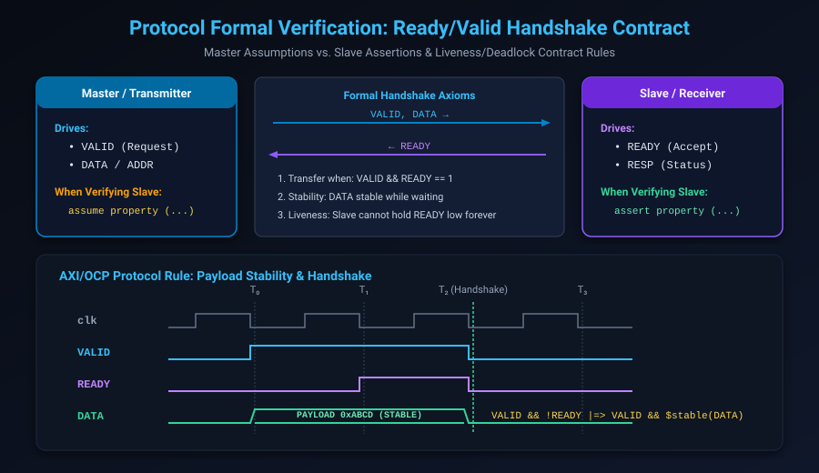

# Protocol Verification & Interface Assertions: AMBA APB, AHB & AXI4

## Introduction: The Interconnect Complexity Challenge

Modern Systems-on-Chip (SoCs) integrate dozens of heterogeneous IP blocks—CPU cores, DSPs, neural accelerators, DMA controllers, and high-speed memory interfaces—interconnected by standardized on-chip bus architectures such as **ARM AMBA (APB, AHB, AXI4, CHI)**, **TileLink**, or **OCP**.

Bus protocols are defined by strict interface contracts:
- Signal timing relationships across multi-phase handshakes.
- Payload stability rules during backpressure.
- Out-of-order transaction ID tracking and response ordering.
- Deadlock-free arbitration across credit networks.

In simulation, a corner-case protocol violation—such as a slave asserting `READY` prematurely, or a master mutating write data before `READY` is asserted—might only manifest after millions of clock cycles, or worse, cause intermittent data corruption in fabricated silicon.

With formal verification, protocol rules are encoded as mathematical invariants. The formal tool explores every possible legal interleaving of bus transactions, proving protocol compliance or exposing protocol deadlocks instantly.

This chapter covers:
1. **The Formal Interface Contract Architecture**.
2. **The Universal Ready/Valid Handshake Axioms**.
3. **AMBA APB Protocol Formal Verification**.
4. **AMBA AXI4-Lite & AXI4 Channel Architectures**.
5. **Deadlock, Livelock & Starvation Freedom Proofs**.
6. **Hands-On Exercises & Review Questions**.

---

## The Formal Interface Contract

When formally verifying an interface, the circuit boundary must be partitioned into **Assumptions** and **Assertions**:



### The Duality of Verification Roles

| Interface Direction | When Verifying the Slave / Target | When Verifying the Master / Initiator |
| :--- | :--- | :--- |
| **Inputs to DUT** | Constrained via `assume property` | Checked via `assert property` |
| **Outputs from DUT** | Checked via `assert property` | Constrained via `assume property` |

This duality ensures that properties written for a protocol can be seamlessly reused: to verify a slave, you assume the master rules and assert the slave rules; to verify a master, you reverse the directives!

---

## The Universal Ready/Valid Handshake Axioms

Almost all modern high-speed streaming protocols (AXI4, TileLink, Avalon-ST) rely on the **Ready/Valid** handshake mechanism. The AMBA AXI specification establishes four inviolable rules:

### 1. Handshake Transfer Rule
A data transfer occurs if and only if **both `VALID` and `READY` are asserted on the same active clock edge**:

```systemverilog
wire handshake = valid && ready;
```

### 2. Payload Stability Rule
Once the transmitter asserts `VALID`, **it must keep `VALID` high and must keep the payload (`ADDR`, `DATA`, `STRB`) completely stable** until the receiver asserts `READY` and the handshake completes:

```systemverilog
property p_payload_stability;
    @(posedge clk) disable iff (!rst_n)
    valid && !ready |=> valid && $stable(data);
endproperty
assert_payload_stable: assert property (p_payload_stability)
    else $error("Protocol Violation: DATA changed while waiting for READY!");
```

### 3. No Combinatorial Dependency on Ready
To prevent circular combinatorial loops and deadlocks in interconnect switches, **`VALID` must NEVER combinatorially depend on `READY`**:
- A master is permitted to wait for `READY` before asserting `VALID` in a future cycle, but `VALID` generation within the same cycle must not be gated through combinational logic by `READY`.

### 4. Liveness Contract
A slave must not hold `READY` low indefinitely if the master is presenting valid data:

```systemverilog
property p_slave_liveness;
    @(posedge clk) disable iff (!rst_n)
    valid |-> s_eventually(ready);
endproperty
```

---

## AMBA APB (Advanced Peripheral Bus) Formal Verification

APB is a low-bandwidth, non-pipelined peripheral bus designed for accessing configuration registers. Its protocol is governed by a 3-state state machine:

```text
    +--------+
    |  IDLE  | <-------------------+
    +--------+                     |
        | PSEL=1                   |
        v                          |
    +--------+                     |
    | SETUP  |                     |
    +--------+                     |
        | PENABLE=1                | PREADY=1
        v                          |
    +--------+                     |
    | ACCESS | --------------------+
    +--------+ (Wait while PREADY=0)
```

### Complete APB Slave Formal Checker: `apb_slave_sva.sv`

```systemverilog
module apb_slave_sva (
    input logic        pclk,
    input logic        presetn,
    input logic [31:0] paddr,
    input logic        psel,
    input logic        penable,
    input logic        pwrite,
    input logic [31:0] pwdata,
    input logic [31:0] prdata,
    input logic        pready,
    input logic        pslverr
);

    default clocking @(posedge pclk); endclocking
    default disable iff (!presetn);

    // =========================================================================
    // 1. Master Assumptions (Environment constraints for Slave verification)
    // =========================================================================
    // Rule: PENABLE must be low in the first cycle of a transfer (SETUP phase)
    assume_setup_phase: assume property (
        $rose(psel) |-> !penable
    );

    // Rule: In the cycle after SETUP, PENABLE must rise (ACCESS phase)
    assume_access_phase: assume property (
        psel && !penable |=> psel && penable
    );

    // Rule: Address and control signals must remain stable through the ACCESS phase
    assume_control_stable: assume property (
        psel && penable && !pready |=> $stable(paddr) && $stable(pwrite) && $stable(pwdata)
    );

    // =========================================================================
    // 2. Slave Assertions (DUT requirements)
    // =========================================================================
    // Rule: PREADY and PSLVERR must only be driven when PSEL is active
    assert_no_spurious_ready: assert property (
        !psel |-> !pready
    );

    // Rule: Read data must be valid when PREADY is asserted during a read
    assert_read_data_valid: assert property (
        psel && penable && !pwrite && pready |-> !$isunknown(prdata)
    );

    // =========================================================================
    // 3. Covers (Witness paths)
    // =========================================================================
    // Cover a successful read transaction with 2 wait cycles
    cover_read_wait_states: cover property (
        psel && !penable ##1 (psel && penable && !pready) [*2] ##1 (psel && penable && pready)
    );

endmodule
```

---

## AMBA AXI4 & AXI4-Lite Protocol Architecture

AXI4 provides high-performance, pipelined data transfers across **5 independent, parallel channels**:

1. **Read Address (AR)**: Carries read address, burst length (`ARLEN`), size (`ARSIZE`), and transaction ID (`ARID`).
2. **Read Data (R)**: Returns payload data, burst status (`RRESP`), last beat indicator (`RLAST`), and ID (`RID`).
3. **Write Address (AW)**: Initiates write transactions with addressing and burst attributes.
4. **Write Data (W)**: Streams write data beats with byte strobes (`WSTRB`) and last beat indicator (`WLAST`).
5. **Write Response (B)**: Returns write completion status (`BRESP`) and ID (`BID`).

### Channel Independence & Ordering Rules
- **AW and W Decoupling**: A master can send `WDATA` before `AWADDR`, simultaneously with `AWADDR`, or cycles after `AWADDR`. A robust slave must handle all three orderings!
- **ID Tagging**: Transactions with different IDs can complete **out of order**. Transactions with identical IDs must complete in strict order.

---

## Deadlock, Livelock & Starvation Checks

In complex crossbar switches (e.g. AXI Interconnects), deadlock occurs when a cyclic dependency forms:
- Master A holds Channel 1 waiting for Channel 2.
- Master B holds Channel 2 waiting for Channel 1.
- Both masters stall indefinitely, freezing the entire SoC.

### Formulating Deadlock Freedom in SVA

Deadlock is mathematically proven using **Strong Liveness Properties**:

```systemverilog
// Deadlock freedom: Every initiated address request eventually completes
property p_axi_ar_liveness;
    @(posedge clk) disable iff (!rst_n)
    arvalid |-> s_eventually(arready);
endproperty
assert_no_deadlock_ar: assert property (p_axi_ar_liveness)
    else $error("Deadlock Detected: ARVALID stuck without ARREADY!");
```

### The Role of Fairness Assumptions
If you run this assertion without constraints, the solver will produce a **false counterexample**: it will hold `RREADY` low forever, causing the slave's read buffers to fill up and backpressure `ARREADY` indefinitely!

To avoid this spurious report, add a **Downstream Drain Fairness Assumption**:
```systemverilog
assume_downstream_drain: assume property (@(posedge clk) disable iff (!rst_n)
    rvalid |-> s_eventually(rready)
);
```

With this assumption in place, the solver proves that if the environment drains data fairly, the slave will never deadlock.

---

## Hands-On Exercise

### The Problem
Write a production formal checker for an **AXI4-Stream** slave interface (`s_axis`):
- Ports: `clk`, `rst_n`, `s_axis_tvalid`, `s_axis_tready`, `s_axis_tdata[31:0]`, `s_axis_tlast`, `s_axis_tstrb[3:0]`.
- Enforce the following:
  1. Once `tvalid` is high, `tdata`, `tlast`, and `tstrb` must not change until `tready` is high.
  2. `tvalid` must remain low during reset.
  3. Frame completion: A packet frame terminates on the beat where `tvalid && tready && tlast`.
  4. Write a cover statement for a 4-beat packet transfer.

### The Solution

```systemverilog
module axis_slave_sva (
    input logic        clk,
    input logic        rst_n,
    input logic        s_axis_tvalid,
    input logic        s_axis_tready,
    input logic [31:0] s_axis_tdata,
    input logic        s_axis_tlast,
    input logic [3:0]  s_axis_tstrb
);

    default clocking @(posedge clk); endclocking
    default disable iff (!rst_n);

    // 1. Reset Safety: tvalid must be 0 while reset is asserted
    assert_reset_val: assert property (@(posedge clk)
        !rst_n |-> !s_axis_tvalid
    );

    // 2. Protocol Invariant: Payload stability during backpressure
    property p_axis_stability;
        s_axis_tvalid && !s_axis_tready |=> 
            s_axis_tvalid && 
            $stable(s_axis_tdata) && 
            $stable(s_axis_tlast) && 
            $stable(s_axis_tstrb);
    endproperty
    assert_payload_stable: assert property (p_axis_stability)
        else $error("AXI-Stream Violation: Payload mutated during stall!");

    // 3. Functional Cover: 4-beat packet ending with TLAST
    cover_4beat_packet: cover property (
        (s_axis_tvalid && s_axis_tready && !s_axis_tlast) [*3]
        ##1
        (s_axis_tvalid && s_axis_tready && s_axis_tlast)
    );

endmodule
```

---

## Review Questions & Self-Assessment

1. **Why must `VALID` never combinatorially depend on `READY` in AMBA AXI protocols?**
   *Answer:* If master A computes `VALID` based on slave B's `READY`, and slave B computes `READY` based on master A's `VALID`, a closed combinatorial loop is created. This causes timing closure failures and circular deadlock conditions in interconnect switches.
2. **What does the payload stability rule enforce when `VALID` is asserted?**
   *Answer:* Once `VALID` is asserted, the transmitter cannot change `DATA`, `ADDR`, or control signals, nor can it withdraw `VALID`, until the receiver asserts `READY` and the transaction completes.
3. **What is the difference between verifying an APB Master vs an APB Slave using the same assertion module?**
   *Answer:* The direction of directives is reversed: for an APB slave, inputs driven by the master (such as `PSEL` and `PADDR`) are `assume` properties, while slave outputs (`PREADY`, `PRDATA`) are `assert` properties. For an APB master, `PSEL` and `PADDR` become `assert` properties, while `PREADY` becomes an `assume` property.
4. **Why is an environment fairness assumption necessary when proving deadlock freedom?**
   *Answer:* In unconstrained formal environments, the solver can intentionally refuse to drain output packets (holding consumer `READY` low forever). This causes upstream buffers to stall, producing a false counterexample. A fairness assumption enforces that the environment will eventually accept data, allowing genuine internal deadlocks to be tested.

---

##### Copyright (c) 2026 squared-studio
