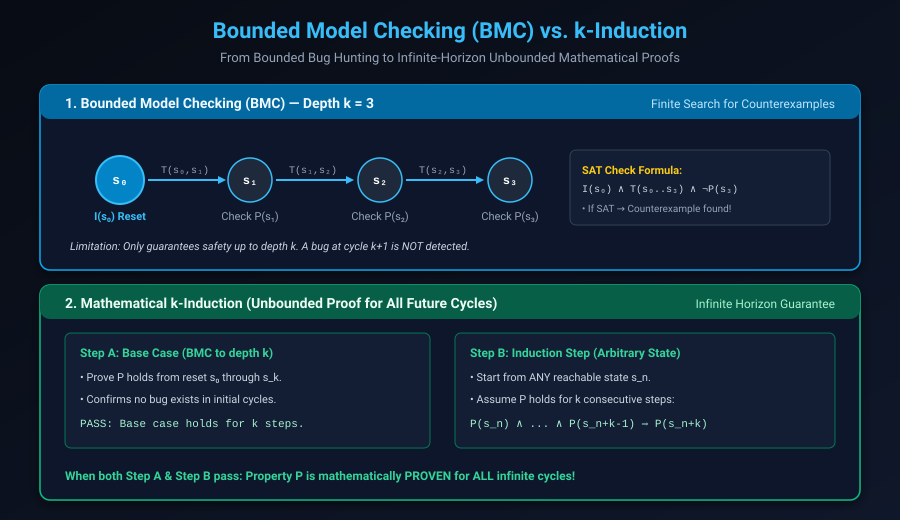

# Advanced Formal Methods: BMC, k-Induction, IC3/PDR & Equivalence Checking

## Introduction: The Algorithmic Heavy Artillery

In simple verification setups, a formal solver evaluates properties across small sequential depths without significant capacity strain. However, industrial SoC subsystems contain tens of thousands of flip-flops, deeply pipelined arithmetic, and multi-cycle latency loops.

To achieve full mathematical closure on designs of this magnitude, verification engineers must understand the underlying proving engines:
- **Bounded Model Checking (BMC)**: The industry's premier bug-hunting engine.
- **$k$-Induction**: The foundational algorithm for unbounded safety proofs.
- **IC3 / PDR (Property-Directed Reachability)**: The revolutionary SAT-based proof engine that proves properties without unrolling.
- **Equivalence Checking (CEC & SEC)**: The gatekeeper ensuring RTL matches synthesized netlists and optimized silicon layouts.

This chapter covers:
1. **BMC vs. $k$-Induction Mechanics**.
2. **The Induction Gap & Inductive Strengthening**.
3. **The IC3 / PDR Algorithm Revolution**.
4. **Equivalence Checking: Combinational (CEC) vs. Sequential (SEC)**.
5. **Formal Abstraction Techniques for High-Capacity Scaling**.
6. **Hands-On Exercises & Review Questions**.

---

## Bounded Model Checking (BMC) vs. k-Induction

The fundamental challenge in hardware verification is proving that a property holds for **infinite time** ($t \rightarrow \infty$):



### 1. Bounded Model Checking (BMC)

BMC unrolls the transition relation $T(s, s')$ up to a user-defined depth $k$, starting from the initial reset state $s_0$. 

The tool constructs a single massive Boolean CNF formula:

$$\Phi_{BMC}(k) = I(s_0) \wedge \bigwedge_{i=0}^{k-1} T(s_i, s_{i+1}) \wedge \bigvee_{j=0}^{k} \neg P(s_j)$$

- If $\Phi_{BMC}(k)$ is **SAT (Satisfiable)**: The solver found a state $s_j$ ($j \le k$) where the property is violated. It outputs a counterexample waveform of length $j$.
- If $\Phi_{BMC}(k)$ is **UNSAT (Unsatisfiable)**: The property holds for all cycles up to depth $k$.
- **Limitation**: BMC **cannot** prove a property holds for infinite time! A bug lurking at cycle $k+1$ remains invisible.

---

### 2. The k-Induction Proof Architecture

To achieve an unbounded proof for all future cycles, formal tools employ **$k$-Induction**, extending mathematical induction to transition systems across two phases:

#### Phase A: Base Case
The tool runs BMC from reset $s_0$ up to depth $k-1$:

$$\text{Base}(k) = I(s_0) \wedge \bigwedge_{i=0}^{k-2} T(s_i, s_{i+1}) \wedge \bigvee_{j=0}^{k-1} \neg P(s_j)$$

If this is UNSAT, no bug exists in the first $k$ cycles.

#### Phase B: Induction Step
The solver picks an **arbitrary state** $s_n$ (which does **not** have to be the reset state $s_0$). It assumes the property holds for $k$ consecutive cycles, and attempts to prove it must also hold at step $k$:

$$\text{Step}(k) = \bigwedge_{i=n}^{n+k-1} P(s_i) \wedge \bigwedge_{i=n}^{n+k-1} T(s_i, s_{i+1}) \wedge \neg P(s_{n+k})$$

- If the Induction Step is **UNSAT**: The property is **mathematically PROVEN for all time** ($t = 0 \dots \infty$)!
- If the Induction Step is **SAT**: The solver found a transition sequence violating $P$.

---

## The Induction Gap & Inductive Strengthening

When the Induction Step fails, the resulting counterexample trace does **not** necessarily mean your RTL has a bug. In over 80% of industrial cases, it indicates an **Induction Failure caused by Unreachable States**.

Because the solver was allowed to pick *any* state $s_n$ to start the induction step, it may pick a state that could never actually be reached from reset (e.g. an internal state register holding an unmapped combination `2'b11`).

### Resolving the Induction Gap:
1. **Increase the Bound $k$**: Increasing $k$ from 1 to 5 or 10 forces the solver to find a longer sequence of valid states, which often prunes shallow unreachable states.
2. **Add Inductive Helper Invariants (Lemmas)**: Formulate an assertion that forbids the unreachable state:
   ```systemverilog
   // Helper invariant that eliminates phantom states
   assert_valid_state: assert property (@(posedge clk) disable iff (!rst_n)
       state inside {IDLE, ACTIVE, WAIT}
   );
   ```

---

## IC3 / PDR: Property-Directed Reachability

In 2011, Aaron Bradley introduced **IC3 (Incremental Construction of Inductive Clauses for Indubitable Correctness)**, also known as **PDR**.

Unlike BMC, which unrolls the circuit cycle-by-cycle, IC3/PDR:
- Analyzes the circuit incrementally by discovering and generalizing **inductive clauses** that block bad states.
- Maintains a sequence of over-approximated reachability frames $F_0, F_1, \dots, F_k$.
- Operates entirely without unrolling the transition relation, consuming a fraction of the memory required by BMC.
- Can solve massive problems that exhaust the capacity of standard $k$-induction.

Modern commercial tools (JasperGold, VC Formal) combine PDR and BMC in parallel multi-threaded portfolios.

---

## Equivalence Checking: CEC vs. SEC

Formal methods are not only used for property verification; they are also the global standard for guaranteeing that optimizations do not alter design behavior:

### 1. Combinational Equivalence Checking (CEC)
- **Goal**: Proves that a post-synthesis gate-level netlist is functionally identical to the golden RTL source.
- **Technique**: Identifies corresponding flip-flops (state points), cuts the circuit between flip-flop registers, and creates a **Miter circuit** (feeding identical inputs to both circuits and XOR-ing their outputs).
- **Tools**: Synopsys Formality, Cadence Conformal LEC.
- **Speed**: Extremely fast (can check 100-million-gate ASICs in hours).

### 2. Sequential Equivalence Checking (SEC)
- **Goal**: Proves two designs are equivalent even when **registers are moved, added, or retimed** (e.g. adding pipeline registers, modifying clock-gating logic, or replacing a multi-cycle multiplier with a pipelined one).
- **Complexity**: PSPACE-complete; requires proving bisimulation across different state spaces.

---

## Formal Abstraction Techniques

When verification engines hit capacity timeouts on large designs, engineers apply **Abstractions**:

| Technique | Description | Hardware Example |
| :--- | :--- | :--- |
| **Black-Boxing** | Removes a complex module entirely, treating its outputs as unconstrained primary inputs. | Black-boxing a 64-bit cryptographic AES core when verifying a bus bridge. |
| **Data Path Abstraction** | Reduces wide data buses to minimal widths (e.g. 64-bit data $\rightarrow$ 2-bit data) when control logic is data-independent. | Verifying FIFO routing logic with 2-bit payloads instead of 512-bit packets. |
| **Counter Reduction** | Scales down massive counter bit-widths. | Reducing a 32-bit timeout counter ($2^{32}$ cycles) to a 3-bit counter to allow BMC to reach the timeout state in 8 cycles. |
| **Cut-Points** | Cuts internal nets, converting them into free, symbolic variables to isolate logic cones. | Cutting an internal complex decoder output to verify downstream state machine transitions. |

---

## Hands-On Exercise

### The Problem
You have a 2-bit Gray-code counter that follows the sequence:
`00 -> 01 -> 11 -> 10 -> 00`.
You want to prove the safety property:
`assert property (gray_count != 2'b11 || $past(gray_count) == 2'b01);`

When you run $k$-induction at $k=1$, the induction step **fails** with a 1-cycle counterexample: the solver invents a transition from `2'b10` to `2'b11`!

1. Explain why 1-induction failed even though the RTL is correct.
2. Resolve the failure by increasing $k$ or by adding an auxiliary invariant.

### The Solution

#### 1. Why 1-Induction Failed:
At $k=1$, the solver starts from an unconstrained state. It is allowed to pick an unreachable state-input pair where the next state is `2'b11` without the previous state having been `2'b01`. The solver has no memory of the past.

#### 2. Resolution:
- **Approach A (Increase Bound)**: Setting $k = 4$ forces the solver to verify a full cycle of the Gray code, which proves the property without any helper lemmas.
- **Approach B (Auxiliary Invariant)**: Add an explicit sequence invariant:
```systemverilog
// Auxiliary Invariant: Exactly one bit flips per clock cycle
assert_single_bit_change: assert property (@(posedge clk) disable iff (!rst_n)
    $onehot(gray_count ^ $past(gray_count))
);
```

---

## Review Questions & Self-Assessment

1. **Why does Bounded Model Checking (BMC) fail to guarantee that a design is free of bugs?**
   *Answer:* BMC only proves that no bug occurs within the explored search depth $k$. If an assertion violation requires $k+1$ cycles from reset to manifest, BMC will report UNSAT up to depth $k$ and miss the bug completely.
2. **What are the two steps required in $k$-induction to achieve an unbounded proof?**
   *Answer:* The Base Case (proving the property holds from reset for the first $k$ cycles via BMC) and the Induction Step (assuming the property holds for $k$ consecutive steps from an arbitrary state, proving it must hold on step $k+1$).
3. **What is an "Induction Failure caused by an Unreachable State"?**
   *Answer:* It occurs during the induction step when the solver begins evaluation from a state that can never actually be reached from reset. The solver demonstrates an assertion violation from this impossible phantom state, producing a spurious counterexample.
4. **What is a Miter Circuit in Combinational Equivalence Checking (CEC)?**
   *Answer:* A Miter circuit connects the identical inputs of two design representations (e.g. Golden RTL and Synthesized Netlist) and passes their corresponding outputs into an XOR gate. The SAT solver attempts to prove that the XOR output can never be 1.

---

##### Copyright (c) 2026 squared-studio
